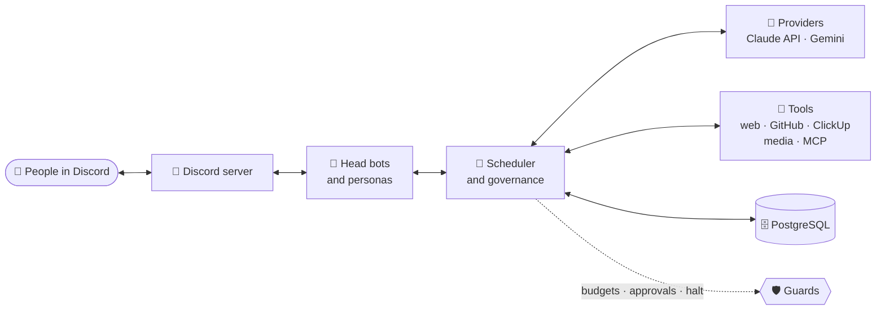

<div align="center">

# 🏢 Assistant

### An AI company that lives inside your Discord server

Ten department heads, persona teammates, real tasks with threads, and a budget<br>
that is checked before every single model call.

<br>


[**Quick start**](#-quick-start) · [**Documentation**](docs/_index.md) · [**Architecture**](#-architecture) · [**Status**](#-project-status)

</div>

---

## ✨ What it is

Assistant runs a whole AI **company** in one Discord server. Department head bots take work, split it, and hand it to each other or to persona members who speak under their own names and avatars. Every task gets its own thread. Budgets and limits are enforced before each model call, risky actions wait for a human click, and an admin can change any setting live.

State lives in **PostgreSQL**. The service only makes outbound connections and publishes no port.

## 👥 The company

| | Department | | Department |
| :---: | :--- | :---: | :--- |
| 🏛️ | **HQ / CEO**: sets goals, routes work | 📣 | **Marketing** |
| 🔬 | **R&D** | 💼 | **Sales** |
| 💻 | **Software** | 🤝 | **HR** |
| 🖥️ | **IT** | 💰 | **Finance** |
| ⚙️ | **Operations** | 🌸 | **Praw**: the Gemini-backed admin assistant |

Persona members join the heads as teammates: a programmer, a researcher, and more, each with their own voice.

## 🌟 Highlights

<table>
<tr>
<td width="50%" valign="top">

### 💸 Spend you can see and cap
Company, bot and task budgets, department monthly caps and spend trends, all checked **before** each model call.

</td>
<td width="50%" valign="top">

### 🙋 Humans stay in the loop
Approval cards for risky actions, a company autopilot for routine work, and a second confirmation for deploys and destructive server changes.

</td>
</tr>
<tr>
<td valign="top">

### 🎛️ Changed live
Slash commands, a Discord settings panel and a local web dashboard, all through the same confirmation card.

</td>
<td valign="top">

### 🧰 Tools you can trust
Every tool declares its safety class. MCP servers run in sandboxed containers, and bots can build plugins through a forge that code builds, not the model.

</td>
</tr>
<tr>
<td valign="top">

### 🌐 Web, documents, media, voice
Headless Chrome for web reading, a document and diagram renderer, music and voice through a secret-free media sidecar, and receipt reading with Google Sheets export.

</td>
<td valign="top">

### 🧠 Self-improving, with review
Department notes, lessons and prompts improve themselves, and a Bot Admin confirms every change.

</td>
</tr>
</table>

## 🗺️ Architecture



## 🚀 Quick start

> [!NOTE]
> You need **Node 22**, **PostgreSQL 17** and **Docker** (for the local database and the Chrome, media and renderer containers).

```bash
npm ci        # install dependencies (install scripts are disabled on purpose)
npm test      # unit suite, no network
npm run dev   # build and start the app in local mode
```

Before `npm run dev`, create the local env file with your bot tokens and keys. Follow these in order:

1. 🛠️ [Local development](docs/getting-started/local-development.md)
2. 🍎 [Local mode setup](docs/getting-started/local-mode-setup.md)
3. ▶️ [First run](docs/getting-started/first-run.md)

## 📚 Documentation

| | Category | What you will find |
| :---: | :--- | :--- |
| 🚀 | [**Getting started**](docs/getting-started/local-development.md) | Local development, local mode, the env file, first run |
| ⚙️ | [**Configuration**](docs/configuration/environment-variables.md) | Environment variables, providers and models, budgets, off days |
| 🧩 | [**Features**](docs/features/organisation.md) | Organisation, Praw, admin console, approvals, tools, web, documents, media, workspaces, MCP and forge, self-knowledge |
| 🔧 | [**Operations**](docs/operations/troubleshooting.md) | Start and stop, health and logs, incidents, halt, backups, key rotation, executor, troubleshooting |
| 📦 | [**Deployment**](docs/deployment/owner-setup-checklist.md) | Owner setup, VPS deploy, acceptance checklist, cutovers from the old bot |
| 📖 | [**Reference**](docs/reference/slash-commands.md) | Slash commands, the data note, a security summary |

👉 The full table of contents is in **[docs/_index.md](docs/_index.md)**.

<details>
<summary><b>Design records</b></summary>
<br>

- 🛡️ Security gate reports: [docs/security/](docs/security/)
- 🗓️ Implementation plans: [docs/plans/](docs/plans/)
- 📐 Design specs: [docs/superpowers/](docs/superpowers/)

</details>

## 📍 Project status

| | |
| :--- | :--- |
| 🏷️ **Version** | v0.1.0 |
| 🖥️ **Runs on** | The owner's Mac, as a launchd agent (`net.labworkspace.assistant`) |
| 🧠 **Model provider** | Claude API by default. The optional local `claude-code-local` provider can be switched off |
| 🛫 **Next** | Move to the company VPS. Checks to run first: [Before moving to the VPS](docs/deployment/before-moving-to-the-vps.md) |

<div align="center">
<br>
<sub>Built for <b>Lab Work Space</b> 🏢</sub>
</div>
