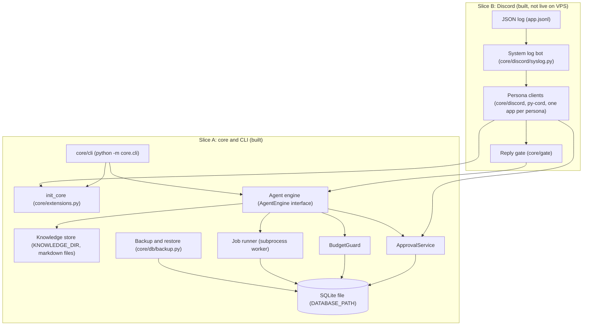

# Architecture — AI Team on Discord (Phase 1)

## Contents

- 1. Summary — L28
- 2. Delivery in two slices — L39
- 3. Components and flow — L52
- 4. Interfaces — L95
- 5. Security posture (summary) — L108
- 6. Phase 2 and out of scope — L125
- 7. Open items — L130
- 8. Decisions — L138
- 9. Folder map — L150
- 10. Related documents — L168

> Status (2026-11-24, v0.2.0 release candidate): Slice A is built on the owner pivot (spec §11): one **SQLite** file at `DATABASE_PATH`, **native systemd** units on a Hostinger VPS, **no Docker, no Compose, no Postgres**. Slice B (Discord clients, reply gate, approvals routing, System log bot, `core/__main__.py`) is built in code; it is not enabled on the VPS until B1-ENABLE. Section 9 lists what exists.

## 1. Summary

A team of AI agents that live in a company Discord server. Staff can watch them and talk to them. Agents can brainstorm with each other, call tools, and keep knowledge as index-first markdown. Phase 1 is built fresh in Python. Only the prompts carry over from the old bot. The team has 20 personas (`prompts/`, including the assistant Praw).

Authoritative sources:
- Scope and requirements: `docs/prd/2026-11-23-ai-team-prd.md`
- Current stack, deploy and data (overrides earlier spec sections where they differ): `docs/specs/2026-11-23-phase1-spec-s11-sqlite-vps.md`
- Build contracts and Gate 1 addendum (its SQLite and Docker parts are superseded by §11): `docs/specs/2026-11-23-phase1-spec.md` §10
- Security verdicts: `docs/security/2026-11-23-gate1-s11.md` (spec §11), `docs/security/2026-11-23-gate1-phase1.md` (Slice A), `docs/security/2026-11-23-gate2-sliceA.md` (Slice A, rejected on supply chain only)
- Task plan: `docs/plans/2026-11-23-phase1-plan.md`

## 2. Delivery in two slices

Phase 1 is delivered in two slices. The owner first deferred Discord until the owner's Discord setup was ready; the Discord code is now built and waits for the owner's live test.

| Slice | Scope | How it is verified | Status |
| :--- | :--- | :--- | :--- |
| **A — core-first** | Config, SQLite layer, migrations, backup and restore, engine, tools, knowledge, approvals, budget, jobs, tasks, personas, and the local CLI harness | Local CLI harness `python -m core.cli` and script mode; acceptance harness `tests/acceptance/run.sh` (re-run on SQLite, see `docs/test-reports/phase1-sliceA.md`); VPS re-run pending | Built on SQLite |
| **B — Discord** | Discord adapters: one client per persona (`core/discord/`), reply gate (`core/gate/`), slash commands `/task`, `/approval`, `/setting`, buttons, embeds, approval cards and routing, System log bot (`core/discord/syslog.py`), pull-user (`core/pulluser/`), voice (`core/voice/`, off unless `VOICE_ENABLED=true`) | Acceptance run in a test Discord server (TASK-021B); B1-SMOKE and B1-ENABLE wait for owner tasks OWN-B-01..07 | Built in code (B1 at commit 927c745, later changes in the v0.2.0 candidate); not live on the VPS |

Rules:
- Slice A never depends on Slice B. Slice B may depend on Slice A.
- The CLI uses the same interfaces (`ReplySink`, `SinkFactory`, `ApprovalPresenter`, `ApprovalService`, `JobRunner`, `AgentEngine`) and the same engine path that the Discord layer will use later. This is how Slice A checks the contracts that Slice B will implement.

## 3. Components and flow

- `init_core` is the shared wiring path for the CLI and for Discord (spec §10.0, §10.1).
- `core/core.py` is empty today. In the target design it holds only wiring. Features register in `AppContext` through extensions (spec §3.0).
- Nothing under `core/` outside `core/cli/` imports `core.cli` (spec §10.15, §10.17 RC-1).

## 4. Interfaces

The contracts are defined in spec §10.1 (replacements for §5.1) and §5.2 to §5.6. This chapter does not copy them. Key points:
- `Actor(kind, user_id, display_name)` is built by the surface. Authorisation is decided only by `ApproverPolicy`. Decision outcomes are fixed strings (`approved`, `rejected`, `not_approver`, `already_decided`, `expired`, `not_found`).
- `AgentRequest` and `ToolContext` carry `origin` (`discord` or `cli`) and `human_actor`.
- Stable error codes are listed in spec §5.6 and §10.14. Startup refusals are listed in spec §10.14.
- CLI identities: `CLI_HUMAN_IDS` lives in `core/interfaces.py` (spec §10.17 RC-1). It is not in `core/cli/identity.py`.
- Knowledge: index-first markdown under `KNOWLEDGE_DIR`. Agents write only to `memory` and `notes`; `rules` and `meetings` are read-only to agents. Format and rules: `docs/development/knowledge-format.md`.
- Database: `core/db/sqlite.py` gives the `Database` API. Schema and migrations are in `core/migration/` (see section 9).
- Discord reply streaming: `STREAM_MODE` (`typing` by default, or `edit`) is read in `core/config.py`; the sink is in `core/discord/sinks.py`. `typing` renews the typing indicator every 8 s and then sends one final message. `edit` posts a placeholder and edits it live.
- Gemini: a tool call's `thought_signature` (`core/interfaces.py`) is echoed back on the next turn; the API returns 400 without it. Google HTTP deadlines are clamped to at least 10 s because the API rejects shorter ones; the adapter enforces the shorter local timeout itself (`core/provider/google/adapter.py`).
- Anthropic: `ANTHROPIC_API_KEY` must be a workspace-scoped key (`sk-ant-api03-...`). A key not scoped to a workspace is rejected with "must include the anthropic-workspace-id header". Setup note: [setup.md](../helper/setup.md#2-secrets-environment-only).

## 5. Security posture (summary)

Full controls and conditions: spec §6, §10 and §11; the Gate reports listed in section 1.

- **Secrets:** environment only. On the VPS they come from the root-only env file `/etc/employee/employee.env` (0600), loaded by systemd `EnvironmentFile`. Never sent to models, logs or chat. `mask_secrets` applies to logs (per field plus a fail-closed line check) and to all outbound text. Config refuses secrets shorter than 12 characters (spec §10.3).
- **Untrusted text:** Discord text, knowledge files, tool results and display names are untrusted and are wrapped before a model sees them (spec §6.2, §10.5).
- **Approvals routing (TASK-031, `docs/specs/2026-11-24-approvals-routing-spec.md`):** a department-level request is decided by that department's AI head in the department approvals channel. A request at or above `approval.hq_threshold_thb` (default 10,000 THB), and any request the classifier cannot route, goes to HQ. HQ items are decided by humans with the `AI-Admin` role, who can also override an AI decision. The classifier fails closed to HQ. Codes look like `DEV-0001` (tasks) and `APR-FIN-0007` (approvals). In dev mode the `admin` CLI identity is the approver. A handler acts only on the database row returned by `decide()` (spec §10.13.8).
- **Runtime settings:** `/setting view|set|reset` runs only in `SETTINGS_CHANNEL_ID`, for approver-role humans. Every change is audited and logged. Keys: [setup.md §4.1](../helper/setup.md#41-runtime-settings-task-031).
- **Config changes:** only through human-confirmed slash commands or CLI approver commands.
- **Subprocess isolation (spec §10.6):** heavy or untrusted work runs in a subprocess with an env allowlist and no bot token or DB path.
  - Same-uid limit (spec §10.17 RC-4): a same-uid worker can read `.env.local` (by absolute path), `KNOWLEDGE_DIR` and `LOG_DIR`. The phase-1 job runner uses a same-uid worker (option b).
  - A dedicated uid (option a) is mandatory for any job kind that decodes user-supplied containers, codecs or attachments, fetches URLs, or runs third-party or agent-chosen code. This includes the phase-2 launcher and job-spawning approval handlers.
- **Database access:** the runtime connection sets an authorizer (`_authorizer` in `core/db/sqlite.py`) that denies dangerous actions and all PRAGMAs except `wal_checkpoint`.
- **Process hardening (native systemd, `deploy/employee.service`):** dedicated `employee` user; `ProtectSystem=strict`, `ProtectHome=yes`, `PrivateTmp=yes`, `NoNewPrivileges=yes`, empty `CapabilityBoundingSet`, `SystemCallFilter=@system-service` with `~@privileged`, `UMask=0077`, `MemoryMax=1G`, `CPUQuota=60%`, `TasksMax=100`, `Nice=5` (shared-host values in the unit; dedicated-host values are in [setup.md §8](../helper/setup.md#8-native-vps-deploy-spec-1111-1118)). Writable paths are only `/var/lib/employee`, `/var/log/employee` and `/run/employee`. `ExecStartPre` refuses an env file that sets `EMP_CLI_DEV`, `DATABASE_PATH`, `KNOWLEDGE_DIR`, `LOG_DIR` or `VOICE_TMP_DIR`.
- **Voice consent and restore:** voice consent is opt-out. A restore of an unreadable DB needs `--allow-optout-gap`, which writes a `consent_gap` marker in the DB directory. Voice stays off while the marker exists (spec §11.8). Details: `docs/specs/2026-11-23-phase1-spec-s11-sqlite-vps.md` §11.
- **CLI dev mode (TASK-025):** runs only when `EMP_CLI_DEV=1` is in the process environment and no Discord token (`DISCORD_BOT_TOKEN` or any `DISCORD_BOT_TOKEN_<ID>`) is set. Otherwise the CLI exits 2 (spec §10.7.6, §10.15).

## 6. Phase 2 and out of scope

- Phase 2 (planned): agents build tools, MCP servers, plugins and skills; the Agent SDK worker and Docker sandbox arrive here. Phase 1 ships no MCP (PRD §7). Phase 2 is the only place where a container sandbox is planned.
- Phase 1 acceptance does not include phase-2 items (PRD §8).

## 7. Open items

- Slice B: `deploy/employee.service` runs `python -m core` (`core/__main__.py` exists). The VPS service is enabled only at B1-ENABLE.
- Slice B: the ffmpeg carve-out in spec §10.6.4 must be resolved by the sa role before TASK-016 (spec §10.17).
- Slice B: Discord setup readiness is the owner's decision (plan, Slice B).
- Off-host backup: none in Slice A (spec §11 OQ-3). Local backups do not survive loss of the disk.
- Spec §7 defaults (defaults stated for owner awareness, changeable without schema change): late-joiner DM failure is never captured; an agent can start recording only when the requester is in that voice channel; budget is per agent; a plain human message in an open task thread is treated as addressed to the assignee; spoken commands are not in phase 1.

## 8. Decisions

| Decision | Choice | Source |
| :--- | :--- | :--- |
| Agent engine | C — hybrid: own loop for chat and brainstorm, Claude Agent SDK worker for heavy work (phase 2) | PRD §5.1 |
| Discord identity | One Discord application per persona (20 personas), plus one optional System log bot; no webhooks. Supersedes the one-bot-plus-webhooks choice | Spec §12.10, §12.14 (supersedes PRD §5.2) |
| Hosting | Hostinger VPS with native systemd units in `deploy/`; no Docker (owner pivot; supersedes PRD §7 Docker Compose) | Spec §11 |
| Database | One SQLite file at `DATABASE_PATH` with numbered-SQL migrations (owner pivot; supersedes PRD §7 PostgreSQL) | Spec §11 |
| Old bot code | Not reused; build fresh | PRD §7 |
| Phase 1 MCP | None; built-in tools only | PRD §7 |
| Voice consent | Opt-out, notice embed plus DM for late joiners | PRD §6.9 |

## 9. Folder map

| Folder | Status |
| :--- | :--- |
| `core/config.py`, `core/interfaces.py`, `core/extensions.py` | exist. `core/core.py` exists and is empty |
| `core/db/` | exists: `sqlite.py` (connection, path checks, authorizer, `Database` API) and `backup.py` (backup and `restore` CLI) |
| `core/migration/` | exists: `runner.py`, `__main__.py` (`python -m core.migration`), `versions/0001_phase1.sql` (schema 0001), `0002_approvals_routing.sql`, `0003_audit_decide.sql`, `retention.py`, `retention_main.py`, tests |
| `core/cli/` | exists: `python -m core.cli` (harness, script mode) |
| `core/functions/logs/` | exists: `logsystem.py` (JSON logger, `install_logging`) and `masking.py` |
| `core/agents/`, `core/provider/`, `core/agent_tools/` | exist: persona loader, providers, built-in tools |
| `core/knowledge/`, `core/jobs/`, `core/budget/`, `core/tasks/`, `core/approvals/` | exist (Slice A; `core/approvals/` also holds the TASK-031 routing: `router.py`, `service.py`, `depts.py`, `cards.py`) |
| `core/__main__.py`, `core/gate/`, `core/discord/` (persona clients, approval cards, `syslog.py` System log bot), `core/voice/`, `core/pulluser/` | exist (Slice B). Voice stays off unless `VOICE_ENABLED=true` |
| `deploy/` | exists: `install.sh`, `employee.service`, `employee-backup.service` and `.timer` (03:30 Asia/Bangkok), `logrotate-employee`, `grype.sha256`; `user/` holds the weekly `employee-audit` service and timer |
| `constraints/`, `pyproject.toml` | exist: `requirements.lock` (runtime) and `dev.lock` (dev and test) |
| `prompts/` | exists: 20 persona files in department folders, plus `_fragments/` and `_system/` |
| `knowledge/` | exists: 14 department areas plus `memory`, `notes`, `drafts`, `rules`, `meetings` and `_template/`, mostly empty. On the VPS `install.sh` seeds `/var/lib/employee/knowledge` from it |
| `docs/` | exists; PRD, plan, specs, security reports, test reports, spike and index |

## 10. Related documents

- Setup, env names and VPS deploy: `docs/helper/setup.md`
- Knowledge store format: `docs/development/knowledge-format.md`
- Persona file format: `docs/development/persona-format.md`
- Current stack and data rules: `docs/specs/2026-11-23-phase1-spec-s11-sqlite-vps.md`
- Discord rollout (one app per persona, System bot): `docs/specs/2026-11-23-phase1-spec-s12-discord-rollout.md` §12.10, §12.14
- Approvals routing: `docs/specs/2026-11-24-approvals-routing-spec.md`
