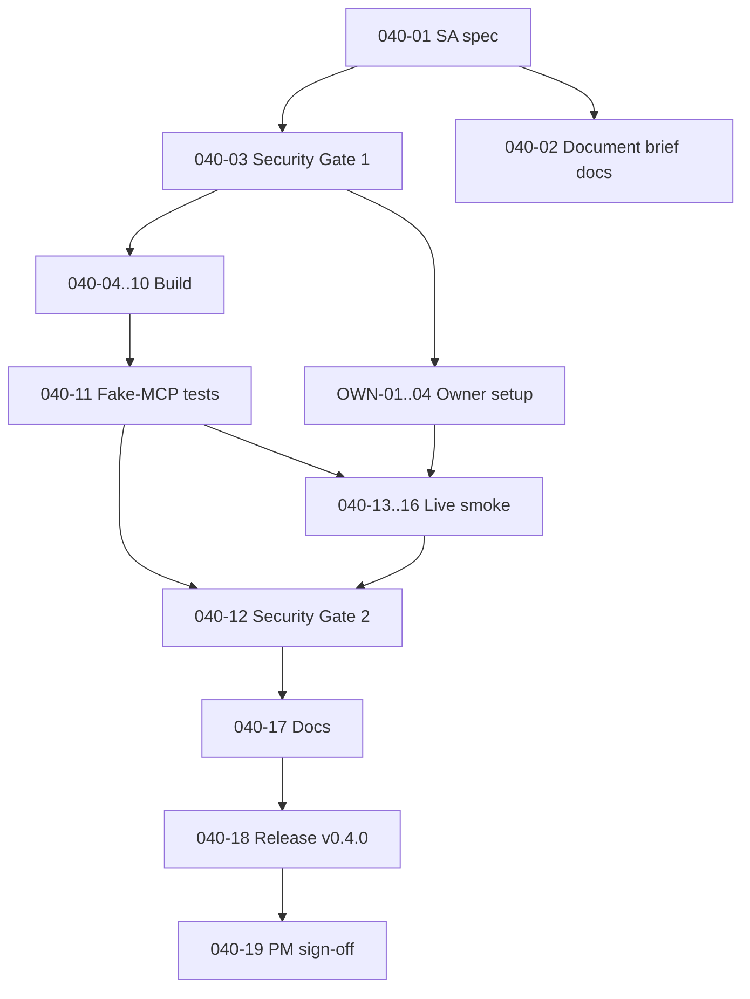

# Phase 2A Plan

## Contents
- 1. Scope and rules
- 2. Pipeline overview
- 3. WBS
  - 3.1 Spec and gates (G1)
  - 3.2 Owner tasks (OWN)
  - 3.3 Build
  - 3.4 Test and Gate 2
  - 3.5 Live smoke (per service)
  - 3.6 Docs, release, sign-off
- 4. Dependency graph
- 5. Parallelism
- 6. Risks
- 7. Out of scope

## 1. Scope and rules

- Source: owner-approved design (D1-D9). Pipeline: spec -> Security Gate 1 -> build -> test -> Security Gate 2 -> release v0.4.0 -> sign-off.
- Runs on the dev Mac (macOS now, Linux later, no Docker). VPS deploy and Phase 2B (self-built tools) are out of scope.
- No build task (TASK-040-04 to -10) starts before TASK-040-03 (Gate 1) is Approved.
- Backend tasks are at component level. The main thread maps each to the spec's file list when briefing.
- Secrets: tokens live only in `.env.local`, referenced by name. No agent reads or prints values. Smoke tests use the environment only.
- Mandatory security-critical tests: argument-inspection code (design §7) and settings/payment refusal have their own tests (TASK-040-11).

## 2. Pipeline overview

## 3. WBS

Status values per task: Todo | In Progress | Blocked | Done. All start Todo.

### 3.1 Spec and gates (G1)

| ID | Owner | Task | Depends | Acceptance criteria |
| :--- | :--- | :--- | :--- | :--- |
| TASK-040-01 | sa | Write Phase 2A spec from the design: pinned MCP server and version per service (maintained, licence checked), full per-tool classification, policy file format, allowlist and department scope location, env var names, host lifecycle (health, backoff, timeouts, output caps), approval card content and safe replay, rate limits, least-privilege token scope per service, test plan, file list | none | 1. Every service in design 5.2 has a named pinned server and licence note. 2. Every tool of each server is classed or explicitly blocked. 3. States least-privilege token scope per service, including Hostinger billing gap. 4. Lists env var names only. 5. Lists files to create or change. |
| TASK-040-02 | document | Official docs from the spec brief (service setup guide for owner, policy file guide) | 040-01 | 1. Setup guide names each token, env var name, and minimal scope. 2. Docs index and Contents updated. |
| TASK-040-03 | security | Gate 1 review of the spec | 040-01 | 1. Report in `docs/security/` with verdict Approved or Rejected. 2. Covers anti-goals: settings/payment bypass via unclassified tool, irreversible without card, secret leak, untrusted text as instructions. 3. Covers argument-inspection design and approved-args replay. 4. Conditions are numbered; build tasks cite them. |

### 3.2 Owner tasks (human owner; agents do not do these)

| ID | Owner | Task | Depends | Done when |
| :--- | :--- | :--- | :--- | :--- |
| OWN-01 | owner | Create central GitHub App (or fine-grained token) with least privilege: repo contents, issues, pull requests; no admin, no webhooks, no secrets, no org settings. Install only on the agreed repos | 040-02 | Token env name present in `.env.local` (name only reported to PM); scope matches setup guide |
| OWN-02 | owner | Create central ClickUp account or app and personal API token; invite only to agreed spaces | 040-02 | Token env name set; account has access only to agreed spaces |
| OWN-03 | owner | Create Google Cloud project, OAuth client or service account for Calendar, Drive, Docs, Sheets only (no Gmail, no sharing-admin scopes); share only the agreed Drive folders and calendar | 040-02 | Credentials env names set; consent scopes list contains no Gmail |
| OWN-04 | owner | Create Hostinger API token (smallest scope the service allows; note whether billing is excluded) | 040-02 | Token env name set; owner records whether billing is excludable (feeds Gate 2) |
| OWN-05 | owner | Confirm department scopes: which ClickUp lists, Drive folders, GitHub repos belong to which department; confirm the access map (design 5.2) | 040-01 | Written scope table delivered to PM and placed in config by backend (040-06) |
| OWN-06 | owner | Put all tokens in `.env.local` by name only; confirm file is git-ignored | OWN-01..04 | `git check-ignore .env.local` passes; names match spec |

### 3.3 Build (backend unless noted)

| ID | Owner | Task | Depends | Acceptance criteria |
| :--- | :--- | :--- | :--- | :--- |
| TASK-040-04 | backend | MCP host: start each server as stdio subprocess with only its own token env, health check, restart with backoff, timeouts, output caps; uses `mcp` SDK and existing subprocess/job conventions | 040-03 | 1. A crashed fake server restarts and the bot stays up. 2. Server env contains only its own token. 3. Output over cap is truncated. |
| TASK-040-05 | backend | Policy gateway: persona allowlist (role-keyed, head resolved from `approval.head.<dept>`), class decision flow, refuse settings/payment/blocked, argument-inspection rules, untrusted wrapper, audit row, log masking, rate limits; registers MCP tools in existing tool registry | 040-03, 040-04 | 1. Each class yields the specified decision. 2. Not-allowed persona refused. 3. Arguments hashed in audit, no secrets logged. 4. Results wrapped via `wrap_tool_result`. |
| TASK-040-06 | backend | Policy files and server config per service (`mcp/<name>/`): pinned package, launch, env names, tool classes; department scopes in config (from OWN-05); startup diff of live tool list vs policy with `#bot-log` notice; replace `mcp/calender` with Google config | 040-03, OWN-05 for scope values | 1. Unknown or new tool is blocked and logged. 2. Every spec-classified tool present. 3. Scope table matches OWN-05. |
| TASK-040-07 | database | Migration for approvals kind `mcp_irreversible` (and any audit columns the spec requires) | 040-03 | 1. Migration applies and rolls forward on a copy of the existing DB. 2. Existing approval kinds unaffected. 3. Migration test passes. |
| TASK-040-08 | backend | Approvals integration: `mcp_irreversible` card showing exact action and arguments, HQ/human routing, replay of the exact approved args only, idempotent on repeat | 040-05, 040-07 | 1. Irreversible call blocks until decided. 2. Rejected call does not run. 3. Changed args after approval are refused. 4. Double approval runs once. |
| TASK-040-09 | backend | Attribution: `**<Name>:**` prefix on text fields, "<Name> (AI)" author on commits, audit-only fallback | 040-05 | 1. Comment, description and commit tools carry attribution. 2. Tool without a carrier field records persona in audit row. |
| TASK-040-10 | backend | Commands and status: `/status` (or existing equivalent) shows servers, health and blocked tools; persona `tools:` frontmatter and gateway reminder line per department | 040-04, 040-06 | 1. Status lists each service state. 2. Persona sees only allowed services. |

### 3.4 Test and Gate 2

| ID | Owner | Task | Depends | Acceptance criteria |
| :--- | :--- | :--- | :--- | :--- |
| TASK-040-11 | tester | Fake MCP server unit and acceptance tests against the original design: allowlist per persona, head resolution after `/move`, settings and payment always refused, unknown tool blocked, irreversible card flow, argument inspection (force push, unmerged branch delete, sharing field), attribution, secret never in logs or prompts, untrusted wrapping, crash recovery | 040-04..10 | 1. Test output attached. 2. Each anti-goal has at least one failing-then-passing case. 3. Argument-inspection has a dedicated test module. 4. Existing suite still green. |
| TASK-040-12 | security | Gate 2 code audit | 040-11, 040-13..16 | 1. Report in `docs/security/` with verdict. 2. Confirms Gate 1 conditions met. 3. Confirms pinned versions and no token in repo, logs or Discord. 4. Confirms Hostinger billing gap is covered by classification. |

### 3.5 Live smoke (after tokens exist; one optional run per service, on the dev Mac)

Each smoke is read-first, then one reversible write in a scratch location, then one blocked-class probe that must be refused. No irreversible action is run live except a card-approval dry run that the human rejects.

| ID | Owner | Task | Depends | Acceptance criteria |
| :--- | :--- | :--- | :--- | :--- |
| TASK-040-13 | tester | GitHub live smoke (scratch repo): read, comment with attribution, a settings tool refused | OWN-06, 040-11 | Output shows allowed read/write, attribution visible, settings refused, audit rows present |
| TASK-040-14 | tester | ClickUp live smoke (scratch list, Praw and one head): read, create and update task, other-department list refused | OWN-06, OWN-05, 040-11 | Same evidence; cross-department write refused |
| TASK-040-15 | tester | Google live smoke (Calendar, Drive, Docs, Sheets; scratch folder): read, create doc, trash file (recoverable), sharing change refused, permanent delete raises card | OWN-06, 040-11 | Same evidence; card created and rejected by human |
| TASK-040-16 | tester | Hostinger live smoke: read-only metrics and list; purchase and firewall tools refused; destroy raises card, human rejects | OWN-06, 040-11 | Same evidence; no VM state changed |

### 3.6 Docs, release, sign-off

| ID | Owner | Task | Depends | Acceptance criteria |
| :--- | :--- | :--- | :--- | :--- |
| TASK-040-17 | document | Update README, changelog draft, Project Book and docs indexes for Phase 2A; update `docs/plans/_index.md` and `docs/specs/_index.md` | 040-12 | 1. Changelog v0.4.0 entry matches delivered work. 2. Indexes list new files. |
| TASK-040-18 | git | Commit in logical commits (no Co-Authored-By, no links), tag v0.4.0 | 040-12, 040-17 | 1. Tag v0.4.0 exists. 2. `.env.local` not tracked. 3. Gate 2 verdict is Approved before tag. |
| TASK-040-19 | pm | DoD sign-off: check each agent's evidence, set plan status Completed, record follow-ups | 040-18 | 1. Each task has cited evidence. 2. Open items listed. |

## 4. Dependency graph

040-01 -> 040-02, 040-03 -> (040-04 -> 040-05 -> 040-08, 040-09), (040-06), (040-07 -> 040-08), 040-10 -> 040-11 -> 040-13..16 -> 040-12 -> 040-17 -> 040-18 -> 040-19.
Owner path: 040-02 -> OWN-01..04 -> OWN-06. OWN-05 after 040-01.

## 5. Parallelism

- After Gate 1: 040-04, 040-06, 040-07 run in parallel; 040-05 follows 040-04.
- OWN-01..05 run in parallel with the whole build, so tokens are ready when 040-11 finishes.
- Smoke tasks 040-13..16 run in parallel.
- Missing tokens for one service do not block the others. That service is marked "smoke pending" and Gate 2 notes it as unverified live; release of that service needs owner decision.

## 6. Risks

| Risk | Owner | Mitigation |
| :--- | :--- | :--- |
| A vendor MCP server exposes a tool we did not classify | backend | Unknown is blocked; startup diff logs it (040-06) |
| Hostinger token cannot exclude billing | security | Gateway classes billing as `payment`; stated in spec and checked at Gate 2 |
| Argument inspection misses a field, letting a settings change through | tester | Worst-case class where a field cannot be inspected; dedicated tests (040-11) |
| Service text acts as instructions (prompt injection) | backend | Untrusted wrapper; Gate 1 and Gate 2 check |
| Pinned server package is abandoned or has an unfit licence | sa | Checked in 040-01; Gate 1 reviews |
| Owner tokens delayed | owner | Smoke per service is independent (section 5) |

## 7. Out of scope

VPS deploy, Phase 2B self-built tools, Gmail, Discord server management, workspace file editing (PRD Phase 3).
