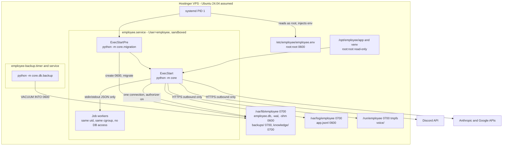
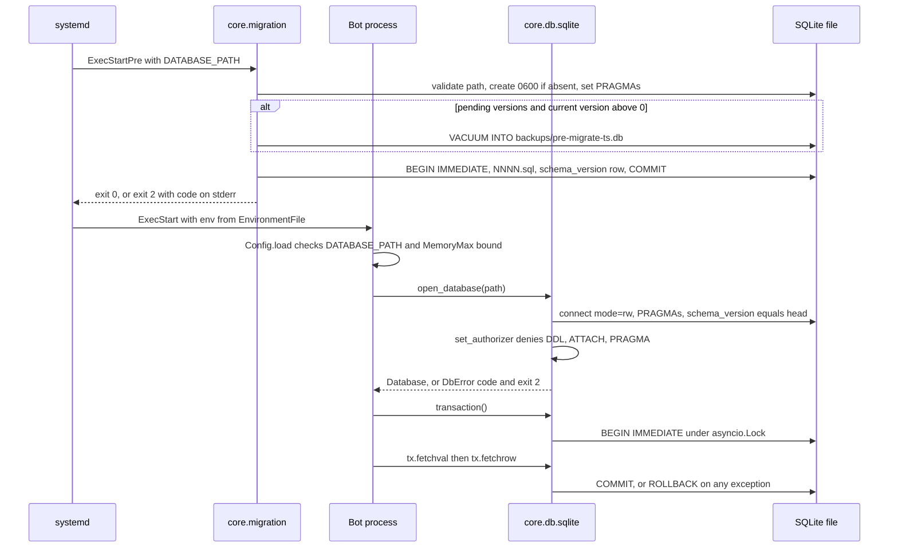
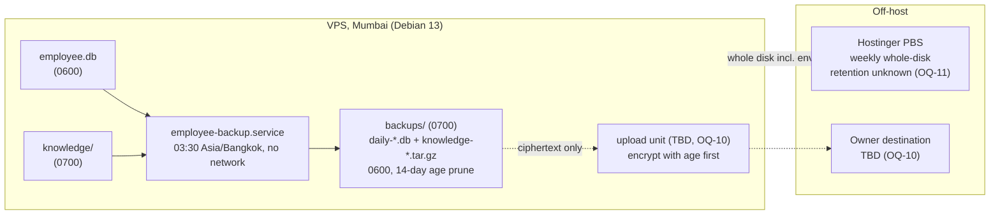

## Contents

> Line numbers refreshed 2026-11-23; regenerate after edits.

- 11.0 Precedence and what this overrides — L91
- 11.1 Decisions — L120
- 11.2 Platform floor (startup refusals) — L135
- 11.3 `core/db/sqlite.py` — PASTE VERBATIM (TASK-006; replaces `core/db/pool.py`, which is deleted) — L141
- 11.4 File and permission rules (G1-08 replacement, TASK-006 + TASK-007 + TASK-005) — L381
- 11.5 DDL — `core/migration/versions/0001_phase1.sql` — PASTE VERBATIM (TASK-006; replaces §5.3 + §10.14 DDL; `0001_phase1.py` is deleted) — L390
- 11.6 Migration runner — PASTE VERBATIM (TASK-006; deletes `core/migration/env.py`, `core/migration/alembic.ini`, `core/migration/versions/0001_phase1.py`) — L565
- 11.7 Query translations (every current call site) — L628
  - 11.7.1 Mechanical rules — L629
  - 11.7.2 `core/jobs/repo.py` — PASTE VERBATIM (TASK-011) — L652
  - 11.7.3 `core/approvals/service.py` (TASK-013A) — replace these statements verbatim — L716
  - 11.7.4 `core/budget/repo.py` — PASTE VERBATIM (TASK-018A) — L737
  - 11.7.5 `core/tasks/repo.py` — PASTE VERBATIM (TASK-012A) — L774
  - 11.7.6 `core/cli/script.py` and `core/cli/__main__.py` (TASK-025) — L871
  - 11.7.7 Slice B patterns (fixed now so TASK-008/009/016 have no choice to make) — L876
- 11.8 Retention, erasure and backups — L886
  - 11.8.1 `core/migration/retention.py` — PASTE VERBATIM (TASK-006; TASK-011 schedules it) — L887
  - 11.8.2 Erasure and retention on disk — L903
  - 11.8.3 `core/db/backup.py` — PASTE VERBATIM (TASK-006) — L908
- 11.9 Configuration (TASK-007; replaces §5.7 `DATABASE_URL` and §10.3.2 DB parts) — L968
- 11.10 Security deltas (for the security gate) — L1014
- 11.11 Native VPS runtime (TASK-005; replaces §10.9 and every Docker/Compose rule) — L1030
  - 11.11.1 Layout — L1031
  - 11.11.2 `deploy/employee.service` — PASTE VERBATIM — L1043
  - 11.11.3 `deploy/logrotate-employee` → `/etc/logrotate.d/employee` — PASTE VERBATIM — L1114
  - 11.11.4 Backup timer — PASTE VERBATIM — L1129
  - 11.11.5 Host packages and upgrades (`deploy/install.sh`, run as root, idempotent) — L1178
  - 11.11.6 Retired files — L1205
  - 11.11.7 Host acceptance checks (devops runs; security re-runs) — L1212
- 11.12 Job subprocess isolation (replaces §10.6.1 restatement, §10.6.3 tmpfs note, RC-4 list, §6.4) — L1223
  - 11.12.1 `core/jobs/runner.py` module docstring — PASTE VERBATIM — L1224
  - 11.12.2 What systemd gives Slice A workers — L1238
  - 11.12.3 Phase-2 roadmap rule (not built; mandatory before any RC-4 kind merges) — L1249
- 11.13 Development on the VPS — L1271
- 11.14 Test strategy (replaces every throwaway-Postgres instruction) — L1285
  - 11.14.1 Fixtures — L1286
  - 11.14.2 New tests (TASK-006 unless noted). Location: `core/migration/tests/test_migration.py`, rewritten, plus `tests/test_db.py`. — L1317
  - 11.14.3 `assumed` behaviours: tester probes first and reports before the build continues — L1382
  - 11.14.4 Invalidated existing assertions (sa rule 4) — L1391
- 11.15 Files affected and order — L1412
- 11.16 Diagrams — L1428
- 11.17 Open questions (owner / pm) — L1488
- 11.18 Gate 1 conditions (overrides earlier §11 text) — L1496
  - 11.18.0 Overlap with §11.3–§11.8 (database, built in parallel) — L1505
  - 11.18.1 S11-01: root never writes through paths the service owns — L1514
  - 11.18.2 S11-02: dev account, admin account, SSH (owner checklist plus TASK-005) — L1527
  - 11.18.3 S11-03: backups bounded by age, restore keeps opt-outs, busy checkpoint — L1576
  - 11.18.4 S11-04: patch coverage (venv, ffmpeg, kernel) — L1682
  - 11.18.5 S11-05: deploy pinned by commit SHA — L1726
  - 11.18.6 S11-06: env-file guard on every start — L1741
  - 11.18.7 S11-07: backup unit hardening; timer only after a prod DB exists — L1813
  - 11.18.8 S11-08: phase-2 unit details (not built) — L1872
  - 11.18.9 S11-09: SQLite DB config on every connection — L1887
  - 11.18.10 S11-10: host checks replacing the Docker tests — L1929
  - 11.18.11 S11-11: CLI dev mode refused under the service user — L1947
  - 11.18.12 Files added to §11.15 — L1976
  - 11.18.13 Open questions added to §11.17 — L1986
- 11.19 Target host: Debian 13 (overrides §11 where they conflict) — L1996
  - 11.19.1 Platform floor (replaces §11.2 bullets 1 and 4) — L2005
  - 11.19.2 Locks and venv (TASK-005; replaces the "Python 3.12" text in §11.11.1, §11.11.5 step 4 and §11.13) — L2015
  - 11.19.3 Host packages (`deploy/install.sh` step 1; replaces §11.11.5 step 1) — L2041
  - 11.19.4 Patch coverage without Ubuntu Pro (replaces the Pro/ESM text in §11.18.2 step 6, §11.18.4 and §11.10) — L2071
  - 11.19.5 Unattended upgrades on Debian (replaces §11.11.5 step 8 and the §11.18.4 step 8b block) — L2102
  - 11.19.6 Memory and CPU sizing for 4 GB / 1 vCPU (replaces the §11.11.2 and §11.18.6 `MemoryMax=3G` line and the §11.11.2 "Memory bound" rule) — L2139
  - 11.19.7 sshd and firewall on Debian (replaces §11.18.2 `install.sh` step 9) — L2161
  - 11.19.8 Units on Debian (no other change) — L2194
  - 11.19.9 Knowledge directory: local backup and restore (owner decision; TASK-006, database; extends §11.8.3 and §11.18.3) — L2205
  - 11.19.10 Off-host copies (rule placeholder; not built in Slice A) — L2352
  - 11.19.11 Data location (record for the privacy notice; document) — L2395
  - 11.19.12 Files affected (added to §11.15 / §11.18.12) — L2405
  - 11.19.13 Open questions added to §11.17 — L2414
- 11.20 Shared-host profile (owner decision 2026-11-23; overrides §11.11.5, §11.18, §11.19 host steps) — L2420
  - 11.20.1 Host facts (verified) — L2423
  - 11.20.2 Rule: the installer never changes host-owned configuration — L2434
  - 11.20.3 Resource caps on the shared host — L2445
  - 11.20.4 Coexistence — L2451
  - 11.20.5 Acceptance (shared host) — L2457

## 11. OWNER PIVOT: SQLITE + NATIVE VPS (owner decisions 2026-11-23; overrides all earlier text)

### 11.0 Precedence and what this overrides
§11 overrides every earlier section where they conflict. Wherever text below says "replace", the old text is void.

| Overridden | Replaced by |
| :-- | :-- |
| §1 stack line ("PostgreSQL 16 (Docker), asyncpg, Alembic") | Python 3.12, stdlib `sqlite3` (SQLite ≥ 3.37), numbered-SQL migrations, systemd on the VPS |
| §2 ("one container", "PostgreSQL runs in its own container", "do not get `DATABASE_URL`") | §11.11, §11.12 (workers do not get `DATABASE_PATH`) |
| §3.0 table rows 005 and 006, startup step 3 | §11.15 ownership; step 3 = `open_database(config.database_path)`, refuse unless schema at head |
| §3.6 advisory lock (line "SELECT pg_advisory_xact_lock") and §4 sequence "advisory lock" | `db.transaction()` (`BEGIN IMMEDIATE`) + §11.7.4 |
| §3.7 step 5 and §10.12.7 `payload='{}'::jsonb` | `UPDATE jobs SET payload='{}', result=NULL WHERE kind='voice_transcribe' AND id=?1` |
| §4 diagram labels "PostgreSQL" | read as "SQLite file" (document agent updates labels) |
| §5.1 / §10.1 `AppContext.db: "asyncpg.Pool"` and `import asyncpg` | `db: "Database"`, `from core.db.sqlite import Database` under `TYPE_CHECKING` |
| §5.3 DDL, downgrade, retention | §11.5, §11.6, §11.8 |
| §5.4 masking of the `DATABASE_URL` password | no DB secret any more; the generic `postgres(ql)://` DSN regex stays (harmless) |
| §5.7 `DATABASE_URL` secret | `DATABASE_PATH` (required, not secret) |
| §6.1 T6 "advisory lock", T7 "0700 tmpfs directory" | `BEGIN IMMEDIATE`; `RuntimeDirectory` tmpfs `/run/employee/voice` |
| §6.4 Docker launcher | §11.12.3 |
| §9.3 rows "ORM/migration" and "Job queue" | stdlib sqlite3 + numbered SQL; SQLite table polled by the single bot process (no SKIP LOCKED) |
| §9.4 A2, §10.0 "Compose-only variables" | deleted (`DATABASE_MIGRATE_URL`, `POSTGRES_*` no longer exist) |
| §10.3.2 DB password rules (`db_password_empty`, `secret_too_short:DATABASE_URL`) | deleted |
| §10.6.1 dedicated uid via `create_subprocess_exec(user=…)`, §10.6.3 "tmpfs in Compose" | §11.12 |
| §10.9 entirely | §11.10, §11.11 |
| §10.14 DDL and startup refusal list | §11.5, §11.9.3 |
| §10.16 TASK-005 and TASK-006 ACs | §11.15 |
| §10.17 RC-4 list of what a worker can read | §11.12.1 |

Slice A invariant: no file under `core/`, `tests/` or `deploy/` imports `asyncpg`, `alembic` or `sqlalchemy`, or calls `docker`. Acceptance:
`grep -rnE "asyncpg|alembic|sqlalchemy|docker|DATABASE_URL|DATABASE_MIGRATE_URL|POSTGRES_|emp_app|emp_migrator|::jsonb|::uuid|::text|pg_advisory|FOR UPDATE|make_interval|now\(\)" core tests deploy pyproject.toml --include=*.py --include=*.sh --include=*.toml --include=*.service --include=*.timer` finds nothing, except the `postgres` masking regex in `core/functions/logs/masking.py`.

### 11.1 Decisions
| Topic | Decision | Why |
| :-- | :-- | :-- |
| Driver | stdlib `sqlite3`, run in one dedicated thread (`ThreadPoolExecutor(max_workers=1)`) | no new dependency; same model as aiosqlite |
| Connection model | one connection per bot process, one `asyncio.Lock`; every statement and every transaction is serialized | one process, low volume; removes all locking questions |
| Transactions | `BEGIN IMMEDIATE … COMMIT` via `db.transaction()` | takes the write lock at BEGIN, so count-then-insert is atomic |
| Timestamps | TEXT `YYYY-MM-DDTHH:MM:SS.SSSZ` (UTC), produced by `strftime('%Y-%m-%dT%H:%M:%fZ','now')`; CHECK enforces the exact format | readable in the `sqlite3` shell; string order = time order; works on SQLite 3.37 (no `unixepoch`) |
| Dates (`day`) | TEXT `YYYY-MM-DD`, CHECK `day = date(day)` | |
| UUIDs | TEXT, generated by a DDL default expression in canonical lowercase 8-4-4-4-12 form | no insert code changes; matches `str(uuid.UUID(x))` used by `decide()` |
| JSON / arrays | TEXT with `json_valid` + `json_type` CHECKs; `participants`, `access`, `payload`, `result` are decoded to Python objects by `core.db.sqlite` | |
| Booleans | INTEGER CHECK IN (0,1) | |
| Table names | unprefixed, as in §5.3 | |
| Migrations | numbered SQL files + `schema_version`, forward only | smaller than Alembic batch mode; rollback = the automatic pre-migration backup |
| Least privilege | file modes + runtime `set_authorizer` | replaces the `emp_app` role |

### 11.2 Platform floor (startup refusals)
- Python 3.12.x (`requires-python >=3.12` unchanged).
- `sqlite3.sqlite_version_info >= (3, 37, 0)`, otherwise `sqlite_too_old`. RETURNING needs 3.35 and STRICT needs 3.37.
- JSON functions must be present (`SELECT json_valid('[]')` = 1), otherwise `db_pragma_failed`.
- Target OS: Ubuntu 24.04 LTS (Python 3.12, SQLite 3.45). This is assumed until OQ-1 is answered.

### 11.3 `core/db/sqlite.py` — PASTE VERBATIM (TASK-006; replaces `core/db/pool.py`, which is deleted)
```python
"""SQLite access (spec §11.3). One connection on one worker thread behind one asyncio.Lock, so every
statement and every transaction is serialized. The API mirrors the asyncpg subset the repos used."""
import asyncio
import json
import os
import re
import sqlite3
import stat
from concurrent.futures import ThreadPoolExecutor
from contextlib import asynccontextmanager
from datetime import datetime, timezone
from pathlib import Path
from typing import Any
from urllib.parse import quote

PROJECT_ROOT = Path(__file__).resolve().parent.parent.parent
VERSIONS_DIR = PROJECT_ROOT / "core" / "migration" / "versions"
VERSION_RE = re.compile(r"^(\d{4})_[a-z0-9_]{1,60}\.sql$")
MIN_SQLITE = (3, 37, 0)  # RETURNING needs 3.35, STRICT tables 3.37
JSON_COLS = frozenset({"participants", "access", "payload", "result"})
NOW = "strftime('%Y-%m-%dT%H:%M:%fZ','now')"
_DENY = frozenset(getattr(sqlite3, n) for n in (
    "SQLITE_CREATE_INDEX", "SQLITE_CREATE_TABLE", "SQLITE_CREATE_TEMP_INDEX", "SQLITE_CREATE_TEMP_TABLE",
    "SQLITE_CREATE_TEMP_TRIGGER", "SQLITE_CREATE_TEMP_VIEW", "SQLITE_CREATE_TRIGGER", "SQLITE_CREATE_VIEW",
    "SQLITE_CREATE_VTABLE", "SQLITE_DROP_INDEX", "SQLITE_DROP_TABLE", "SQLITE_DROP_TEMP_INDEX",
    "SQLITE_DROP_TEMP_TABLE", "SQLITE_DROP_TEMP_TRIGGER", "SQLITE_DROP_TEMP_VIEW", "SQLITE_DROP_TRIGGER",
    "SQLITE_DROP_VIEW", "SQLITE_DROP_VTABLE", "SQLITE_ALTER_TABLE", "SQLITE_ATTACH", "SQLITE_DETACH",
    "SQLITE_REINDEX", "SQLITE_ANALYZE"))


class DbError(Exception):
    """Startup refusal; .code is the stable string printed on exit."""

    def __init__(self, code: str):
        super().__init__(code)
        self.code = code


def _private(p: str, want_dir: bool) -> bool:
    st = os.lstat(p)
    kind_ok = stat.S_ISDIR(st.st_mode) if want_dir else stat.S_ISREG(st.st_mode)
    return kind_ok and st.st_uid == os.geteuid() and not st.st_mode & 0o077


def validate_db_path(path: str, forbidden=()) -> str:
    """Absolute, not a symlink, outside PROJECT_ROOT and `forbidden`, in a 0700 dir owned by the euid;
    the db, -wal and -shm files (when present) are regular, owned by the euid, mode & 0o077 == 0."""
    bad = DbError("db_path_invalid")
    if not path or not os.path.isabs(path) or os.path.islink(path) or os.path.islink(os.path.dirname(path)):
        raise bad
    real = os.path.realpath(path)
    for base in (PROJECT_ROOT, *forbidden):
        b = os.path.realpath(base)
        if real == b or real.startswith(b + os.sep):
            raise bad
    d = os.path.dirname(path)
    os.makedirs(d, mode=0o700, exist_ok=True)
    if not _private(d, True):
        raise bad
    for f in (path, path + "-wal", path + "-shm"):
        if os.path.lexists(f) and not _private(f, False):
            raise bad
    return path


def connect(path: str, create: bool = False) -> sqlite3.Connection:
    """Configured connection WITHOUT the authorizer (migration, backup, and the base of open_database)."""
    if sqlite3.sqlite_version_info < MIN_SQLITE:
        raise DbError("sqlite_too_old")
    validate_db_path(path)
    if create and not os.path.lexists(path):
        os.close(os.open(path, os.O_RDWR | os.O_CREAT | os.O_EXCL | os.O_NOFOLLOW | os.O_CLOEXEC, 0o600))
    try:
        conn = sqlite3.connect(f"file:{quote(path)}?mode=rw", uri=True, autocommit=True)
    except sqlite3.OperationalError:
        raise DbError("db_path_invalid") from None
    try:
        mode = conn.execute("PRAGMA journal_mode=WAL").fetchone()[0]
        for p in ("foreign_keys=ON", "busy_timeout=5000", "synchronous=FULL", "secure_delete=ON",
                  "trusted_schema=OFF", "temp_store=MEMORY"):
            conn.execute("PRAGMA " + p)
        ok = (mode == "wal" and conn.execute("PRAGMA foreign_keys").fetchone()[0] == 1
              and conn.execute("SELECT json_valid('[]')").fetchone()[0] == 1)
    except sqlite3.Error:
        ok = False
    if not ok:
        conn.close()
        raise DbError("db_pragma_failed")
    validate_db_path(path)  # -wal/-shm may exist now: same owner and private mode
    return conn


def head_version(versions_dir: Path = VERSIONS_DIR) -> int:
    nums = []
    for p in versions_dir.glob("*.sql"):
        m = VERSION_RE.match(p.name)
        if not m:
            raise DbError("migration_name_invalid")
        nums.append(int(m.group(1)))
    nums.sort()
    if nums != list(range(1, len(nums) + 1)):
        raise DbError("migration_gap")
    return len(nums)


def current_version(conn: sqlite3.Connection) -> int:
    if conn.execute("SELECT 1 FROM sqlite_master WHERE type='table' AND name='schema_version'").fetchone() is None:
        return 0
    return conn.execute("SELECT coalesce(max(version), 0) FROM schema_version").fetchone()[0]


def _authorizer(action, arg1, arg2, dbname, source):
    if action in _DENY:
        return sqlite3.SQLITE_DENY
    if action == sqlite3.SQLITE_PRAGMA and (arg1 or "").lower() != "wal_checkpoint":
        return sqlite3.SQLITE_DENY
    return sqlite3.SQLITE_OK


def _open_runtime(path: str) -> sqlite3.Connection:
    conn = connect(path)
    try:
        if current_version(conn) != head_version():
            raise DbError("schema_not_head")
        conn.set_authorizer(_authorizer)
    except BaseException:
        conn.close()
        raise
    return conn


def _row(names, values) -> dict[str, Any]:
    d = dict(zip(names, values))
    for k in JSON_COLS.intersection(d):
        if isinstance(d[k], str):
            d[k] = json.loads(d[k])
    return d


def utc_text(dt: datetime) -> str:
    """Python-side timestamp in the exact NOW format. dt must be timezone-aware."""
    if dt.tzinfo is None:
        raise ValueError("naive_datetime")
    u = dt.astimezone(timezone.utc)
    return u.strftime("%Y-%m-%dT%H:%M:%S.") + f"{u.microsecond // 1000:03d}Z"


class _Api:
    async def _exec(self, sql: str, args: tuple):  # -> (rowcount, rows)
        raise NotImplementedError

    async def execute(self, sql: str, *args) -> int:
        return (await self._exec(sql, args))[0]

    async def fetch(self, sql: str, *args) -> list[dict[str, Any]]:
        return (await self._exec(sql, args))[1]

    async def fetchrow(self, sql: str, *args) -> dict[str, Any] | None:
        rows = (await self._exec(sql, args))[1]
        return rows[0] if rows else None

    async def fetchval(self, sql: str, *args) -> Any:
        row = await self.fetchrow(sql, *args)
        return next(iter(row.values())) if row else None


class Database(_Api):
    def __init__(self, conn: sqlite3.Connection, ex: ThreadPoolExecutor):
        self._conn, self._ex, self._lock = conn, ex, asyncio.Lock()

    def _run(self, fn, *a):
        return asyncio.get_running_loop().run_in_executor(self._ex, fn, *a)

    def _q(self, sql, args):  # db thread only
        cur = self._conn.execute(sql, args)
        try:
            rows = cur.fetchall()  # drain: a RETURNING statement completes only when stepped to the end
            if cur.description is None:
                return cur.rowcount, []
            names = [c[0] for c in cur.description]
            return cur.rowcount, [_row(names, r) for r in rows]
        finally:
            cur.close()

    def _rollback(self):  # db thread only
        if self._conn.in_transaction:
            self._conn.execute("ROLLBACK")

    async def _exec(self, sql, args):
        async with self._lock:
            return await self._run(self._q, sql, args)

    @asynccontextmanager
    async def transaction(self):
        """BEGIN IMMEDIATE ... COMMIT under the lock. Inside, use only the yielded handle (self.* deadlocks)
        and await nothing but the handle (no provider, Discord, presenter or sleep calls)."""
        async with self._lock:
            try:
                await asyncio.shield(self._run(self._conn.execute, "BEGIN IMMEDIATE"))
                yield _Tx(self)
                await asyncio.shield(self._run(self._conn.execute, "COMMIT"))
            except BaseException:
                await asyncio.shield(self._run(self._rollback))
                raise

    async def close(self) -> None:
        async with self._lock:
            await self._run(self._conn.close)
        self._ex.shutdown(wait=True)


class _Tx(_Api):
    def __init__(self, db: Database):
        self._db = db

    async def _exec(self, sql, args):
        return await self._db._run(self._db._q, sql, args)


async def open_database(path: str) -> Database:
    """Runtime connection: PRAGMAs, schema at head, authorizer on. Raises DbError(code)."""
    ex = ThreadPoolExecutor(max_workers=1, thread_name_prefix="emp-db")
    try:
        conn = await asyncio.get_running_loop().run_in_executor(ex, _open_runtime, path)
    except BaseException:
        ex.shutdown(wait=False)
        raise
    return Database(conn, ex)
```
Rules for callers:
- Repos keep the parameter name they have (`pool`/`db`). `Database` is the only object passed as `ctx.db`.
- `execute()` returns the row count as an `int`.
- `fetch`/`fetchrow` return `dict`s, so index rows by column name, never `r[0]`.
- One SQL statement per call: `sqlite3` refuses multi-statement strings.
- Bind only `str`, `int`, `float`, `bytes` and `None`. Convert `date` with `.isoformat()`, `uuid.UUID` with `str()`, lists and dicts with `json.dumps()`. Anything else raises `ProgrammingError`, and that is the intended behaviour.
- Placeholders are `?N` (numbered; reuse allowed). Never use `$N`, `:name` or bare `?` mixed with `?N`.
- Never use `datetime('now')` or Python `isoformat()` for stored timestamps. Use the `NOW` literal in SQL, or `utc_text()` in Python.

### 11.4 File and permission rules (G1-08 replacement, TASK-006 + TASK-007 + TASK-005)
1. The DB is a single file at `DATABASE_PATH`, which must be absolute. Its parent directory must have mode 0700 and be owned by the process euid. The DB file and its `-wal` and `-shm` files are 0600 and owned by the euid. The path must not be a symlink, and its parent must not be a symlink. It must not be inside `PROJECT_ROOT`, `KNOWLEDGE_DIR`, `LOG_DIR` or `VOICE_TMP_DIR`. Any violation refuses with `db_path_invalid` (enforced by `validate_db_path` in Config, the migration runner, backup and `open_database`).
2. The file is created only by the migration runner, with `O_CREAT|O_EXCL|O_NOFOLLOW` and mode 0600. `open_database` opens with `mode=rw`, so it never creates a file (missing file = `db_path_invalid`).
3. Process umask is 0077 (`UMask=0077` in every unit). SQLite creates `-wal`/`-shm` with the DB file's mode (`assumed`, probe P5).
4. **Authorizer on the runtime connection.** It denies CREATE, DROP and ALTER of every object kind including TEMP, plus CREATE/DROP VTABLE, ATTACH, DETACH, REINDEX and ANALYZE. It denies every PRAGMA except `wal_checkpoint`. `load_extension` stays disabled (the Python default). This is the replacement for "emp_app has no CREATE and no TEMPORARY".
5. **Residual (accepted, recorded for Gate 2):**
   - The authorizer is a control inside the process, not a privilege boundary. Code running as the service uid can open its own unauthorized connection, or write the file directly.
   - The only OS boundary is the uid: other local users, including the dev user, cannot read the DB.

### 11.5 DDL — `core/migration/versions/0001_phase1.sql` — PASTE VERBATIM (TASK-006; replaces §5.3 + §10.14 DDL; `0001_phase1.py` is deleted)
Status: `assumed` (I could not run it). TASK-006's first AC runs it, plus one passing and one failing insert per CHECK (§11.14.2).
```sql
CREATE TABLE tasks (
  short_id          INTEGER PRIMARY KEY AUTOINCREMENT,
  id                TEXT NOT NULL UNIQUE DEFAULT (lower(hex(randomblob(4))) || '-' || lower(hex(randomblob(2))) || '-4' || substr(lower(hex(randomblob(2))), 2) || '-' || substr('89ab', 1 + (random() & 3), 1) || substr(lower(hex(randomblob(2))), 2) || '-' || lower(hex(randomblob(6)))) CHECK (length(id) = 36),
  guild_id          INTEGER NOT NULL,
  origin_channel_id INTEGER NOT NULL,
  thread_id         INTEGER UNIQUE,
  embed_message_id  INTEGER,
  title             TEXT NOT NULL CHECK (length(title) BETWEEN 1 AND 200),
  description       TEXT NOT NULL DEFAULT '' CHECK (length(description) <= 4000),
  created_by_kind   TEXT NOT NULL CHECK (created_by_kind IN ('human','agent')),
  created_by_id     TEXT NOT NULL,
  assignee_agent    TEXT NOT NULL,
  status            TEXT NOT NULL DEFAULT 'open' CHECK (status IN ('open','in_progress','done','failed','cancelled')),
  report            TEXT CHECK (length(report) <= 4000),
  parent_task_id    TEXT REFERENCES tasks(id) ON DELETE SET NULL,
  created_at        TEXT NOT NULL DEFAULT (strftime('%Y-%m-%dT%H:%M:%fZ','now')) CHECK (created_at = strftime('%Y-%m-%dT%H:%M:%fZ', created_at)),
  updated_at        TEXT NOT NULL DEFAULT (strftime('%Y-%m-%dT%H:%M:%fZ','now')) CHECK (updated_at = strftime('%Y-%m-%dT%H:%M:%fZ', updated_at))
) STRICT;
CREATE INDEX tasks_status_idx ON tasks (status, assignee_agent);

CREATE TABLE brainstorm_threads (
  id                 TEXT NOT NULL PRIMARY KEY DEFAULT (lower(hex(randomblob(4))) || '-' || lower(hex(randomblob(2))) || '-4' || substr(lower(hex(randomblob(2))), 2) || '-' || substr('89ab', 1 + (random() & 3), 1) || substr(lower(hex(randomblob(2))), 2) || '-' || lower(hex(randomblob(6)))) CHECK (length(id) = 36),
  kind               TEXT NOT NULL CHECK (kind IN ('task','brainstorm')),
  task_id            TEXT REFERENCES tasks(id) ON DELETE SET NULL,
  guild_id           INTEGER NOT NULL,
  parent_channel_id  INTEGER NOT NULL,
  thread_id          INTEGER UNIQUE,
  topic              TEXT NOT NULL CHECK (length(topic) BETWEEN 1 AND 200),
  owner_agent        TEXT NOT NULL,
  participants       TEXT NOT NULL CHECK (json_valid(participants) AND json_type(participants) = 'array'),
  turn_limit         INTEGER NOT NULL DEFAULT 10 CHECK (turn_limit BETWEEN 1 AND 50),
  turns_used         INTEGER NOT NULL DEFAULT 0 CHECK (turns_used >= 0),
  token_budget       INTEGER NOT NULL CHECK (token_budget > 0),
  tokens_used        INTEGER NOT NULL DEFAULT 0 CHECK (tokens_used >= 0),
  status             TEXT NOT NULL DEFAULT 'open' CHECK (status IN ('open','summarising','closed','aborted')),
  close_reason       TEXT CHECK (close_reason IN ('turn_limit','token_budget','owner_ended','cancelled','restart','error')),
  initiated_by_kind  TEXT NOT NULL CHECK (initiated_by_kind IN ('human','agent')),
  initiated_by_id    TEXT NOT NULL,
  summary_message_id INTEGER,
  created_at         TEXT NOT NULL DEFAULT (strftime('%Y-%m-%dT%H:%M:%fZ','now')) CHECK (created_at = strftime('%Y-%m-%dT%H:%M:%fZ', created_at)),
  closed_at          TEXT CHECK (closed_at = strftime('%Y-%m-%dT%H:%M:%fZ', closed_at)),
  CHECK (instr(participants, json_quote(owner_agent)) > 0),
  CHECK ((kind = 'task' AND json_array_length(participants) BETWEEN 1 AND 6)
      OR (kind = 'brainstorm' AND json_array_length(participants) BETWEEN 2 AND 6))
) STRICT;
CREATE INDEX brainstorm_daily_idx ON brainstorm_threads (initiated_by_kind, created_at);
CREATE INDEX brainstorm_open_idx ON brainstorm_threads (status) WHERE status IN ('open','summarising');

CREATE TABLE jobs (
  id               TEXT NOT NULL PRIMARY KEY DEFAULT (lower(hex(randomblob(4))) || '-' || lower(hex(randomblob(2))) || '-4' || substr(lower(hex(randomblob(2))), 2) || '-' || substr('89ab', 1 + (random() & 3), 1) || substr(lower(hex(randomblob(2))), 2) || '-' || lower(hex(randomblob(6)))) CHECK (length(id) = 36),
  kind             TEXT NOT NULL CHECK (length(kind) BETWEEN 1 AND 64 AND kind GLOB '[a-z]*' AND kind NOT GLOB '*[^a-z0-9_]*'),
  payload          TEXT NOT NULL DEFAULT '{}' CHECK (json_valid(payload) AND json_type(payload) = 'object'),
  status           TEXT NOT NULL DEFAULT 'queued' CHECK (status IN ('queued','running','succeeded','failed','timed_out','cancelled')),
  attempts         INTEGER NOT NULL DEFAULT 0 CHECK (attempts >= 0),
  max_attempts     INTEGER NOT NULL DEFAULT 1 CHECK (max_attempts BETWEEN 1 AND 5),
  timeout_s        INTEGER NOT NULL CHECK (timeout_s BETWEEN 1 AND 3600),
  cancel_requested INTEGER NOT NULL DEFAULT 0 CHECK (cancel_requested IN (0,1)),
  pid              INTEGER,
  exit_code        INTEGER,
  result           TEXT CHECK (json_valid(result)),
  error            TEXT CHECK (length(error) <= 2000),
  created_by       TEXT NOT NULL,
  run_after        TEXT NOT NULL DEFAULT (strftime('%Y-%m-%dT%H:%M:%fZ','now')) CHECK (run_after = strftime('%Y-%m-%dT%H:%M:%fZ', run_after)),
  created_at       TEXT NOT NULL DEFAULT (strftime('%Y-%m-%dT%H:%M:%fZ','now')) CHECK (created_at = strftime('%Y-%m-%dT%H:%M:%fZ', created_at)),
  started_at       TEXT CHECK (started_at = strftime('%Y-%m-%dT%H:%M:%fZ', started_at)),
  finished_at      TEXT CHECK (finished_at = strftime('%Y-%m-%dT%H:%M:%fZ', finished_at))
) STRICT;
CREATE INDEX jobs_queue_idx ON jobs (run_after, created_at) WHERE status = 'queued';
CREATE INDEX jobs_running_idx ON jobs (status) WHERE status = 'running';

CREATE TABLE approvals (
  id                TEXT NOT NULL PRIMARY KEY DEFAULT (lower(hex(randomblob(4))) || '-' || lower(hex(randomblob(2))) || '-4' || substr(lower(hex(randomblob(2))), 2) || '-' || substr('89ab', 1 + (random() & 3), 1) || substr(lower(hex(randomblob(2))), 2) || '-' || lower(hex(randomblob(6)))) CHECK (length(id) = 36),
  kind              TEXT NOT NULL CHECK (kind IN ('generic','artifact_enable','file_write_outside','destructive_cmd','config_change')),
  title             TEXT NOT NULL CHECK (length(title) BETWEEN 1 AND 256),
  summary           TEXT NOT NULL CHECK (length(summary) <= 4000),
  access            TEXT NOT NULL DEFAULT '[]' CHECK (json_valid(access) AND json_type(access) = 'array'),
  payload           TEXT NOT NULL DEFAULT '{}' CHECK (json_valid(payload) AND json_type(payload) = 'object'),
  requested_by      TEXT NOT NULL,
  origin            TEXT NOT NULL CHECK (origin IN ('discord','cli')),
  human_user_id     INTEGER,
  origin_channel_id INTEGER NOT NULL,
  origin_thread_id  INTEGER,
  channel_id        INTEGER,
  message_id        INTEGER,
  status            TEXT NOT NULL DEFAULT 'pending' CHECK (status IN ('pending','approved','rejected','expired','cancelled')),
  decided_by        TEXT CHECK ((decided_by GLOB 'discord:*' AND length(decided_by) BETWEEN 25 AND 28 AND substr(decided_by, 9) NOT GLOB '*[^0-9]*')
                                OR (decided_by GLOB 'cli:[a-z]*' AND length(decided_by) BETWEEN 5 AND 36 AND substr(decided_by, 5) NOT GLOB '*[^a-z0-9_-]*')),
  decided_at        TEXT CHECK (decided_at = strftime('%Y-%m-%dT%H:%M:%fZ', decided_at)),
  expires_at        TEXT NOT NULL CHECK (expires_at = strftime('%Y-%m-%dT%H:%M:%fZ', expires_at)),
  created_at        TEXT NOT NULL DEFAULT (strftime('%Y-%m-%dT%H:%M:%fZ','now')) CHECK (created_at = strftime('%Y-%m-%dT%H:%M:%fZ', created_at)),
  CHECK ((status IN ('approved','rejected')) = (decided_by IS NOT NULL))
) STRICT;
CREATE INDEX approvals_pending_idx ON approvals (expires_at) WHERE status = 'pending';

CREATE TABLE usage_events (
  id             INTEGER PRIMARY KEY,
  agent_id       TEXT NOT NULL,
  day            TEXT NOT NULL CHECK (day = date(day)),
  provider       TEXT NOT NULL,
  model          TEXT NOT NULL,
  purpose        TEXT NOT NULL CHECK (purpose IN ('chat','tier2','brainstorm','summary','image','tts','stt','note')),
  input_tokens   INTEGER NOT NULL DEFAULT 0 CHECK (input_tokens >= 0),
  output_tokens  INTEGER NOT NULL DEFAULT 0 CHECK (output_tokens >= 0),
  units          INTEGER NOT NULL DEFAULT 0 CHECK (units >= 0),
  cost_micro_usd INTEGER NOT NULL CHECK (cost_micro_usd >= 0),
  ref            TEXT,
  created_at     TEXT NOT NULL DEFAULT (strftime('%Y-%m-%dT%H:%M:%fZ','now')) CHECK (created_at = strftime('%Y-%m-%dT%H:%M:%fZ', created_at))
) STRICT;
CREATE INDEX usage_agent_day_idx ON usage_events (agent_id, day);

CREATE TABLE budgets (
  agent_id              TEXT NOT NULL PRIMARY KEY,
  daily_limit_micro_usd INTEGER NOT NULL CHECK (daily_limit_micro_usd > 0),
  updated_by            TEXT NOT NULL CHECK ((updated_by GLOB 'discord:*' AND length(updated_by) BETWEEN 25 AND 28 AND substr(updated_by, 9) NOT GLOB '*[^0-9]*')
                                             OR (updated_by GLOB 'cli:[a-z]*' AND length(updated_by) BETWEEN 5 AND 36 AND substr(updated_by, 5) NOT GLOB '*[^a-z0-9_-]*')),
  updated_at            TEXT NOT NULL DEFAULT (strftime('%Y-%m-%dT%H:%M:%fZ','now')) CHECK (updated_at = strftime('%Y-%m-%dT%H:%M:%fZ', updated_at))
) STRICT;

CREATE TABLE budget_notices (
  agent_id TEXT NOT NULL,
  day      TEXT NOT NULL CHECK (day = date(day)),
  level    TEXT NOT NULL CHECK (level IN ('warn80','fallback100','stop120')),
  sent_at  TEXT NOT NULL DEFAULT (strftime('%Y-%m-%dT%H:%M:%fZ','now')) CHECK (sent_at = strftime('%Y-%m-%dT%H:%M:%fZ', sent_at)),
  PRIMARY KEY (agent_id, day, level)
) STRICT;

CREATE TABLE voice_optouts (
  guild_id     INTEGER NOT NULL,
  user_id      INTEGER NOT NULL,
  source       TEXT NOT NULL CHECK (source IN ('button','dm_button','command')),
  opted_out_at TEXT NOT NULL DEFAULT (strftime('%Y-%m-%dT%H:%M:%fZ','now')) CHECK (opted_out_at = strftime('%Y-%m-%dT%H:%M:%fZ', opted_out_at)),
  PRIMARY KEY (guild_id, user_id)
) STRICT;

CREATE TABLE voice_sessions (
  id                TEXT NOT NULL PRIMARY KEY DEFAULT (lower(hex(randomblob(4))) || '-' || lower(hex(randomblob(2))) || '-4' || substr(lower(hex(randomblob(2))), 2) || '-' || substr('89ab', 1 + (random() & 3), 1) || substr(lower(hex(randomblob(2))), 2) || '-' || lower(hex(randomblob(6)))) CHECK (length(id) = 36),
  guild_id          INTEGER NOT NULL,
  voice_channel_id  INTEGER NOT NULL,
  text_channel_id   INTEGER NOT NULL,
  notice_message_id INTEGER,
  started_by        INTEGER NOT NULL,
  recording         INTEGER NOT NULL DEFAULT 0 CHECK (recording IN (0,1)),
  status            TEXT NOT NULL DEFAULT 'active' CHECK (status IN ('active','processing','done','failed')),
  note_path         TEXT,
  job_id            TEXT REFERENCES jobs(id) ON DELETE SET NULL,
  started_at        TEXT NOT NULL DEFAULT (strftime('%Y-%m-%dT%H:%M:%fZ','now')) CHECK (started_at = strftime('%Y-%m-%dT%H:%M:%fZ', started_at)),
  ended_at          TEXT CHECK (ended_at = strftime('%Y-%m-%dT%H:%M:%fZ', ended_at))
) STRICT;

CREATE TABLE voice_notice_deliveries (
  session_id   TEXT NOT NULL REFERENCES voice_sessions(id) ON DELETE CASCADE,
  user_id      INTEGER NOT NULL,
  method       TEXT NOT NULL CHECK (method IN ('channel','dm')),
  delivered_at TEXT NOT NULL DEFAULT (strftime('%Y-%m-%dT%H:%M:%fZ','now')) CHECK (delivered_at = strftime('%Y-%m-%dT%H:%M:%fZ', delivered_at)),
  PRIMARY KEY (session_id, user_id)
) STRICT;

CREATE TABLE conversation_state (
  channel_id    INTEGER NOT NULL,
  user_id       INTEGER NOT NULL,
  agent_id      TEXT NOT NULL,
  last_reply_at TEXT NOT NULL CHECK (last_reply_at = strftime('%Y-%m-%dT%H:%M:%fZ', last_reply_at)),
  PRIMARY KEY (channel_id, user_id)
) STRICT;
```
Notes:
- **No downgrade.** Rollback means restoring the `pre-migrate-*.db` backup (§11.6).
- **`short_id`** is `INTEGER PRIMARY KEY AUTOINCREMENT`, so retention never causes a user-visible id to be reused (same as bigserial).
- **`id` is `UNIQUE`,** so foreign keys may reference it.
- **The `owner_agent ∈ participants` check is textual.** It assumes agent ids contain no `"` or `\`. Persona ids are slugs, so this holds.
- **Migration files** must end with `;`. They must not contain `BEGIN`, `COMMIT`, `ROLLBACK`, `PRAGMA`, `ATTACH` or `VACUUM` (the runner adds the transaction; a test greps for these words).

### 11.6 Migration runner — PASTE VERBATIM (TASK-006; deletes `core/migration/env.py`, `core/migration/alembic.ini`, `core/migration/versions/0001_phase1.py`)
`core/migration/runner.py`:
```python
"""Numbered-SQL migration runner (spec §11.6). Forward only; the rollback is the pre-migration backup."""
import os
import sqlite3
from pathlib import Path

from core.db.backup import backup_to
from core.db.sqlite import VERSION_RE, VERSIONS_DIR, DbError, connect, current_version, head_version

SCHEMA_VERSION_DDL = (
    "CREATE TABLE IF NOT EXISTS schema_version ("
    " version INTEGER PRIMARY KEY CHECK (version > 0),"
    " name TEXT NOT NULL,"
    " applied_at TEXT NOT NULL DEFAULT (strftime('%Y-%m-%dT%H:%M:%fZ','now'))) STRICT")


def migrate(path: str, versions_dir: Path = VERSIONS_DIR) -> int:
    """Apply every pending NNNN_name.sql, one transaction each; returns the version reached."""
    head = head_version(versions_dir)
    conn = connect(path, create=True)
    try:
        conn.execute(SCHEMA_VERSION_DDL)
        cur = current_version(conn)
        if cur > head:
            raise DbError("schema_ahead")
        if 0 < cur < head:
            backup_to(conn, os.path.join(os.path.dirname(path), "backups"), "pre-migrate")
        for f in sorted(versions_dir.glob("*.sql")):
            n = int(VERSION_RE.match(f.name).group(1))
            if n <= cur:
                continue
            script = (f"BEGIN IMMEDIATE;\n{f.read_text()}\n"
                      f"INSERT INTO schema_version (version, name) VALUES ({n}, '{f.stem}');\nCOMMIT;")
            try:
                conn.executescript(script)
            except sqlite3.Error:
                if conn.in_transaction:
                    conn.execute("ROLLBACK")
                raise DbError(f"migration_failed:{n:04d}") from None
        return head
    finally:
        conn.close()
```
`core/migration/__main__.py`:
```python
"""python -m core.migration — reads DATABASE_PATH from the process env only. Exit 0 ok, 2 refusal (code on stderr)."""
import os
import sys

from core.db.sqlite import DbError
from core.migration.runner import migrate

try:
    v = migrate(os.environ.get("DATABASE_PATH", ""))
except DbError as e:
    print(e.code, file=sys.stderr)
    sys.exit(2)
print(f"schema_version={v}")
```
`f.stem` is safe to interpolate because `head_version` already refused every name not matching `^\d{4}_[a-z0-9_]{1,60}\.sql$`. With `autocommit=True`, `executescript` does not add an implicit COMMIT, so the BEGIN/COMMIT in the script text is the whole transaction.

### 11.7 Query translations (every current call site)
#### 11.7.1 Mechanical rules
| Postgres | SQLite |
| :-- | :-- |
| `$N` | `?N` (numbered, reusable) |
| `now()` | `strftime('%Y-%m-%dT%H:%M:%fZ','now')` |
| `now() - interval '1 day'` | `strftime('%Y-%m-%dT%H:%M:%fZ','now','-1 day')` |
| `now() + make_interval(hours => $N)` | `strftime('%Y-%m-%dT%H:%M:%fZ','now','+' \|\| ?N \|\| ' hours')` |
| `now() - make_interval(days => $N)` | `strftime('%Y-%m-%dT%H:%M:%fZ','now','-' \|\| ?N \|\| ' days')` |
| `::uuid`, `::text`, `::jsonb`, `::text[]` | delete |
| `ARRAY[$N]` | `json_array(?N)` |
| `col = ANY($N::text[])` | `col IN (SELECT value FROM json_each(?N))`, param `json.dumps(list(...))` |
| `true` / `false` in SQL | `1` / `0` |
| `FOR UPDATE SKIP LOCKED` | delete (single serialized writer) |
| `pg_advisory_xact_lock(...)` | `async with db.transaction() as tx:` (BEGIN IMMEDIATE) |
| data-modifying CTE (`WITH q AS (UPDATE …)`) | statements in sequence inside `db.transaction()` |
| `date_trunc('day', now() AT TIME ZONE tz) AT TIME ZONE tz` | Python `utc_text(datetime.now(ZoneInfo(tz)).replace(hour=0, minute=0, second=0, microsecond=0))` bound as `?N` |
| `ON CONFLICT DO NOTHING RETURNING true` + `is True` | `RETURNING 1` + `is not None` |
| `DO UPDATE SET c=$N` | `DO UPDATE SET c=excluded.c` |
| `pool.acquire() as c, c.transaction()` | `db.transaction() as c` |
| `int(status_string.split()[-1])` | `execute()` already returns an `int` |
| `r[0]` | `r["col"]` |
| `ORDER BY created_at` | `ORDER BY created_at, rowid` (ms ties) |

#### 11.7.2 `core/jobs/repo.py` — PASTE VERBATIM (TASK-011)
```python
"""jobs table access (SQLite, spec §11.7). No free text is ever written to `error` (spec 10.4)."""
import json
from typing import Any

CLAIM = ("UPDATE jobs SET status='running', started_at=strftime('%Y-%m-%dT%H:%M:%fZ','now'), attempts=attempts+1 "
         "WHERE id = (SELECT id FROM jobs WHERE status='queued' AND run_after <= strftime('%Y-%m-%dT%H:%M:%fZ','now') "
         "ORDER BY created_at, rowid LIMIT 1) RETURNING *")
TERMINAL = ("succeeded", "failed", "timed_out", "cancelled")


async def insert(pool, kind: str, payload: dict, created_by: str, timeout_s: int) -> str:
    return await pool.fetchval(
        "INSERT INTO jobs (kind, payload, created_by, timeout_s) VALUES (?1, ?2, ?3, ?4) RETURNING id",
        kind, json.dumps(payload), created_by, timeout_s)


async def claim(pool) -> dict[str, Any] | None:
    return await pool.fetchrow(CLAIM)


async def set_pid(pool, job_id, pid: int) -> None:
    await pool.execute("UPDATE jobs SET pid=?2 WHERE id=?1", job_id, pid)


async def finish(pool, job_id, status: str, error: str | None, exit_code: int | None, result: dict | None) -> dict | None:
    return await pool.fetchrow(
        "UPDATE jobs SET status=?2, error=?3, exit_code=?4, result=?5, "
        "finished_at=strftime('%Y-%m-%dT%H:%M:%fZ','now'), pid=NULL WHERE id=?1 RETURNING *",
        job_id, status, error, exit_code, None if result is None else json.dumps(result))


async def cancel(pool, job_id: str) -> bool:
    """queued -> cancelled directly; running -> cancel_requested. True if the job was found (spec 3.10)."""
    async with pool.transaction() as tx:
        if await tx.fetchval("SELECT 1 FROM jobs WHERE id=?1", job_id) is None:
            return False
        await tx.execute("UPDATE jobs SET status='cancelled', finished_at=strftime('%Y-%m-%dT%H:%M:%fZ','now') "
                         "WHERE id=?1 AND status='queued'", job_id)
        await tx.execute("UPDATE jobs SET cancel_requested=1 WHERE id=?1 AND status='running'", job_id)
    return True


async def cancel_requested_ids(pool) -> set[str]:
    return {r["id"] for r in await pool.fetch("SELECT id FROM jobs WHERE status='running' AND cancel_requested=1")}


async def get(pool, job_id: str) -> dict | None:
    return await pool.fetchrow("SELECT * FROM jobs WHERE id=?1", job_id)


async def orphan_running(pool) -> int:
    return await pool.execute("UPDATE jobs SET status='failed', error='orphaned', "
                              "finished_at=strftime('%Y-%m-%dT%H:%M:%fZ','now'), pid=NULL WHERE status='running'")
```
Changes in `core/jobs/runner.py` (TASK-011):
- (a) In `sweep_once`, append `(retention.WAL_CHECKPOINT, ())` as the last statement.
- (b) `register_kind` raises `ValueError("kind_invalid")` if `kind.env_secrets` contains `DATABASE_PATH` or `DISCORD_BOT_TOKEN`.
- (c) Replace the module docstring with the §11.12.1 text.
- (d) Never pass `close_fds=False` or `pass_fds` to `create_subprocess_exec`. The default `close_fds=True` keeps the DB fd out of workers.
- `row["payload"]` is now a decoded dict; the existing `isinstance(payload, str)` branch stays harmless.
- Class names `PgJobRunner` and `PgApprovalService` stay unchanged in Slice A.

#### 11.7.3 `core/approvals/service.py` (TASK-013A) — replace these statements verbatim
- `request()`. The count and the insert go in one transaction, which removes the "count-then-insert is not atomic" shortcut and its comment. The presenter call stays outside, after the block:
```python
        async with self.pool.transaction() as tx:
            n = await tx.fetchval(
                "SELECT count(*) FROM approvals WHERE requested_by=?1 "
                "AND created_at > strftime('%Y-%m-%dT%H:%M:%fZ','now','-1 day')", requested_by)
            if n >= RATE_LIMIT_PER_DAY:
                raise ValueError("rate_limited")
            row = await tx.fetchrow(
                "INSERT INTO approvals (kind,title,summary,access,payload,requested_by,origin,human_user_id,origin_channel_id,"
                "origin_thread_id,expires_at) VALUES (?1,?2,?3,?4,?5,?6,?7,?8,?9,?10,"
                "strftime('%Y-%m-%dT%H:%M:%fZ','now','+' || ?11 || ' hours')) RETURNING *",
                kind, title, summary, json.dumps(list(access)), json.dumps(payload), requested_by, origin, human_user_id,
                origin_channel_id, origin_thread_id, self.cfg.approval_ttl_h)
```
- Presenter id update: `"UPDATE approvals SET channel_id=?2, message_id=?3 WHERE id=?1"`.
- `decide()` UPDATE: `"UPDATE approvals SET status=?2, decided_by=?3, decided_at=strftime('%Y-%m-%dT%H:%M:%fZ','now') WHERE id=?1 AND status='pending' AND expires_at > strftime('%Y-%m-%dT%H:%M:%fZ','now') AND origin=?4 RETURNING *"`.
- `decide()` lookup: `"SELECT status, origin FROM approvals WHERE id=?1"`.
- `sweep_expired()`: `"UPDATE approvals SET status='expired' WHERE status='pending' AND expires_at <= strftime('%Y-%m-%dT%H:%M:%fZ','now') RETURNING *"`.

#### 11.7.4 `core/budget/repo.py` — PASTE VERBATIM (TASK-018A)
```python
"""usage_events / budgets / budget_notices access (SQLite, spec §11.7). `day` is bound as 'YYYY-MM-DD'."""
from datetime import date


async def spent(pool, agent: str, day: date) -> int:
    return int(await pool.fetchval(
        "SELECT COALESCE(SUM(cost_micro_usd), 0) FROM usage_events WHERE agent_id=?1 AND day=?2", agent, day.isoformat()))


async def limit(pool, agent: str) -> int | None:
    return await pool.fetchval("SELECT daily_limit_micro_usd FROM budgets WHERE agent_id=?1", agent)


async def insert_usage(pool, agent, day, provider, model, purpose, tin, tout, units, cost, ref) -> None:
    await pool.execute(
        "INSERT INTO usage_events (agent_id, day, provider, model, purpose, input_tokens, output_tokens, units,"
        " cost_micro_usd, ref) VALUES (?1,?2,?3,?4,?5,?6,?7,?8,?9,?10)",
        agent, day.isoformat(), provider, model, purpose, tin, tout, units, cost, ref)


async def first_notice(pool, agent: str, day: date, level: str) -> bool:
    """True only for the caller that inserted the row (once per agent/day/level)."""
    return await pool.fetchval(
        "INSERT INTO budget_notices (agent_id, day, level) VALUES (?1,?2,?3) ON CONFLICT DO NOTHING RETURNING 1",
        agent, day.isoformat(), level) is not None


async def upsert_limit(pool, agent: str, micro: int, by: str) -> None:
    await pool.execute(
        "INSERT INTO budgets (agent_id, daily_limit_micro_usd, updated_by) VALUES (?1,?2,?3) "
        "ON CONFLICT (agent_id) DO UPDATE SET daily_limit_micro_usd=excluded.daily_limit_micro_usd, "
        "updated_by=excluded.updated_by, updated_at=strftime('%Y-%m-%dT%H:%M:%fZ','now')",
        agent, micro, by)
```

#### 11.7.5 `core/tasks/repo.py` — PASTE VERBATIM (TASK-012A)
```python
"""SQLite queries for tasks and brainstorm_threads (spec §11.7). Parameterised only."""
import json
from datetime import datetime
from zoneinfo import ZoneInfo

from core.db.sqlite import utc_text

TERMINAL = ("closed", "aborted")


class Repo:
    def __init__(self, pool):
        self.db = pool

    async def insert_task(self, *, guild_id, channel_id, title, description, kind, by_id, assignee):
        return await self.db.fetchrow(
            "INSERT INTO tasks (guild_id, origin_channel_id, title, description, created_by_kind, created_by_id,"
            " assignee_agent) VALUES (?1,?2,?3,?4,?5,?6,?7) RETURNING *",
            guild_id, channel_id, title, description, kind, by_id, assignee)

    async def link_task_thread(self, task, *, thread_id, embed_message_id, kind, by_id, turn_limit, token_budget):
        """Set tasks.thread_id and insert the thread control row in one transaction."""
        async with self.db.transaction() as c:
            await c.execute("UPDATE tasks SET thread_id=?2, embed_message_id=?3, "
                            "updated_at=strftime('%Y-%m-%dT%H:%M:%fZ','now') WHERE id=?1",
                            task["id"], thread_id, embed_message_id)
            return await c.fetchrow(
                "INSERT INTO brainstorm_threads (kind, task_id, guild_id, parent_channel_id, thread_id, topic,"
                " owner_agent, participants, turn_limit, token_budget, initiated_by_kind, initiated_by_id)"
                " VALUES ('task',?1,?2,?3,?4,?5,?6,json_array(?6),?7,?8,?9,?10) RETURNING *",
                task["id"], task["guild_id"], task["origin_channel_id"], thread_id, task["title"],
                task["assignee_agent"], turn_limit, token_budget, kind, by_id)

    async def set_task(self, task_id, status, report=None, *, only_from=("open", "in_progress")):
        return await self.db.fetchrow(
            "UPDATE tasks SET status=?2, report=COALESCE(?3, report), updated_at=strftime('%Y-%m-%dT%H:%M:%fZ','now')"
            " WHERE id=?1 AND status IN (SELECT value FROM json_each(?4)) RETURNING *",
            task_id, status, report, json.dumps(list(only_from)))

    async def task_by_thread(self, thread_id):
        return await self.db.fetchrow("SELECT * FROM tasks WHERE thread_id=?1", thread_id)

    async def task_by_id(self, task_id):
        return await self.db.fetchrow("SELECT * FROM tasks WHERE id=?1", task_id)

    async def get(self, row_id):
        return await self.db.fetchrow("SELECT * FROM brainstorm_threads WHERE id=?1", row_id)

    async def by_thread(self, thread_id):
        return await self.db.fetchrow("SELECT * FROM brainstorm_threads WHERE thread_id=?1", thread_id)

    async def create_brainstorm(self, *, guild_id, channel_id, topic, owner, participants, turn_limit, token_budget,
                                kind, by_id, daily_max, tz, task_id=None):
        """Returns the row, or None when an agent-initiated brainstorm hits the daily cap (BEGIN IMMEDIATE)."""
        async with self.db.transaction() as c:
            if kind == "agent":
                start = datetime.now(ZoneInfo(tz)).replace(hour=0, minute=0, second=0, microsecond=0)
                n = await c.fetchval(
                    "SELECT count(*) FROM brainstorm_threads WHERE kind='brainstorm' AND initiated_by_kind='agent'"
                    " AND created_at >= ?1", utc_text(start))
                if n >= daily_max:
                    return None
            return await c.fetchrow(
                "INSERT INTO brainstorm_threads (kind, task_id, guild_id, parent_channel_id, topic, owner_agent,"
                " participants, turn_limit, token_budget, initiated_by_kind, initiated_by_id)"
                " VALUES ('brainstorm',?1,?2,?3,?4,?5,?6,?7,?8,?9,?10) RETURNING *",
                task_id, guild_id, channel_id, topic, owner, json.dumps(list(participants)), turn_limit,
                token_budget, kind, by_id)

    async def set_thread(self, row_id, thread_id):
        await self.db.execute("UPDATE brainstorm_threads SET thread_id=?2 WHERE id=?1", row_id, thread_id)

    async def add_turn(self, row_id, tokens):
        return await self.db.fetchrow(
            "UPDATE brainstorm_threads SET turns_used=turns_used+1, tokens_used=tokens_used+?2"
            " WHERE id=?1 AND status IN ('open','summarising') RETURNING *", row_id, tokens)

    async def begin_summary(self, row_id, reason):
        """open -> summarising (atomic: exactly one caller wins)."""
        return await self.db.fetchrow(
            "UPDATE brainstorm_threads SET status='summarising', close_reason=?2 WHERE id=?1 AND status='open'"
            " RETURNING *", row_id, reason)

    async def close(self, row_id, summary_message_id=None):
        await self.db.execute(
            "UPDATE brainstorm_threads SET status='closed', closed_at=strftime('%Y-%m-%dT%H:%M:%fZ','now'),"
            " summary_message_id=?2 WHERE id=?1 AND status='summarising'", row_id, summary_message_id)

    async def abort(self, row_id, reason):
        return await self.db.fetchrow(
            "UPDATE brainstorm_threads SET status='aborted', close_reason=?2, closed_at=strftime('%Y-%m-%dT%H:%M:%fZ','now')"
            " WHERE id=?1 AND status IN ('open','summarising') RETURNING *", row_id, reason)
```
`core/agent_tools/brainstorm.py` (anchor `orch.repo.get(uuid.UUID(ctx.thread_record_id))`) becomes `orch.repo.get(str(uuid.UUID(ctx.thread_record_id)))`. This keeps the validation and binds a `str`.

#### 11.7.6 `core/cli/script.py` and `core/cli/__main__.py` (TASK-025)
- `_pending`: `"SELECT id, title, requested_by FROM approvals WHERE origin='cli' AND status='pending' ORDER BY created_at, rowid"`.
- `/jobs`: `"SELECT id, kind, status FROM jobs ORDER BY created_at DESC, rowid DESC LIMIT 20"`.
- `__main__.py`: `from core.db.sqlite import DbError, open_database`. Replace `pool = await create_pool(config)` with `pool = await open_database(config.database_path)`. The refusal line becomes `isinstance(e, (Refusal, ConfigError, DbError))`, so the code (e.g. `schema_not_head`) is printed instead of the type name.

#### 11.7.7 Slice B patterns (fixed now so TASK-008/009/016 have no choice to make)
- `conversation_state` touch:
  `INSERT INTO conversation_state (channel_id, user_id, agent_id, last_reply_at) VALUES (?1,?2,?3,strftime('%Y-%m-%dT%H:%M:%fZ','now')) ON CONFLICT (channel_id, user_id) DO UPDATE SET agent_id=excluded.agent_id, last_reply_at=excluded.last_reply_at`
- Recovery (§3.0 step 7):
  - `UPDATE jobs SET status='failed', error='runner_restart', finished_at=strftime('%Y-%m-%dT%H:%M:%fZ','now'), pid=NULL WHERE status='running'`
  - `UPDATE brainstorm_threads SET status='aborted', close_reason='restart', closed_at=strftime('%Y-%m-%dT%H:%M:%fZ','now') WHERE status IN ('open','summarising') RETURNING *`
  - `UPDATE voice_sessions SET status='failed', ended_at=strftime('%Y-%m-%dT%H:%M:%fZ','now') WHERE status='active'`
- Voice job clearing: `UPDATE jobs SET payload='{}', result=NULL WHERE kind='voice_transcribe' AND id=?1`.
- Booleans are written as `1`/`0`.

### 11.8 Retention, erasure and backups
#### 11.8.1 `core/migration/retention.py` — PASTE VERBATIM (TASK-006; TASK-011 schedules it)
```python
"""Retention sweeper SQL (spec §11.8; 5.3 + 10.10.6). TASK-011 schedules it daily. Params are SQLite ?N."""

CONVERSATION_STATE = "DELETE FROM conversation_state WHERE last_reply_at < strftime('%Y-%m-%dT%H:%M:%fZ','now','-1 day')"
JOBS = "DELETE FROM jobs WHERE finished_at < strftime('%Y-%m-%dT%H:%M:%fZ','now','-30 days')"
USAGE_EVENTS = "DELETE FROM usage_events WHERE created_at < strftime('%Y-%m-%dT%H:%M:%fZ','now','-400 days')"
# ?1 = TASKS_RETENTION_DAYS
TASKS = ("DELETE FROM tasks WHERE status IN ('done','failed','cancelled') "
         "AND updated_at < strftime('%Y-%m-%dT%H:%M:%fZ','now','-' || ?1 || ' days')")
BRAINSTORM_THREADS = ("DELETE FROM brainstorm_threads WHERE status IN ('closed','aborted') "
                      "AND closed_at < strftime('%Y-%m-%dT%H:%M:%fZ','now','-' || ?1 || ' days')")
# Last: copy freed (secure_delete-zeroed) pages from the WAL into the main file and truncate the WAL.
WAL_CHECKPOINT = "PRAGMA wal_checkpoint(TRUNCATE)"
# Voice audit tables (voice_sessions, voice_optouts, voice_notice_deliveries): kept 400 days, no sweep SQL in phase 1.
```
#### 11.8.2 Erasure and retention on disk
- `secure_delete=ON` overwrites deleted rows. The sweep's final checkpoint pushes those zeroed pages into the main file.
- Backups are not rewritten by erasure or retention. Residual: deleted rows survive in backups for at most `BACKUP_KEEP` days (14). This must be stated in the privacy notice (OQ-5).
- Transcripts stay in `knowledge/meetings/` files (§10.10), not in the DB.

#### 11.8.3 `core/db/backup.py` — PASTE VERBATIM (TASK-006)
```python
"""Online backup (spec §11.8). `python -m core.db.backup` writes a daily backup of DATABASE_PATH.
Exit 0 ok, 2 refusal (code on stderr)."""
import os
import sqlite3
import sys
from datetime import datetime, timezone
from urllib.parse import quote

from core.db.sqlite import DbError, _private, connect

BACKUP_KEEP = 14


def backup_to(conn: sqlite3.Connection, dir_: str, prefix: str, keep: int = BACKUP_KEEP) -> str:
    """VACUUM INTO a new 0600 file in a 0700 dir, verify integrity, keep the newest `keep` files of this prefix."""
    os.makedirs(dir_, mode=0o700, exist_ok=True)
    if os.path.islink(dir_) or not _private(dir_, True):
        raise DbError("backup_dir_invalid")
    out = os.path.join(dir_, f"{prefix}-{datetime.now(timezone.utc):%Y%m%dT%H%M%S%fZ}.db")
    os.close(os.open(out, os.O_WRONLY | os.O_CREAT | os.O_EXCL | os.O_NOFOLLOW | os.O_CLOEXEC, 0o600))
    try:
        conn.execute("VACUUM INTO ?", (out,))
        chk = sqlite3.connect(f"file:{quote(out)}?mode=ro", uri=True)
        try:
            ok = chk.execute("PRAGMA integrity_check").fetchone()[0] == "ok"
        finally:
            chk.close()
    except sqlite3.Error:
        ok = False
    if not ok:
        os.unlink(out)
        raise DbError("backup_failed")
    names = sorted(n for n in os.listdir(dir_) if n.startswith(prefix + "-") and n.endswith(".db"))
    for n in names[:-keep]:
        os.unlink(os.path.join(dir_, n))
    return out


if __name__ == "__main__":
    try:
        path = os.environ.get("DATABASE_PATH", "")
        c = connect(path)
        try:
            print(backup_to(c, os.path.join(os.path.dirname(path), "backups"), "daily"))
        finally:
            c.close()
    except DbError as e:
        print(e.code, file=sys.stderr)
        sys.exit(2)
```
- Backups live in `<dirname(DATABASE_PATH)>/backups/` (mode 0700, files 0600): `daily-*.db` from the timer (§11.11.4) and `pre-migrate-*.db` from the runner. The newest 14 of each prefix are kept.
- Off-host copy is not in Slice A (OQ-3).
- Restore procedure:
  1. Stop the service.
  2. `install -o employee -g employee -m 0600 <backup> /var/lib/employee/employee.db`.
  3. Delete `employee.db-wal` and `employee.db-shm`.
  4. Start the service.

### 11.9 Configuration (TASK-007; replaces §5.7 `DATABASE_URL` and §10.3.2 DB parts)
1. `core/config.py`:
   - `SECRETS = ("DISCORD_BOT_TOKEN", "ANTHROPIC_API_KEY", "GOOGLE_API_TOKEN")`.
   - `_SPEC`: delete `"DATABASE_URL"` and add `"DATABASE_PATH": (str, _REQ)`.
   - Delete `_db_password`, delete the DB block in `_check_secrets`, and remove the two password entries from `_secret_values`.
   - Remove `from urllib.parse import unquote, urlsplit` if it becomes unused.
   - In `Config.load`, after `vals["voice_tmp_dir"] = _check_voice_dir(v)`, add `vals["database_path"] = _check_db_path(v)` and `_check_memory(v)`.
   - PASTE VERBATIM:
```python
from core.db.sqlite import DbError, validate_db_path

CGROUP_FILE = "/proc/self/cgroup"
CGROUP_ROOT = "/sys/fs/cgroup"
BOT_BASELINE_MB = 512


def _check_db_path(c) -> str:
    try:
        return validate_db_path(c.database_path, (c.knowledge_dir, c.log_dir, c.voice_tmp_dir))
    except DbError as e:
        raise ConfigError(e.code) from None


def _check_memory(c) -> None:
    """Global rule 11: the unit's MemoryMax (shared by bot + workers) must hold the bot baseline plus every
    concurrent job's RLIMIT_AS. Skipped when not under a cgroup v2 memory limit (dev shell, macOS, tests)."""
    try:
        cg = open(CGROUP_FILE).read().strip().split("::", 1)[1]
        raw = open(CGROUP_ROOT + cg + "/memory.max").read().strip()
    except (OSError, IndexError):
        return
    if raw != "max" and int(raw) < (BOT_BASELINE_MB + c.job_max_concurrency * c.job_memory_limit_mb) * 2**20:
        raise ConfigError("bounds:MEMORY_MAX")
```
2. `core/functions/logs/masking.py`: docstring of `set_exact` becomes "Called once by Config.load with DISCORD_BOT_TOKEN, ANTHROPIC_API_KEY, GOOGLE_API_TOKEN." No behaviour change.
3. **Startup refusals (§10.14 list replaced):**
   - Bot and CLI:
     - `budget_guard_missing`, `cli_dev_disabled`, `cli_flag_in_env_file`, `cli_flag_in_discord_mode`;
     - `secret_too_short:<NAME>` for the three API secrets;
     - `voice_tmp_dir_invalid`, `approver_role_invalid`;
     - `db_path_invalid`, `db_pragma_failed`, `sqlite_too_old`, `schema_not_head`, `migration_gap`, `migration_name_invalid`, `bounds:MEMORY_MAX`.
   - Migration and backup only: `schema_ahead`, `migration_failed:NNNN`, `backup_dir_invalid`, `backup_failed`.
   - Deleted: `db_password_empty`, `secret_too_short:DATABASE_URL`.
   - The bot and CLI exit with code 2 on any refusal (systemd `RestartPreventExitStatus=2`).
4. `core/interfaces.py`: under `TYPE_CHECKING` replace `import asyncpg` with `from core.db.sqlite import Database`; `AppContext.db: "Database"`.

### 11.10 Security deltas (for the security gate)
- **G1-08 becomes file-based**, as set out in §11.4 and §11.11:
  - `DATABASE_PATH` directory is 0700 and the DB, `-wal`, `-shm` and backups are 0600, all owned by `employee`.
  - The env file is root:root 0600, and systemd reads it as root, so the service uid cannot read it.
  - The runtime authorizer denies DDL, TEMP, ATTACH and PRAGMA.
  - Test: §11.14.2 T-DB-5 and T-DB-6.
- **Retired Gate 2 items:**
  - G2-03 and G2-04 (postgres and python base image CVEs) and G2-09 (compose limits) no longer apply.
  - They are replaced by host posture (unattended security upgrades, §11.11.5), a scan of the hashed lock (`pip-audit -r constraints/requirements.lock --require-hashes` or grype on the venv), and `MemoryMax`/`TasksMax` (§11.11.2).
  - G2-08 is kept: hashed lock, pip removed from the venv, test deps not installed in prod.
- **Masking:**
  - No DB credential exists any more.
  - The secret values are no longer on disk under the service uid. The env file is root:root 0600, and `.env.local` exists only in the dev checkout.
- **Sensitive fields (unchanged):** API tokens. `DATABASE_PATH` is not a secret.
- **Requires security gate:** yes. The gate re-runs the G1-08 probes (T-DB-5, T-DB-6), `systemd-analyze security employee.service`, and the §11.11.7 host checks.

### 11.11 Native VPS runtime (TASK-005; replaces §10.9 and every Docker/Compose rule)
#### 11.11.1 Layout
| Path | Owner:group | Mode | Content |
| :-- | :-- | :-- | :-- |
| `/opt/employee/app` | root:root | 0755, files not group/other writable | git checkout (code, `prompts/`, seed `knowledge/`, `constraints/`, `deploy/`) |
| `/opt/employee/venv` | root:root | 0755 | Python 3.12 venv from the hashed lock, pip removed |
| `/etc/employee/employee.env` | root:root | 0600 | secrets and §5.7 values (EnvironmentFile) |
| `/var/lib/employee` (StateDirectory) | employee:employee | 0700 | `employee.db` (+`-wal`, `-shm`) 0600, `backups/` 0700, `knowledge/` 0700 |
| `/var/log/employee` (LogsDirectory) | employee:employee | 0700 | `app.jsonl` 0600 (§10.9.5 rules unchanged) |
| `/run/employee` (RuntimeDirectory, tmpfs) | employee:employee | 0700 | `voice/` (`VOICE_TMP_DIR`) |

Service user: `useradd --system --user-group --home-dir /var/lib/employee --no-create-home --shell /usr/sbin/nologin employee`. No password, no sudo, not in any other group.

#### 11.11.2 `deploy/employee.service` — PASTE VERBATIM
```ini
[Unit]
Description=Employee AI team bot (spec §11)
Wants=network-online.target
After=network-online.target
StartLimitIntervalSec=300
StartLimitBurst=5

[Service]
Type=exec
User=employee
Group=employee
WorkingDirectory=/opt/employee/app
EnvironmentFile=/etc/employee/employee.env
Environment=PYTHONUNBUFFERED=1 PYTHONDONTWRITEBYTECODE=1 PATH=/opt/employee/venv/bin:/usr/bin:/bin
Environment=DATABASE_PATH=/var/lib/employee/employee.db
Environment=KNOWLEDGE_DIR=/var/lib/employee/knowledge LOG_DIR=/var/log/employee VOICE_TMP_DIR=/run/employee/voice
ExecStartPre=/opt/employee/venv/bin/python -m core.migration
ExecStart=/opt/employee/venv/bin/python -m core
Restart=on-failure
RestartSec=5s
RestartPreventExitStatus=2
UMask=0077
StateDirectory=employee
StateDirectoryMode=0700
LogsDirectory=employee
LogsDirectoryMode=0700
RuntimeDirectory=employee
RuntimeDirectoryMode=0700
ReadWritePaths=/var/lib/employee /var/log/employee /run/employee
MemoryMax=3G
TasksMax=200
LimitCORE=0
NoNewPrivileges=yes
CapabilityBoundingSet=
AmbientCapabilities=
ProtectSystem=strict
ProtectHome=yes
PrivateTmp=yes
PrivateDevices=yes
ProtectKernelTunables=yes
ProtectKernelModules=yes
ProtectKernelLogs=yes
ProtectControlGroups=yes
ProtectClock=yes
ProtectHostname=yes
ProtectProc=invisible
ProcSubset=pid
RestrictSUIDSGID=yes
RestrictNamespaces=yes
RestrictRealtime=yes
LockPersonality=yes
RemoveIPC=yes
RestrictAddressFamilies=AF_UNIX AF_INET AF_INET6
SystemCallArchitectures=native
SystemCallFilter=@system-service
SystemCallFilter=~@privileged
SystemCallErrorNumber=EPERM

[Install]
WantedBy=multi-user.target
```
Rules:
- **Enabling:** the unit is installed in Slice A but enabled only after `core/__main__.py` exists (TASK-008, Slice B). Slice A on the VPS means CLI dev plus tests (§11.13).
- **No MemoryDenyWriteExecute:** it is deliberately not set, because the py-cord voice path (ctypes/cffi via opus and PyNaCl) may need W+X trampolines. Re-evaluate after TASK-016.
- **Memory bound:** `MemoryMax` must be ≥ `512 MiB + JOB_MAX_CONCURRENCY × JOB_MEMORY_LIMIT_MB` (with defaults, 2560 MiB ≤ 3G). Config enforces this with `bounds:MEMORY_MAX`. If the VPS has less RAM, lower `JOB_MAX_CONCURRENCY` or `JOB_MEMORY_LIMIT_MB` in the env file, never `MemoryMax` alone (OQ-2).
- **Path variables:** `DATABASE_PATH`, `KNOWLEDGE_DIR`, `LOG_DIR` and `VOICE_TMP_DIR` are set only by `Environment=` lines. `/etc/employee/employee.env` must not contain them or `EMP_CLI_DEV`, because EnvironmentFile overrides Environment (`assumed`, probe P7). The deploy check refuses an env file that does:
  `grep -Eq '^[[:space:]]*(export[[:space:]]+)?(EMP_CLI_DEV|DATABASE_PATH|KNOWLEDGE_DIR|LOG_DIR|VOICE_TMP_DIR)[[:space:]]*=' /etc/employee/employee.env && exit 1`
- **Logging:** the bot logs to `LOG_DIR/app.jsonl` only (`Log(..., stdout=False)`). stdout and stderr go to journald and carry only startup refusal codes.

#### 11.11.3 `deploy/logrotate-employee` → `/etc/logrotate.d/employee` — PASTE VERBATIM
```text
/var/log/employee/*.jsonl {
    su employee employee
    daily
    rotate 30
    missingok
    notifempty
    compress
    delaycompress
    copytruncate
}
```
`copytruncate` is safe because the log file is opened with `O_APPEND` (§10.9.5). Rotated files keep mode 0600.

#### 11.11.4 Backup timer — PASTE VERBATIM
`deploy/employee-backup.service`:
```ini
[Unit]
Description=Employee SQLite backup (spec §11.8)

[Service]
Type=oneshot
User=employee
Group=employee
WorkingDirectory=/opt/employee/app
Environment=PYTHONDONTWRITEBYTECODE=1 DATABASE_PATH=/var/lib/employee/employee.db
ExecStart=/opt/employee/venv/bin/python -m core.db.backup
UMask=0077
StateDirectory=employee
StateDirectoryMode=0700
ReadWritePaths=/var/lib/employee
NoNewPrivileges=yes
CapabilityBoundingSet=
ProtectSystem=strict
ProtectHome=yes
PrivateTmp=yes
PrivateDevices=yes
PrivateNetwork=yes
ProtectKernelTunables=yes
ProtectKernelModules=yes
ProtectControlGroups=yes
ProtectProc=invisible
RestrictAddressFamilies=AF_UNIX
RestrictNamespaces=yes
SystemCallArchitectures=native
SystemCallFilter=@system-service
SystemCallFilter=~@privileged
```
`deploy/employee-backup.timer`:
```ini
[Unit]
Description=Daily Employee SQLite backup

[Timer]
OnCalendar=*-*-* 03:30:00 Asia/Bangkok
Persistent=true
RandomizedDelaySec=10m

[Install]
WantedBy=timers.target
```
The backup unit has no `EnvironmentFile`, so it receives no secrets. It does not declare `RuntimeDirectory=employee`, because doing so would remove the bot's `/run/employee` when the backup unit stops.

#### 11.11.5 Host packages and upgrades (`deploy/install.sh`, run as root, idempotent)
1. `apt-get install -y --no-install-recommends python3.12 python3.12-venv sqlite3 unattended-upgrades git`. When TASK-016 lands, also `ffmpeg libopus0` from the OS packages.
2. Create the service user (§11.11.1).
3. Code: `git -C /opt/employee/app fetch && git -C /opt/employee/app checkout --detach <release tag>`, then `chown -R root:root /opt/employee/app && chmod -R go-w /opt/employee/app`.
4. Venv (service stopped):
   `rm -rf /opt/employee/venv && python3.12 -m venv /opt/employee/venv && /opt/employee/venv/bin/pip install --no-cache-dir --require-hashes -r /opt/employee/app/constraints/requirements.lock && rm -rf /opt/employee/venv/bin/pip* /opt/employee/venv/lib/python3.12/site-packages/pip*`
   Then the DAVE gate: `/opt/employee/venv/bin/python -c "import discord; assert hasattr(discord.VoiceClient, 'is_dave_connection')"`.
5. Env file:
   - `install -d -o root -g root -m 0700 /etc/employee`.
   - If absent, `install -o root -g root -m 0600 /dev/null /etc/employee/employee.env`. The owner fills it with `sudoedit`.
   - Run the §11.11.2 grep guard.
6. Knowledge seed:
   - `install -d -o employee -g employee -m 0700 /var/lib/employee /var/lib/employee/knowledge`;
   - `cp -r --update=none /opt/employee/app/knowledge/. /var/lib/employee/knowledge/`;
   - `chown -R employee:employee /var/lib/employee/knowledge && chmod -R go-rwx /var/lib/employee/knowledge`.
7. Units:
   - copy `deploy/*.service`, `deploy/*.timer` to `/etc/systemd/system/` and `deploy/logrotate-employee` to `/etc/logrotate.d/employee`;
   - `systemctl daemon-reload`;
   - `systemd-analyze verify /etc/systemd/system/employee*.service /etc/systemd/system/employee-backup.timer`;
   - `systemctl enable --now employee-backup.timer`;
   - `systemctl enable --now employee.service` only when `core/__main__.py` exists.
8. Security upgrades:
   - `/etc/apt/apt.conf.d/20auto-upgrades` = `APT::Periodic::Update-Package-Lists "1";` and `APT::Periodic::Unattended-Upgrade "1";`;
   - `/etc/apt/apt.conf.d/51employee-unattended` = `Unattended-Upgrade::Automatic-Reboot "false";` and `Unattended-Upgrade::Remove-Unused-Dependencies "true";` (the Ubuntu default origins are security only and stay unchanged);
   - `/etc/needrestart/conf.d/employee.conf` = `$nrconf{restart} = 'a';`, so services restart after library upgrades.
9. Firewall (recommended baseline): `ufw default deny incoming && ufw allow OpenSSH && ufw enable`. The bot needs no inbound port.

#### 11.11.6 Retired files
Delete:
- `Dockerfile`, `.dockerignore`;
- `docker/compose.yml`, `docker/postgres/Dockerfile`, `docker/postgres/init/10-roles.sh` and the whole `docker/` folder.

`.gitignore` is unchanged.

#### 11.11.7 Host acceptance checks (devops runs; security re-runs)
- `stat -c '%a %U:%G' /var/lib/employee /var/lib/employee/employee.db* /var/lib/employee/backups /var/log/employee /etc/employee/employee.env` prints:
  - `700 employee:employee` for the directories;
  - `600 employee:employee` for the DB files;
  - `600 root:root` for the env file.
- `sudo -u employee cat /etc/employee/employee.env` fails.
- `systemctl show employee -p MemoryMax -p TasksMax -p NoNewPrivileges` prints `3221225472`, `200` and `yes`.
- `systemd-analyze security employee.service` reports level SAFE or OK. Record the number in the Gate 2 evidence.
- `ss -H -ltnup -e | grep -c "uid:$(id -u employee)"` prints 0 (no listening socket).
- `unattended-upgrade --dry-run` exits 0, and `systemctl is-enabled unattended-upgrades` prints `enabled`.

### 11.12 Job subprocess isolation (replaces §10.6.1 restatement, §10.6.3 tmpfs note, RC-4 list, §6.4)
#### 11.12.1 `core/jobs/runner.py` module docstring — PASTE VERBATIM
```text
DB-backed subprocess job runner (spec 3.10 as amended by 10.4, 10.6 and 11.12).

Isolation limit (11.12.1): jobs receive no secrets except `kind.env_secrets` (never DISCORD_BOT_TOKEN or
DATABASE_PATH), never touch the database (the parent alone reads and writes job rows; workers speak JSON on
stdin/stdout), and inherit the systemd sandbox of employee.service. A worker runs under the bot's uid, so it
can still read the bot's environment (/proc/<ppid>/environ), open DATABASE_PATH and its -wal/-shm and
backups/ (read and write), and read/write KNOWLEDGE_DIR and LOG_DIR. That is acceptable only while every job
kind is first-party code and parses no untrusted container or codec format. Any kind that decodes
user-supplied containers/codecs/attachments, fetches URLs, or runs third-party or agent-chosen code must run in
the phase-2 isolated unit (spec 11.12.3) before merge; a uid change from the bot is impossible
(CapabilityBoundingSet= empty, NoNewPrivileges). Checklist item for every PR adding a file to core/jobs/kinds/.
```
#### 11.12.2 What systemd gives Slice A workers
Workers inherit the following from the unit:
- uid `employee`;
- no capabilities, `NoNewPrivileges`, the syscall filter;
- `ProtectSystem=strict` (writes only under the three ReadWritePaths and the private `/tmp`), `ProtectHome`, `PrivateDevices`, `PrivateTmp`;
- the shared `MemoryMax`/`TasksMax`, plus the existing per-job RLIMITs (`JOB_MEMORY_LIMIT_MB`, `JOB_CPU_LIMIT_S`).

Job `cwd` stays `tempfile.mkdtemp(prefix="emp-job-")`, which now lands in the unit's private `/tmp`.

What workers do not get: separation from the bot (the §11.12.1 list).

#### 11.12.3 Phase-2 roadmap rule (not built; mandatory before any RC-4 kind merges)
- Mechanism: a socket-activated per-connection template unit.
  - `deploy/employee-jobs.socket`:
    - `ListenStream=/run/employee-jobs/jobs.sock`, `SocketUser=employee`, `SocketGroup=employee`, `SocketMode=0600`;
    - `Accept=yes`, `MaxConnections=` = `JOB_MAX_CONCURRENCY`.
  - `employee-job@.service`:
    - `DynamicUser=yes`, `StandardInput=socket`, `StandardOutput=socket`, `StandardError=journal`;
    - `ExecStart=/opt/employee/venv/bin/python -m core.jobs.worker_entry`;
    - the same hardening as §11.11.2;
    - `InaccessiblePaths=/var/lib/employee /var/log/employee /etc/employee /run/employee`;
    - `PrivateNetwork=yes`, unless the kind fetches URLs, in which case it gets its own template;
    - `MemoryMax=<JOB_MEMORY_LIMIT_MB>M`, `TasksMax=32`, `RuntimeMaxSec=3600`.
- The bot connects to the socket instead of calling `create_subprocess_exec`, for kinds marked `isolated=True`. The stdin/stdout JSON protocol is unchanged.
  - Cancel = close the socket.
  - Hard stop = `RuntimeMaxSec`.
  - Input files are passed on stdin, never by a path into the bot's directories.
- Rejected:
  - `create_subprocess_exec(user=…)`: needs CAP_SETUID.
  - bubblewrap: blocked by `RestrictNamespaces=yes`, and by Ubuntu 24.04's AppArmor restriction on unprivileged user namespaces.
  - `systemd-run --uid`: needs a polkit grant to the bot uid, which would let it start arbitrary units.
- §10.17 "Slice B open: ffmpeg carve-out" stays open for sa before TASK-016. ffmpeg comes from OS packages.

### 11.13 Development on the VPS
- **Dev account:** a separate Linux account (the owner's login), never `employee`, not in group `employee`. No sudo is needed for dev or tests; deploys use sudo and `deploy/install.sh`.
- **Checkout and venv:**
  - Checkout at `~/src/employee`.
  - `python3.12 -m venv .venv && .venv/bin/pip install --require-hashes -r constraints/requirements.lock && .venv/bin/pip install pytest pytest-asyncio`.
- **Dev DB:**
  - `DATABASE_PATH=$HOME/.local/state/employee-dev/dev.db` (directory 0700).
  - Create or upgrade it with `DATABASE_PATH=… .venv/bin/python -m core.migration`.
  - The prod DB is unreadable to the dev user by construction: its directory is 0700 and owned by `employee`, and `validate_db_path` checks the owner.
- **Dev env:**
  - `.env.local` lives at mode 0600 in the checkout (gitignored, `dotenv_guard` unchanged).
  - CLI: `set -a; . ./.env.local; set +a; EMP_CLI_DEV=1 .venv/bin/python -m core.cli`.
  - Never copy `/etc/employee/employee.env`. Dev uses separate API keys (OQ-4).

### 11.14 Test strategy (replaces every throwaway-Postgres instruction)
#### 11.14.1 Fixtures
- `tests/conftest.py`:
  - `base_env` replaces `"DATABASE_URL": …` with `"DATABASE_PATH": str(tmp_path / "data" / "emp.db")` (Config creates `data/` at 0700; no migration).
  - Add the fixtures below. PASTE VERBATIM:
```python
import os

import pytest_asyncio

from core.db.sqlite import open_database
from core.migration.runner import migrate


def make_db_path(base) -> str:
    d = os.path.join(str(base), "data")
    os.makedirs(d, mode=0o700, exist_ok=True)
    os.chmod(d, 0o700)
    p = os.path.join(d, "emp.db")
    migrate(p)
    return p


@pytest_asyncio.fixture
async def db(tmp_path):
    d = await open_database(make_db_path(tmp_path))
    yield d
    await d.close()
```
- Modules that use `loop_scope="module"` define their own module-scoped fixture with `tmp_path_factory.mktemp("db")` + `make_db_path`, and the same loop scope as their tests.
- DB tests always run: delete every `TEST_APP_URL` / `TEST_MIGRATE_URL` lookup and every `skipif(not APP)` marker.

#### 11.14.2 New tests (TASK-006 unless noted). Location: `core/migration/tests/test_migration.py`, rewritten, plus `tests/test_db.py`.
- **T-DB-1 Schema:**
  - Fresh `migrate()` returns 1, and `schema_version` max = 1.
  - All 11 tables plus `schema_version` exist.
  - `PRAGMA foreign_key_check` is empty.
  - A second `migrate()` is a no-op that returns 1 and creates no backup.
- **T-DB-1b Migration file guards:**
  - A temp `versions_dir` with `0001_a.sql` and `0003_b.sql` gives `migration_gap`.
  - `1_a.sql` gives `migration_name_invalid`.
  - A failing `0002_bad.sql` gives `migration_failed:0002`, `schema_version` stays 1, and a `pre-migrate-*.db` exists at 0600.
  - A DB at version 2 against head 1 gives `schema_ahead`.
  - A grep test: no `.sql` under `versions/` contains `BEGIN`, `COMMIT`, `ROLLBACK`, `PRAGMA`, `ATTACH` or `VACUUM`.
- **T-DB-2 CHECK fixtures, one pass and one fail each:**
  - Timestamp: `'2026-11-23T10:00:00.123Z'` passes; `'2026-11-23 10:00:00'`, `'2026-11-23T10:00:00+00:00'` and `'2026-11-23T10:00:00.1234Z'` fail.
  - `day`: `'2026-11-23'` passes; `'2026-11-23T00:00:00'` fails.
  - `kind`: `a`, and `a`+63 chars, pass; `A1`, `1a`, `a-b` and 65 chars fail.
  - `decided_by` and `updated_by`:
    - pass: `discord:`+17 digits, `discord:`+20 digits, `cli:a`, `cli:a-b_1`, `cli:`+`a`×32;
    - fail: `discord:`+16 digits, `discord:`+21 digits, `discord:12345678901234567x`, `cli:Admin`, `cli:1a`, `cli:`+`a`×33, `cli:`.
  - `participants`: owner not in the list fails; a task with 1 participant passes; a brainstorm with 1 participant fails; 7 participants fail; `'not json'` fails.
  - `payload`: `'[]'` fails, `'{}'` passes.
  - `access`: `'{}'` fails.
  - `cancel_requested=2` fails.
  - STRICT: `guild_id='abc'` fails.
  - Approvals: `status='approved'` with `decided_by NULL` fails.
- **T-DB-3 UUID:** for each of `tasks`, `brainstorm_threads`, `jobs`, `approvals` and `voice_sessions`, the inserted row satisfies `str(uuid.UUID(r["id"])) == r["id"]` and `uuid.UUID(r["id"]).version == 4`.
- **T-DB-4 PRAGMAs:** on `connect(p)`:
  - `journal_mode` = `wal`, `foreign_keys` = 1, `synchronous` = 2, `secure_delete` = 1, `trusted_schema` = 0;
  - `sqlite3.sqlite_version_info >= (3,37,0)`;
  - with `MIN_SQLITE` monkeypatched to `(99,0,0)`, `connect` raises `sqlite_too_old`.
- **T-DB-5 Authorizer (G1-08):** on `open_database`:
  - each of `CREATE TABLE x(a)`, `CREATE TEMP TABLE y(a)`, `DROP TABLE budgets`, `ALTER TABLE budgets ADD COLUMN z`, `ATTACH DATABASE ':memory:' AS m` and `PRAGMA foreign_keys=OFF` raises `sqlite3.DatabaseError`;
  - `INSERT INTO budgets (agent_id, daily_limit_micro_usd, updated_by) VALUES ('a', 1, 'cli:dev')` works;
  - `PRAGMA wal_checkpoint(TRUNCATE)` works.
- **T-DB-6 Files:**
  - After use, the DB, `-wal` and `-shm` are 0600 and the directory 0700.
  - Each of these gives `db_path_invalid`: a relative path; a symlinked DB file; a symlinked parent; directory 0755; file 0644; a path under `PROJECT_ROOT`; `open_database` on a missing file.
  - A migrated DB whose `schema_version` row was deleted gives `schema_not_head`.
  - Config with `DATABASE_PATH` under `KNOWLEDGE_DIR` gives `db_path_invalid`.
- **T-DB-7 Serialization:**
  - 10 queued jobs and 50 concurrent `repo.claim()` calls give exactly 10 distinct rows.
  - Coroutine A, inside `transaction()`, inserts and then raises after `await asyncio.sleep(0)`. Concurrent coroutine B `execute()`s an insert. B's row persists, A's does not, and B finished after A's rollback.
- **T-DB-8 Cancellation:** cancel a task blocked inside `transaction()`. The data is rolled back, `db._conn.in_transaction` is False afterwards, and the next `execute()` succeeds.
- **T-DB-9 Retention:**
  - Port `test_retention_and_rows`. Seed timestamps with `strftime('%Y-%m-%dT%H:%M:%fZ','now','-100 days')` and participants as `'["a","b"]'`.
  - The same expected survivors as before.
  - `WAL_CHECKPOINT` runs through the authorized `Database`.
- **T-DB-10 Daily cap (TASK-012A):**
  - With `daily_max=3`, 10 concurrent agent `create_brainstorm` calls give exactly 3 rows.
  - A row seeded at local midnight − 1 ms (`utc_text`) is not counted; one at local midnight is counted.
- **T-DB-11 `utc_text`:** for a fixed instant, it equals SQLite's `strftime('%Y-%m-%dT%H:%M:%fZ', <same instant>)`; a naive datetime raises `ValueError`.
- **T-DB-12 Backup:**
  - `backup_to` creates a 0600 file in a 0700 directory, and `integrity_check` returns `ok`.
  - 16 calls leave 14 files.
  - A backup directory at 0755 gives `backup_dir_invalid`.
- **T-DB-13 Rows:**
  - `fetchrow` returns a `dict`, and JSON columns come back as `list`/`dict`.
  - `execute()` returns the row count.
  - A multi-statement string raises `sqlite3.ProgrammingError`.
- **T-JOB (TASK-011):** the worker env has no `DATABASE_PATH`; `register_kind(JobKind("x", 5, env_secrets=("DATABASE_PATH",)))` raises `kind_invalid`.
- **T-CFG (TASK-007):**
  - Missing `DATABASE_PATH` gives `missing:DATABASE_PATH`.
  - `DATABASE_PATH` is absent from `repr(config)` checks only if listed in `SECRETS`. It is not, so assert it is present.
  - With `CGROUP_FILE` and `CGROUP_ROOT` monkeypatched to temp files holding `0::/x` and `memory.max=1073741824`, defaults give `bounds:MEMORY_MAX`; `max` passes.

#### 11.14.3 `assumed` behaviours: tester probes first and reports before the build continues
- **P1:** `?1` numbered placeholders with a tuple raise no `DeprecationWarning` under `python -W error::DeprecationWarning` on Python 3.12 and 3.13.
- **P2:** the strftime round-trip CHECK accepts its own output and rejects the formats in T-DB-2.
- **P3:** `-` at the end of a GLOB class (`[^a-z0-9_-]`) is a literal (`cli:a-b` passes).
- **P4:** `VACUUM INTO` accepts a pre-created empty 0600 file and keeps its mode.
- **P5:** `-wal` and `-shm` get the DB file's mode.
- **P6:** the authorizer's `arg1` for `PRAGMA wal_checkpoint(...)` is `wal_checkpoint`.
- **P7:** systemd EnvironmentFile overrides `Environment=` on the target host. If not, the grep guard still applies.

#### 11.14.4 Invalidated existing assertions (sa rule 4)
| File:line (anchor) | Old | Required |
| :-- | :-- | :-- |
| `tests/conftest.py:15` `base_env` | `"DATABASE_URL": "postgresql://emp_app:…"` | `"DATABASE_PATH": str(tmp_path / "data" / "emp.db")` |
| `tests/test_config.py:42-51` `test_db_password_rules` | `db_password_empty`, `secret_too_short:DATABASE_URL` | delete; replaced by T-CFG and the T-DB-6 Config case |
| `tests/test_config.py:54-56` `test_db_password_exact_forms_masked` | DB password masked | delete (no DB secret) |
| `tests/test_jobs.py:1,6,13-14,23-28` | asyncpg pool, `skipif(not APP)` | module-scoped `Database` fixture, always runs |
| `tests/test_jobs.py:83-86` | `setenv("DATABASE_URL", …)`; `"DATABASE_URL" not in env` | `DATABASE_PATH` |
| `tests/test_jobs.py:89` worker module | `'DATABASE_URL' in os.environ` | `'DATABASE_PATH' in os.environ` (expect False) |
| `tests/test_approvals.py:6,53` | `asyncpg.create_pool(APP…)` | `Database` fixture |
| `tests/test_budget.py:185-186` | `asyncpg.create_pool(APP, server_settings=…)` | `Database` fixture |
| `tests/test_tasks.py:6,79` | asyncpg pool | `Database` fixture |
| `tests/test_cli.py:9,51` `_env` | `"DATABASE_URL": APP` | `"DATABASE_PATH": make_db_path(tmp_path)` |
| `tests/test_cli.py:95` | unreachable postgres URL; `== 2` | `DATABASE_PATH` of a missing file in a 0700 directory; still `== 2` (refusal occurs before the DB opens) |
| `tests/test_cli.py:106-109,126-128` | asyncpg `DELETE`s, one multi-statement `execute` | `open_database` + one `DELETE` per call (multi-statement refused) |
| `core/migration/tests/test_migration.py` (all 3 tests) | alembic up/down/up; `emp_app` privileges; retention via asyncpg | T-DB-1/1b (no downgrade), T-DB-5, T-DB-9 |
| `tests/test_container.py` | docker image `.env*`/pytest/pip checks | delete those tests; move the `git check-ignore` parametrized test to `tests/test_ignore_files.py` (G2-05 kept) |
| `tests/acceptance/run.sh` | docker `postgres:16`, `alembic upgrade`, `psql` evidence, AC-10 grep of `$APW $MPW $RPW` | `DBDIR=$(mktemp -d); chmod 700 "$DBDIR"; export TEST_DATABASE_PATH="$DBDIR/acc.db"; DATABASE_PATH=$TEST_DATABASE_PATH $PY -m core.migration > "$OUT/migration.txt"`; DB evidence via `$PY -c` with `sqlite3` (read-only URI); AC-10 loop over the two planted API values only |
| `tests/acceptance/run_case.py:2,9,45-52` | `TEST_APP_URL`, asyncpg, `'{}'::jsonb` | `TEST_DATABASE_PATH`, `open_database`, `INSERT INTO jobs (kind, payload, created_by, timeout_s) VALUES (?1, '{}', 'acc', 30)`, env `DATABASE_PATH` |
| `tests/acceptance/evidence/alembic.txt`, `db_jobs.txt` | Postgres evidence | regenerated as `migration.txt`, `db_jobs.txt` |

### 11.15 Files affected and order
| Step | Agent / task | Files |
| :-- | :-- | :-- |
| 1 | database (TASK-006) | new: `core/db/sqlite.py`, `core/db/backup.py`, `core/migration/runner.py`, `core/migration/__main__.py`, `core/migration/versions/0001_phase1.sql`; rewrite: `core/migration/retention.py`, `core/migration/tests/test_migration.py`, new `tests/test_db.py`, `tests/conftest.py` fixtures; delete: `core/db/pool.py`, `core/migration/env.py`, `core/migration/alembic.ini`, `core/migration/versions/0001_phase1.py`. AC: T-DB-1…13 green; probes P1–P6 reported. |
| 2a | backend TASK-007 (config) | `core/config.py`, `core/interfaces.py` (db type), `core/functions/logs/masking.py` (docstring), `tests/test_config.py`, `tests/conftest.py` `base_env` |
| 2b | backend TASK-011 (jobs) | `core/jobs/repo.py`, `core/jobs/runner.py`, `tests/test_jobs.py` |
| 2c | backend TASK-013A (approvals) | `core/approvals/service.py`, `tests/test_approvals.py` |
| 2d | backend TASK-018A (budget) | `core/budget/repo.py`, `tests/test_budget.py` |
| 2e | backend TASK-012A (tasks) | `core/tasks/repo.py`, `core/agent_tools/brainstorm.py`, `tests/test_tasks.py` |
| 2f | backend TASK-025 (CLI) | `core/cli/__main__.py`, `core/cli/script.py`, `tests/test_cli.py` |
| 3 | devops (TASK-005), may run parallel to step 2 | `pyproject.toml` (drop `asyncpg`, `alembic`, `sqlalchemy[asyncio]`; comment "checked in the Dockerfile" becomes "checked by deploy/install.sh"), regenerate `constraints/requirements.lock` (hashes), new `deploy/{employee.service,employee-backup.service,employee-backup.timer,logrotate-employee,install.sh}`, delete `Dockerfile`, `.dockerignore`, `docker/**`, `tests/test_container.py` → `tests/test_ignore_files.py`; run §11.11.7 on the VPS |
| 4 | tester (TASK-021A) | P1–P7 probes, `tests/acceptance/run.sh`, `tests/acceptance/run_case.py`, evidence regeneration, full `pytest` on the VPS (no Docker), §11.0 grep |
| 5 | security (TASK-022A delta) | re-verify G1-08 (T-DB-5/6, file modes), §11.11.7, `systemd-analyze security`, lock scan; close G2-03/04/09 as N/A; record §11.4.5 and §11.12.1 residuals |
| 6 | document | `docs/helper/setup.md` (Compose → systemd, env names), `docs/development/architecture.md`, Book `data.md`, `operations.md`, `architecture.md`, `modules/core.md`, `modules/tools-and-extensions.md`, spec §4 labels |
Steps 2a–2f depend only on step 1 and are independent of each other; 2a must merge first if any test imports `base_env`.

### 11.16 Diagrams



### 11.17 Open questions (owner / pm)
- **OQ-1:** Which OS and version is the VPS? §11 assumes Ubuntu 24.04 (Python 3.12, SQLite 3.45). Debian 12 or Ubuntu 22.04 would need Python 3.12 from another source.
- **OQ-2:** How much RAM does the VPS have? `MemoryMax=3G` with the default jobs needs at least 4 GB. Otherwise lower `JOB_MAX_CONCURRENCY` or `JOB_MEMORY_LIMIT_MB`.
- **OQ-3:** Off-host backups: none in Slice A. Local backups do not survive loss of the disk. Use Hostinger snapshots, or an encrypted copy elsewhere?
- **OQ-4:** Confirm a separate dev Linux account and separate dev API keys. For Slice B, also a separate test Discord bot and guild.
- **OQ-5:** Is 14-day backup retention acceptable as the bound on how long erased or expired rows persist (privacy notice wording)?


### 11.18 Gate 1 conditions (overrides earlier §11 text)
Source: `docs/security/2026-11-23-gate1-s11.md` (S11-01 … S11-11). Where this section conflicts with §11.0–§11.17, this section wins.

| Deadline (gate verdict) | Items |
| :-- | :-- |
| Before the TASK-005/006 merge (Slice A) | S11-01, S11-02, S11-03, S11-04, S11-05 |
| Before `employee.service` is enabled (TASK-008, Slice B). The unit files still ship in TASK-005. | S11-06, S11-07, S11-08 |
| Gate 2 checks | S11-09, S11-10, S11-11 |

#### 11.18.0 Overlap with §11.3–§11.8 (database, built in parallel)
- 11.18.3 and 11.18.9 restate S11-03 and S11-09 as whole functions.
- If database's §11.3 or §11.8 text differs from these blocks, database's text wins, as long as it keeps the behaviour stated here:
  - pruning is by age across every prefix;
  - the restore re-applies current `voice_optouts`;
  - a busy checkpoint is retried and then logged as a failure;
  - DEFENSIVE is on and the FTS3 tokenizer is off on every connection (`connect()`).
- Keep exactly one copy of each block.

#### 11.18.1 S11-01: root never writes through paths the service owns
Owner: devops, TASK-005 (`deploy/install.sh` step 6), and database, TASK-006 (restore runbook, 11.18.3). Slice A.

Replaces §11.11.5 step 6 (anchor `install -d -o employee -g employee -m 0700 /var/lib/employee /var/lib/employee/knowledge`). The `chown -R employee:employee /var/lib/employee/knowledge && chmod -R go-rwx` line is deleted. PASTE VERBATIM:
```sh
# Step 6: knowledge seed (S11-01). Root touches only /var/lib/employee itself; /var/lib is root-owned, so it cannot be a planted symlink.
install -d -o employee -g employee -m 0700 /var/lib/employee
runuser -u employee -- sh -c 'umask 077; mkdir -p /var/lib/employee/knowledge && cp -r --update=none /opt/employee/app/knowledge/. /var/lib/employee/knowledge/'
```
- Rule: any later `install.sh` step, runbook or Gate 2 script that creates, copies, chowns or chmods something under `/var/lib/employee`, `/var/log/employee` or `/run/employee` runs it through `runuser -u employee --`.
- Root may only read, `stat` and `test` those paths.
- The §11.8.3 restore steps 2–3 are replaced by the runbook in 11.18.3.

#### 11.18.2 S11-02: dev account, admin account, SSH (owner checklist plus TASK-005)
Owner: **the owner, on the VPS** (checklist), plus devops TASK-005 (step 9, `constraints/dev.lock`), plus document (`docs/helper/setup.md`). Slice A. This replaces the §11.13 sentence "No sudo is needed for dev or tests; deploys use sudo and `deploy/install.sh`."

Owner checklist. Run the steps in this order and keep one root or admin SSH session open the whole time.
1. Create the admin account: `adduser <admin>`, `usermod -aG sudo <admin>`. Put your public key in `/home/<admin>/.ssh/authorized_keys` (mode 0600, owned by `<admin>`). Alternatively, use root with an SSH key only.
2. From a **new** terminal, prove that `ssh <admin>@<vps>` and `sudo -v` work. Do not continue until they do. (Hostinger's browser console is the fallback.)
3. Remove the dev account from privileged groups, as admin:
   `for g in sudo admin lxd docker adm systemd-journal employee; do getent group "$g" >/dev/null && gpasswd -d <dev> "$g" 2>/dev/null; done`
   Then `rm -f /run/sudo/ts/<dev>` and `loginctl terminate-user <dev>`, so the old group set and any cached sudo timestamp are gone.
4. Verify:
   - `id -nG <dev> | tr ' ' '\n' | grep -Exq 'sudo|admin|lxd|docker|adm|systemd-journal|employee'` exits **1**;
   - `runuser -u <dev> -- sudo -n true` fails.
5. Run `deploy/install.sh` (step 9 below) from the admin account or as root. Then check that `sshd -T | grep -Ei '^(passwordauthentication|kbdinteractiveauthentication|permitrootlogin) '` prints `passwordauthentication no`, `kbdinteractiveauthentication no` and `permitrootlogin without-password`. That last value is sshd's name for `prohibit-password`. Test a new login before closing the old session.
6. Ubuntu Pro ESM-apps (for S11-04): `pro attach <token>` (free for personal use), then `pro enable esm-apps`. If you decline, record it, and the weekly grype host scan in 11.18.4 becomes mandatory.
7. `loginctl enable-linger <dev>`, so the dev user's weekly audit timer runs (11.18.4).
8. Edit the env file only from the admin account, with no editor residue. Either:
   - `sudo install -o root -g root -m 0600 /dev/stdin /etc/employee/employee.env` (paste the whole file, then Ctrl-D); or
   - `SUDO_EDITOR="vim -n -i NONE -c 'set nobackup nowritebackup noundofile'" sudoedit /etc/employee/employee.env`.

   The new guard (11.18.6) checks the file on every service start.

§11.13 dev account text, replaced. PASTE VERBATIM:
```text
- Dev account: a separate Linux account, never `employee`, and in none of the groups sudo, admin, lxd, docker,
  adm, systemd-journal or employee. Deploys and env-file edits run from a separate admin account, or as root over
  an SSH key (spec 11.18.2).
- Venv: `python3.12 -m venv .venv && .venv/bin/pip install --require-hashes -r constraints/dev.lock`
  (runtime + test + audit, all hashed). No unhashed `pip install`.
- CLI, in a subshell so secrets never stay in the login shell:
  `(set -a; . ./.env.local; set +a; EMP_CLI_DEV=1 exec .venv/bin/python -m core.cli)`
```
- `constraints/dev.lock` is a new file (devops, TASK-005).
  - In `pyproject.toml`, add `audit = ["pip-audit"]` under `[project.optional-dependencies]`.
  - Generate the lock with `pip-compile --allow-unsafe --generate-hashes --strip-extras --extra test --extra audit -c constraints/requirements.lock --output-file=constraints/dev.lock pyproject.toml`. The `-c` keeps the runtime pins identical to prod.

`deploy/install.sh` step 9. Replaces §11.11.5 step 9. PASTE VERBATIM:
```sh
# Step 9: firewall and sshd (S11-02). Refuses rather than risk locking the owner out.
ufw default deny incoming && ufw allow OpenSSH && ufw --force enable
if grep -Eqs '(^|[[:space:]])(ssh-ed25519|ssh-rsa|ecdsa-sha2-nistp[0-9]+|sk-ssh-ed25519@openssh\.com|sk-ecdsa-sha2-nistp256@openssh\.com) ' /root/.ssh/authorized_keys /home/*/.ssh/authorized_keys; then
  # 00- sorts before Ubuntu's 50-cloud-init.conf; sshd keeps the first value it reads.
  printf '%s\n' 'PasswordAuthentication no' 'KbdInteractiveAuthentication no' 'PermitRootLogin prohibit-password' > /etc/ssh/sshd_config.d/00-employee.conf
  chmod 0644 /etc/ssh/sshd_config.d/00-employee.conf
  sshd -t && systemctl try-reload-or-restart ssh
else
  echo "ssh_no_authorized_key" >&2; exit 1
fi
```

#### 11.18.3 S11-03: backups bounded by age, restore keeps opt-outs, busy checkpoint
Owner: database TASK-006 (`backup_to`, runbook), backend TASK-011 (`sweep_once`), document (privacy notice). Slice A.

(1) `core/db/backup.py`. Add `import re` and `from datetime import timedelta` to the imports, plus the module constant below. Replace `backup_to` with this. PASTE VERBATIM:
```python
BACKUP_RE = re.compile(r"(?:daily|pre-migrate)-(\d{8}T\d{12}Z)\.db")


def backup_to(conn: sqlite3.Connection, dir_: str, prefix: str, keep: int = BACKUP_KEEP) -> str:
    """VACUUM INTO a new 0600 file in a 0700 dir, verify integrity, keep the newest `keep` files of this prefix,
    then delete every daily-*/pre-migrate-* backup older than `keep` days (S11-03: the erasure bound is by age)."""
    os.makedirs(dir_, mode=0o700, exist_ok=True)
    if os.path.islink(dir_) or not _private(dir_, True):
        raise DbError("backup_dir_invalid")
    out = os.path.join(dir_, f"{prefix}-{datetime.now(timezone.utc):%Y%m%dT%H%M%S%fZ}.db")
    os.close(os.open(out, os.O_WRONLY | os.O_CREAT | os.O_EXCL | os.O_NOFOLLOW | os.O_CLOEXEC, 0o600))
    try:
        conn.execute("VACUUM INTO ?", (out,))
        chk = sqlite3.connect(f"file:{quote(out)}?mode=ro", uri=True)
        try:
            ok = chk.execute("PRAGMA integrity_check").fetchone()[0] == "ok"
        finally:
            chk.close()
    except sqlite3.Error:
        ok = False
    if not ok:
        os.unlink(out)
        raise DbError("backup_failed")
    names = sorted(n for n in os.listdir(dir_) if n.startswith(prefix + "-") and n.endswith(".db"))
    for n in names[:-keep]:
        os.unlink(os.path.join(dir_, n))
    cutoff = datetime.now(timezone.utc) - timedelta(days=keep)
    for n in os.listdir(dir_):
        m = BACKUP_RE.fullmatch(n)
        if m and datetime.strptime(m.group(1), "%Y%m%dT%H%M%S%fZ").replace(tzinfo=timezone.utc) < cutoff:
            os.unlink(os.path.join(dir_, n))
    return out
```
- Files whose names do not match `BACKUP_RE` are never deleted.
- §11.8.2 and §11.8.3: the sentence "The newest 14 of each prefix are kept" becomes "The newest 14 of each prefix are kept, and any backup older than 14 days is deleted at the next backup."
- Add to T-DB-12: seed `pre-migrate-<now−15d>.db`, `daily-<now−15d>.db`, `daily-<now−13d>.db` and `notes.txt`. After `backup_to(c, d, "daily")`, both 15-day files are gone, and the 13-day file and `notes.txt` remain.

(2) `core/jobs/runner.py` `sweep_once`. This replaces §11.7.2 change (a): the checkpoint is no longer an entry in `stmts`. PASTE VERBATIM:
```python
    async def sweep_once(self) -> None:
        c = self.cfg
        stmts = [(retention.CONVERSATION_STATE, ()), (retention.JOBS, ()), (retention.USAGE_EVENTS, ()),
                 (retention.TASKS, (c.tasks_retention_days,)), (retention.BRAINSTORM_THREADS, (c.tasks_retention_days,))]
        for sql, args in stmts:
            try:
                await self.pool.execute(sql, *args)
            except Exception as e:
                if not self._stopping:
                    log.error("job.sweep_error exc_type=%s", type(e).__name__)
        for fn in self._sweeps:
            try:
                await fn()
            except Exception as e:
                if not self._stopping:
                    log.error("job.sweep_error exc_type=%s", type(e).__name__)
        # S11-03: busy=1 means a reader (e.g. the backup) pins WAL frames, so deleted rows stay in -wal. 1 try + 5 retries.
        busy = None
        for attempt in range(6):
            if self._stopping:
                return
            try:
                busy = await self.pool.fetchval(retention.WAL_CHECKPOINT)
            except Exception as e:
                log.error("job.sweep_error exc_type=%s", type(e).__name__)
                return
            if busy == 0:
                return
            if attempt < 5:
                await asyncio.sleep(2)
        log.error("job.sweep_error code=wal_checkpoint_busy")
```
Test (TASK-011): a fake pool whose `fetchval` returns 1 six times. Assert six calls, five sleeps (monkeypatch `asyncio.sleep`) and one `code=wal_checkpoint_busy` log line. Returning 0 on the first call gives one call and no log.

(3) Restore runbook. Replaces §11.8.3 "Restore procedure" steps 1–4 and covers S11-01 too. Run as root from the admin account. PASTE VERBATIM:
```sh
B='<backup file name, e.g. daily-20261124T033012345678Z.db>'
case "$B" in ''|*/*) echo bad_backup_name >&2; exit 1;; esac
systemctl stop employee.service employee-backup.timer employee-backup.service
runuser -u employee -- sh -ec '
umask 077
cd /var/lib/employee
sqlite3 -readonly -bail employee.db ".mode insert voice_optouts" "SELECT * FROM voice_optouts;" > optouts.raw
sed "s/^INSERT INTO /INSERT OR IGNORE INTO /" optouts.raw > optouts.sql
cp "backups/$1" employee.db.new
sqlite3 -bail employee.db.new < optouts.sql
test "$(sqlite3 -readonly employee.db.new "PRAGMA integrity_check;")" = ok
rm -f employee.db-wal employee.db-shm
mv -f employee.db.new employee.db
rm -f optouts.raw optouts.sql
' sh "$B"
# Run the one-shot retention sweep here (OQ-6), then:
systemctl start employee.service employee-backup.timer
```
- Every current `voice_optouts` row is re-applied, so an opt-out recorded after the backup is never lost.
- A user who opted back in after the backup stays opted out. That is the safe direction; record it in the privacy notice.
- If the backup's `voice_optouts` columns differ from the current DB's, the inserts fail and `-e`/`-bail` stop the script before `mv`. Nothing changes.
- If the current DB cannot be read, the export fails and the restore stops (OQ-9).
- `optouts.*` holds personal data and is deleted at the end. On failure, delete it by hand.

(4) Privacy notice (document, OQ-3/OQ-5): state the 14-day local backup bound and the Hostinger snapshot retention. Snapshots also capture `/var/lib/employee/knowledge` (transcripts).

#### 11.18.4 S11-04: patch coverage (venv, ffmpeg, kernel)
Owner: devops TASK-005, the owner (Pro attach, 11.18.2 step 6), security TASK-022A (Gate 2), TASK-016 (ffmpeg, Slice B). Slice A.
- §11.10: "`pip-audit -r constraints/requirements.lock --require-hashes` **or** grype on the venv" becomes "**and**".
- Weekly scan. It runs as the dev user: no root needed, because the lock and `/opt/employee/venv` are world-readable.
  - `pip-audit` comes from `constraints/dev.lock`.
  - grype is a pinned release tarball. Its sha256 is recorded in `deploy/grype.sha256` (new file, TASK-005) and checked with `sha256sum -c deploy/grype.sha256` before extracting to `~/.local/bin/grype`.
  - New `deploy/user/employee-audit.service`. PASTE VERBATIM:
```ini
[Unit]
Description=Employee weekly dependency scan (spec 11.18 S11-04)

[Service]
Type=oneshot
ExecStart=%h/src/employee/.venv/bin/pip-audit --strict --require-hashes --disable-pip -r /opt/employee/app/constraints/requirements.lock
ExecStart=%h/.local/bin/grype --fail-on high dir:/opt/employee/venv
```
  - New `deploy/user/employee-audit.timer`. PASTE VERBATIM:
```ini
[Unit]
Description=Weekly Employee dependency scan

[Timer]
OnCalendar=Mon *-*-* 05:00:00 Asia/Bangkok
Persistent=true

[Install]
WantedBy=timers.target
```
  - Install as the dev user: `install -m 0644 deploy/user/employee-audit.* ~/.config/systemd/user/ && systemctl --user daemon-reload && systemctl --user enable --now employee-audit.timer`. A failed run shows in `systemctl --user --failed`.
- If the owner declines Ubuntu Pro, add a third `ExecStart=%h/.local/bin/grype --fail-on high dir:/var/lib/dpkg` (host dpkg database). `assumed`: grype catalogs dpkg from that directory. Probe it on the host.
- Ubuntu Pro ESM-apps: Ubuntu 24.04's default `50unattended-upgrades` already lists the `ESMApps` and `ESM` (infra) origins, so `51employee-unattended` adds no origin. `assumed`: probe with `grep -n ESMApps /etc/apt/apt.conf.d/50unattended-upgrades`.
- Gate 2 attaches the output of `apt-cache policy ffmpeg libopus0` (once TASK-016 installs them) and of `pro security-status`.
- Kernel reboots. This replaces the `51employee-unattended` text in §11.11.5 step 8 (anchor `Unattended-Upgrade::Automatic-Reboot "false";`); confirm in OQ-7. PASTE VERBATIM:
```sh
# Step 8b: reboot at 04:30 Asia/Bangkok, after the 03:30 (+10m jitter) backup. Automatic-Reboot-Time is host local time.
case "$(timedatectl show -p Timezone --value)" in
  Asia/Bangkok) RT=04:30 ;;
  UTC|Etc/UTC)  RT=21:30 ;;
  *) echo "reboot_tz_unknown" >&2; exit 1 ;;
esac
printf '%s\n' 'Unattended-Upgrade::Automatic-Reboot "true";' "Unattended-Upgrade::Automatic-Reboot-Time \"$RT\";" \
  'Unattended-Upgrade::Remove-Unused-Dependencies "true";' > /etc/apt/apt.conf.d/51employee-unattended
```

#### 11.18.5 S11-05: deploy pinned by commit SHA
Owner: devops TASK-005, plus the owner (runs the checkout). Slice A.
- `install.sh` must not check out code itself, because bash would be running a file that changes under it.
- The owner, as root, runs the checkout before invoking the script. The SHA is the 40-hex value recorded in the Gate 2 report:
  `git -C /opt/employee/app fetch origin && git -C /opt/employee/app checkout --detach <sha>`
- Usage becomes `deploy/install.sh <sha>`.
- Replaces §11.11.5 step 3 (anchor `checkout --detach <release tag>`). PASTE VERBATIM:
```sh
# Step 3: code integrity (S11-05). A short or wrong SHA never equals the 40-hex HEAD.
SHA="${1:?usage: install.sh <release commit sha>}"
[ "$(git -C /opt/employee/app rev-parse HEAD)" = "$SHA" ] || { echo "deploy_sha_mismatch" >&2; exit 1; }
[ -z "$(git -C /opt/employee/app status --porcelain --untracked-files=no)" ] || { echo "deploy_tree_dirty" >&2; exit 1; }
chown -R root:root /opt/employee/app && chmod -R go-w /opt/employee/app
```

#### 11.18.6 S11-06: env-file guard on every start
Owner: devops TASK-005 (file lands now). Gate deadline: before enabling the service (TASK-008, Slice B).
- The full unit replaces §11.11.2. The only changes are the new first `ExecStartPre=+` line and its comment. PASTE VERBATIM `deploy/employee.service`:
```ini
[Unit]
Description=Employee AI team bot (spec §11)
Wants=network-online.target
After=network-online.target
StartLimitIntervalSec=300
StartLimitBurst=5

[Service]
Type=exec
User=employee
Group=employee
WorkingDirectory=/opt/employee/app
EnvironmentFile=/etc/employee/employee.env
Environment=PYTHONUNBUFFERED=1 PYTHONDONTWRITEBYTECODE=1 PATH=/opt/employee/venv/bin:/usr/bin:/bin
Environment=DATABASE_PATH=/var/lib/employee/employee.db
Environment=KNOWLEDGE_DIR=/var/lib/employee/knowledge LOG_DIR=/var/log/employee VOICE_TMP_DIR=/run/employee/voice
# S11-06: runs as root (+) on every start; refuses an env file that sets the CLI flag or a path variable.
ExecStartPre=+/bin/sh -c '! grep -Eq "^[[:space:]]*(export[[:space:]]+)?(EMP_CLI_DEV|DATABASE_PATH|KNOWLEDGE_DIR|LOG_DIR|VOICE_TMP_DIR)[[:space:]]*=" /etc/employee/employee.env'
ExecStartPre=/opt/employee/venv/bin/python -m core.migration
ExecStart=/opt/employee/venv/bin/python -m core
Restart=on-failure
RestartSec=5s
RestartPreventExitStatus=2
UMask=0077
StateDirectory=employee
StateDirectoryMode=0700
LogsDirectory=employee
LogsDirectoryMode=0700
RuntimeDirectory=employee
RuntimeDirectoryMode=0700
ReadWritePaths=/var/lib/employee /var/log/employee /run/employee
MemoryMax=3G
TasksMax=200
LimitCORE=0
NoNewPrivileges=yes
CapabilityBoundingSet=
AmbientCapabilities=
ProtectSystem=strict
ProtectHome=yes
PrivateTmp=yes
PrivateDevices=yes
ProtectKernelTunables=yes
ProtectKernelModules=yes
ProtectKernelLogs=yes
ProtectControlGroups=yes
ProtectClock=yes
ProtectHostname=yes
ProtectProc=invisible
ProcSubset=pid
RestrictSUIDSGID=yes
RestrictNamespaces=yes
RestrictRealtime=yes
LockPersonality=yes
RemoveIPC=yes
RestrictAddressFamilies=AF_UNIX AF_INET AF_INET6
SystemCallArchitectures=native
SystemCallFilter=@system-service
SystemCallFilter=~@privileged
SystemCallErrorNumber=EPERM

[Install]
WantedBy=multi-user.target
```
- **Missing file:** if the env file is missing, `! grep` succeeds. That is acceptable only because `EnvironmentFile=` has no `-` prefix, so systemd already fails the unit. Never add a `-` prefix.
- **Guard failure:** a guard failure is exit 1. `Restart=on-failure` plus `StartLimitBurst=5` bounds the retries. `assumed`: whether `RestartPreventExitStatus` applies to `ExecStartPre` is not relied on.
- **install.sh grep:** the §11.11.2 rule's `install.sh` grep stays as an early deploy refusal.
- **§11.10 wording:** the bullet "The env file is root:root 0600, and systemd reads it as root, so the service uid cannot read it." becomes "The env file is root:root 0600 and systemd reads it as root, so the service uid cannot open the file. The values are in the bot's process environ (`/proc/<pid>/environ`, readable by the same uid; see §11.12.1)."

#### 11.18.7 S11-07: backup unit hardening; timer only after a prod DB exists
Owner: devops TASK-005. Gate deadline: TASK-008, Slice B.
- The full unit replaces §11.11.4 `deploy/employee-backup.service`. PASTE VERBATIM:
```ini
[Unit]
Description=Employee SQLite backup (spec §11.8)

[Service]
Type=oneshot
User=employee
Group=employee
WorkingDirectory=/opt/employee/app
Environment=PYTHONDONTWRITEBYTECODE=1 DATABASE_PATH=/var/lib/employee/employee.db
ExecStart=/opt/employee/venv/bin/python -m core.db.backup
UMask=0077
StateDirectory=employee
StateDirectoryMode=0700
ReadWritePaths=/var/lib/employee
LimitCORE=0
MemoryMax=512M
NoNewPrivileges=yes
CapabilityBoundingSet=
AmbientCapabilities=
ProtectSystem=strict
ProtectHome=yes
PrivateTmp=yes
PrivateDevices=yes
PrivateNetwork=yes
ProtectKernelTunables=yes
ProtectKernelModules=yes
ProtectKernelLogs=yes
ProtectControlGroups=yes
ProtectClock=yes
ProtectHostname=yes
ProtectProc=invisible
ProcSubset=pid
LockPersonality=yes
RestrictSUIDSGID=yes
RestrictRealtime=yes
RemoveIPC=yes
RestrictAddressFamilies=AF_UNIX
RestrictNamespaces=yes
SystemCallArchitectures=native
SystemCallFilter=@system-service
SystemCallFilter=~@privileged
SystemCallErrorNumber=EPERM
```
- If the DB outgrows the 512M cap (`temp_store=MEMORY`), the backup fails with `backup_failed` or an OOM kill, and no partial file is kept. Raise the cap together with the DB size.
- Replaces §11.11.5 step 7 (anchor `systemctl enable --now employee-backup.timer`). PASTE VERBATIM:
```sh
# Step 7: units. The service (when present) creates the prod DB via its migration ExecStartPre; the timer waits for it (S11-07).
install -o root -g root -m 0644 /opt/employee/app/deploy/employee.service /opt/employee/app/deploy/employee-backup.service /opt/employee/app/deploy/employee-backup.timer /etc/systemd/system/
install -o root -g root -m 0644 /opt/employee/app/deploy/logrotate-employee /etc/logrotate.d/employee
systemctl daemon-reload
systemd-analyze verify /etc/systemd/system/employee.service /etc/systemd/system/employee-backup.service /etc/systemd/system/employee-backup.timer
if [ -f /opt/employee/app/core/__main__.py ]; then systemctl enable --now employee.service; fi
if [ -f /var/lib/employee/employee.db ]; then systemctl enable --now employee-backup.timer; fi
```

#### 11.18.8 S11-08: phase-2 unit details (not built)
Owner: sa/devops, at the first RC-4 kind. Deadline: before any RC-4 kind merges. In §11.12.3, the bullet "the same hardening as §11.11.2" is replaced by this. PASTE VERBATIM:
```text
- the §11.11.2 hardening lines only (NoNewPrivileges through SystemCallErrorNumber); the unit has NO
  EnvironmentFile=, NO Environment= path variables (DATABASE_PATH, KNOWLEDGE_DIR, LOG_DIR, VOICE_TMP_DIR) and NO
  ReadWritePaths=;
- RestrictAddressFamilies=AF_UNIX and IPAddressDeny=any alongside PrivateNetwork=yes (a URL-fetching kind gets its
  own template instead);
- kind.env_secrets reach the isolated worker only inside the stdin JSON preamble (a top-level "secrets" object whose
  keys are a subset of kind.env_secrets); worker_entry reads it into a local mapping, never logs it, and never sets
  it via the unit's environment;
- employee-jobs.socket MaxConnections= is rendered by deploy/install.sh from JOB_MAX_CONCURRENCY read (as root) from
  /etc/employee/employee.env, refusing a value that is not a positive integer; a unit file cannot read the env file.
```

#### 11.18.9 S11-09: SQLite DB config on every connection
Owner: database TASK-006. Gate 2 check. Replaces §11.3 `connect()`. The only change is the two `setconfig` calls and their `getconfig` check. It sits in `connect()`, not `_open_runtime`, so the migration, backup and runtime connections all get it. PASTE VERBATIM:
```python
def connect(path: str, create: bool = False) -> sqlite3.Connection:
    """Configured connection WITHOUT the authorizer (migration, backup, and the base of open_database)."""
    if sqlite3.sqlite_version_info < MIN_SQLITE:
        raise DbError("sqlite_too_old")
    validate_db_path(path)
    if create and not os.path.lexists(path):
        os.close(os.open(path, os.O_RDWR | os.O_CREAT | os.O_EXCL | os.O_NOFOLLOW | os.O_CLOEXEC, 0o600))
    try:
        conn = sqlite3.connect(f"file:{quote(path)}?mode=rw", uri=True, autocommit=True)
    except sqlite3.OperationalError:
        raise DbError("db_path_invalid") from None
    try:
        # S11-09: the target's SQLite build options differ; do not rely on compile-time defaults.
        conn.setconfig(sqlite3.SQLITE_DBCONFIG_DEFENSIVE, True)
        conn.setconfig(sqlite3.SQLITE_DBCONFIG_ENABLE_FTS3_TOKENIZER, False)
        mode = conn.execute("PRAGMA journal_mode=WAL").fetchone()[0]
        for p in ("foreign_keys=ON", "busy_timeout=5000", "synchronous=FULL", "secure_delete=ON",
                  "trusted_schema=OFF", "temp_store=MEMORY"):
            conn.execute("PRAGMA " + p)
        ok = (conn.getconfig(sqlite3.SQLITE_DBCONFIG_DEFENSIVE)
              and not conn.getconfig(sqlite3.SQLITE_DBCONFIG_ENABLE_FTS3_TOKENIZER)
              and mode == "wal" and conn.execute("PRAGMA foreign_keys").fetchone()[0] == 1
              and conn.execute("SELECT json_valid('[]')").fetchone()[0] == 1)
    except sqlite3.Error:
        ok = False
    if not ok:
        conn.close()
        raise DbError("db_pragma_failed")
    validate_db_path(path)  # -wal/-shm may exist now: same owner and private mode
    return conn
```
- **T-DB-4 add:** `getconfig(SQLITE_DBCONFIG_DEFENSIVE)` is True and `getconfig(SQLITE_DBCONFIG_ENABLE_FTS3_TOKENIZER)` is False.
- **T-DB-5 add** (on `open_database`, also run on the target host for Gate 2): each of these raises `sqlite3.DatabaseError`, and afterwards `<tmp>/x.db` does not exist:
  - `SELECT fts3_tokenizer('simple', x'00')`
  - `VACUUM INTO '<tmp>/x.db'`
  - `SELECT * FROM pragma_table_info('budgets')`
  - `SELECT load_extension('x')`
- `assumed`: DEFENSIVE does not affect migration DDL or `VACUUM INTO`. T-DB-1 and T-DB-12 prove it once `connect()` carries the change.

#### 11.18.10 S11-10: host checks replacing the Docker tests
Owner: devops TASK-005 (runs them), tester TASK-021A, security TASK-022A (re-runs). Gate 2.
- The `git check-ignore` test moves to `tests/test_ignore_files.py`, as already listed in §11.14.4. Only the image half of `tests/test_container.py` is dropped.
- Append to §11.11.7. Run as root. PASTE VERBATIM:
```sh
test -z "$(find /opt/employee -name '.env*')"
test -z "$(find /opt/employee ! -type l -perm /022)"
! runuser -u <dev> -- ls /var/lib/employee
! runuser -u <dev> -- ls /var/log/employee
! id -nG <dev> | tr ' ' '\n' | grep -Exq 'sudo|admin|lxd|docker|adm|systemd-journal|employee'
# After TASK-008 enables the service: prove _check_memory fires under the unit, then remove the drop-in.
mkdir -p /etc/systemd/system/employee.service.d
printf '[Service]\nMemoryMax=1G\n' > /etc/systemd/system/employee.service.d/99-s11-10.conf
systemctl daemon-reload; systemctl restart employee.service || true; sleep 5
journalctl -u employee.service -n 50 --no-pager | grep -q 'bounds:MEMORY_MAX'
rm /etc/systemd/system/employee.service.d/99-s11-10.conf; systemctl daemon-reload; systemctl restart employee.service
```

#### 11.18.11 S11-11: CLI dev mode refused under the service user
Owner: backend TASK-007 (`core/config.py`, `tests/test_config.py`). Gate 2 check.
- Add `import pwd` to `core/config.py` and replace `cli_dev_env`. PASTE VERBATIM:
```python
def cli_dev_env() -> bool:
    """RC-1: process environment only (never an env file), no Discord token, and never as the service user (S11-11)."""
    if os.environ.get("EMP_CLI_DEV") != "1" or os.environ.get("DISCORD_BOT_TOKEN"):
        return False
    try:
        return pwd.getpwuid(os.geteuid()).pw_name != "employee"
    except KeyError:  # uid with no passwd entry: fail closed
        return False
```
- Add to `tests/test_config.py`. PASTE VERBATIM:
```python
def test_cli_dev_refused_as_service_user(monkeypatch):
    monkeypatch.setenv("EMP_CLI_DEV", "1")
    monkeypatch.delenv("DISCORD_BOT_TOKEN", raising=False)
    monkeypatch.setattr(C.pwd, "getpwuid", lambda uid: type("P", (), {"pw_name": "employee"})())
    assert not C.cli_dev_env()

    def missing(uid):
        raise KeyError(uid)

    monkeypatch.setattr(C.pwd, "getpwuid", missing)
    assert not C.cli_dev_env()
```
- The existing `test_cli_dev` (anchor `assert C.cli_dev_env() and C.cli_dev_allowed(cfg)`) stays valid. Tests never run as `employee` (§11.13).

#### 11.18.12 Files added to §11.15
| Agent / task | Files |
| :-- | :-- |
| devops TASK-005 | `deploy/install.sh` (steps 3, 6, 7, 8b, 9 above; takes `<sha>`), `deploy/employee.service`, `deploy/employee-backup.service`, `deploy/user/employee-audit.{service,timer}`, `deploy/grype.sha256`, `constraints/dev.lock`, `pyproject.toml` (`audit` extra) |
| database TASK-006 | `core/db/sqlite.py` `connect()`, `core/db/backup.py` `backup_to`, T-DB-4/5/12 additions, restore runbook in §11.8.3 |
| backend TASK-011 | `core/jobs/runner.py` `sweep_once`, test for the busy retry |
| backend TASK-007 | `core/config.py` `cli_dev_env`, `tests/test_config.py` |
| document | §11.13 text, `docs/helper/setup.md` (admin vs dev account, subshell CLI, env-file editing), privacy notice (backup bound, snapshots, opt-out on restore) |
| owner | 11.18.2 checklist, Pro attach, OQ-6..OQ-9 |

#### 11.18.13 Open questions added to §11.17
- **OQ-6:** No entry point exists for "run the retention sweep once" before restarting after a restore. `_sweeper` runs `sweep_once` immediately on start, which is after the bot is up. Pick one:
  - (a) add a minimal `__main__` to `core/migration/retention.py` (database's file) that runs the five statements plus the checkpoint through `connect()`, run as `runuser -u employee`;
  - (b) accept the sweep that runs on start.

  Recommendation: (a).
- **OQ-7:** Should unattended upgrades reboot the host automatically at 04:30 Asia/Bangkok? The alternative is that the owner reboots by hand whenever `/var/run/reboot-required` exists.
- **OQ-8:** grype fails on `high`. Is that threshold right? And who reads `systemctl --user --failed` each week? There is no alert channel.
- **OQ-9:** If the current DB is unreadable at restore time, current opt-outs cannot be exported, and the runbook stops. Should the owner re-collect opt-outs, or restore anyway and record the gap?

### 11.19 Target host: Debian 13 (overrides §11 where they conflict)
Source: Hostinger API facts, 2026-11-23. The host is a KVM 1 VPS: 1 vCPU, 4 GB RAM, 50 GB disk, **Debian 13 (trixie)**, data centre Mumbai. A root SSH key exists. There is no Hostinger firewall group. Hostinger takes weekly whole-disk backups to its off-host PBS.

Precedence: where this section conflicts with §11.0–§11.18, this section wins, but every S11-xx guarantee in §11.18 still holds. It answers **OQ-1** (Debian 13) and **OQ-2** (4 GB). It narrows **OQ-3** (§11.19.10).

Items marked `assumed` are probed on the VPS by devops (TASK-005) before the build continues. Results go to `docs/test-reports/s11-probes.md` as P8 onward.

**Requires security gate:** yes (§11.19.4, §11.19.5, §11.19.7, §11.19.9–§11.19.11).

#### 11.19.1 Platform floor (replaces §11.2 bullets 1 and 4)
- **Runtime:** Python **3.13.x**, from Debian's `python3.13` package.
  - `requires-python = ">=3.12"` in `pyproject.toml` stays unchanged, so dev machines on 3.12 keep working.
- **SQLite:** Debian 13 ships 3.46.x (`assumed`). That is above `MIN_SQLITE = (3, 37, 0)` (`core/db/sqlite.py`, anchor `MIN_SQLITE = (3, 37, 0)`).
  - The startup refusal `sqlite_too_old` is unchanged.
  - Python's `sqlite3` module links the system `libsqlite3-0`, so the version the venv sees is the OS version.
- **Architecture:** amd64 (`assumed`). Probe: `dpkg --print-architecture`.
- **Debian enables the FTS3 tokenizer at build time** (`assumed`). That makes the S11-09 per-connection `ENABLE_FTS3_TOKENIZER=False` mandatory on this host. The T-DB-5 host run (`fts3_tokenizer` must raise) is the proof.
- **Code audit for 3.13-removed modules (PEP 594):** `grep` of `core/`, `tests/` and `tools/` found no imports of `audioop`, `cgi`, `crypt`, `telnetlib`, `pipes` and the like. Dependencies are a separate matter (§11.19.2).

#### 11.19.2 Locks and venv (TASK-005; replaces the "Python 3.12" text in §11.11.1, §11.11.5 step 4 and §11.13)
1. **Regenerate both locks for 3.13.** Use the same commands as the current headers, with `--python-version 3.13`:
   - `uv pip compile --python-version 3.13 --python-platform linux --generate-hashes --strip-extras --allow-unsafe -o constraints/requirements.lock pyproject.toml`
   - `uv pip compile --python-version 3.13 --python-platform linux --generate-hashes --strip-extras --allow-unsafe --extra test --extra audit -c constraints/requirements.lock -o constraints/dev.lock pyproject.toml`
   - Update the header comments to say "Python 3.13".
2. **`audioop` (`assumed`):** 3.13 removed it, and py-cord's voice path uses it.
   - If py-cord 2.8.1 declares `audioop-lts; python_version >= "3.13"`, the 3.13 lock contains `audioop-lts==`. Check with `grep -c '^audioop-lts==' constraints/requirements.lock`.
   - If the count is 0 and the import gate (step 4) fails, add `"audioop-lts; python_version >= '3.13'"` to `pyproject.toml` dependencies and re-lock.
3. **Wheels only (`assumed`):** every locked package must have a cp313 or abi3 manylinux x86_64 wheel. The host has no compiler. This matters most for `davey`, `cffi`, `pynacl`, `cryptography`, `pydantic-core`, `rpds-py`, `jiter`, `aiohttp`, `multidict`, `yarl`, `frozenlist` and `propcache`.
   - Probe on the dev Mac before the VPS: `pip download --only-binary=:all: --python-version 3.13 --platform manylinux2014_x86_64 --implementation cp --no-deps --require-hashes -r constraints/requirements.lock -d <scratch>`. It must exit 0.
4. **`deploy/install.sh` step 4.** Replace the lines from anchor `rm -rf /opt/employee/venv && python3.12 -m venv` through the DAVE gate. PASTE VERBATIM:
```sh
# Step 4: venv from the hashed lock (Debian 13, Python 3.13; spec 11.19.2), service stopped; wheels only, pip removed afterwards.
systemctl stop employee.service 2>/dev/null || true
rm -rf /opt/employee/venv && python3.13 -m venv /opt/employee/venv
/opt/employee/venv/bin/pip install --no-cache-dir --only-binary=:all: --require-hashes -r /opt/employee/app/constraints/requirements.lock
rm -rf /opt/employee/venv/bin/pip* /opt/employee/venv/lib/python3.13/site-packages/pip*
# Platform floor (11.19.1): the venv must be 3.13 and see SQLite >= MIN_SQLITE (imported, so it cannot drift).
/opt/employee/venv/bin/python -c "import sys; sys.path.insert(0, '/opt/employee/app'); import sqlite3; from core.db.sqlite import MIN_SQLITE; assert sys.version_info[:2] == (3, 13) and sqlite3.sqlite_version_info >= MIN_SQLITE, (sys.version, sqlite3.sqlite_version)"
# DAVE + voice import gate: fails loudly if a 3.13-removed module (audioop) or a voice wheel is missing.
/opt/employee/venv/bin/python -c "import discord, discord.player, discord.voice, nacl.secret, davey; assert hasattr(discord.voice.VoiceClient, 'is_dave_connection')"
```
   - Importing `core.db.sqlite` as root is safe. `core/db/sqlite.py` imports only the stdlib. The tree is root-owned and `go-w` after step 3, and `cd /` (top of `install.sh`) keeps the caller's directory off `sys.path`.
   - `assumed`: the import names `davey` and `discord.player`. If either differs, use the module that py-cord 2.8.1 imports for DAVE and for audio.
5. **§11.13 dev venv text:** `python3.12 -m venv .venv` becomes `python3.13 -m venv .venv`. The §11.11.1 table row `/opt/employee/venv` becomes "Python 3.13 venv from the hashed lock, pip removed".

#### 11.19.3 Host packages (`deploy/install.sh` step 1; replaces §11.11.5 step 1)
Owner checklist **step 0**. This is new and runs before §11.18.2 step 1. The owner's `git checkout` (§11.18.5) and the admin account (`sudo`, `sudoedit`) need these packages before `install.sh` can run. Run as root over the existing root SSH key:
```sh
apt-get update && DEBIAN_FRONTEND=noninteractive apt-get install -y --no-install-recommends git sudo ca-certificates
timedatectl show -p Timezone --value   # must print Etc/UTC, UTC or Asia/Bangkok; otherwise: timedatectl set-timezone Etc/UTC
```
`assumed`: a minimal Hostinger Debian 13 image lacks `git` or `sudo`. Probe: `command -v git sudo`.

Replace step 1 in `deploy/install.sh` (anchor `apt-get install -y --no-install-recommends python3.12`). PASTE VERBATIM:
```sh
# Step 1: host packages, Debian 13 only (spec 11.19.3). ffmpeg libopus0 join when TASK-016 lands (Debian main).
grep -qx 'VERSION_CODENAME=trixie' /etc/os-release || { echo "host_not_debian13" >&2; exit 1; }
export DEBIAN_FRONTEND=noninteractive APT_LISTCHANGES_FRONTEND=none
apt-get update
apt-get install -y --no-install-recommends python3.13 python3.13-venv sqlite3 unattended-upgrades apt-listchanges needrestart ufw git ca-certificates tzdata libpam-systemd
```

| Package | Why on Debian |
| :-- | :-- |
| `python3.13`, `python3.13-venv` | The minor version is named explicitly, so the venv path `lib/python3.13` is fixed. `python3-venv` would also work, but it hides the version. |
| `sqlite3` | The shell used by the runbooks. `libsqlite3-0` comes in as a dependency. |
| `unattended-upgrades`, `needrestart` | Debian does not install `needrestart` by default (Ubuntu does). Without it, `/etc/needrestart/conf.d/employee.conf` has no effect. |
| `apt-listchanges` | Records changelogs in the apt history. `APT_LISTCHANGES_FRONTEND=none` keeps `install.sh` non-interactive. It sends no mail, because no MTA is configured (OQ-8). |
| `ufw` | Step 9. It pulls in `iptables` (nft backend). |
| `tzdata` | `OnCalendar=… Asia/Bangkok` needs the zone file. Probe: `systemd-analyze calendar '*-*-* 03:30:00 Asia/Bangkok'` exits 0. |
| `libpam-systemd` | Gives the dev user's SSH session `XDG_RUNTIME_DIR`, so `systemctl --user` (employee-audit timer) works. `assumed`: it is already present on the image. |
| `ffmpeg libopus0` | TASK-016 only. Same names on Debian 13. |

Package availability is `assumed`. Probe: `apt-cache policy python3.13 python3.13-venv sqlite3 needrestart ufw apt-listchanges libpam-systemd`. Every package must show a candidate from `trixie` or `trixie-security`.

#### 11.19.4 Patch coverage without Ubuntu Pro (replaces the Pro/ESM text in §11.18.2 step 6, §11.18.4 and §11.10)
- **No Ubuntu Pro or ESM on Debian:**
  - Delete §11.18.2 step 6. Steps 7 and 8 keep their numbers, because `docs/helper/setup.md` §8.1 cites them. Step 6 reads "(removed: Debian has no Ubuntu Pro; see 11.19.4)".
  - Delete the §11.18.4 bullets "If the owner declines Ubuntu Pro…" and "Ubuntu Pro ESM-apps: …", and the `pro security-status` item.
- **The host dpkg scan is mandatory.** This closes G2S11-02. Its deadline moves from TASK-016 to **TASK-005**, because the Pro branch no longer exists.
  - Why the scan does not use `dir:/var/lib/dpkg`: the dpkg cataloger matches `**/var/lib/dpkg/status` under the scan root, so that root would catalog nothing and pass.
  - `--only-fixed`: Debian carries many no-DSA and unfixed high CVEs. Without the flag, the unit would fail every week whether or not action is possible.
  - Replace `deploy/user/employee-audit.service`. PASTE VERBATIM:
```ini
[Unit]
Description=Employee weekly dependency scan (spec 11.18 S11-04, 11.19.4)

[Service]
Type=oneshot
ExecStart=%h/src/employee/.venv/bin/pip-audit --strict --require-hashes --disable-pip -r /opt/employee/app/constraints/requirements.lock
ExecStart=%h/.local/bin/grype --fail-on high dir:/opt/employee/venv
ExecStart=/bin/sh -ec 'T=$$(mktemp -d); trap "rm -rf $$T" EXIT; mkdir -p $$T/var/lib/dpkg $$T/etc; cp /var/lib/dpkg/status $$T/var/lib/dpkg/status; cp /etc/os-release $$T/etc/os-release; %h/.local/bin/grype --distro debian:13 --only-fixed --fail-on high dir:$$T'
```
  - **Gate 2 one-time probe.** It proves the dpkg scan catalogs packages, so a pass is not a pass over nothing. Run as the dev user:
    ```sh
    T=$(mktemp -d); mkdir -p $T/var/lib/dpkg $T/etc; cp /var/lib/dpkg/status $T/var/lib/dpkg/; cp /etc/os-release $T/etc/
    ~/.local/bin/grype --distro debian:13 -o json dir:$T | python3 -c 'import json,sys; m=json.load(sys.stdin)["matches"]; assert any(x["artifact"]["type"]=="deb" for x in m), "no deb packages matched"'; rm -rf $T
    ```
    This probe deliberately omits `--only-fixed`. `assumed`: the grype release pinned in `deploy/grype.sha256` has trixie data in its vulnerability DB.
- **Gate 2 evidence:**
  - `apt-cache policy ffmpeg libopus0` (TASK-016);
  - the probe above;
  - the `unattended-upgrade` origins output (§11.19.5).

  It replaces `pro security-status`.

#### 11.19.5 Unattended upgrades on Debian (replaces §11.11.5 step 8 and the §11.18.4 step 8b block)
- **Default origins (`assumed`):** Debian's stock `/etc/apt/apt.conf.d/50unattended-upgrades` lists both of these:
  - `origin=Debian,codename=${distro_codename},label=Debian` (stable point releases);
  - `origin=Debian,codename=${distro_codename}-security,label=Debian-Security`.

  So "the default origins are security only" (Ubuntu text) is **false** here. Point releases are applied too (OQ-12).
- **Merging:** apt config lists merge across files, so a `51` file can only add origins. Removing one would need `#clear`.
- **Pinned origin:** `51employee-unattended` pins the Debian-Security origin, so security coverage never depends on the stock file.
- Replace `install.sh` step 8 (anchor `# Step 8: security upgrades`) up to the needrestart lines, inclusive. PASTE VERBATIM:
```sh
# Step 8: security upgrades, Debian 13 (spec 11.19.5). Debian's stock origins include point releases AND Debian-Security;
# 51employee-unattended adds the security origin explicitly (lists merge), so coverage never depends on the stock file.
printf '%s\n' 'APT::Periodic::Update-Package-Lists "1";' 'APT::Periodic::Unattended-Upgrade "1";' > /etc/apt/apt.conf.d/20auto-upgrades
ORIGIN='Unattended-Upgrade::Origins-Pattern { "origin=Debian,codename=${distro_codename}-security,label=Debian-Security"; };'
if [ "$AUTO_REBOOT" = true ]; then
  # Step 8b: reboot at 04:30 Asia/Bangkok, after the 03:30 (+10m jitter) backup. Automatic-Reboot-Time is host local time.
  case "$(timedatectl show -p Timezone --value)" in
    Asia/Bangkok) RT=04:30 ;;
    UTC|Etc/UTC)  RT=21:30 ;;
    *) echo "reboot_tz_unknown" >&2; exit 1 ;;
  esac
  printf '%s\n' "$ORIGIN" 'Unattended-Upgrade::Automatic-Reboot "true";' "Unattended-Upgrade::Automatic-Reboot-Time \"$RT\";" \
    'Unattended-Upgrade::Remove-Unused-Dependencies "true";' > /etc/apt/apt.conf.d/51employee-unattended
else
  printf '%s\n' "$ORIGIN" 'Unattended-Upgrade::Automatic-Reboot "false";' 'Unattended-Upgrade::Remove-Unused-Dependencies "true";' > /etc/apt/apt.conf.d/51employee-unattended
fi
install -d -m 0755 /etc/needrestart/conf.d
printf '%s\n' "\$nrconf{restart} = 'a';" > /etc/needrestart/conf.d/employee.conf
```
- **Timezone:** `install.sh` never changes the host timezone. Debian cloud images default to `Etc/UTC` (`assumed`; the step 0 probe checks it). On UTC the reboot is 21:30, which is 04:30 Asia/Bangkok.
  - A Mumbai-specific zone such as `Asia/Kolkata` hits `reboot_tz_unknown`, by design. The owner then runs `timedatectl set-timezone Etc/UTC` (step 0).
  - The backup timer names `Asia/Bangkok` explicitly, so it fires at 03:30 Bangkok on any host zone.
- **§11.11.7 acceptance additions:**
  - `unattended-upgrade --dry-run -d 2>&1 | grep -i 'allowed origins'` must contain `trixie-security` and `Debian-Security`;
  - `grep -c 'Debian-Security' /etc/apt/apt.conf.d/51employee-unattended` prints 1;
  - `test -x /usr/sbin/needrestart`.

#### 11.19.6 Memory and CPU sizing for 4 GB / 1 vCPU (replaces the §11.11.2 and §11.18.6 `MemoryMax=3G` line and the §11.11.2 "Memory bound" rule)
| Item | Old | New | Rule |
| :-- | :-- | :-- | :-- |
| `deploy/employee.service` `MemoryMax` | `3G` | **`2G`** | Bot plus job workers share it. 2G + backup 512M = 2.5 GiB of caps, which leaves about 1.3 GiB for the kernel, sshd, journald, apt, needrestart, page cache and the dev user's pytest runs (§11.13; not capped). |
| `deploy/employee-backup.service` `MemoryMax` | `512M` | `512M` (unchanged) | §11.18.7 rule unchanged: raise it together with the DB size. |
| `JOB_MAX_CONCURRENCY` default (`core/config.py` `_SPEC`, anchor `"JOB_MAX_CONCURRENCY": (int, 2)`) | 2 | **1** | 1 vCPU. A second CPU-bound job only halves wall-clock speed and risks `JOB_DEFAULT_TIMEOUT_S` (wall clock), and it starves the Discord heartbeat. |
| `JOB_MEMORY_LIMIT_MB` default | 1024 | 1024 (unchanged) | |
| `_check_memory` / `bounds:MEMORY_MAX` (`core/config.py`, anchor `BOT_BASELINE_MB = 512`) | — | code unchanged | With defaults, 512 + 1×1024 = 1536 MiB ≤ 2048 MiB. The owner may set `JOB_MAX_CONCURRENCY=1` with `JOB_MEMORY_LIMIT_MB` up to 1536, or `JOB_MAX_CONCURRENCY=2` with `JOB_MEMORY_LIMIT_MB` ≤ 768. Anything larger refuses with `bounds:MEMORY_MAX` (exit 2). Never raise `MemoryMax` above 2G on this host. |
| `TasksMax` (bot) | 200 | 200 (unchanged) | This is a runaway-fork bound, not a RAM bound. 200 tasks cost about 3 MiB of kernel stacks. |

- **Literals that change with it:**
  - §11.11.7: `systemctl show employee -p MemoryMax …` prints `2147483648`, `200`, `yes`.
  - §11.11.2 rule text: "with defaults, 1536 MiB ≤ 2G".
  - OQ-2: answered (4 GB; 2G bot cap).
  - phase1-spec §5.7 default table: `JOB_MAX_CONCURRENCY` = 1.
  - The `docs/helper/setup.md` env table, if it lists the default.
- **S11-10 check still valid:** the `MemoryMax=1G` drop-in (§11.18.10) still trips `bounds:MEMORY_MAX`, because 1024 MiB < 1536 MiB.
- **Existing tests (sa rule 4):** none are invalidated. `tests/test_jobs.py` (anchor `job_max_concurrency=2`) and `tests/test_slice_a_fixes.py` (anchor `job_max_concurrency=1`) pass explicit values. No test asserts the `_SPEC` default.
- `assumed` probes:
  - `findmnt -no FSTYPE /tmp` prints `tmpfs` (a trixie default). If so, job scratch dirs (`tempfile.mkdtemp(prefix="emp-job-")` under `PrivateTmp`) are RAM-backed and count against the bot's 2G. That is acceptable, because `MemoryMax` bounds it.
  - `swapon --show` is empty (no swap). If swap exists, add `MemorySwapMax=0` to both units, so `MemoryMax` stays a real RAM bound.

#### 11.19.7 sshd and firewall on Debian (replaces §11.18.2 `install.sh` step 9)
- **Include line:** Debian 13 `sshd_config` begins with `Include /etc/ssh/sshd_config.d/*.conf` (`assumed`; `install.sh` checks it). sshd keeps the first value it reads, so `00-employee.conf` wins over any later drop-in.
- **cloud-init:** whether the image ships `50-cloud-init.conf` does not matter. No cloud-init file is assumed.
- **Unit name:** the Debian unit is `ssh.service`.
- **Socket activation:** Debian does not use `ssh.socket` by default (`assumed`). If it is active, the port from `sshd -T` may not be the listening port, so the script refuses.
- **No Hostinger firewall group exists**, so ufw is the only filter. Optional defence in depth (owner, Hostinger panel): a firewall group that allows only the SSH port.
- Replace step 9. PASTE VERBATIM:
```sh
# Step 9: firewall and sshd (S11-02, spec 11.19.7). Refuses rather than risk locking the owner out.
grep -Eq '^[[:space:]]*Include[[:space:]]+/etc/ssh/sshd_config\.d/\*\.conf' /etc/ssh/sshd_config || { echo "sshd_no_include" >&2; exit 1; }
! systemctl is-active --quiet ssh.socket || { echo "sshd_socket_activation" >&2; exit 1; }
SSHP="$(sshd -T | awk '$1=="port"{print $2; exit}')"
case "$SSHP" in ''|*[!0-9]*) echo "sshd_port_unknown" >&2; exit 1 ;; esac
ufw default deny incoming && ufw allow "$SSHP/tcp" && ufw --force enable
if grep -Eqs '(^|[[:space:]])(ssh-ed25519|ssh-rsa|ecdsa-sha2-nistp[0-9]+|sk-ssh-ed25519@openssh\.com|sk-ecdsa-sha2-nistp256@openssh\.com) ' /root/.ssh/authorized_keys /home/*/.ssh/authorized_keys; then
  # 00- sorts before any other drop-in (cloud-init's 50-cloud-init.conf, if the image has one); sshd keeps the first value it reads.
  printf '%s\n' 'PasswordAuthentication no' 'KbdInteractiveAuthentication no' 'PermitRootLogin prohibit-password' > /etc/ssh/sshd_config.d/00-employee.conf
  chmod 0644 /etc/ssh/sshd_config.d/00-employee.conf
  sshd -t && systemctl try-reload-or-restart ssh
  E="$(sshd -T)"
  for want in 'passwordauthentication no' 'kbdinteractiveauthentication no' 'permitrootlogin without-password'; do
    printf '%s\n' "$E" | grep -qx "$want" || { echo "sshd_setting_not_effective:$want" >&2; exit 1; }
  done
else
  echo "ssh_no_authorized_key" >&2; exit 1
fi
```
- **Port rule:** `ufw allow <port>/tcp` replaces `ufw allow OpenSSH`. It removes the dependency on the ufw application profile and follows a non-default SSH port.
- **Acceptance (§11.11.7 add):** `ufw status verbose` shows `Default: deny (incoming)` and exactly one `ALLOW IN` rule, for `<port>/tcp` (v4 and v6).
- **Owner checklist (§11.18.2):**
  - Step 1 `usermod -aG sudo <admin>` works once step 0 has installed `sudo`.
  - The step 3 group loop is unchanged. `admin`, `lxd` and `docker` do not exist on Debian, and `getent` skips them.

#### 11.19.8 Units on Debian (no other change)
- **systemd:** Debian 13 has systemd 257 with unified cgroup v2 (`assumed`; probe `stat -fc %T /sys/fs/cgroup` prints `cgroup2fs`). So:
  - every directive in §11.18.6 and §11.18.7 is supported;
  - `_check_memory` reads `memory.max` as designed.
- **`deploy/employee.service`:** the only change is `MemoryMax=2G`.
- **`deploy/employee-backup.service`:** the only change is that line 9 (anchor `Environment=PYTHONDONTWRITEBYTECODE=1 DATABASE_PATH=/var/lib/employee/employee.db`) becomes:
```ini
Environment=PYTHONDONTWRITEBYTECODE=1 DATABASE_PATH=/var/lib/employee/employee.db KNOWLEDGE_DIR=/var/lib/employee/knowledge
```
  `ReadWritePaths=/var/lib/employee` already covers reading `knowledge/` and writing `backups/`. The unit still has no `EnvironmentFile` and no network (`PrivateNetwork=yes`).

#### 11.19.9 Knowledge directory: local backup and restore (owner decision; TASK-006, database; extends §11.8.3 and §11.18.3)

> Main-thread note 2026-11-23: TASK-006-KB already built `backup_knowledge`/`restore_knowledge` in core/db/backup.py before this section was written. As in §11.18.0, the built code wins where it differs, provided it keeps the §11.19.9 behaviour (0600 O_EXCL archive, regular files/dirs only, no symlinks, 14-day age prune, data-filter restore into a sibling dir, old dir kept or restored on failure). Exclusion of `.tmp-*` files is a required follow-up if missing.
- **Rule:** every daily backup run also writes a gzip tar of `KNOWLEDGE_DIR`. The archive:
  - is named `knowledge-<UTC %Y%m%dT%H%M%S%fZ>.tar.gz`;
  - goes in the **same** `/var/lib/employee/backups/` directory (0700, employee);
  - is created 0600 with `O_EXCL|O_NOFOLLOW`;
  - is read back in full before success.
- **Retention:** the newest 14 are kept, and any archive older than 14 days is deleted by the shared age prune (S11-03). The erasure bound for knowledge entries is therefore 14 days, the same as for DB rows.
- **What goes into the archive:**
  - only regular files and directories;
  - symlinks, devices and in-flight `.tmp-*` files (the `KnowledgeStore` `mkstemp(prefix=".tmp-")` writes) are excluded;
  - owner and group are not recorded.
- **Order and failure:** the knowledge archive runs after the DB backup. On failure, the unit exits 2 with `backup_failed` or `knowledge_dir_invalid`. The DB backup from the same run stays.
- `core/db/backup.py` changes. PASTE VERBATIM, each block whole:

(1) Imports. Add `import tarfile` after `import sys`.

(2) Replace `_prune_old`:
```python
def _prune_old(dir_: str, days: int) -> None:
    """S11-03 + 11.19.9: erased/expired data must not outlive `days` in any backup, whatever its prefix or format."""
    cutoff = datetime.now(timezone.utc) - timedelta(days=days)
    for n in os.listdir(dir_):
        m = re.fullmatch(r"(?:daily|pre-migrate|knowledge)-(\d{8}T\d{12}Z)\.(?:db|tar\.gz)", n)
        if m and datetime.strptime(m[1], "%Y%m%dT%H%M%S%fZ").replace(tzinfo=timezone.utc) < cutoff:
            os.unlink(os.path.join(dir_, n))
```

(3) Add after `_prune_old`:
```python
KNOWLEDGE_RE = re.compile(r"knowledge-\d{8}T\d{12}Z\.tar\.gz")


def _regular_only(ti: tarfile.TarInfo) -> tarfile.TarInfo | None:
    """Regular files and dirs only: never symlinks, devices, or in-flight `.tmp-` writes (KnowledgeStore mkstemp)."""
    if os.path.basename(ti.name).startswith(".tmp-") or not (ti.isfile() or ti.isdir()):
        return None
    ti.uid = ti.gid = 0
    ti.uname = ti.gname = ""
    return ti


def backup_knowledge(src: str, dir_: str, keep: int = BACKUP_KEEP) -> str:
    """11.19.9: gzip tar of KNOWLEDGE_DIR as a new 0600 file in the 0700 backups dir, read back in full,
    keep the newest `keep`, then the shared age prune (same erasure bound as the DB backups)."""
    if not src or os.path.islink(src) or not os.path.isdir(src):
        raise DbError("knowledge_dir_invalid")
    os.makedirs(dir_, mode=0o700, exist_ok=True)
    if os.path.islink(dir_) or not _private(dir_, True):
        raise DbError("backup_dir_invalid")
    out = os.path.join(dir_, f"knowledge-{datetime.now(timezone.utc):%Y%m%dT%H%M%S%fZ}.tar.gz")
    fd = os.open(out, os.O_WRONLY | os.O_CREAT | os.O_EXCL | os.O_NOFOLLOW | os.O_CLOEXEC, 0o600)
    try:
        with os.fdopen(fd, "wb") as f, tarfile.open(fileobj=f, mode="w:gz") as tar:
            tar.add(src, arcname="knowledge", filter=_regular_only)
        with tarfile.open(out, "r:gz") as tar:  # verify: every member's data decompresses
            for m in tar:
                if m.isfile():
                    data = tar.extractfile(m)
                    while data.read(1 << 20):
                        pass
    except (OSError, EOFError, tarfile.TarError):
        os.unlink(out)
        raise DbError("backup_failed") from None
    names = sorted(n for n in os.listdir(dir_) if KNOWLEDGE_RE.fullmatch(n))
    for n in names[:-keep]:
        os.unlink(os.path.join(dir_, n))
    _prune_old(dir_, keep)
    return out


def restore_knowledge(backup: str, kdir: str) -> None:
    """11.19.9 restore (service stopped): extract with the stdlib "data" filter into a sibling dir, then swap.
    On any failure the current knowledge dir is left (or put back) in place."""
    if not kdir or os.path.islink(kdir) or not KNOWLEDGE_RE.fullmatch(os.path.basename(backup)):
        raise DbError("knowledge_dir_invalid" if not kdir or os.path.islink(kdir) else "bad_backup_name")
    new, old = kdir + ".restore", kdir + ".old"
    for p in (new, old):
        if os.path.lexists(p):
            shutil.rmtree(p)
    os.mkdir(new, 0o700)
    try:
        with tarfile.open(backup, "r:gz") as tar:
            tar.extractall(new, filter="data")
        got = os.path.join(new, "knowledge")
        if os.path.islink(got) or not os.path.isdir(got):
            raise DbError("restore_failed")
        if os.path.lexists(kdir):
            os.rename(kdir, old)
        os.rename(got, kdir)
    except (OSError, EOFError, tarfile.TarError, DbError) as e:
        if not os.path.lexists(kdir) and os.path.lexists(old):
            os.rename(old, kdir)
        shutil.rmtree(new, ignore_errors=True)
        raise e if isinstance(e, DbError) else DbError("restore_failed") from None
    shutil.rmtree(new, ignore_errors=True)
    shutil.rmtree(old, ignore_errors=True)
```

(4) `__main__`:
   - Directly after the `restore` branch's `sys.exit(0)`, insert:
```python
        if sys.argv[1:2] == ["restore-knowledge"]:
            names = sys.argv[2:]
            if len(names) != 1 or "/" in names[0] or not KNOWLEDGE_RE.fullmatch(names[0]):
                raise DbError("bad_backup_name")
            restore_knowledge(os.path.join(os.path.dirname(path), "backups", names[0]), os.environ.get("KNOWLEDGE_DIR", ""))
            sys.exit(0)
```
   - Replace `print(backup_to(c, os.path.join(os.path.dirname(path), "backups"), "daily"))` with:
```python
            bdir = os.path.join(os.path.dirname(path), "backups")
            print(backup_to(c, bdir, "daily"))
            print(backup_knowledge(os.environ.get("KNOWLEDGE_DIR", ""), bdir))
```
   - Update the module docstring: "…writes a daily backup of DATABASE_PATH and a tar of KNOWLEDGE_DIR (11.19.9)."

- **Restore runbook (knowledge).** Run as root from the admin account. It complies with S11-01, because every write happens as `employee`. PASTE VERBATIM:
```sh
K='<knowledge backup file name, e.g. knowledge-20261124T033012345678Z.tar.gz>'
case "$K" in ''|*/*) echo bad_backup_name >&2; exit 1;; esac
systemctl stop employee.service employee-backup.timer employee-backup.service
cd /opt/employee/app && umask 077
runuser -u employee -- env DATABASE_PATH=/var/lib/employee/employee.db KNOWLEDGE_DIR=/var/lib/employee/knowledge \
  /opt/employee/venv/bin/python -m core.db.backup restore-knowledge "$K"
systemctl start employee.service employee-backup.timer
```
  - Restoring brings back knowledge entries that were erased after the archive date. The owner re-applies those erasures before restarting (OQ-13).
- **Tests.** T-DB-13 goes in `tests/test_db.py`. Seed `<tmp>/k/` with:
  - `a.md`;
  - `sub/b.md`;
  - a symlink `s -> /etc/passwd`;
  - `.tmp-x`.

  Then assert each of the following:
  - **Archive contents:** `backup_knowledge` returns a 0600 file. Its members are exactly `knowledge`, `knowledge/a.md`, `knowledge/sub` and `knowledge/sub/b.md`.
  - **Count:** 15 more runs leave 14 `knowledge-*` files.
  - **Age prune:** a seeded `knowledge-<now−15d>.tar.gz` is pruned and `knowledge-<now−13d>.tar.gz` stays.
  - **Source refusal:** a symlinked `src` gives `knowledge_dir_invalid`.
  - **Restore:** `restore_knowledge` round-trips `a.md`. An archive whose member is `../evil` gives `restore_failed`, and `kdir` is unchanged.
  - **Rollback:** with `os.rename` patched to fail on the second call, `kdir` is still in place afterwards.
- **Existing assertions still hold (sa rule 4):**
  - `test_backup` (anchor `assert len(os.listdir(bd)) == 14`): no `knowledge-*` file is written by `backup_to`.
  - `test_backup_prunes_by_age` (anchor `len(left) == 4`): `notes.txt` still does not match the widened regex.
- **Disk:** 14 archives plus 14 DB backups sit on the 50 GB disk. The §11.11.7 check adds: `stat -c '%a %U:%G' /var/lib/employee/backups/knowledge-*` prints `600 employee:employee`.

#### 11.19.10 Off-host copies (rule placeholder; not built in Slice A)
- **Hostinger weekly backups (fact):** whole-disk copies, off-host, on Hostinger PBS. They contain:
  - the DB and its `-wal`;
  - the local backups and knowledge archives;
  - the knowledge directory (transcripts);
  - `/etc/employee/employee.env`, whose API secrets are plaintext inside Hostinger's copy.

  Their retention and storage region are **unknown** (OQ-11). Consequences:
  - **Erasure bound:** the 14-day bound (OQ-5) does **not** hold for Hostinger copies. The privacy notice must say that erased data can persist in provider backups for the provider's retention period.
  - **Restoring a Hostinger backup** rolls back the whole disk, including `voice_optouts`, and bypasses the opt-out re-apply in the restore runbook. Rule: after any Hostinger restore, before starting `employee.service`:
    - if the pre-restore host was readable, export its `voice_optouts` first and re-apply them with the §11.18.3 runbook;
    - otherwise, create the consent-gap marker as `employee`: `runuser -u employee -- sh -c 'umask 077; date -u +%Y-%m-%dT%H:%M:%S.000Z > /var/lib/employee/consent_gap'`.

    Voice stays off while the marker exists (G2S11-03, TASK-016).
  - **Secrets:** a rotation of the three API secrets is due whenever a Hostinger backup containing them is believed exposed.
- **Owner-chosen off-host copy (destination TBD, OQ-10):**
  - Rule: nothing leaves the host unencrypted.
  - Encrypt each `daily-*.db` and `knowledge-*.tar.gz` with a public-key tool before upload. `age` with a recipient public key is recommended (Debian package `age`). The private key is never stored on the VPS.
  - The upload runs in its **own** unit, because `employee-backup.service` keeps `PrivateNetwork=yes`. That unit has no `EnvironmentFile`, reads backups only, and holds only the upload credential.
  - Remote retention must be ≤ the privacy-notice bound, or the notice states the remote bound.
  - This section is specified once OQ-10 is answered. Until then, the only off-host copy is Hostinger's whole-disk backup.



#### 11.19.11 Data location (record for the privacy notice; document)
- **Location:** all personal data at rest is stored in **Mumbai, India**: DB rows, conversation state, knowledge transcripts, logs and local backups. Hostinger's PBS copies are in a region not yet confirmed (OQ-11).
- **For the privacy notice:** for Thai data subjects, this is a cross-border transfer under the Thai PDPA (transfers abroad, sections 28–29). The notice states:
  - the destination country (India);
  - the processor (Hostinger);
  - the safeguard or legal basis the owner relies on (OQ-14);
  - the retention bounds from §11.19.9 and §11.19.10.
- **Scope:** this spec records the fact only. The legal basis is the owner's decision.
- **Existing provider transfers** (Anthropic, Google, Discord) are already in the PRD and keep their own entries.

#### 11.19.12 Files affected (added to §11.15 / §11.18.12)
| Agent / task | Files |
| :-- | :-- |
| devops TASK-005 | `deploy/install.sh` (steps 1, 4, 8, 9 above), `deploy/employee.service` (`MemoryMax=2G`), `deploy/employee-backup.service` (`KNOWLEDGE_DIR` line), `deploy/user/employee-audit.service` (dpkg scan), `constraints/requirements.lock` and `constraints/dev.lock` (3.13 re-lock), probes P8+ |
| database TASK-006 | `core/db/backup.py` (`_prune_old`, `backup_knowledge`, `restore_knowledge`, `__main__`), T-DB-13 |
| backend TASK-007 | `core/config.py` `JOB_MAX_CONCURRENCY` default 1 |
| document | `docs/helper/setup.md` (Python 3.13, step 0, Pro step removed, knowledge restore, Hostinger restore rule), privacy notice (§11.19.10, §11.19.11), phase1-spec §5.7 default |
| owner | step 0, timezone check, OQ-10..OQ-14 |

#### 11.19.13 Open questions added to §11.17
- **OQ-10:** Off-host destination for the encrypted copies (for example object storage or a home NAS), its region and its retention. Who holds the `age` private key?
- **OQ-11:** Hostinger PBS retention period and storage region. Ask Hostinger support or read the panel. Both go into the privacy notice.
- **OQ-12:** Unattended upgrades: keep Debian point releases (stock behaviour), or security only (`#clear` plus security origin)? Recommendation: keep point releases. Debian sometimes ships fixes through point releases, ffmpeg included.
- **OQ-13:** A knowledge restore resurrects entries erased after the archive date. Is there an erasure log to re-apply from, or does the owner accept a manual check?
- **OQ-14:** The PDPA cross-border transfer basis for storing Thai users' data in India: consent in the privacy notice, or another basis?
### 11.20 Shared-host profile (owner decision 2026-11-23; overrides §11.11.5, §11.18, §11.19 host steps)
Source: owner decision (platform v2 / lwd removed because Docker used too many resources; deploy natively with systemd **without touching host configuration** owned by the existing stack) and a read-only survey of VM 1754227 on 2026-11-23 (owner-pasted + `lw` SSH).

#### 11.20.1 Host facts (verified)
| Item | Value |
| :-- | :-- |
| Admin account | `lw` (only `AllowUsers` entry; full sudo). Root SSH disabled. |
| Resources | 1 vCPU, 3.9 GB RAM (~3.3 GB available), 2 GB swapfile, 42 GB free disk |
| Running stack | caddy, cloudflared, fail2ban, monarx-agent, unattended-upgrades, docker (only `postgres:18-trixie` on 127.0.0.1:5432); lwd inactive |
| Firewall | ufw active: default deny incoming, `22/tcp LIMIT`; nftables service inactive |
| sshd | `Include /etc/ssh/sshd_config.d/*.conf` present; `ssh.socket` inactive; AllowUsers lw |
| Upgrades | unattended-upgrades on, `Automatic-Reboot "false"`; needrestart not installed |
| Platform | Debian 13 amd64, systemd 257, cgroup2, `/tmp` tmpfs, timezone Asia/Bangkok, Python 3.13.5, SQLite 3.46.1; `python3.13-venv`, `sqlite3`, `ffmpeg` available, not installed |

#### 11.20.2 Rule: the installer never changes host-owned configuration
`deploy/install.sh` gets a `--shared-host` mode (default **on**; `--dedicated-host` restores §11.18/§11.19 behaviour for a host that runs only this app). In shared-host mode it MUST NOT:
- touch ufw, nftables, iptables or any firewall rule (the bot needs no inbound port);
- write `/etc/ssh/sshd_config.d/*` or reload sshd (step 9 skipped entirely);
- write `20auto-upgrades`, `51employee-unattended` or change reboot policy (step 8/8b skipped; host keeps `Automatic-Reboot "false"`);
- install or configure `needrestart` (it would auto-restart other services);
- install packages beyond `python3.13 python3.13-venv sqlite3 git ca-certificates tzdata` (`ffmpeg libopus0` only when TASK-016 lands);
- change timezone, hostname, users other than creating `employee`, or anything under /etc not named `employee`.
It still runs: step 2 (create `employee` system user), step 3 (SHA check), step 4 (venv as specified, gates run as `employee`), step 5/6 (dirs, knowledge seed via runuser), step 7 (install `employee.service`, `employee-backup.{service,timer}`, logrotate; swap drop-in), and the env-file guard.
- Each skipped step prints `skip:<step> shared-host` so the run log shows it.

#### 11.20.3 Resource caps on the shared host
- `deploy/employee.service`: `MemoryMax=1G`, `CPUQuota=60%`, `TasksMax=100`, `Nice=5` (other services stay responsive on 1 vCPU).
- Swap exists (2 GB): the S1119-11 drop-in `MemorySwapMax=0` is written for both units.
- Config defaults for this host: `JOB_MAX_CONCURRENCY=1`, `JOB_MEMORY_LIMIT_MB=512` so `_check_memory` passes (512 bot baseline + 512 ≤ 1024). Document in setup.md; set in `/etc/employee/employee.env` only if the code defaults differ.
- `deploy/employee-backup.service`: `MemoryMax=256M`, `Nice=10`, `IOSchedulingClass=idle`.

#### 11.20.4 Coexistence
- The bot binds no port. Caddy/cloudflared are untouched; nothing is added to the Caddyfile or tunnel.
- The existing Postgres container is not used (SQLite stays, §11). No Docker usage is added by this app.
- fail2ban: deploy and probes use the `lw` account with the owner-authorised key only; never retry failed auth (a ban happened on 2026-11-23 after denied root attempts).
- Security patching of host packages stays with the host's unattended-upgrades (security + point releases per OQ-12); reboots are manual by the owner when `/var/run/reboot-required` exists. The weekly grype/pip-audit user timer (§11.19.4) still runs as `lw`.

#### 11.20.5 Acceptance (shared host)
- After `sudo deploy/install.sh <sha>`: `sudo ufw status numbered`, `sshd -T`, `/etc/apt/apt.conf.d/` listing and the Docker container list are byte-identical to the pre-install snapshot (installer saves them to `/var/lib/employee-install/pre` (root 0700, never under a service-managed dir) before step 1; an EXIT trap re-snapshots to `.../post` and diffs on every exit, success or failure; any diff → exit 1 `host_config_changed:<which>`; running-service and dpkg version diffs are printed as report-only `report:*` lines).
- `systemctl show employee -p MemoryMax,CPUQuotaPerSecUSec,TasksMax` = `1073741824`, `600ms`, `100`.
- `free -m` available memory after start stays ≥ 2 GB.
