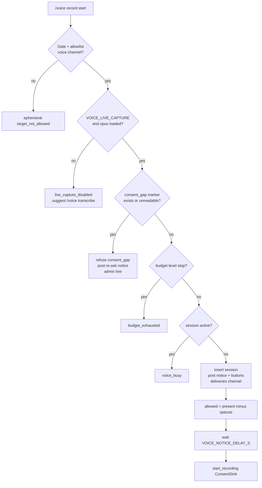
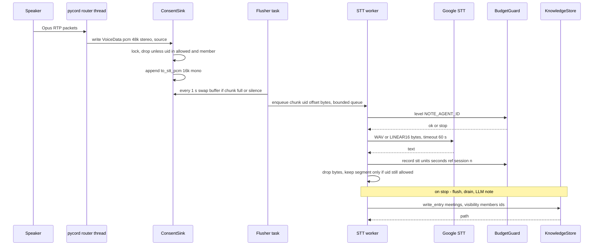
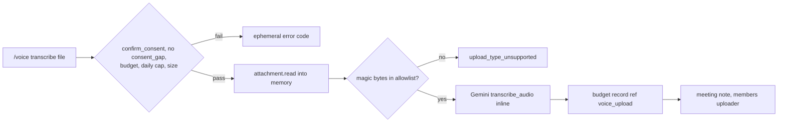

# §12 Discord rollout on LabWorkSpace

## Contents
- 12.1 Owner decisions
- 12.2 Two Discord applications (dev and prod)
- 12.3 Coexistence with the old bot: channel allowlist
- 12.4 Local development with Discord
- 12.5 Slice B order
- 12.6 Acceptance additions
- 12.7 Gate 1 conditions (overrides 12.1–12.6)
- 12.8 Discord-side setup before B1 goes live
- 12.9 Owner revision 2026-11-23: one application, versions by git tag (overrides 12.1, 12.2, 12.4, 12.7 S12-02)
- 12.10 Owner revision 2: one Discord application per persona (overrides 12.9 'one application' and main spec §5.2 webhook identity)
- 12.10.1 Gate 1 conditions for §12.10 (S1210-01..10; S1210-07 replaces the webhook fallback)
- 12.11 Thai name matching (owner-delegated decision 2026-11-23)
- 12.12 Slice B2 voice (overrides main spec §3.7, §10.6.4, §10.10, §10.12 where they conflict)
- 12.12.23 Gemini terms check (2026-11-23)
- 12.13 One local env file (owner decision 2026-11-23)
- 12.14 System log bot: a 21st application posts WARNING+ logs to ADMIN_NOTIFY_CHANNEL_ID (requires security gate)
- 12.14.10 Gate 1 conditions applied (S1214-01..06; amends S12-02)

## 12.1 Owner decisions
Recorded 2026-11-23:
- Develop and test on the owner's Mac first, then deploy to the VPS (shared-host profile, §11.20).
- The bot must work in the **LabWorkSpace** Discord server.
- The old bot (Discord AI Company, repo Lab-Work-Space/Assistant, Node) **coexists during testing**. The new bot must not answer where the old one works.
- **Two new Discord applications**: `employee-dev` (runs on the Mac) and `employee-prod` (runs on the VPS). Separate tokens; never the old bot's application.
- Slice B order: **text first** (B1), **voice later** (B2).

## 12.2 Two Discord applications (dev and prod)
- Both are invited to the same guild (`DISCORD_GUILD_ID` = LabWorkSpace) with the same scopes and permissions (spec §5.7 / setup.md): `bot`, `applications.commands`; intents Message Content, Server Members, Voice States.
- Dev token lives only on the Mac in `.env.discord.local` (gitignored by `/.env.*.local`), never in `.env.local` (the CLI dev runner refuses `DISCORD_BOT_TOKEN` there by design).
- Prod token lives only in `/etc/employee/employee.env` on the VPS (root 0600).
- Slash commands are registered **guild-scoped** for each application (instant update, no global propagation). The dev app's commands carry no prefix; Discord shows the app name next to each command, so dev and prod are distinguishable.
- A token is never reused across the two applications.

## 12.3 Coexistence with the old bot: channel allowlist
New config `CHANNEL_ALLOWLIST` (comma-separated channel ids; categories allowed: a category id admits all its child channels and their threads).
- **Empty means refuse to start** when `DISCORD_BOT_TOKEN` is set and `ROLLOUT_MODE=coexist` (default during testing); `ROLLOUT_MODE=full` allows an empty list (all channels) after the old bot is retired.
  - *Note (§12.10 S1210-04): the token name is now `DISCORD_BOT_TOKEN_<ID>`; the plain `DISCORD_BOT_TOKEN` is refused (`use_per_persona_tokens`). The empty-list rule above stands.*
- Outside the allowlist the bot **ignores the message entirely**: no read into context, no reply, no reaction, no log line containing message content (log only `gate.outside_allowlist` with channel id).
- DMs: allowed only for members holding the approver role while `ROLLOUT_MODE=coexist`; everyone after `full`.
- Threads and webhook personas (task/brainstorm threads) are created only under allowlisted channels; `TASKS_CHANNEL_ID` and `ADMIN_NOTIFY_CHANNEL_ID` must be inside the allowlist (startup refusal `channel_not_allowlisted` otherwise).
- Pull-user (TASK-017) may DM or create a thread only inside the allowlist; voice moves are B2.
- Name clash: the old bot also has a persona named พราว. During coexist, webhook personas use the display name suffix `(ใหม่)` (config `PERSONA_NAME_SUFFIX`, default empty in `full`).

## 12.4 Local development with Discord
- `scripts/dev-discord.sh` (new): same private data dir as `scripts/dev-local.sh` but a separate sub-dir (`discord/`), loads `.env.discord.local` in a subshell without printing it, refuses if the file is missing, if `CHANNEL_ALLOWLIST` is empty, or if `EMP_CLI_DEV` is set; runs `python -m core.migration` then `python -m core`.
- `core/__main__.py` (TASK-008) is the Discord entry point used by both the Mac script and `deploy/employee.service`.
- Tests never need a real token: the Discord layer is tested with fakes; a manual smoke checklist is run by the owner on the dev application.

## 12.5 Slice B order
**B1 (text):** TASK-008 Discord layer + `core/__main__.py` + streaming + embeds + allowlist (§12.3); TASK-009 reply gate (Tier 1/Tier 2, active conversation); TASK-012B task/brainstorm threads + webhook personas; TASK-013B approval buttons + AI-Admin role check (incl. G2-07); TASK-018B `/budget` + `Guard.notifier` to `ADMIN_NOTIFY_CHANNEL_ID`; TASK-017 pull-user (thread/DM only); weekly scan alert to admin channel (OQ-8); TASK-021B/022B text parts.
**B2 (voice):** TASK-002 STT spike incl. DAVE receive probe; TASK-016 voice (consent_gap honoured, G2S11-03); ffmpeg/libopus on VPS; pull-user voice move.

## 12.6 Acceptance additions
- A message in a non-allowlisted channel produces no reply and no content in logs (log line only).
- Dev and prod applications running at the same time in the same guild do not both answer the same message (allowlists must not overlap; startup warns if the other app's id is configured as a known peer and overlap is detected — optional, owner checks by config).
- Startup refuses an empty allowlist in coexist mode and a TASKS/ADMIN channel outside it.

## 12.7 Gate 1 conditions (overrides 12.1–12.6)
Source: docs/security/2026-11-23-gate1-s12.md (S12-01..S12-08). Required before the B1 build merges.
- **S12-01 Outbound gate.** `SinkFactory.for_target` (and every send path: respond to another channel, thread creation, webhook post, pull-user) refuses a channel outside `CHANNEL_ALLOWLIST` with `target_not_allowed`. In `ROLLOUT_MODE=coexist` every outbound DM goes only to members holding the approver role; others → `target_not_allowed`. The earlier sentence "Pull-user may DM or create a thread only inside the allowlist" is replaced by this rule.
- **S12-02 Channels.** `TASKS_CHANNEL_ID`, `ADMIN_NOTIFY_CHANNEL_ID` and `APPROVAL_CHANNEL_ID` must all be inside the allowlist (startup refusal `channel_not_allowlisted`). Dev and prod use **separate** values for all three and non-overlapping allowlists. **Amended by 12.14.10 (S1214-01): `ADMIN_NOTIFY_CHANNEL_ID` is no longer checked against the allowlist and Praw need not see it.**
- **S12-03 One gate first.** A single `allowed_channel(event)` check runs first in every listener (message, edit, raw events, reactions, thread events, interactions) before buffering, conversation state or Tier 1. Interactions outside the allowlist get an ephemeral refusal; a coexist DM from a non-approver gets silence. A test asserts every registered listener calls the gate first.
- **S12-04 Webhooks and names.** Reuse an owned webhook per channel, create only if none is owned by this application (no churn between dev and prod). Reply-gate name matching (Tier 1) strips `PERSONA_NAME_SUFFIX` before matching.
- **S12-05 Config.** `ROLLOUT_MODE` ∈ {coexist, full}, default `coexist`. Allowlist ids must be snowflakes that resolve in the guild at `on_ready` (else refuse `allowlist_unresolved`). `PERSONA_NAME_SUFFIX` must be non-empty in coexist. `gate.outside_allowlist` is rate-limited (one line per channel per minute with a suppressed count).
- **S12-06 dev-discord.sh.** Refuses `.env.discord.local` unless it is a regular file (not a symlink), owned by the current user, mode 0600; after sourcing, refuses if it set `EMP_CLI_DEV`, `DATABASE_PATH`, `KNOWLEDGE_DIR`, `LOG_DIR` or `VOICE_TMP_DIR`; exports the path variables after sourcing; never sources `.env.local`.
- **S12-07 App identity.** `DISCORD_EXPECTED_APP_ID` is required; `on_ready` refuses with `app_id_mismatch` if the token belongs to another application (prevents running the prod token on the Mac or the old bot's token).
- **S12-08 Carry-overs.** G2-07 is fixed in 013B/018B before merge. B1 includes G1-11, G1-13, G1-14. `pull_user` returns `voice_not_available` in B1. Voice stays off on the dev app. G2S11-03 (consent_gap) and G1-10/G1-12 are B2 entry conditions.

## 12.8 Discord-side setup before B1 goes live
Source: S12-09..S12-12. Owner tasks (OWN-B-01..04) with a step-by-step guide in docs/helper/discord-apps.md (written in B1).
- **Minimal permissions** for each app role: View Channel, Send Messages, Send Messages in Threads, Create Public Threads, Read Message History, Embed Links, Attach Files, Use Application Commands, Add Reactions. **Manage Webhooks only as a channel overwrite on allowlisted channels** (never guild-wide: it would expose the old bot's webhooks). Voice permissions (Connect, Speak, Move Members) wait for B2.
- **Server-side deny:** each app role is denied View Channel everywhere except its own test channels (category overwrite), so other guild content never reaches the Mac token.
- **Public Bot off** for both applications; the bot leaves (and logs) any guild other than `DISCORD_GUILD_ID`. Dev-token rotation runbook in the guide.
- **Smoke checklist** (B1-SMOKE) includes coexistence probes: message in a non-allowlisted channel → no reply; slash command in a non-allowlisted channel → ephemeral refusal; DM from a non-approver → silence; dev and prod never answer the same message.

## 12.9 Owner revision 2026-11-23: one application, versions by git tag (overrides 12.1, 12.2, 12.4, 12.7 S12-02)
- **One Discord application** (name `employee`), one token. No dev/prod split. The same bot runs on the Mac while developing and on the VPS when deployed.
- **Single running instance.** The token must run in one place at a time (two gateway sessions on one token answer twice). Rule: before starting on the VPS, stop the Mac run, and vice versa. On `on_ready` the bot posts `online: <host> <git describe>` to `ADMIN_NOTIFY_CHANNEL_ID` so a second instance is visible; it also refuses to start if the DB has a `instance_heartbeat` newer than 90 s from another host (only effective when both share a DB, i.e. never across Mac/VPS — so the admin-channel line is the real signal; documented in the guide).
- **Token location:** Mac `.env.discord.local` (S12-06 checks still apply); VPS `/etc/employee/employee.env`. `DISCORD_EXPECTED_APP_ID` (S12-07) is the same value on both.
- **Channels:** one set of `TASKS_CHANNEL_ID`, `ADMIN_NOTIFY_CHANNEL_ID`, `APPROVAL_CHANNEL_ID` inside one `CHANNEL_ALLOWLIST` (S12-02 "separate dev/prod values" is void; the allowlist checks stay).
- **Versions:** releases are marked by annotated git tags on GitHub, semver `vMAJOR.MINOR.PATCH` (pre-1.0 while phase 1 is in progress). The VPS deploys a tag: `install.sh` is given the tag's commit SHA (S11-05 unchanged). `v0.1.0` = Slice A as deployed on the VPS. Each B1/B2 milestone gets the next minor tag after its tests and gate pass.
- `scripts/dev-discord.sh` stays as the way to run the bot on the Mac (with the single-instance rule above).

## 12.10 Owner revision 2: one Discord application per persona (overrides 12.9 "one application" and main spec §5.2 webhook identity)
Owner decision 2026-11-23: every persona is its own Discord bot (one Application = one token), like the old bot's multi-bot setup. Versions-by-tag and single-instance rules from 12.9 still apply (per token).
- **Tokens:** `DISCORD_BOT_TOKEN_<ID>` per persona id in upper case (e.g. `DISCORD_BOT_TOKEN_PRAW`, `DISCORD_BOT_TOKEN_TEK`). `DISCORD_BOT_TOKEN` alone is no longer used (refuse if set, `use_per_persona_tokens`). Each token is a secret (masked, never logged). Two personas sharing one token → startup refusal `token_shared`.
- **App identity (S12-07 per bot):** `DISCORD_APP_ID_<ID>` required for every configured token; each client's `on_ready` refuses on mismatch (`app_id_mismatch:<id>`).
- **Intake client:** exactly one client — Praw (`praw`, configurable `INTAKE_PERSONA`) — has the Message Content and Server Members intents and receives guild messages. It runs the S12-03 allowlist gate and the reply gate. All other persona clients connect with `Intents.guilds` only (no message content, no members), `member_cache_flags` none, no guild chunking, small message cache — they only post and receive interactions on their own messages. This keeps RAM and gateway load low and avoids 20 clients each reading every message.
- **Addressing:** a real @mention of a persona bot (user id → persona id map built at `on_ready`) is Tier 0 of the reply gate (§3.1 rule 1 now resolves to that persona). Replies to a persona bot's message address that persona. Tier 1 name matching (aliases, suffix-stripped) stays for un-mentioned names.
- **Posting:** a persona's replies, task/brainstorm thread turns and embeds are sent by that persona's own client (no webhooks). Webhooks remain only as a fallback for a persona whose token is not configured (logged `persona.no_token_fallback`, posted via the intake client's webhook with `PERSONA_NAME_SUFFIX`). Manage Webhooks permission is needed only if any persona lacks a token.
  - *Superseded by §12.10.1 S1210-07: no webhook fallback; a persona without a token is disabled and its work goes to Praw.*
- **Interactions:** buttons (approvals, pull-user join) are attached by the posting client; every client registers the same shared `ButtonRouter`, so a click lands in one path regardless of which bot posted. Slash commands (`/budget`, admin commands) are registered only on the intake client.
- **Process:** all clients run in one process and one asyncio loop (`core/__main__.py`), started with a small stagger (0.5 s) to respect gateway identify limits; one client failing to log in disables only that persona (fallback above) and posts a line to the admin channel; the intake client failing is fatal.
  - *Superseded by §12.10.1 S1210-07: the "fallback above" is no webhook fallback; a failed persona is disabled (`persona_disabled:<id>`), not webhooked.*
- **Resources (shared host):** expected +10–25 MB per non-intake client; with 20 personas the service stays under the 1 GB `MemoryMax`; acceptance measures RSS after all clients are ready (record in the B1 test report).
- **Owner setup:** create one Application per persona (name = persona display name, avatar), Public Bot off, invite each to LabWorkSpace with the minimal permission set (§12.8; Message Content + Server Members intents only on the intake app). The guide docs/helper/discord-apps.md lists all persona ids and env names. Discord may cap applications per account/team (`assumed`; if hit, fall back to webhook personas for the rest).
  - *Superseded by §12.10.1 S1210-07: the webhook fallback is removed; personas beyond a Discord cap are disabled, not webhooked.*
- **Coexist:** `CHANNEL_ALLOWLIST` and server-side View Channel denies apply to every persona app's role; the intake gate is the only reader of message content.

### 12.10.1 Gate 1 conditions for §12.10 (before merge unless noted)
Source: docs/security/2026-11-23-gate1-s12.md "§12.10 delta" (S1210-01..10).
- **S1210-01** The `allowed_channel` gate runs first on every client (intake and persona clients: interactions, thread and guild events); the gate-first test and leave-other-guilds rule iterate over all clients.
- **S1210-02** The shared ButtonRouter binds each click to the message it was posted on: `interaction.message.author == client.user`, and the message id matches the stored record (`approvals.message_id`, `tasks.embed_message_id`); only the intake client posts approval cards.
- **S1210-04** Refuse `unknown_persona_token` (token env for an id that is not a persona) and `app_id_shared`; the plain `DISCORD_BOT_TOKEN` refusal runs before other config checks; `app_id_mismatch` is fatal for that client.
- **S1210-05** Every client sends with `AllowedMentions.none()` (except the allowed pull-user target, the budget role notice and the B2 late-joiner consent mention `users=[uid]` — S1212-09), `mask_secrets`, and `SinkFactory.for_target`; Tier 0 and reply-to-persona resolve by user id, never by name.
- **S1210-06** Only the intake client reads DMs (others ignore DM messages); DM interactions `fetch_member` in the guild and fail closed.
- **S1210-07 (decision)** No webhook fallback: a persona without a token, or whose client fails to log in, is **disabled** (its work is routed to Praw with an admin-channel line `persona_disabled:<id>`). Manage Webhooks is therefore never needed. This replaces the webhook-fallback bullets in §12.10.
- **S1210-09** Hard cap on clients (`DISCORD_MAX_CLIENTS`, default 25), per-client error isolation, and B1 acceptance records RSS and thread count against `MemoryMax=1G` / `TasksMax=100`.
- **S1210-10** One summary `online:` line for the whole process (not one per bot). S12-04/07/09/10/11 apply per app.
- Before live (owner/document): per-app portal check (Message Content + Server Members on intake only; Public Bot off), reduced role permissions (no Manage Webhooks, Mention Everyone, Read Message History for non-intake), per-token rotation runbook, coexist nickname suffix on each persona bot (S1210-03, S1210-08).

### 12.11 Thai name matching (owner-delegated decision 2026-11-23)
Overrides main spec 3.1 "Thai aliases match as substrings". Owner rule: a Thai persona name is a noun and counts as a call only when it stands as its own word. In Tier 1 a Thai alias occurrence is a direct hit only if what follows is end-of-text, whitespace or punctuation, or a chain of one or more WHOLE words from `THAI_NEXT` (`core/gate/reply_gate.py`: ว่า, ว่าไง, ไง, ช่วย, หน่อย, ครับ, คับ, ค่ะ, คะ, ค่า, จ้า, จ๋า, จ้ะ, นะ, น้า, ล่ะ, เอ๊ย, เอ้ย, ๆ, สิ, ซิ, อ่ะ, อะ, ไหม, มั้ย, มั๊ย, ได้ไหม, ทำ, ตอบ, ดู, บอก, คิด, ว่าง, อยู่ไหม, มา, ไป, ที), each word ending at end/space/punctuation or followed by another whole word (longest match first, backtracking). Anything else glued directly after the name is silence for that occurrence: no hit and no Tier 2 call. Text before the name is irrelevant. Examples: "พราวมาก", "พราวมากมาย", "เทคโนโลยีใหม่", "ฝนตกหนัก" -> silent, 0 LLM calls; "พราว มาก", "พราวว่าไง", "พราวช่วยดูหน่อย", "พราวมาไหม", "หวัดดีพราว", "ถามพราวหน่อย" -> praw. Whether a name followed by a space is a clear call or ambiguous (Tier 2) is unchanged (vocative before / particle after / name alone). ASCII aliases keep their boundary rule and Tier 2 behaviour. Also fixed: an @mention of a disabled persona's bot account routes to Praw (S1210-07).

### 12.12 Slice B2 voice (overrides main spec §3.7, §10.6.4, §10.10, §10.12 where they conflict)


Requires security gate (Gate 1 delta before TASK-016 merges). Also overrides the §12.5 B2 bullet ("ffmpeg/libopus on VPS; pull-user voice move") and the S12-08 sentence "Voice stays off on the dev app". There is no dev app since §12.10; the rule now is `VOICE_ENABLED=false` by default.

#### 12.12.1 Evidence that drives this section (code read 2026-11-23, py-cord 2.8.1 in `.venv`)
- `discord/voice/client.py` `start_recording` emits a RuntimeWarning: "Voice reception is currently broken due to Discord's DAVE ... protocol" (pycord issue 3139).
- `discord/voice/receive/router.py` (`PacketRouter._do_run`) calls `self.sink.write(data, data.source)`. `data` is a `VoiceData` object with `.pcm` (48 kHz stereo s16le) and `.source` (a Member, an `Object`, or None). The router also calls `sink.__sink_listeners__` and `sink.walk_children()`.
- `discord/opus.py` (`PacketDecoder`) calls `sink.is_opus()`.
- The shipped `discord/sinks/core.py` `Sink` defines none of `is_opus`, `walk_children` or `__sink_listeners__`. **Stock sinks (`WaveSink`) are therefore expected to fail on 2.8.1 even without DAVE** (`assumed`; the TASK-002 probe confirms it). A custom sink must implement this contract (§12.12.6).
- `reader.py` calls the after-callback as `after(error)` with one argument. The spike recorder's `_done(sink, channel, session)` does not match.
- `opus.py` `_decode_packet` calls `dave.decrypt(...)` on PCM that is already decoded. `reader.py` also DAVE-decrypts before decoding. Whether receive under DAVE yields intelligible audio is unknown. **Plan for failure:** the upload fallback (§12.12.9) is a full feature, not a footnote.
- `discord/player.py`: `AudioSource.read()` must return 20 ms of 48 kHz stereo s16le (3840 bytes). `PCMAudio` drops a short final frame.
- google-genai 3.6.1 does not hard-code the TTS sample rate. The rate comes from the response part's `inline_data.mime_type` (Google documents `audio/L16;codec=pcm;rate=24000`, which is `assumed` until TASK-002 sees it).

#### 12.12.2 Decisions
| ID | Decision | Reason |
| :-- | :-- | :-- |
| B2-D1 | **No ffmpeg anywhere** (host, venv, code). Receive: py-cord sink plus `libopus0` (Opus to PCM inside py-cord). STT input: pure Python (`array` slicing, stdlib `wave`). TTS: Gemini PCM expanded to 48 kHz stereo in a custom `AudioSource`. No `FFmpegPCMAudio`. | Shared 1 vCPU host. ffmpeg pulls 181 packages; `libopus0` is 1. |
| B2-D2 | **The intake client (Praw, `INTAKE_PERSONA`) is the only voice client.** Connect and Speak are granted only to Praw's role, and only as channel overwrites on allowlisted voice channels. No Move Members. | It already has Voice States, Server Members and Guilds intents (`core/discord/intents.py` `make_intents`). Slash commands live only on intake (§12.10). Member resolution in the sink needs the member cache, and persona clients have `MemberCacheFlags.none()`. One voice connection fits "max 1 session". Persona apps stay at Intents.guilds. |
| B2-D3 | **STT default `STT_PROVIDER=gemini`** (audio understanding through the existing `GoogleAdapter` and `GOOGLE_API_TOKEN`). The switch `google-stt` selects Cloud Speech-to-Text v1 REST (as in `tools/spikes/stt/transcribe.py`) with its own key `GOOGLE_STT_API_KEY`. TASK-002 may flip the default (rule in §12.12.10). | No new dependency or key. Est. ≈ $0.004–0.006/min against $0.016–0.024/min for Cloud STT (`assumed`, prices to verify). Gemini accepts phone formats (m4a/aac/mp3/ogg/flac/wav) as they are, which the fallback needs without ffmpeg. Cloud STT v1 does not accept m4a. |
| B2-D4 | **STT runs in-process (async), per chunk, while the meeting is live.** No `voice_transcribe` job kind and no raw audio on disk. Audio exists only in process memory and is dropped after each chunk's STT call. | No subprocess per job (≈30–50 MB RSS each). No files means no deletion races. The §10.6.1 dedicated-uid trigger does not fire. |
| B2-D5 | **Meeting notes are always members-only** (G1-10). The §10.10.2 public-channel exception is void. | Owner decision. |
| B2-D6 | **Pull-user voice move (017-V) is dropped.** `destination="voice"` sends the existing thread mention or DM invite, with a link to the requester's (allowlisted) voice channel. | Move Members on a shared server is a guild-wide power over the old bot's members too. Moving people without consent is intrusive. An invite link gets the same result. See OQ-15. |
| B2-D7 | **Live capture is off until TASK-002 passes.** `VOICE_LIVE_CAPTURE=false` by default. With it false, join, TTS and the upload fallback still work when `VOICE_ENABLED=true`. | DAVE risk. |

#### 12.12.3 Configuration (`core/config.py`; bounds are startup refusals `bounds:<NAME>`)
| Name | Type / default | Rule |
| :-- | :-- | :-- |
| `VOICE_ENABLED` | bool, `false` | When false: no voice commands are registered, `ctx.voice=None`, and `pull_user` voice returns `voice_not_available`. |
| `VOICE_LIVE_CAPTURE` | bool, `false` | Requires `VOICE_ENABLED`. The owner sets it only after a TASK-002 PASS that is recorded in the plan. |
| `STT_PROVIDER` | str | Validated only when `VOICE_ENABLED`: must be in `{gemini, google-stt}`, else `stt_provider_invalid`. `google-stt` requires `GOOGLE_STT_API_KEY` (secret, added to the masking exact set). |
| `STT_MODEL` | str | Price key = value without the `provider/` prefix. |
| `VOICE_CHUNK_S` | int, **30** (was 55) | 5..55 (Cloud STT sync limit is about 60 s). |
| `VOICE_SILENCE_FLUSH_MS` | int, 1500 | 500..5000. |
| `VOICE_MIN_SEGMENT_MS` | int, 500 | Shorter buffers are discarded and never sent. |
| `VOICE_MAX_PENDING_CHUNKS` | int, 6 | 1..20. |
| `VOICE_MAX_SESSION_MIN` | int, 120 | 5..240. |
| `VOICE_NOTICE_DELAY_S` | int, 10 | 5..60 (unchanged meaning). |
| `VOICE_UPLOAD_MAX_MB` | int, 10 | 1..14. Inline Gemini request ≤ 20 MB after base64 encoding. |
| `VOICE_UPLOAD_MAX_PER_USER_DAY` | int, 3 | 0 disables uploads. |
| `TTS_MAX_CHARS` | int, 1000 | Unchanged. |
| `VOICE_TMP_DIR` | unchanged | Config checks in §10.12.6 stay. **B2 writes nothing there** (memory-only). It is reserved. |

`core/budget/prices.py` `UNIT["stt"]` gains a key for each STT model the spike selects (µUSD per audio second; for example Cloud STT v1 standard ≈ 400, `assumed`). Gemini stays at 100 until verified. Every budget `record` strips the `provider/` prefix from `TTS_MODEL` and `STT_MODEL` so the price key matches (`google/gemini-3.8-flash-tts` becomes `gemini-3.8-flash-tts`). Otherwise the unknown-model maximum price is charged.

#### 12.12.4 Actors, boundaries and permissions
- **Actors.** Humans in the voice channel; the starter (a human present in that voice channel); approvers (AI-Admin); the owner (clears `consent_gap`); Praw's client; Google (Gemini STT/TTS or Cloud STT); `NOTE_AGENT_ID` (LLM note).
- **Trust boundaries:**
  - Discord audio into the process (untrusted PCM; opt-out filter at `sink.write`).
  - The process to Google (audio and text out; text comes back as untrusted data).
  - STT text into the LLM (wrapped `<untrusted>`, no tools).
  - Note text into knowledge `meetings` (members-only).
- **Praw role permissions (B2 additions, channel overwrites on allowlisted voice channels only):** View Channel, Connect, Speak, Send Messages (the voice channel's text chat). Never Move Members, Mute Members, Deafen Members or Priority Speaker.
- A voice channel is usable only if `allowed_channel` admits it (its id or its category in `CHANNEL_ALLOWLIST`). Otherwise the reply is `target_not_allowed` (ephemeral).

#### 12.12.5 Commands (intake client only, guild-scoped, every handler runs the S12-03 gate first)
| Command | Who | Effect / errors |
| :-- | :-- | :-- |
| `/voice join` | a member in an allowlisted voice channel | Praw joins (TTS only, no capture). Errors: `voice_disabled`, `not_in_voice`, `target_not_allowed`, `voice_busy` (another session in the guild), `opus_not_loaded`. |
| `/voice leave` | a member in that voice channel, or an approver | Stops capture (if any) and leaves. |
| `/voice record start` | a member present in that voice channel | §12.12.6 flow. Errors: `live_capture_disabled`, `consent_gap`, `budget_exhausted`, `voice_busy`, `target_not_allowed`. |
| `/voice record stop` | a member present, or an approver | Stop flow. |
| `/voice optout` / `/voice optin` | self | Guild-wide (`voice_optouts`). Effect is immediate in the live session. Ephemeral confirmation. |
| `/voice transcribe file:<attachment> confirm_consent:<bool> [title:<1..80>]` | a member, in an allowlisted text channel | §12.12.9. |
| `/knowledge erase note:<file> [user:<member>]` | approver | Unchanged (§10.10.4). |

The `voice_join` agent tool (`core/agent_tools/voice.py`) is **not built** in B2. `init_core` already skips a missing extension module. Agents never start a voice session.

#### 12.12.6 Live capture flow (requires `VOICE_ENABLED` and `VOICE_LIVE_CAPTURE`)
**Pre-conditions, checked in this order at `/voice record start`; the first failure wins and nothing is captured:**
1. Gate and allowlist pass.
2. `VOICE_LIVE_CAPTURE` is true.
3. `discord.opus.is_loaded()` is true, else load is attempted (§12.12.11).
4. **consent_gap:** the marker is `os.path.join(os.path.dirname(DATABASE_PATH), "consent_gap")` (as in `core/db/backup.py` `restore`). If it exists, or `os.path.exists` raises, the request **fails closed**:
   - reply `consent_gap`;
   - post the re-ask notice (below) in the voice channel's text chat;
   - post the admin line `voice.consent_gap channel=<id>`.

   Capture stays refused until the owner deletes the marker (docs/helper/setup.md "consent_gap" step). The bot never deletes it.
5. `budget.level(NOTE_AGENT_ID) != "stop"`, else `budget_exhausted`.
6. No other active session (`voice_busy`).

**Happy path:**
1. Insert `voice_sessions(recording=1, status='active')`.
2. Post the notice embed with **Opt out** and **Opt in** buttons, custom ids `emp:rec:optout:<session_id>` and `emp:rec:optin:<session_id>`, in the voice channel's text chat (`voice_channel.send`). Post it also in the command channel if that differs; that copy has no buttons and links to the first. Store `notice_message_id`.
3. Insert `voice_notice_deliveries(method='channel')` for every non-bot member present.
4. `allowed = present − voice_optouts(guild)`. Read from the DB at this moment.
5. Wait `VOICE_NOTICE_DELAY_S`. Members who opt out during the wait are removed.
6. `vc.start_recording(ConsentSink(session), after)`.
7. A **flusher** task (asyncio, every 1 s) moves each user's buffer to the STT queue when either:
   - the buffer reaches `VOICE_CHUNK_S` of audio; or
   - the user has been silent `VOICE_SILENCE_FLUSH_MS` and the buffer is ≥ `VOICE_MIN_SEGMENT_MS`.

   The swap happens under the session lock.
8. **STT worker** (one coroutine per session, one call in flight):
   - checks `budget.level(NOTE_AGENT_ID)`; at `stop` it stops capture with the reason `budget`;
   - builds the request (WAV via `wave` into `BytesIO` for Gemini, raw LINEAR16 for Cloud STT);
   - calls the adapter with timeout 60 s and one retry for a retryable `ProviderError`;
   - records the budget: `record(NOTE_AGENT_ID, "google", model, Usage(), "stt", units=ceil(seconds), ref=f"{session_id}:{n}")`. This happens once Google has returned a response, success or error;
   - drops the bytes (`del`, `bytearray.clear()`);
   - if the text is not empty **and the user is still in `allowed`**, appends `Segment(user_id, display_name, offset_s, text)` to the in-memory list.
9. **Stop.** Triggers: the command; the last human leaving the voice channel; Praw being disconnected or moved; `VOICE_MAX_SESSION_MIN`; budget `stop`; `after(error)` with an error; three consecutive dropped chunks. Steps:
   1. `stop_recording()`.
   2. Flush all buffers.
   3. Drain the queue (timeout 120 s).
   4. Set status `processing`.
   5. Run the meeting note (§12.12.8).
   6. Set status `done`, or `failed` with an honest status embed in the text chat.
   7. Praw leaves if the last human left.

**ConsentSink contract — PASTE VERBATIM shape (module `core/voice/sink.py`):**
```python
import threading
import discord
from core.voice.pcm import to_stt_pcm


class ConsentSink(discord.sinks.Sink):
    """py-cord 2.8.1 receive contract (router.py / opus.py): is_opus, walk_children, __sink_listeners__, write(VoiceData, source)."""
    __sink_listeners__ = ()

    def __init__(self, session):
        super().__init__()
        self.session = session  # holds .lock (threading.Lock), .allowed (set[int]), .guild, .buffers, .first_ts, .last_ts, .clock

    def is_opus(self) -> bool:
        return False  # py-cord decodes Opus to 48 kHz stereo PCM with libopus

    def walk_children(self, with_self: bool = False):
        return [self] if with_self else []

    def write(self, data, user):  # runs on py-cord's packet-router thread
        uid = getattr(user, "id", None)
        if uid is None or not data.pcm:
            return  # unknown speaker: dropped (10.12.4)
        s = self.session
        with s.lock:
            if uid not in s.allowed or s.guild.get_member(uid) is None:
                return  # opted-out / not-noticed / non-member audio is never copied
            buf = s.buffers.setdefault(uid, bytearray())
            if not buf:
                s.first_ts[uid] = s.clock()
            buf += to_stt_pcm(data.pcm)
            s.last_ts[uid] = s.clock()

    def cleanup(self):
        self.finished = True  # nothing on disk; the session drops buffers
```

**PCM helpers — PASTE VERBATIM (module `core/voice/pcm.py`; the TASK-002 spike imports the same functions):**
```python
import array
import sys

assert sys.byteorder == "little"  # array('h') is native-endian; Discord/Gemini PCM is s16le
FRAME_BYTES = 3840  # 20 ms of 48 kHz stereo s16le (discord.opus.Encoder.FRAME_SIZE)


def to_stt_pcm(pcm48s: bytes) -> bytes:
    """48 kHz stereo s16le -> 16 kHz mono s16le: left channel of every 3rd frame. C-speed slicing.
    shortcut: decimation without a low-pass filter; TASK-002 scores CER on exactly this output, upgrade to a 3-tap average if CER fails on aliasing."""
    a = array.array("h")
    a.frombytes(pcm48s[: len(pcm48s) - len(pcm48s) % 4])
    return a[0::6].tobytes()


class MonoPcmSource:
    """s16le mono at `rate` (48000 % rate == 0) -> 20 ms frames of 48 kHz stereo s16le, built per read() (no full-size copy).
    Subclass of discord.AudioSource in core/voice/tts.py; kept import-free here for tests."""

    def __init__(self, pcm: bytes, rate: int):
        if rate <= 0 or 48000 % rate:
            raise ValueError("tts_format_unsupported")
        self._k, self._pos, self._pcm = 48000 // rate, 0, pcm
        self._step = 2 * 960 // self._k  # input bytes per 20 ms

    def read(self) -> bytes:
        chunk = self._pcm[self._pos:self._pos + self._step]
        self._pos += self._step
        if not chunk:
            return b""
        a = array.array("h")
        a.frombytes(chunk.ljust(self._step, b"\x00"))  # pad the final partial frame
        n = 2 * self._k  # k time copies x 2 channels
        out = array.array("h", bytes(len(a) * n * 2))
        for i in range(n):
            out[i::n] = a
        return out.tobytes()

    def is_opus(self) -> bool:
        return False
```
Self-checks (unit tests): for rates 8000, 12000, 16000, 24000 and 48000, every non-final `read()` returns exactly `FRAME_BYTES`. `to_stt_pcm` of 3840 bytes returns 640 bytes. A short final input is padded, not dropped.

**Late joiner** (`on_voice_state_update` into the recorded channel; the gate runs first):
1. The joiner is not in `allowed`. If a delivery row already exists for them in this session (rejoin) and they have not opted out, re-add them at once.
2. Otherwise post, in the voice channel's text chat, `<@uid>` plus a short notice line with a jump link to the main notice and `/voice optout`. Use `AllowedMentions(users=[Object(uid)], everyone=False, roles=False)`. **This message has no buttons** (see the router rule below).
3. Insert `voice_notice_deliveries(method='channel')`.
4. **Additionally**, best effort: DM the same text only if `gate.dm_ok(uid)` is true (approver in `coexist`; everyone in `full`). DM failure is ignored.
5. After `VOICE_NOTICE_DELAY_S`, if the joiner is still present and not opted out, add them to `allowed`.

If the channel post fails, the joiner is never captured and the bot logs `voice.notice_failed user=<id>`.

**S12-01 conflict, resolved explicitly.** The S12-01 DM rule is **not widened**. Consent delivery relies on the voice channel's text chat. Discord requires View Channel to Connect, so every member present can see it (`assumed`; the TASK-021B-V probe checks it). The §10.12.1 rule "DM a member without view_channel" is therefore void. The DM is an extra, never the only notice.

**Opt-out during capture** (button, `/voice optout`):
1. Upsert `voice_optouts`.
2. Under `session.lock`: remove the user from `allowed` and drop `buffers[uid]`.
3. In the loop: remove that user's queued chunks and already-transcribed segments for this session.
4. An in-flight STT result for that user is discarded on return (the `allowed` check in step 8).
5. Ephemeral confirmation.

Opt-in deletes the row. The user is re-added only if a delivery row exists for this session.

**Button router** (`core/discord/buttons.py` `_RECORD`): add `"rec": "SELECT notice_message_id AS m FROM voice_sessions WHERE id=?1"`. S1210-02 binding is unchanged: only the main notice (and the re-ask notice) carry buttons.

**Re-ask notice (consent_gap).**
1. Insert `voice_sessions(recording=0, status='done', ended_at=now)` with the posted `notice_message_id`, so its buttons bind.
2. The text says previous opt-out choices may have been lost in a restore. It asks everyone to opt out again if they want to, and states that recording stays off until consent is confirmed by the owner.

#### 12.12.7 Resources (shared host: MemoryMax 1G, CPUQuota 60%, TasksMax 100)
- **Sessions.** At most 1 voice session per process (`voice_busy`). Max length `VOICE_MAX_SESSION_MIN`.
- **Per-speaker audio:**
  - py-cord decodes 48 kHz stereo s16le at 192,000 B/s. This is transient, per 20 ms packet.
  - The sink keeps 16 kHz mono at 32,000 B/s, so a 30 s chunk is 960 KB.
- **Memory bound** ≈ speakers × 960 KB + `VOICE_MAX_PENDING_CHUNKS` × 960 KB. With 25 speakers this is ≤ 30 MB; a typical 5-speaker meeting is ≈ 10 MB. Add the voice stack (davey, nacl, jitter buffers, ≈ 20–40 MB, `assumed`) and TTS (24 kHz mono, ≈ 48 KB/s, so ≤ 4.5 MB per 1000-char reply; expanded per frame, never as a whole). Note: tmpfs would count against MemoryMax too, which is one reason B2 keeps nothing on disk.
- **Backlog.** If the queue is full, the chunk is dropped:
  - transcript marker `(gap <mm:ss>-<mm:ss>: backlog)`;
  - log `voice.chunk_dropped`;
  - three consecutive drops stop capture with the reason `backlog`.
- **CPU target:** ≤ 20% of one vCPU on average for a 5-speaker meeting. That covers Opus decode in C, slicing in C, and one HTTPS call per chunk. `assumed`; TASK-002 measures it on the VPS from the `systemctl show -p CPUUsageNSec` delta and RSS before and after.
- **Threads.** The voice stack adds about 6 threads (packet router, event router, speaking timer, keep-alive, player). B2 acceptance re-checks TasksMax.
- **Deletion.** No raw audio file is ever created. Chunk bytes are dropped after the STT call. On a crash, audio is lost with the process (`LimitCORE=0` in `deploy/employee.service`; no swap per `install.sh`).
- **Startup recovery.** `voice_sessions` rows with status `active` or `processing` become `failed` with `ended_at=now`, and an admin line is posted.

#### 12.12.8 Transcript and meeting note (replaces §3.7 Worker/on_done and §10.12.7)
- **Sanitising, before any storage:**
  - display name: remove `[`, `]`, `:` and control characters or newlines, cap at 32 chars, fall back to `user`;
  - STT text: fold `\r\n` to spaces and replace `[` with `(` and `]` with `)`, so no line can forge or escape the `[<user_id>]:` erasure token (`core/knowledge/store.py` `erase_user`: `f"[{uid}]:" in ln`).
- **LLM input** (`prompts/_system/meeting-note.md`): lines `[mm:ss] <name>: <text>` sorted by offset, inside `<untrusted>`. Engine run as in §3.7: `NOTE_AGENT_ID`, trigger `voice_note`, no tools, NullSink.
- **Prompt change** (closes an erasure gap: `erase_user` blanks only the `## Summary` section):
  - the model outputs only `## Summary` (first line ≤ 120 chars plus bullets), with `### Decisions` and `### Action items` **nested under it**;
  - the model no longer outputs `## Participants`.
- **Body written by the system:**
```
## Summary
<model output incl. ### Decisions / ### Action items>
## Participants
- <name> [<user_id>]
## Transcript
<name> [<user_id>]: <text>
```
- **Visibility:** `"members:" + ",".join(ids)` of users in `allowed` with at least one segment. Always members-only (B2-D5).
- **Write call:** `KnowledgeStore.write_entry("meetings", ..., human_user_id=started_by, visibility=...)`. Zero segments means no note; status `done` with "no speech captured".
- Retention: 90 days via the existing sweeper (`KNOWLEDGE_MEETINGS_RETENTION_DAYS`).
- No transcript is written to the DB, so the §10.12.7 job-payload clearing is void.

#### 12.12.9 Fallback: upload a recording (works whether or not live capture is on)
`/voice transcribe file:<attachment> confirm_consent:true [title]`, in an allowlisted text channel.

**Validation (all before download):**
- `confirm_consent` must be true, else `consent_not_confirmed`. The option text reads: "Everyone recorded agreed, and no member who opted out is in it."
- `consent_gap` absent, else `consent_gap` (fail closed).
- Budget not `stop`.
- Count of today's `usage_events` with `purpose='stt' AND ref LIKE 'voice_upload:<uid>:%'` < `VOICE_UPLOAD_MAX_PER_USER_DAY`, else `upload_rate_limited`.
- `attachment.size ≤ VOICE_UPLOAD_MAX_MB`, else `upload_too_large`.

**Download and sniff:**
- `await attachment.read()` into memory. It is **never written to disk**.
- A **magic-byte sniff of the first 12 bytes only** sets the MIME type; the user's `content_type` is ignored:

  | Bytes | MIME |
  | :-- | :-- |
  | `RIFF....WAVE` | wav |
  | `ID3`, or `0xFF 0xFB/F3/F2` | mp3 |
  | `OggS` | ogg |
  | `fLaC` | flac |
  | `....ftyp` | mp4/m4a (Gemini support `assumed`; TASK-002 tests it) |
  | `0xFF 0xF1/F9` | aac |

  Anything else gets `upload_type_unsupported`.
- **The bytes are never decoded locally**, so the §10.6.1 untrusted-format trigger (dedicated worker uid) is not fired.

**Transcription:**
- Always through Gemini (`GoogleAdapter.transcribe_audio`, inline bytes, no Files API, so nothing is stored server-side by us). Prompt: verbatim transcript, Thai with English words, speaker turns labelled `S1:`, `S2:`, ...
- Budget: units = audio seconds from `usage_metadata` audio tokens ÷ 32 (`assumed`), else size-based worst case. `ref="voice_upload:<uid>:<uuid4>"`.

**Note:** same note pipeline.
- Participants: `- <uploader> [<uploader_id>] (uploader)`.
- Transcript lines: `S<n>: <text>` (sanitised; no user ids are possible).
- Visibility: `members:<uploader_id>` (approvers can read per §10.10.1).
- Erasure of a single speaker is impossible, so erasure falls back to `delete_entry` (`/knowledge erase note:<file>` without `user`). The notice text and the command reply say so.

#### 12.12.10 STT adapter and TASK-002 measurement
- **Interface** (`core/voice/stt.py`): `async transcribe(pcm16k_mono: bytes | None, *, audio: bytes | None = None, mime: str = "audio/wav", languages=("th-TH","en-US")) -> tuple[str, int]`, returning (text, billed_seconds).
- **`GeminiStt`** calls a new additive `GoogleAdapter.transcribe_audio(model, audio, mime, prompt, timeout_s)`, using `types.Part.from_bytes` and `map_error`.
- **`CloudStt`** posts to `speech:recognize` v1 (LINEAR16, 16000, `th-TH`, alternative `en-US`). Header `x-goog-api-key` is set from `GOOGLE_STT_API_KEY` and never logged. It runs in `asyncio.to_thread(urllib.request.urlopen, timeout=60)`. No new dependency.
- **Cost estimate fields** in the spike report and in `prices.py`: `stt_usd_per_min = µUSD_per_s × 60 / 1e6`.
  - Gemini: audio 32 tokens/s × audio input price + output ≈ 10 tokens/s × output price (`assumed`).
  - Cloud STT v1: list price per minute (`assumed` $0.024).
- **TASK-002 protocol** (reuses `tools/spikes/stt/`; runs on the Mac, never on the VPS):
  1. **Rewrite `recorder.py` for 2.8.1.** It uses `core.voice.sink.ConsentSink` (probe mode: everyone who ran `/stt-record start` after the notice) and a one-argument `after(error)`. It writes 16 kHz mono WAV via `core.voice.pcm.to_stt_pcm` plus `wave`. `WaveSink` is removed.
  2. **Mandatory DAVE live probe** in an allowlisted test voice channel, with at least 3 humans talking 30 s each. Log `vc.is_dave_connection()`. PASS requires all three:
     - (a) PCM frames > 0 for every speaker;
     - (b) no router or decoder exception (`after(error)` gets None);
     - (c) a human confirms the WAV is intelligible, and its CER is within 5 points of the phone-recorded reference clips.
  3. **Playback probe.** Play 5 s of Gemini TTS through `MonoPcmSource` and log the parsed `mime_type`. PASS means humans hear it clearly.
  4. **Clips:** at least 10 Thai and 3 mixed real-conversation clips, 10–60 s. Source: the production sink if the probe passed; otherwise phone recordings. Gemini gets the phone file as it is. For Cloud STT only, convert on the Mac with `afconvert -f WAVE -d LEI16@16000 -c 1`.
  5. `transcribe.py` gains `--provider gemini|google-stt`, and both run on the same clips. `score.py` is unchanged (CER, ignoring punctuation and spaces). References are corrected by humans.
  6. **Report** `docs/spikes/stt-google-thai.md`: per provider, per-clip CER, averages, latency, cost/min; DAVE probe (a)(b)(c) and playback result; VPS CPU and RSS. No audio, transcripts or secrets.
  7. **Decision rule:**
     - default = the provider with average CER ≤ 10%;
     - if both pass and are within 2 points, keep `gemini`;
     - if neither passes, NO-GO and escalate (TASK-016 blocked).
     - The DAVE result sets `VOICE_LIVE_CAPTURE`. On FAIL, live capture stays off and B2 ships join, TTS and upload only (OQ-20).
- `README.md`: remove "needs ffmpeg"; `brew install opus` only.

#### 12.12.11 Opus load and runtime DAVE guard
- **Voice init** (`core/voice/ext.py` `setup_discord`): `if not discord.opus.is_loaded(): discord.opus.load_opus(ctypes.util.find_library("opus") or "libopus.so.0")`. On failure, voice is disabled for the process: the admin line is `voice_disabled:opus_not_loaded` and commands reply `opus_not_loaded`. Text keeps running.
- **Isolation.** Any voice exception is caught in voice code. It stops the session and leaves the channel, and it never propagates into the intake client (intake failure is fatal per §12.10).
- **Runtime guard.** If `after(error)` reports an error, or no PCM frame has arrived from any allowed member within 60 s of capture start while at least one allowed member is present, the bot:
  1. stops capture with the reason `receive_failed`;
  2. sets `VOICE_LIVE_CAPTURE` off in memory until restart;
  3. posts the admin line `voice.capture_disabled reason=receive_failed`;
  4. posts the notice "live transcription unavailable; use /voice transcribe".

  Garbage audio that still decodes cannot be detected at runtime; the TASK-002 probe decides that.

#### 12.12.12 TTS (replaces §3.7 TTS)
- Call: `generate_content(model, contents=text, config=GenerateContentConfig(response_modalities=["AUDIO"], speech_config=SpeechConfig(voice_config=VoiceConfig(prebuilt_voice_config=PrebuiltVoiceConfig(voice_name=TTS_VOICE)))))` through an additive `GoogleAdapter.synthesize_speech`.
- Parse `inline_data.mime_type`. It must be `audio/L16` with `rate=<int>` and 48000 % rate == 0, else `tts_format_unsupported` (logged, nothing played).
- Play `TtsSource(MonoPcmSource)` (subclass of `discord.AudioSource`) from a per-guild sequential queue (max 5 items; extra items are dropped with `tts.queue_full`).
- Triggers: `ctx.voice.after_reply` (already called in `core/gate/reply_gate.py`) speaks when Praw is connected and the user is in the same voice channel. The text is `strip_markdown`, code blocks removed, `[:TTS_MAX_CHARS]`.
- Budget per §10.2.4, with the model price key stripped of its prefix.
- All personas are spoken through Praw's voice connection with one `TTS_VOICE` (OQ-17).

#### 12.12.13 Diagrams






#### 12.12.14 Error codes (all ephemeral replies; logs carry the code, never content)
| Code | Cause |
| :-- | :-- |
| `voice_disabled` | `VOICE_ENABLED=false` |
| `live_capture_disabled` | live capture off or disabled by the runtime guard |
| `opus_not_loaded` | libopus is missing |
| `not_in_voice` | the invoker is not in a voice channel |
| `target_not_allowed` | the channel is not allowlisted (S12-01/03) |
| `voice_busy` | a session is already active |
| `consent_gap` | the marker exists or cannot be read |
| `consent_not_confirmed` | the upload confirmation was false |
| `budget_exhausted` | `NOTE_AGENT_ID` or the persona is at `stop` (TTS: silently skipped, `tts.skipped reason=budget`) |
| `upload_too_large` | size cap exceeded |
| `upload_type_unsupported` | magic-byte sniff did not match the allowlist |
| `upload_rate_limited` | daily per-user cap reached |
| `stt_failed` | ProviderError after retry: segment gap marker; upload: reply |
| `tts_format_unsupported` | TTS MIME is not L16 or the rate does not divide 48000 |
| `receive_failed` | runtime guard tripped |
| `voice_not_available` | pull-user voice when voice is disabled or the requester is not in an allowlisted voice channel |

#### 12.12.15 Pull-user voice (017-V reduced; B2-D6)
`core/pulluser/service.py` `pull`, when `destination == "voice"`:
1. Resolve the requester's voice channel (`member.voice.channel`). It must be in `DISCORD_GUILD_ID` and pass `allowed_channel`, else `voice_not_available`.
2. Run the same flow as thread/DM, but `pull_invite_embed(..., cid=<voice_channel_id>)` gives a link to the voice channel.
3. The method is returned as `voice_invite_dm` or `voice_invite_thread`.

The S12-01/G1-11 checks, the rate limit and AllowedMentions are unchanged. No Move Members is ever used.

#### 12.12.16 Host package amendment B2-PKG (overrides §11 package lines; §10.6.4 void)
- **Install:** `apt-get install -y --no-install-recommends libopus0` (Debian 13). This is a host change and needs owner approval (§11.20.2). Run the G2S11-02 dpkg scan afterwards.
- **`deploy/install.sh`:**
  - the step-1 comment (L71 "ffmpeg libopus0 join when TASK-016 lands") becomes `libopus0`;
  - after the import check (L105, `assert hasattr(discord.voice.VoiceClient, 'is_dave_connection')`, which stays), add `runuser -u employee -- /opt/employee/venv/bin/python -c "import discord.opus as o; o.load_opus('libopus.so.0'); assert o.is_loaded()"`.
- **§11 file anchors** where `ffmpeg libopus0` becomes `libopus0` (line numbers are hints):
  - "When TASK-016 lands, also `ffmpeg libopus0`" (≈L1179);
  - "§10.17 ... ffmpeg carve-out stays open" (≈L1269): **closed by §12.12 (no ffmpeg)**;
  - "§11.18.4 patch coverage (venv, ffmpeg, kernel)" (≈L1682) and `apt-cache policy ffmpeg libopus0` (≈L1713, ≈L2096);
  - "Step 1: host packages ... ffmpeg libopus0" (≈L2051);
  - the `ffmpeg libopus0` table row (≈L2067);
  - "`ffmpeg` available, not installed" (≈L2432, fact only);
  - "(`ffmpeg libopus0` only when TASK-016 lands)" (≈L2440).
- **Main spec:**
  - §10.6.4 (fixed ffmpeg argv) is void;
  - §10.17 "Slice B open: ffmpeg carve-out" (≈L2379) is closed;
  - the §3.0 deps row "Image needs ffmpeg and libopus" becomes libopus only;
  - "TASK-016 may append exactly one STT client dependency line" becomes "none needed".

#### 12.12.17 Files and ownership
| Task | Owner | Files |
| :-- | :-- | :-- |
| TASK-002 | backend | **Creates** `core/voice/__init__.py`, `core/voice/pcm.py`, `core/voice/sink.py` (verbatim above). Rewrites `tools/spikes/stt/recorder.py`. Edits `transcribe.py` (`--provider`) and `README.md`. Writes `docs/spikes/stt-google-thai.md` (adds provider and DAVE/playback columns). Tests `tests/voice/test_pcm.py`, `tests/voice/test_sink.py`. |
| TASK-B2-PKG | devops | `deploy/install.sh` (§12.12.16), `docs/helper/setup.md` package list. The §11 text amendments go to `document`. |
| TASK-016 | backend | `core/voice/ext.py` (init, setup_discord, commands, listeners, opus load), `core/voice/session.py` (state, lock, flusher, queue, stop, recovery), `core/voice/stt.py`, `core/voice/tts.py`, `core/voice/notice.py` (embeds, consent_gap, re-ask, late joiner), `core/voice/upload.py`; additive `GoogleAdapter.transcribe_audio` and `synthesize_speech` in `core/provider/google/adapter.py`; `core/discord/buttons.py` (`_RECORD["rec"]`); `core/discord/strings.py` (notice text, provider-dependent: "Google Gemini" or "Google Cloud Speech-to-Text"; audio held in memory only and discarded after each ~30 s chunk; members-only note; 90-day retention; opt-out and erasure; upload erasure limitation); `core/discord/embeds.py`; `core/config.py` (§12.12.3); `core/budget/prices.py`; `prompts/_system/meeting-note.md`; `.env.example`; `docs/helper/discord-apps.md` (Praw voice overwrites). |
| TASK-017-V | backend | `core/pulluser/service.py`, `tests/test_pulluser.py`. |

All tests use fakes: a fake `VoiceData`/member/guild, a fake voice client with `start_recording`/`stop_recording`/`after`, fake STT and TTS adapters, and a fake clock.

| Test file | Covers |
| :-- | :-- |
| `tests/voice/test_session.py` | flush on size and on silence; backlog drop and the stop after 3 drops; max length; last human leaves; budget stop mid-meeting; startup recovery |
| `tests/voice/test_consent.py` | opted-out user never buffered; opt-out mid-session removes buffer, queue items, segments and in-flight result; late joiner captured only after notice and delay; failed channel post means never captured; consent_gap present or unreadable refuses and posts re-ask; re-ask buttons bind; S12-01 DM only via `dm_ok` |
| `tests/voice/test_note.py` | sanitising (`[1]:` in a display name or in STT text cannot erase another user); body layout; `erase_user` removes Decisions and Action items (nested) and the user's lines; members-only visibility; zero segments means no note |
| `tests/voice/test_upload.py` | each validation code; sniff table; never written to disk (`VOICE_TMP_DIR` stays empty); rate cap via `usage_events` |
| `tests/voice/test_tts.py` | MIME parse; frame sizes; queue cap; budget skip |
| `tests/test_gate_first.py` | extend: the voice-state listener calls the gate first |

**Existing assertions and fixtures affected (sa rule 4):**
- `tests/test_pulluser.py:74-76` `test_voice_not_available`: still valid (the fixture requester is not in voice; the code is kept). Add a voice-invite test.
- `STT_PROVIDER="google"` in `core/cli/fakes.py:14`, `tests/conftest.py:39` and `tests/acceptance_b1/harness.py:219`: unchanged, because validation runs only when `VOICE_ENABLED=true`. If 016 validates always, change all three to `"gemini"`.
- `core/config.py:42` `VOICE_CHUNK_S` 55 becomes 30. No test asserts 55 (grep clean).
- `core/discord/buttons.py:33` comment "'rec' ... inactive" becomes an active entry.
- No test asserts ffmpeg (grep clean).

**Plan rows to amend** (`docs/plans/2026-11-23-phase1-plan.md`):
- TASK-002: both providers, production pcm path, playback probe.
- TASK-016:
  - AC(5) "discloses Google STT" becomes provider-dependent;
  - AC(6) "ffmpeg runs per §10.6.4" becomes "no ffmpeg; no raw audio on disk (§12.12.7)";
  - dependency "B2-PKG" stays;
  - "Uses JobRunner for transcription (A8)" becomes in-process (B2-D4).
- TASK-017 AC(1) and (6), and AC-8 voice part: "moved" becomes "voice-channel invite".
- B2-PKG-SPEC and B2-PKG: libopus0 only; AC(1) `ffmpeg -version` becomes the opus load check.
- TASK-022B-V: "ffmpeg isolation (§10.6.4)" becomes "upload passthrough, no local decode; in-memory audio".
- Carry-over line ≈L162 "dpkg/ffmpeg scan" becomes "dpkg scan".

#### 12.12.18 Acceptance items (B2)
1. TASK-002 report has the DAVE probe (a)(b)(c), the playback result, per-provider CER and cost/min, and VPS CPU and RSS. `VOICE_LIVE_CAPTURE` is set according to the result.
2. The notice is posted before any capture. An opted-out user is absent from buffers, segments and the note (fake test, plus a live check if live capture is enabled).
3. While `consent_gap` exists: live record and upload are refused, and the re-ask is posted (test, G2S11-03).
4. No file is created under `VOICE_TMP_DIR` or elsewhere during live capture or upload (test plus a VPS `find` after a session).
5. The note in `knowledge/meetings/` has visibility `members:<ids>` and the index line is `(restricted)`. `erase_user` leaves no line containing the user's id, and the Summary (including Decisions and Action items) is replaced.
6. TTS is audible in the voice channel without ffmpeg (`dpkg -l ffmpeg` shows not installed on the VPS).
7. STT and TTS are refused or skipped when the budget gate is closed. `usage_events` rows exist for `stt` and `tts` with price keys without the prefix.
8. Only `libopus0` was added to the host; the dpkg scan has no High finding; other services are unaffected (§11.20.4).
9. RSS and thread count during a 5-speaker session stay within MemoryMax 1G and TasksMax 100, and CPU is recorded.
10. Pull-user `destination=voice` sends an invite with a voice-channel link and never moves anyone.
11. AC-10: grep of logs and chat finds no secret, no transcript text and no audio bytes.

#### 12.12.19 Security notes for Gate 1 delta
- **Consent:** opt-out filter at the earliest point (`ConsentSink.write`, before copying). consent_gap fails closed (marker existence and read errors). The S12-01 DM rule is unchanged. New AllowedMentions exception: **late-joiner consent mention** (`users=[that uid]` only); add it to the S1210-05 list.
- **Data minimisation:**
  - audio is never on disk; memory only; `LimitCORE=0`; no swap;
  - chunk bytes are dropped after the STT call;
  - no transcript in the DB or in logs;
  - log fields: `session_id`, `user_id`, `seconds`, `provider`, error type, code.
- **Untrusted input:**
  - STT text is sanitised (newlines, brackets) and wrapped `<untrusted>` for the LLM (no tools);
  - display names are sanitised;
  - uploads: size cap before download, magic-byte sniff (12 bytes), the user's content_type is ignored, no local decode, inline to Gemini.
- **Erasure:** `[<user_id>]:` lines and Participants are system-written. Decisions and Action items are nested under Summary so `erase_user` covers them. Upload notes can only be erased whole (stated in the notice and reply).
- **AuthZ:**
  - record start/stop requires presence in that voice channel (approver may stop);
  - erase is approver-only;
  - uploads are capped per user per day and by budget;
  - buttons are bound to `voice_sessions.notice_message_id` (S1210-02).
- **Permissions:** Praw only; Connect and Speak as channel overwrites on allowlisted voice channels; no Move, Mute or Deafen. Persona apps get no voice permissions.
- **Secrets:** `GOOGLE_STT_API_KEY` (if used) is added to masking and the env-file checks, and is never logged (header only).
- **Isolation:** a voice exception never kills the intake client; the runtime DAVE guard disables capture.
- **Resource limits:** 1 session, max length, bounded queue, TTS queue 5, `TTS_MAX_CHARS`, upload ≤ `VOICE_UPLOAD_MAX_MB`.
- **Residual:**
  - uploaded recordings rely on the uploader's consent assertion;
  - Gemini/Google receive meeting audio (paid-tier data terms, OQ-19);
  - receive-path garbage under DAVE cannot be detected at runtime (the probe decides).

#### 12.12.20 Owner questions
- **OQ-15** Drop the pull-user voice *move* and send a voice-channel invite instead (no Move Members)? Recommendation: drop.
- **OQ-16** Upload fallback: any member (capped 3/day) or approvers only? Is the uploader's consent confirmation acceptable? Note visible to the uploader and approvers only? Recommendation: any member, as specified.
- **OQ-17** TTS for every persona spoken from Praw's voice connection with one `TTS_VOICE` (persona voices out of scope for phase 1)? Recommendation: yes.
- **OQ-18** In `coexist`, is the in-channel `<@user>` mention (no DM for non-approvers) a sufficient late-joiner notice? Alternative: do not capture non-approver late joiners until `full`. Recommendation: the mention suffices (Connect implies View Channel).
- **OQ-19** STT default Gemini (meeting audio goes to the Gemini API under its data terms) or Cloud STT (needs a separate key, ≈4× cost)? Recommendation: Gemini, unless TASK-002 shows a CER gap of more than 2 points.
- **OQ-20** If the DAVE probe fails: ship B2 with join, TTS and upload only, and defer live capture until py-cord fixes receive (issue 3139)? Recommendation: yes.
- **OQ-21** Keep the max meeting length at 120 min and the chunk at 30 s? Recommendation: yes.

#### 12.12.21 Owner decisions 2026-11-23 (override 12.12.1–12.12.20)
- **OQ-15:** pull-user voice = **invite link**, never move (B2-D6 confirmed; no Move Members).
- **OQ-19:** STT default **Gemini** (B2-D3 confirmed); Cloud STT stays a config switch.
- **OQ-20:** if the DAVE probe fails, **ship what works** (join + TTS) and keep live capture off until py-cord fixes receive.
- **OQ-16 → upload fallback DROPPED.** Owner: meeting notes are only a convenience, so no `/voice transcribe` upload path. §12.12.9, the `VOICE_UPLOAD_*` config, `core/voice/upload.py`, `tests/voice/test_upload.py`, upload error codes and the upload rows in §12.12.13/§12.12.19 are void. Consequence: if DAVE receive fails, B2 ships join + TTS only (no notes).
- **OQ-17, OQ-18, OQ-21 (main-thread calls on owner-delegated defaults):** all personas speak through Praw with one `TTS_VOICE`; the in-channel `<@user>` mention is the late-joiner notice in coexist; max meeting 120 min, chunk 30 s.

#### 12.12.22 Gate 1 conditions for §12.12 (before TASK-016 merges; source docs/security/2026-11-23-gate1-s1212.md)
- **S1212-01** consent_gap check uses a shared `os.lstat` helper: only `FileNotFoundError` means absent; any other OSError → present (fail closed). Same helper for record start and the re-ask path.
- **S1212-02** Re-check `uid in session.allowed` immediately before each STT request; a chunk queued before an opt-out is dropped, never sent.
- **S1212-03** `after_reply` receives `channel_id`; TTS speaks only replies posted in the voice channel's own text chat (never DMs or other channels); `mask_secrets` runs before TTS.
- **S1212-04** Erasure hardening: display names strip leading `#` and all line separators recognised by `str.splitlines()`; model output lines starting with `## ` are demoted to `### ` before writing; STT text folds every `splitlines()` separator. `erase_user` behaviour stays correct for nested Decisions/Action items (test).
- **S1212-05** The late-joiner mention message carries the full disclosure text (not only a jump link); if the main notice post fails, capture never starts.
- **S1212-06** void (upload dropped, §12.12.21).
- **S1212-07** `ConsentSink` enforces a per-user byte cap (= `VOICE_CHUNK_S` × 32000 × 2) and a session total cap; overflow forces a flush or drops with a gap marker. Amends the verbatim block.
- **S1212-08** Opt-out/opt-in buttons act only on the clicking user (self-only).
- **S1212-09** The late-joiner `users=[uid]` mention is added to the S1210-05 AllowedMentions exception list.
- **S1212-10** Re-ask notice rate-limited (once per channel per 10 min); TTS sample-rate allowlist {8000, 12000, 16000, 24000, 48000} and a max PCM size per reply.
- **S1212-11** `GOOGLE_STT_API_KEY` (if used) is in the masking exact set and the short-secret refusal; STT text passes `wrap_untrusted` before the LLM.
- **Before live (owner/devops):** S1212-12 libopus/davey patch + restart policy; S1212-13 notice wording names Google and the transfer abroad; S1212-14 owner confirms Gemini paid-tier data terms; TASK-002 probe clips opt-in only, kept in a 0700 gitignored dir outside iCloud, deleted after the report.

#### 12.12.23 Gemini terms check (2026-11-23)
Sources: https://ai.google.dev/gemini-api/terms, https://ai.google.dev/gemini-api/docs/logs-policy, https://ai.google.dev/gemini-api/docs/zdr.
- Paid Services (Cloud project with active billing): Google does not use prompts/responses to improve products; processing is under a Data Processing Addendum; prompts and responses are logged for a limited period solely to detect/prevent Prohibited Use Policy violations.
- Unpaid Services (free tier): Google uses content to improve products and human reviewers may read it. Unacceptable for meeting audio.
- The Gemini Developer API has no regional data-residency pinning (processing outside Thailand, location chosen by Google).
- Zero data retention exists only for approved projects; not assumed.
- Notice wording (`voice_notice_text`) separates our copy (memory only, deleted after each chunk) from Google's limited retention and states no training on paid terms.
- Interlock: `GEMINI_PAID_TIER_CONFIRMED` (default false). With `STT_PROVIDER=gemini`, `/voice record start` returns `paid_tier_not_confirmed` and the STT worker sends nothing and stops the session, until the owner sets it true after confirming billing. TTS is unaffected (no personal audio sent).

### 12.13 One local env file (owner decision 2026-11-23)
- On the Mac `.env.local` is the single env file for both `scripts/dev-local.sh` (CLI) and `scripts/dev-discord.sh`; `.env.discord.local` is retired. `EMP_DISCORD_ENV_FILE` still overrides the Discord file.
- `dev-discord.sh` keeps the S12-06 checks (regular file, not a symlink, owner, mode 0600) and refuses a non-empty `EMP_CLI_DEV`, `DATABASE_PATH`, `KNOWLEDGE_DIR`, `LOG_DIR`, `VOICE_TMP_DIR` or plain `DISCORD_BOT_TOKEN`; empty template lines are accepted.
- S12-06's refusal to source `.env.local` is superseded by this decision. G1-06 is preserved because `dev-local.sh` unsets every `DISCORD_BOT_TOKEN*` and `DISCORD_APP_ID_*` variable after sourcing and before launching the CLI, so the CLI dev gate never sees a Discord token; the Discord run still never carries `EMP_CLI_DEV`.

### 12.14 System log bot (owner decision 2026-11-24; requires security gate)
Overrides §12.9/§12.10 "the bot posts `online:`" (now posted by System), §12.10 "admin-channel line" and S1210-07's "admin-channel line `persona_disabled:<id>`" (posted by System), §12.5 "Guard.notifier to ADMIN_NOTIFY_CHANNEL_ID" (posted by System), and the weekly scan alert token (now System's).

#### 12.14.1 Decisions
- **D1** A 21st Discord application named `System` posts every line in `ADMIN_NOTIFY_CHANNEL_ID` (#bot-log): startup and admin lines, budget notices, the weekly scan alert, and forwarded logs. No persona, no LLM, no slash commands, no listeners except `on_ready`.
- **D2** Only records with level `WARNING`, `ERROR` or `CRITICAL` written through `Log.write_log` are forwarded. Library logger records (event `lib.log`) are never forwarded.
- **D3** Praw is in every room except #bot-log. Discord side: Praw has no View on #bot-log. Code side: the inbound gate drops every event from #bot-log and its threads (12.14.5). Allowlist gate change only; reply gate (`core/gate/`) unchanged.
- **D4** If System is not configured, fails login or fails its checks, the line goes to the log file only. Never falls back to Praw or any persona.

#### 12.14.2 Configuration (`core/config.py`)
- Env: `DISCORD_BOT_TOKEN_SYSTEM`, `DISCORD_APP_ID_SYSTEM`. Empty values ignored, as today.
- `_check_discord` collects `SYSTEM` through the existing `_TOKEN_KEY`/`_APPID_KEY` loop, so existing checks cover it: `secret_too_short:DISCORD_BOT_TOKEN_SYSTEM`, `missing:DISCORD_APP_ID_SYSTEM`, `token_shared`/`app_id_shared` (System vs personas), `too_many_clients` (System counts toward `DISCORD_MAX_CLIENTS`; 21 ≤ 25).
- At the end: `vals["system_token"] = tokens.pop("SYSTEM", None)`; `vals["system_app_id"] = apps.get("SYSTEM") if vals["system_token"] else None`. Set both to `None` before the `if not tokens: return` early exit.
- `_secret_values` adds `vals["system_token"]` (exact-value masking). `Config.__repr__` excludes `system_token`.
- `core/__main__.py`: refuse `persona_id_reserved:system` if any loaded persona has `env_suffix(id) == "SYSTEM"`.
- `scripts/dev-local.sh:29` already unsets `^DISCORD_BOT_TOKEN|DISCORD_APP_ID_` (covers SYSTEM).
- No new tuning env names; forwarder limits are constants (12.14.4).

#### 12.14.3 Client and startup (`core/discord/client.py`, `core/__main__.py`)
- `system = bot_factory(config, False) if config.system_token else None` (non-intake `make_bot`: `Intents(guilds=True)`, `MemberCacheFlags.none()`, no chunking, `AllowedMentions.none()`, no commands).
- `setup_discord(ctx, bots, system=None)`. `DiscordApp.system` is kept out of `bots`: never in `persona_by_user_id`, `disabled`, `clients=` count or the per-pid listener loop.
- Only `on_ready` registered on System (ungated, in `UNGATED`).
- `run(tokens, system_token=None)`: intake at 0 s, System at 0.5 s, then personas.
- Settle set is `set(bots) | {"@system"}` when configured; `_summary` waits for System up to `SETTLE_TIMEOUT_S`.
- `_system_ready` (idempotent; forwarder task starts once):
  1. `bot.application_id == cfg.system_app_id`, else `app_id_mismatch:system` (S12-07).
  2. Leave every guild other than `DISCORD_GUILD_ID`, log `guild.left` WARNING `persona="system"`.
  3. `g = get_guild(...)`, else `guild_not_found`.
  4. `ch = g.get_channel(admin_notify_channel_id)`, else `channel_not_found`.
  5. `p = ch.permissions_for(g.me)` (g.me always cached even with MemberCacheFlags.none()); require `p.view_channel and p.send_messages`, else `system_no_access`.
  6. Set `app.system_channel = ch`, start forwarder task, `settle("@system")`.
- `_system_failed(code)` (refusal or `login_failed`): log `system.disabled` WARNING `reason=<code prefix>`; `system_channel = None`; `log.tap = None`; clear forwarder queue; settle; close System client. Never fatal, no fallback.
- `shutdown()` also cancels the forwarder task, sets `log.tap = None`, closes System. No final flush.
- `_intake_ready`: S12-02 unchanged. New: if `admin_ch.permissions_for(g.me).view_channel` is true, log `intake.sees_admin_channel` WARNING.

#### 12.14.4 Log forwarder (`core/discord/syslog.py` new; `core/functions/logs/logsystem.py`)
- `Log.__init__`: `self.tap = None`.
- `write_log`: after the locked write, `if self.tap and str(level).upper() in ("WARNING","ERROR","CRITICAL"): self.tap(str(level).upper(), line)` in its own try/except. `write_log` never raises.
- Tap receives the line after `_render` (mask_obj and exact_values check already ran).
- Only `core/__main__` installs the tap (via `setup_discord`, when System configured). CLI, jobs, scan CLI never forward.
- Constants: `QUEUE_MAX=200`, `FLUSH_S=5.0`, `MSG_MAX=1900`, `LINE_MAX=300`, `VALUE_MAX=64`, `DEDUP_S=60.0`, `FAIL_STOP=3`, `SKIP_EVENTS={"lib.log"}`, `SKIP_SYSTEMS={"logforward"}`, `DROP_KEYS={"message","msg","frames","text","content","body","prompt"}`.
- `offer(level, line)` thread-safe (`threading.Lock`): `json.loads(line)`; skip SKIP_EVENTS/SKIP_SYSTEMS; dedup key `(level, system, event)` — within `DEDUP_S` of last queued same key only `suppressed[key] += 1`; first record after the window carries ` (+N)`; if deque full, `dropped += 1`. `offer` never logs.
- Line format: `HH:MM:SSZ LEVEL system event k=v k=v (+N)`. Time = `ts[11:19]` UTC. Scalar fields only (str/int/float/bool/None); drop DROP_KEYS and non-scalars; strings fold `\n`/`\r` to space, cut to VALUE_MAX; every backtick becomes `'`; whole line cut to LINE_MAX with "…". A `log.masking_failure` line forwards as `LEVEL <system> log.masking_failure`.
- Sender task (one, on the loop): every FLUSH_S take lines in order while total fits MSG_MAX; if `dropped > 0` first line is `dropped=N` (reset on send). Content "```text\n" + lines + "\n```", passed through `mask_secrets` again, `ch.send(content=..., allowed_mentions=AllowedMentions.none())`. ≤12 messages/min.
- Send failure: discard batch (file log keeps it), log `logforward.send_failed` WARNING `status`, `error=type` (system `logforward`, never forwarded). After FAIL_STOP consecutive Forbidden/NotFound: `logforward.stopped` WARNING, `tap = None`. Success resets counter. 429 retried inside py-cord (its warnings are `lib.log`, skipped).
- Records offered before System is ready are buffered (bounded by QUEUE_MAX) and sent once ready.

#### 12.14.5 Inbound gate exclusion (`core/discord/allowlist.py`)
`Gate.allowed_channel` guild branch: `ok = gid == guild and ch is not None and self.channel_ok(ch) and self.cfg.admin_notify_channel_id not in (ch.id, getattr(ch, "parent_id", None))`. Slash command/button in #bot-log gets ephemeral `NOT_ALLOWED`; messages there ignored and logged `gate.outside_allowlist` INFO. `channel_ok` unchanged (S12-02 still passes).

#### 12.14.6 Migrated posters
- `DiscordApp._admin_line(text)` sends via `self.system_channel` with `AllowedMentions.none()` and `mask_secrets`; if channel is None or HTTPException, log `admin.line` INFO `text=<text>` to file only. Callers unchanged (`_summary`, `core/voice/session.py admin()`). `online:`/`persona_disabled:` formats unchanged.
- `notifier.make_notifier`: `ch = app.system_channel`; if None, role id missing or level unknown → `RuntimeError("notify_unavailable")`. Text and `AllowedMentions(roles=[rid])` approver ping unchanged (only ping System sends). Never grant Mention Everyone.
- `notifier.post_scan_alert`: `token = config.system_token`; if missing `RuntimeError("missing_system_token")`. Never use intake token.
- `sinks.py` unchanged (`for_target` already refuses #bot-log).

#### 12.14.7 Error codes and log events
- System non-fatal refusals: `app_id_mismatch:system`, `guild_not_found`, `channel_not_found`, `system_no_access`, `login_failed` → each `system.disabled` WARNING.
- Fatal startup refusal (exit 2): `persona_id_reserved:system`, plus existing config codes with suffix SYSTEM.
- Events: `intake.sees_admin_channel` WARNING; `admin.line` INFO; `logforward.send_failed` WARNING; `logforward.stopped` WARNING; `notify_unavailable` (raised); `missing_system_token` (scan CLI exit 1).

#### 12.14.8 Acceptance
- A1: WARNING write_log reaches #bot-log via System fake within one flush; INFO does not; `lib.log` and `logforward` never do.
- A2: configured secret never in posted text; `message`/`frames` absent; every post `AllowedMentions.none()`, ≤1900 chars, in a code block with no backtick inside.
- A3: 250 offers before ready → ≤200 queued + `dropped=50`; 10 identical keys inside 60 s → 1 line, next after window carries `(+9)`.
- A4: System missing/login failure/app id mismatch/no access → no Praw message in #bot-log, `system.disabled` logged, bot keeps running, `admin.line` in file.
- A5: event in #bot-log or its threads refused by gate; slash command there gets ephemeral refusal.
- A6: config refuses SYSTEM without app id, SYSTEM sharing token/app id with a persona, 25 personas + System over default cap; `repr(config)` has no token.
- A7: budget notice and scan alert use System channel/token; scan alert raises `missing_system_token` when absent.
- A8: gate-first test (S12-03/S1210-01) iterates System too (only `on_ready`).

#### 12.14.9 Owner decisions on open questions (2026-11-24)
- **OQ-1** System optional until the app is created, then required.
- **OQ-2** Praw seeing #bot-log logs WARNING (`intake.sees_admin_channel`); no refusal.
- **OQ-3** #bot-log View is restricted to the approver role (AI-Admin, which holds every human member). Owner chose "anyone can approve".
- **OQ-4** No pings on ERROR/CRITICAL.
- **OQ-5** `/budget` refused in #bot-log is acceptable.
- Reply gate unchanged: bots reply only when addressed (D3 changes the allowlist gate only).
- Persona home rooms live in the 🤖 BOT category. Discord-side only, no code change.

#### 12.14.10 Gate 1 conditions applied (TASK-030, `docs/security/2026-11-24-gate1-s1214.md`; these override 12.14.1-12.14.8)
- **S1214-01** `Gate.excluded(ch)` (id or parent id equals `ADMIN_NOTIFY_CHANNEL_ID`) is checked inside `Gate.channel_ok`, so `allowed_channel`, sinks, `create_thread`, approvals, voice and pulluser all refuse #bot-log and its threads, in coexist and in full mode with an empty allowlist. `threads._channel` (history, edits) refuses it too. **S12-02 amended:** `_intake_ready` no longer looks up the admin channel at all (Discord does not cache a channel the bot cannot View, so `channel_not_found` would turn "Praw has no View" into a fatal refusal; System's own check covers it). If Praw can still see it, `intake.sees_admin_channel` WARNING.
- **S1214-02** The forwarder uses the allowlist `FORWARD_KEYS` (in `core/discord/syslog.py`), not `DROP_KEYS`; unknown keys are dropped silently. Extend it only through spec edits.
- **S1214-03** `Log.write_log` calls the tap after leaving `Log._lock`; `offer` parses and filters before taking the forwarder lock; the lock guards only deque/dict work, never a log call or an await.
- **S1214-04** `_check_discord` refuses `admin_channel_shared` when the admin channel equals `APPROVAL_CHANNEL_ID` or `TASKS_CHANNEL_ID`; System refuses `channel_not_found` unless #bot-log is a text channel.
- **S1214-05** Final content is cut to 2000 chars after the last `mask_secrets`; the whole message (fence included) stays within 1900 before masking; dedup maps clear above 1000 keys; System refuses `system_over_privileged` if it has Administrator or Mention Everyone.
- **S1214-06** Discord-side steps are in `docs/helper/discord-apps.md` (System section).
