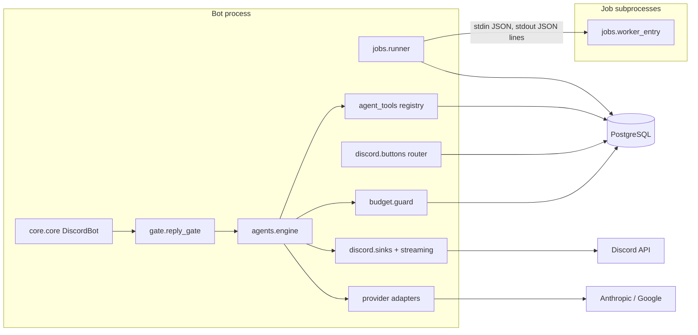
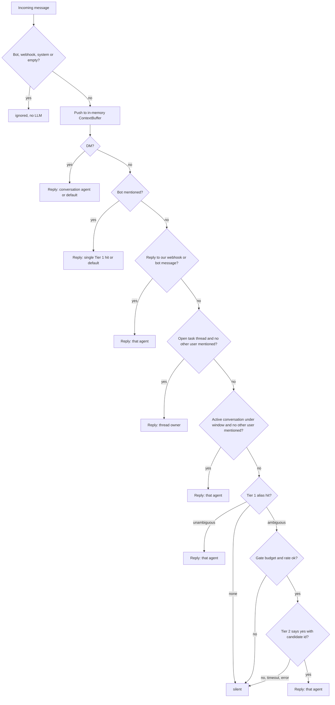
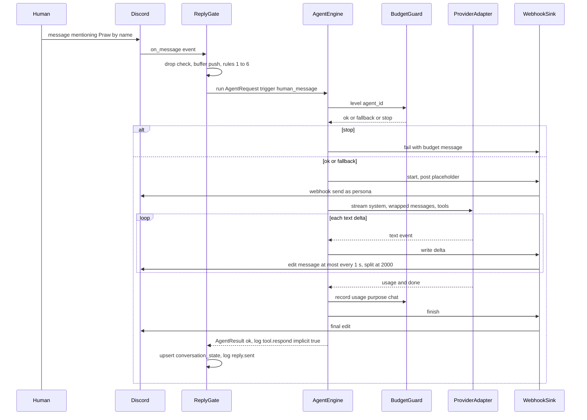
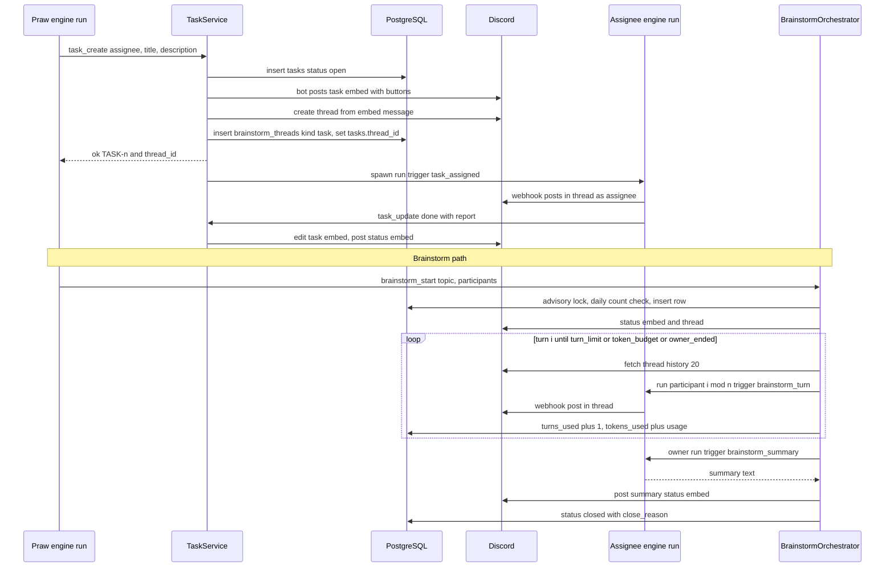
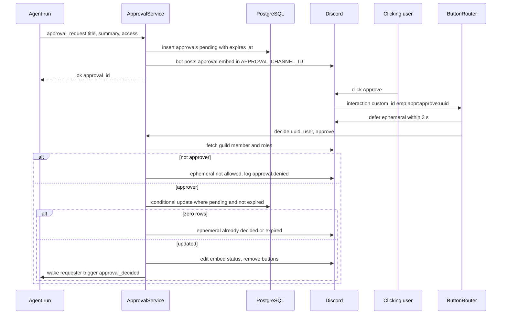
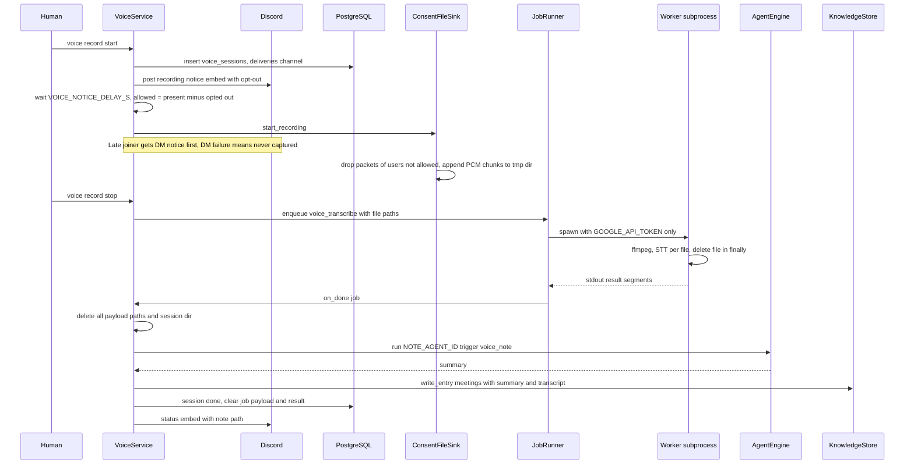
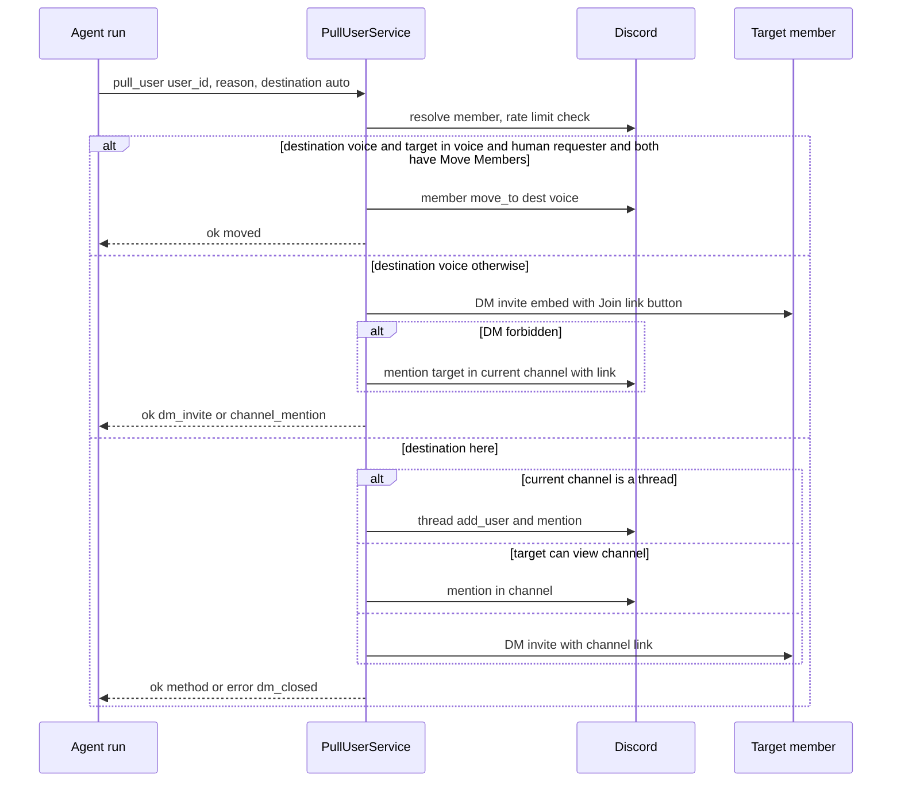
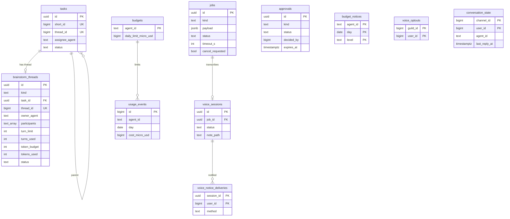
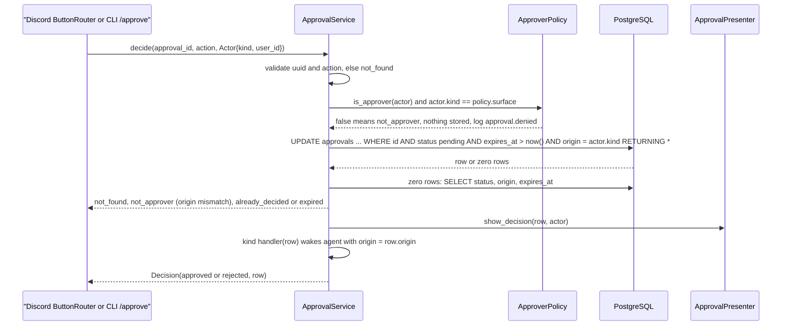

# Phase 1 Spec — Specification Handoff Brief

```text
======================================================================
SPECIFICATION HANDOFF BRIEF (for document + security)
======================================================================
PLAN REF: docs/plans/2026-11-23-phase1-plan.md (TASK-001)
TARGET TEMPLATE: freeform
OUTPUT DESTINATION: docs/specs/2026-11-23-phase1-spec.md (main thread saves). Security brief = §6 of this file (split by main thread). Document brief = whole file.
REQUIRES SECURITY GATE: yes (Gate 1, TASK-004)
```

## Contents

> Line numbers refreshed 2026-11-23; regenerate after edits.
> §11 SQLite + native VPS pivot — separate file docs/specs/2026-11-23-phase1-spec-s11-sqlite-vps.md (overrides conflicts).

- 1. MODULE IDENTIFIER — L75
- 2. ACTORS & BOUNDARIES — L78
- 3. DETAILED LOGIC & FLOWS — L89
  - 3.0 Module layout and file ownership (disjoint per task) — L91
  - 3.1 Reply gate (TASK-009) — L151
  - 3.2 Agent engine loop (TASK-010) — L194
  - 3.3 Streaming and split rules (TASK-008) — L219
  - 3.4 Tool registry and built-in tools (phase 1) — L241
  - 3.5 Approvals (TASK-013) — L275
  - 3.6 Delegation, task threads and brainstorm (TASK-012) — L288
  - 3.7 Voice (TASK-016) — L324
  - 3.8 Pull-user (TASK-017) — L375
  - 3.9 Knowledge store (TASK-014) — L398
  - 3.10 Job runner (TASK-011) — L413
  - 3.11 Budget (TASK-018) — L452
- 4. MERMAID DIAGRAMS — L476
- 5. DATA, API & ERROR CONTRACTS — L781
  - 5.1 `core/interfaces.py` — PASTE VERBATIM (TASK-007) — L783
  - 5.2 Persona frontmatter schema (TASK-007 loader, TASK-020 content) — L1047
  - 5.3 DDL — migration `core/migration/versions/0001_phase1.py`, `upgrade()` runs this via `op.execute` — PASTE VERBATIM (TASK-006) — L1071
  - 5.4 Logging contract (TASK-007) — L1257
  - 5.5 Embed and button contracts (TASK-008 builders; feature tasks call them) — L1279
  - 5.6 Error codes (stable strings; tools return them in `ToolResult.error`) — L1294
  - 5.7 Configuration (env names only; TASK-007 `core/config.py`) — L1313
  - 5.8 Deadlines per hop — L1368
- 6. SECURITY & PRIVACY NOTES (Gate 1) — L1376
  - 6.1 Threat model and controls — L1378
  - 6.2 `wrap_untrusted` (TASK-010, `core/agents/untrusted.py`) — L1395
  - 6.3 PRD §4 anti-goals — L1410
  - 6.4 Phase-2 safe launcher note (not built) — L1420
- 7. OPEN QUESTIONS — L1428
- 8. BOOK CHAPTERS AFFECTED — L1436
- 9. TRACEABILITY, VERIFICATION, DECISIONS, PLAN AMENDMENTS — L1439
  - 9.1 PRD §6 → module — L1441
  - 9.2 AC verification — L1457
  - 9.3 PRD §9 decisions — L1471
  - 9.4 Plan amendments (pm to apply) — L1483
- 10. GATE 1 ADDENDUM — L1515
  - 10.0 Global renames and ownership changes (A) — L1519
  - 10.1 Interfaces — replacements to §5.1 (G1-01, G1-06, G1-10, G1-11; A; TASK-007) — L1528
  - 10.2 G1-01 — Budget fails closed (A; TASK-018A, 010, 015, 025; voice parts B; TASK-016) — L1794
  - 10.3 G1-02 — Masking robustness (A; TASK-007) — L1828
  - 10.4 G1-03 — No free text in logs, DB or chat (A; TASK-010, 011) — L1886
  - 10.5 G1-04 — `wrap_untrusted` (A; TASK-010) — replaces §6.2, PASTE VERBATIM — L1903
  - 10.6 G1-05 — Subprocess isolation, option (b) chosen (A; TASK-011; ffmpeg B; TASK-016) — L1946
  - 10.7 G1-06 — Actor and ApproverPolicy (A; TASK-013A, 018A, 025; Discord policy B; TASK-013B, 018B) — L1964
  - 10.8 G1-07 — Knowledge writes (A; TASK-014) — L2063
  - 10.9 G1-08 — Containers, secrets and DB roles (A; TASK-005, 006) — L2083
  - 10.10 G1-10 — Meeting transcript visibility and retention (10.1, 10.6: A; TASK-014, 006; rest B; TASK-016) — L2126
  - 10.11 G1-11 — Side effects on people (11.1, 11.3: A; TASK-010; 11.2, 11.4, 11.5: B; TASK-008, 017) — L2155
  - 10.12 G1-12 — Voice notice, consent and deletion (B; TASK-016; Config checks A; TASK-007) — L2176
  - 10.13 G1-13 and G1-14 — Webhooks and approval UX (B; TASK-008, 013B, 018B; 13.4 A; TASK-007) — L2201
  - 10.14 DDL and error-code changes (A; TASK-006) — L2220
  - 10.15 CLI harness (A; TASK-025; G1-06, G1-09) — L2265
  - 10.16 Plan amendments (pm to apply) — L2344
  - 10.17 Gate 1 re-check amendments (A; override all earlier text) — L2376

## 1. MODULE IDENTIFIER
MOD-P1 — AI Team on Discord, phase 1 core (`core/`, `prompts/`, `knowledge/`). Stack: Python 3.12, py-cord 2.x (pin the exact version at build; it must be a release with DAVE support, i.e. it documents `VoiceClient.is_dave_connection()`), PostgreSQL 16 (Docker), asyncpg, Alembic.

## 2. ACTORS & BOUNDARIES

> **SUPERSEDED IN PART by §10.6.1 (worker credential restatement), §10.7 (Actor). Read §10 before implementing this section.**
- **Actors:** human members of the single guild `DISCORD_GUILD_ID`; approvers (holders of the role resolved from `APPROVER_ROLE_ID`, or from `APPROVER_ROLE_NAME`, default `AI-Admin`); agents (personas loaded from `prompts/*/*.md`); Discord API; LLM providers (Anthropic, Google); job subprocesses.
- **Process boundary:**
  - The bot process (one container) runs the gateway connection, the reply gate, the agent loop (async HTTP to providers), the tools and the job supervisor.
  - Job subprocesses run separately. They start with a fresh, allowlisted environment, do not get `DISCORD_BOT_TOKEN` or `DATABASE_URL`, and talk to the bot only over stdin/stdout.
  - PostgreSQL runs in its own container.
- **Trust boundaries:** every Discord message, embed, attachment name, display name, thread title, knowledge file body, tool result and provider output is untrusted. Only these are trusted: prompt files in `prompts/`, the env config, and DB rows written by the bot.
- **Out of guild:** messages from other guilds are dropped. A DM is accepted only if its author is a member of `DISCORD_GUILD_ID`.

## 3. DETAILED LOGIC & FLOWS

### 3.0 Module layout and file ownership (disjoint per task)

> **SUPERSEDED IN PART by §10.0 (ownership: core/extensions.py + init_core move to TASK-007; load_extension dropped). Read §10 before implementing this section.**
`core/core.py` is reduced to wiring. Every feature is a py-cord extension that registers its service in `bot.ctx` (an `AppContext`). The tasks share only `core/interfaces.py` (written once by TASK-007, verbatim from §5.1) and the static extension list `core/extensions.py` (written once by TASK-008, verbatim below).

| Path | Owner task | Content |
| :-- | :-- | :-- |
| `pyproject.toml` (deps), `docker/`, `.dockerignore`, `.gitignore`, CI | 005 | Deps: `py-cord[voice]`, `asyncpg`, `alembic`, `sqlalchemy` (Alembic only), `anthropic`, `google-genai`, `pyyaml`, `jsonschema`, `pytest`, `pytest-asyncio`. Image needs `ffmpeg` and `libopus`. TASK-016 may append exactly one STT client dependency line. |
| `core/db/pool.py`, `core/migration/**` (incl. `alembic.ini`, async env) | 006 | asyncpg pool plus a startup schema-head check. Migration 0001 = §5.3 DDL. |
| `core/config.py`, `core/interfaces.py`, `core/functions/logs/logsystem.py`, `core/functions/logs/masking.py`, `core/agents/persona.py` | 007 | Env loader and bounds checks, protocols, JSON logger with masking, persona loader. |
| `core/core.py`, `core/__main__.py`, `core/extensions.py`, `core/discord/{split.py,streaming.py,sinks.py,webhooks.py,buttons.py,embeds.py,strings.py}` | 008 | Bot, intents, startup order, splitter, StreamWriter, sinks, webhook pool, button router, embed builders, fixed user-facing strings (Thai). |
| `core/gate/{reply_gate.py,context_buffer.py,conversation.py,ext.py}` | 009 | `on_message`, gate, in-memory buffer, conversation_state, per-channel locks, engine invocation. |
| `core/provider/{registry.py,anthropic/adapter.py,google/adapter.py,local/__init__.py}`, `core/agents/{engine.py,prompt_builder.py,untrusted.py,ext.py}`, `core/agent_tools/{__init__.py,registry.py,respond.py}` | 010 | Adapters, engine loop, tool registry, respond tool. `local/` stays an empty placeholder. |
| `core/jobs/{runner.py,worker_entry.py,repo.py,ext.py}`, `core/jobs/kinds/{__init__.py,selftest_crash.py,selftest_sleep.py}` | 011 | Job queue, supervisor and worker entry. |
| `core/tasks/{service.py,brainstorm.py,repo.py,ext.py}`, `core/agent_tools/{task.py,brainstorm.py}` | 012 | Tasks, thread control, orchestrator, `/brainstorm`. |
| `core/approvals/{service.py,repo.py,ext.py}`, `core/agent_tools/approval.py` | 013 | Approval embeds, decisions, expiry sweeper. |
| `core/knowledge/store.py`, `core/agent_tools/knowledge.py`, `knowledge/meetings/_index.md`, `knowledge/_template/*.md` | 014 | Index-first store. |
| `core/agent_tools/image.py` | 015 | Image tool. |
| `core/voice/{session.py,sink.py,consent.py,stt.py,tts.py,notes.py,repo.py,ext.py}`, `core/jobs/kinds/voice_transcribe.py`, `core/agent_tools/voice.py` | 016 | Voice. |
| `core/pulluser/service.py`, `core/agent_tools/pull_user.py` | 017 | Pull-user. |
| `core/budget/{guard.py,prices.py,repo.py,ext.py}` | 018 | Budget, `/budget`. |
| `prompts/_fragments/{delegation,asking,approval-request,report-format}.md`, `prompts/_system/{wrapper,tier2-classifier,brainstorm-summary,meeting-note}.md` | 019 | Prompts. |
| `prompts/{account,hr,it,legal,marketing,sales}/<Name>.md`, `prompts/assistant/Praw.md` | 020 | Personas. |

`core/extensions.py` — PASTE VERBATIM (TASK-008):
```python
# Load order matters: services first, tools next, gate last.
# A missing module is skipped with a WARNING only when ModuleNotFoundError names that module; any other error aborts startup.
EXTENSIONS = [
    "core.budget.ext",
    "core.agents.ext",
    "core.jobs.ext",
    "core.approvals.ext",
    "core.tasks.ext",
    "core.voice.ext",
    "core.agent_tools.knowledge",
    "core.agent_tools.image",
    "core.agent_tools.task",
    "core.agent_tools.brainstorm",
    "core.agent_tools.approval",
    "core.agent_tools.voice",
    "core.agent_tools.pull_user",
    "core.gate.ext",
]
```
Each module exposes `setup(bot)` (the py-cord extension contract) and reads or writes `bot.ctx`. `core.agents.ext` sets `ctx.tools`, `ctx.providers` and `ctx.engine`, and registers `respond`. Until `core.budget.ext` runs, `ctx.budget = NoopBudgetGuard()` (§5.1).

**Startup order** (`core/__main__.py` → `DiscordBot.start()`):
1. `Config.load()`: validate required variables and bounds; refuse to start on error.
2. Initialise `Log`, install the masking handler on the root `logging` logger, and set the `httpx`/`httpcore` loggers to WARNING.
3. Create the asyncpg pool. Refuse to start if the Alembic revision is not at head.
4. `PersonaRegistry.load()`. Refuse if `DEFAULT_AGENT_ID` is missing, an alias collides or a fragment is missing.
5. Create `discord.Bot` with intents `guilds`, `guild_messages`, `dm_messages`, `message_content`, `members`, `voice_states`, and `allowed_mentions=AllowedMentions.none()`.
6. Load `EXTENSIONS`.
7. `on_ready`:
   - register slash commands as guild commands;
   - resolve the approver role (by ID; otherwise by name, refusing if 0 or more than 1 role matches);
   - recovery: jobs `running` → `failed` with error `runner_restart`; threads `open`/`summarising` → `aborted` with reason `restart`, posting a notice in the thread; voice sessions `active` → `failed`;
   - purge `VOICE_TMP_DIR`.

### 3.1 Reply gate (TASK-009)
**Pre-conditions:** the message is in `DISCORD_GUILD_ID` or is a DM from a guild member.

**Drop with no LLM call (`rule=ignored`):** `author.bot`, `message.webhook_id is not None`, system messages, our own user, messages with empty content (attachments only, phase 1).

**Order** (the first rule that matches wins):
1. DM → the agent in `conversation_state` for the DM channel if its last reply was less than `REPLY_ACTIVE_WINDOW_S` ago, otherwise `DEFAULT_AGENT_ID` (`dm`).
2. The bot user is mentioned, or its managed role is → the single persona with any Tier 1 hit if exactly one hits, otherwise default (`mention`).
3. A reply to a message whose `webhook_id` is in our webhook-id set → persona whose `name` equals the referenced message's `author.name`. A reply to a message by our bot user → the persona in the embed author, otherwise default (`reply_to_agent`).
4. Open thread control (`brainstorm_threads.kind='task'`, `status='open'`, `thread_id` = this channel) and the message mentions no other user → the owner agent (`active_conversation`).
5. `conversation_state(channel_id, author_id)` has a last reply less than `REPLY_ACTIVE_WINDOW_S` ago and the message mentions no other non-bot user → that agent (`active_conversation`).
6. Tier 1 name match (below):
   - unambiguous → that persona (`name_tier1`);
   - ambiguous → Tier 2 (`name_tier2`), else silent.
7. Otherwise → `silent`.

Whatever the decision, every non-dropped message is pushed to the in-memory `ContextBuffer` and nothing is persisted.

**Tier 1 (no cost):**
- Normalise both text and aliases: NFC, `casefold()`, remove U+200B–U+200D and U+FEFF, collapse whitespace.
- Candidates per persona = `name` + `aliases`.
- ASCII aliases need a non-alphanumeric boundary on both sides. Thai aliases match as substrings.
- A hit is **unambiguous** when exactly one persona hits AND some occurrence satisfies either:
  - the text before it, with whitespace and punctuation stripped, is empty or in `VOCATIVES = {"hey","hi","hello","ok","yo","เฮ้","นี่","น้อง","คุณ","ว่าไง"}`; or
  - the text after it, stripped the same way, is empty or in `PARTICLES = {"ครับ","ค่ะ","คะ","จ้า","จ๊ะ","นะ","หน่อย","ว่าไง","ช่วยหน่อย"}`.
  - Example: "พราวว่าไง" is unambiguous (the alias is at the start).
- Any other hit is ambiguous; the candidates are every persona that hit.

**Tier 2 (cheap model):**
- Runs only on an ambiguous Tier 1 hit, and only when `_gate` budget is below 100% and the per-channel rate (`REPLY_TIER2_MAX_PER_MIN_CHANNEL`) allows.
- Input: system = `prompts/_system/tier2-classifier.md`; user = the last ≤5 buffer entries (each truncated to 300 characters, untrusted-wrapped), the current message, and the candidates (id, name, aliases).
- Call: `provider.complete(model=REPLY_TIER2_MODEL, max_output_tokens=8, timeout_s=REPLY_TIER2_TIMEOUT_S)`.
- Parse `re.fullmatch(r"(yes:[a-z][a-z0-9_-]{1,31}|no)", out.strip())`. The id must be among the candidates. Anything else, a timeout or an error → silent.
- Usage is recorded under agent `_gate`, purpose `tier2`.

**After a decision to reply:**
- Admission: take the per-(channel_id, agent_id) `asyncio.Lock`. If more than 3 are waiting → drop and log `gate.dropped reason=busy`.
- Per-user cap: `USER_MAX_RUNS_PER_HOUR` → drop and log `reason=user_rate`.
- Build the sink (`ctx.sinks.for_channel` or `for_dm`), the context (buffer snapshot of the channel, excluding the current message) and the `AgentRequest(trigger="human_message")`, then call `await ctx.engine.run(req)`.
- On `ok`: upsert `conversation_state(channel, user, agent, now())`, push the agent's final text to the buffer, call `ctx.voice.after_reply(...)` if `ctx.voice` is set, and log `reply.sent`.

**ContextBuffer:** per channel `deque(maxlen=CONTEXT_BUFFER_SIZE)` of `(ts, author_id, author_name, text[:500])`. Entries older than `CONTEXT_BUFFER_TTL_S` are dropped on read. In memory only and never logged.

### 3.2 Agent engine loop (TASK-010)

> **SUPERSEDED IN PART by §10.1, §10.2, §10.4, §10.11 (engine changes). Read §10 before implementing this section.**
1. Load the persona. `level = await ctx.budget.level(agent_id)`:
   - `stop` → `sink.fail(strings.BUDGET_STOP)`, at most once per channel per hour; return `error=budget_exhausted`;
   - `fallback` → `model = persona.cheap_model`.
2. `sink.start()` posts the placeholder `"…"`.
3. System prompt = `_system/wrapper.md` + persona body + fragments (in frontmatter order) + runtime block (agent roster `id | name | dept | role`, current time in `APP_TIMEZONE`, channel kind). It never contains env values. `prompt_builder` runs `mask_secrets` on the result; if anything was masked, it refuses with `error=prompt_contains_secret`.
4. Messages = context entries plus the current text, each wrapped by `wrap_untrusted` (§6.2).
5. Loop, round 0..`AGENT_MAX_TOOL_ROUNDS-1`:
   - before every provider call, re-check the budget level;
   - `async for ev in adapter.stream(...)`:
     - `text` → `sink.write`;
     - `tool_call` → collect;
     - `usage` → `budget.record(purpose)`;
   - if there are no tool calls, break;
   - otherwise, for each call, `registry.invoke` (allowlist, schema, human-trigger check, timeout); the result is masked, wrapped as `<tool_result name=… ok=…>` and appended;
   - a model `text` emitted before tool calls in the same round is kept in the stream.
6. `sink.finish()`. If any text was produced, it is the **implicit `respond(type="chat")`**; log `tool.respond agent=<id> run=<run_id> type=chat implicit=true msgs=<n>`. If there is no text, delete the placeholder.
7. Cap the whole run at `AGENT_RUN_TIMEOUT_S`. Provider first-event and idle timeout is `PROVIDER_IDLE_TIMEOUT_S`.
8. Thinking output, if the provider returns it, is never streamed or logged. Effort mapping: `low` = thinking off; `medium`/`high` = the provider's thinking budget from a table in each adapter.
9. Concurrency: a global `asyncio.Semaphore(AGENT_MAX_CONCURRENCY)`.

**Provider model string:** `<provider>/<model-id>`. Prefixes: `anthropic`, `google`, `gemini` (alias of `google`). The model id is passed as is; an unknown model gives `ProviderError("model_not_found")`. The Google adapter passes `GOOGLE_API_TOKEN` explicitly (it is not the SDK default name). The Anthropic adapter uses `ANTHROPIC_API_KEY`.

### 3.3 Streaming and split rules (TASK-008)

> **SUPERSEDED IN PART by §10.2 (aborted-stream cost), §10.13. Read §10 before implementing this section.**
- **`split_message(text, limit=2000, soft=1900) -> list[str]`:** a pure, greedy function. Each chunk depends only on the text up to its own end, so earlier chunks never change as the text grows (test: for all prefixes p of a sample, `split(p)[:-1]` is a prefix of `split(full)`).
  - **Split point**, searched backward from `soft`: the last `"\n\n"`, else the last `"\n"`, else the last space, else `soft`.
  - **Never split before a combining mark:** while `unicodedata.category(text[i]) in {"Mn","Mc"}`, move the split back. This covers Thai vowel and tone marks.
  - **Code fences:** track fence state over lines beginning with `` ``` ``. If a split falls inside an open fence, the chunk ends with `"\n```"` and the next chunk begins with ``"```<lang>\n"`` (the original info string). The final chunk length is always ≤ `limit`.
- **StreamWriter (inside the sinks):**
  - it keeps the full text; every `STREAM_EDIT_INTERVAL_S` it recomputes the chunks;
  - finalised chunks are edited once to their exact text, then frozen;
  - a new chunk → a new message; the last chunk is edited in place if it changed;
  - at most one edit is in flight, and newer text is coalesced;
  - after an HTTP 429 the interval doubles, up to 5 s, and resets after 10 successful edits;
  - deleted placeholder (`NotFound`) → stop editing and post the rest as new messages.
- `STREAM_MAX_MESSAGES` messages at most; past that, append `strings.TRUNCATED` and stop the stream (the run continues and the text is discarded).
- Every outbound string (content, embed title, description, fields, filenames) goes through `mask_secrets` first. All sends use `AllowedMentions.none()` except the pull-user mention (§3.8).
- **Sinks:**
  - `WebhookSink`: guild channel or thread. Uses the per-parent-channel webhook named `emp-personas`, created on demand (Manage Webhooks) and cached; webhook ids are added to the gate's id set. It sends with `username=persona.name`, `avatar_url=persona.avatar_url`, `thread=` when in a thread, and edits with `webhook.edit_message`. Sends are serialised by a per-webhook lock.
  - `DmSink`: bot account. If the agent is not the default, the content is prefixed with `**<name>:** `.
  - `NullSink`: summaries and tests.
- **Embeds with buttons are always posted by the bot account,** never by a webhook.

### 3.4 Tool registry and built-in tools (phase 1)

> **SUPERSEDED IN PART by §10.11 (G1-11 side-effect tool checks), §10.4 (G1-03). Read §10 before implementing this section.**
- Tool names match `^[a-z][a-z0-9_]{0,63}$` (provider-safe, no dots).
- Persona allowlist entries: exact name, prefix group `knowledge_*`, or `*` (all registered tools).
- `invoke` steps, each mapping to an error code:
  1. not allowed → `tool_not_allowed`;
  2. JSON Schema (`jsonschema`, `additionalProperties:false`) fails → `invalid_arguments`;
  3. `needs_human_trigger` and `ctx.human_user_id is None` → `needs_human`;
  4. `asyncio.wait_for(spec.timeout_s)` expires → `tool_timeout`;
  5. an exception → `tool_error` (masked message, stack trace logged).
- A tool never returns `ok=True` unless its side effect is confirmed: the Discord API returned an object, or the file was renamed into place.
- Log `tool.call agent run name ok error ms`. Arguments are not logged (they may hold user text); only argument keys are logged.

| Tool | Owner | Args (JSON Schema summary, all strings length-capped) | Effect / result |
| :-- | :-- | :-- | :-- |
| `respond` | 010 | `type` enum chat\|embed (req); `content` str 1..4000 (req); `title` str ≤256 (embed only; with chat → `invalid_arguments`); `fields` ≤10 of {name ≤256, value ≤1024, inline bool}; `color` `^#[0-9A-Fa-f]{6}$`; `target` {kind enum here\|thread\|dm, id `^[0-9]{17,20}$`} | Posts chat (split, not streamed) or a status embed **without components**. A DM target must be a guild member, not a bot, and is rate-limited (`DM_MAX_PER_HOUR_PER_AGENT`, 5/h per target); it calls `ctx.conversation.touch(dm_channel, user, agent)`. Result `{message_ids}`. Log `tool.respond implicit=false`. |
| `knowledge_read_index` | 014 | `area` `^[a-z0-9-]{1,32}$` | Returns `_index.md` text. |
| `knowledge_read` | 014 | `area`, `file` `^[a-z0-9-]{1,64}\.md$` | Returns the entry, truncated to 64 KB. |
| `knowledge_search` | 014 | `query` str 1..200, `areas` array ≤10 | Case-insensitive substring match over **index lines only** of the listed or all areas; returns the matching lines. |
| `knowledge_write` | 014 | `area`, `title` ≤120, `hook` ≤160, `tags` array ≤8 of `^[a-z0-9-]{1,24}$`, `body` ≤32 KB | Writes the entry and one index line (§3.9). Result `{path}`. |
| `image_generate` | 015 | `prompt` 1..2000, `aspect` enum 1:1\|16:9\|9:16 | Gemini image model `IMAGE_MODEL`, timeout 90 s; `sink.send_file`. A safety block → `image_blocked`. Cost purpose `image`. |
| `task_create` | 012 | `assignee_agent_id` id regex, `title` 1..200, `description` ≤4000 | §3.6. Result `{task: "TASK-<n>", thread_id}`. |
| `task_update` | 012 | `status` enum in_progress\|done\|failed, `report` ≤4000 | Only the task's assignee inside its thread; edits the task embed and posts a status embed. |
| `brainstorm_start` | 012 | `topic` 1..200, `participants` array 2..6 ids (unique), `turn_limit` 1..20 | §3.6. |
| `brainstorm_end` | 012 | `reason` ≤200 | Owner only, inside an open brainstorm → `close_reason=owner_ended`. |
| `approval_request` | 013 | `title` ≤256, `summary` ≤4000, `access` array ≤10 of ≤200 | Kind `generic`. Rate limit 10/day/agent. Result `{approval_id}`. |
| `voice_join` | 016 | `channel_id` snowflake?, `record` bool | `needs_human_trigger`. The default channel is the requester's voice channel. `record=true` only if the requester is in that voice channel. |
| `voice_leave` | 016 | — | Stops the recording and leaves. |
| `tts_speak` | 016 | `text` 1..`TTS_MAX_CHARS` | Only if the bot is in voice in this guild; otherwise `not_in_voice`. |
| `pull_user` | 017 | `user_id` snowflake, `reason` ≤300, `destination` enum auto\|voice\|here | §3.8. |

The plan's "task" tool is split into `task_create` and `task_update`; the "pull-user" tool is `pull_user`.

### 3.5 Approvals (TASK-013)

> **SUPERSEDED IN PART by §10.7 (G1-06 Actor/ApproverPolicy; ApprovalService.decide). Read §10 before implementing this section.**
- **Request:** insert a row (`expires_at = now() + APPROVAL_TTL_H`). The bot posts an approval embed in `APPROVAL_CHANNEL_ID` with Approve/Reject buttons, then stores `channel_id`/`message_id`. The tool returns the id. The requesting agent tells the human it is waiting.
- **Click:**
  1. The router calls `interaction.response.defer(ephemeral=True)` immediately.
  2. Resolve the member: in a DM, fetch the member from `DISCORD_GUILD_ID`. If the member does not have the approver role id → ephemeral `strings.NOT_APPROVER`, log `approval.denied`.
  3. Run `UPDATE approvals SET status=$2, decided_by=$3, decided_at=now() WHERE id=$1 AND status='pending' AND expires_at>now() RETURNING *`. Zero rows → re-read the row and reply ephemerally `already_decided` or `expired`.
  4. Edit the embed (status field, colour, `view=None`).
  5. Call the kind handler. The `generic` handler wakes the requesting agent: `AgentRequest(trigger="approval_decided", text="<title> was approved|rejected by <display name>", origin thread or channel, human_user_id=None)`.
- **Sweeper (every 60 s):** pending and past `expires_at` → `expired`; edit the embed.
- Phase-2 kinds (`artifact_enable`, `file_write_outside`, `destructive_cmd`, `config_change`) are already in the DDL CHECK but have no handler in phase 1. Requesting one → `unsupported_kind`.

### 3.6 Delegation, task threads and brainstorm (TASK-012)
**`task_create`:**
1. The assignee exists and is not the caller (else `invalid_assignee`).
2. Origin channel = the current guild channel. From a DM, or from inside a thread, use `TASKS_CHANNEL_ID`.
3. Insert the task (`open`).
4. The bot posts the task embed.
5. `message.create_thread(name=f"TASK-{n} {title}"[:100])`.
6. Insert `brainstorm_threads(kind='task', owner=assignee, participants=[assignee], turn_limit=BRAINSTORM_TURN_LIMIT, token_budget=BRAINSTORM_TOKEN_BUDGET)` and set `tasks.thread_id`.
7. `asyncio.create_task(engine.run(AgentRequest(agent=assignee, trigger="task_assigned", thread_id, text=title+description, sink=WebhookSink(thread, assignee))))`.
8. The task becomes `in_progress` when the run starts.
9. The tool returns immediately.
- Any Discord failure after the insert → task `failed` with the error in the report, and the tool returns `discord_error`.

**Turns (task thread):**
- Every agent run in the thread is one turn: `UPDATE ... SET turns_used=turns_used+1, tokens_used=tokens_used+$n`.
- When `turns_used >= turn_limit` or `tokens_used >= token_budget`, run the summary flow.

**`brainstorm_start` / `/brainstorm topic agents turns`:**
- Validate: participants unique, 2..6, all exist; owner = the first participant (the caller if the caller is a participant).
- Initiator: `human` when the run has `human_user_id` and trigger `human_message`, or for the slash command; otherwise `agent`.
- Inside one transaction: `SELECT pg_advisory_xact_lock(hashtext('brainstorm_daily'))`, then for agent-initiated brainstorms count today's rows in `APP_TIMEZONE` with `initiated_by_kind='agent'`. A count ≥ `BRAINSTORM_AGENT_DAILY_MAX` → `daily_limit_reached`. Otherwise insert the row with `thread_id NULL`.
- The bot posts a status embed in the parent channel and creates a thread from it; `UPDATE thread_id`. On failure → `aborted`, `close_reason=error`.
- **Orchestrator loop** (asyncio task per thread):
  - `for i in range(turn_limit)`: re-read the row (stop if not `open`) and check `tokens_used < token_budget`;
  - speaker = `participants[i % n]` (round robin, n ≥ 2, so never the same agent twice in a row);
  - context = `thread.history(limit=20)` oldest first; each message is labelled by webhook username (agent) or display name (human) and untrusted-wrapped;
  - `engine.run(trigger="brainstorm_turn", tools_override=allowlist ∩ {knowledge_read_index, knowledge_read, knowledge_search} ∪ {brainstorm_end if owner}, max_output_tokens=BRAINSTORM_TURN_MAX_OUTPUT_TOKENS)`;
  - add the usage to the row;
  - stop reasons: `turn_limit`, `token_budget`, `owner_ended`, `cancelled`, `error` (engine error twice in a row).
- **Summary:** status → `summarising`. The owner runs `trigger="brainstorm_summary"` with tools `()`, prompt `_system/brainstorm-summary.md`, `max_output_tokens=1024`. This is allowed even over the token budget. Post a status embed, store `summary_message_id`, then `closed` + `closed_at`. If linked to a task, post the summary in the task thread.
- **Loop guard (complete):**
  1. The gate drops every bot and webhook message, so agents never trigger each other through Discord.
  2. Agent→agent turns exist only inside the orchestrator, while the row is `open`.
  3. Round robin with n ≥ 2 means no self-reply.
  4. The turn and token caps always end in a summary.

### 3.7 Voice (TASK-016)

> **SUPERSEDED IN PART by §10.10, §10.12, §10.6.4 (voice visibility, consent, ffmpeg). Read §10 before implementing this section.**
**Join:** `/voice join`, `/voice record start|stop`, `/voice leave`, `/voice optout`, `/voice optin`, or the `voice_join` tool. The text channel = where the command was issued, else the voice channel's built-in text chat.

**Recording start:**
1. Insert `voice_sessions(recording=true)`.
2. Post the recording-notice embed (§5.5) in the text channel.
3. Insert `voice_notice_deliveries(method='channel')` for every member present.
4. Load the opt-outs for the guild.
5. `allowed = present − opted_out`.
6. Wait `VOICE_NOTICE_DELAY_S`.
7. `vc.start_recording(ConsentFileSink, on_stop)`.

**ConsentFileSink:**
- In the per-packet write hook (py-cord `Sink.write(data, user)`; verify the signature against the pinned version), drop the packet if `user` is not in `allowed`.
- Otherwise append the PCM to `VOICE_TMP_DIR/<session>/<user_id>-<chunk>.pcm` (the directory is created with mode 0700). Rotate the chunk every `VOICE_CHUNK_S` of audio, keeping the per-chunk start offset.
- Memory is bounded because nothing accumulates in BytesIO.

**Late joiner** (`on_voice_state_update` into the recorded channel):
- Not in `allowed`. DM the notice embed with the same buttons.
- On success: insert the delivery (`dm`); add the user to `allowed` unless they have opted out.
- On DM failure: **fail closed**. The user is never captured; log `voice.notice_failed user=<id>`.

**Opt-out** (button, DM button or `/voice optout`): upsert `voice_optouts`, remove the user from `allowed`, delete that user's chunk files for this session immediately, and confirm ephemerally. Opt-in deletes the row and re-adds the user only if a notice delivery exists for them.

**Stop** (command, leave, last human left, or `VOICE_MAX_SESSION_MIN`):
1. `stop_recording`; status → `processing`.
2. Enqueue job `voice_transcribe` with payload `{session_id, files:[{user_id, display_name, path, offset_s}], languages:["th-TH","en-US"]}` and `env_secrets=("GOOGLE_API_TOKEN",)`.

**Worker** (`core/jobs/kinds/voice_transcribe.py`):
- For each file: ffmpeg converts to the STT input format, then STT runs (vendor and model from the TASK-002 spike; interface `transcribe(path, languages) -> str`).
- Each file is deleted in `finally`.
- Result: `{"segments":[{"user_id","display_name","offset_s","text"}]}`.

**`on_done(job)` (any status):**
1. Delete every path in the payload plus `VOICE_TMP_DIR/<session>` (the second deletion guard).
2. If the job succeeded: run `engine.run(agent=NOTE_AGENT_ID, trigger="voice_note", tools_override=(), sink=NullSink, prompt _system/meeting-note.md, text=transcript sorted by offset)`.
3. `KnowledgeStore.write_entry("meetings", slug=f"{date}-{voice_slug}-{HHMM}", title=f"Meeting {voice_name} {date}", hook=<first summary line ≤120>, tags=["meeting","voice"], body="## Summary\n…\n## Participants\n…\n## Transcript\n<name>: <text>…")`.
4. Set `voice_sessions.note_path` and status `done`; post a status embed with the path.
5. `UPDATE jobs SET payload='{}'::jsonb, result=NULL` (no transcript stays in the DB).
- On failure: status `failed` and an honest status embed.
- Opted-out users never appear because their audio was never written.

**TTS:**
- Gemini TTS via `google-genai` (`TTS_MODEL`, `TTS_VOICE`). Output is PCM 24 kHz mono s16le, played through `FFmpegPCMAudio(pipe=True, before_options="-f s16le -ar 24000 -ac 1")` from a per-guild sequential queue.
- `ctx.voice.after_reply(guild_id, user_id, persona, text)`: if the bot is connected in that guild and the user is in the same voice channel, speak `strip_markdown(text)[:TTS_MAX_CHARS]` with code blocks removed.
- Cost purpose `tts`.

**Live spoken commands** (a voice-addressed agent): not in phase 1.

### 3.8 Pull-user (TASK-017)

> **SUPERSEDED IN PART by §10.11 (pull-user permission checks). Read §10 before implementing this section.**
**Setup:**
- Resolve the target member in the guild (not a bot), else `user_not_found`.
- Rate limit `PULL_MAX_PER_TARGET` per 10 min → `rate_limited`.
- `dest_voice` = the requester's voice channel, else the bot's voice channel in the guild, else None.
- `destination=auto` → `voice` if `dest_voice` exists, else `here`.

**voice:**
- Target is in voice, AND `ctx.human_user_id` is set, AND that human has `move_members` on both the source and destination channels, AND the bot does too → `member.move_to(dest_voice)` → `{method:"moved"}`.
- Otherwise → DM invite embed with a link button `https://discord.com/channels/<guild>/<dest_voice>` → `{method:"dm_invite"}`.
- DM `Forbidden` → mention the target in the current text channel with the link (`AllowedMentions(users=[target])`) → `{method:"channel_mention"}`.
- Missing bot permission while the human has it → `missing_permission:move_members`.

**here:**
- Current channel is a thread → `thread.add_user(target)` plus a mention message → `thread_invite`.
- A text channel the target can view → mention → `channel_mention`.
- Otherwise → DM invite with a link to the channel → `dm_invite`.
- DM `Forbidden` → `dm_closed`.

Private-channel creation is not built; thread or DM covers PRD §6.9.

### 3.9 Knowledge store (TASK-014)

> **SUPERSEDED IN PART by §10.8 (G1-07 knowledge writes), §10.10 (G1-10 visibility/retention). Read §10 before implementing this section.**
- Root = `KNOWLEDGE_DIR`. Every path is `root/area/file`. After `os.path.realpath` it must start with `realpath(root)+os.sep`, and symlinks are rejected (`os.path.islink` on the area and file) → `invalid_path`.
- Areas must already exist (seeded: `memory`, `rules`, `meetings`) → `area_not_found`. No directory-listing tool exists.
- **Every file open** logs `knowledge.open agent=<id> run=<run_id> area=<area> file=<name>`, where `file` is literally `_index.md` for the index.
- **Write:**
  - takes a per-area `asyncio.Lock`;
  - slug = `slugify(title)`, unique-suffixed (`-2`, `-3`…);
  - the entry is built from `knowledge/_template/<area>.md` if it exists, else from frontmatter `title, tags, author, created`;
  - write the temp file, then `os.replace`;
  - append one line `- [Title](slug.md) — hook | tag1, tag2` (title and hook stripped of `]`, `(`, `)` and newlines) by writing the whole index to a temp file and running `os.replace`;
  - log `knowledge.write area file agent`.
- Content read from knowledge is untrusted-wrapped when returned to the model.

### 3.10 Job runner (TASK-011)

> **SUPERSEDED IN PART by §10.4, §10.6 (cwd=mkdtemp not PROJECT_ROOT, no stderr in logs, job-kind allowlist). Read §10 before implementing this section.**
**Claim loop** (bot process, `JOB_MAX_CONCURRENCY` slots, poll every `JOB_POLL_INTERVAL_S`):
```sql
UPDATE jobs SET status='running', started_at=now(), attempts=attempts+1
WHERE id = (SELECT id FROM jobs WHERE status='queued' AND run_after<=now()
            ORDER BY created_at FOR UPDATE SKIP LOCKED LIMIT 1)
RETURNING *;
```
**Spawn:** `asyncio.create_subprocess_exec(sys.executable, "-m", "core.jobs.worker_entry", stdin=PIPE, stdout=PIPE, stderr=PIPE, cwd=PROJECT_ROOT, env=env, start_new_session=True)`.
- `env` = {PATH, LANG, TZ, PYTHONPATH=PROJECT_ROOT} + `kind.env_secrets` only. Store the pid.

**IPC:**
- **stdin:** one JSON line `{"job_id","kind","payload"}`, then close.
- **stdout:** JSON lines. `{"type":"progress","msg":str}` lines are optional. The last line is `{"type":"result","ok":bool,"data":object,"error":str|null}`.
- **Output cap:** reading stdout past `JOB_OUTPUT_CAP_BYTES` → kill → `failed`, `error=output_cap_exceeded`. stderr is capped at 64 KB, masked and logged at WARNING.

**worker_entry:**
- Applies `resource.setrlimit(RLIMIT_AS, JOB_MEMORY_LIMIT_MB)` and `RLIMIT_CPU` (Linux; noted as best-effort on macOS).
- Validates `kind` with `^[a-z][a-z0-9_]{0,63}$` and imports `core.jobs.kinds.<kind>`.
- Calls `run(payload, progress) -> dict` and prints the result. An exception becomes the result `ok=false`, `error=<type>: <masked msg>`.

**Outcomes:**

| Condition | Status | `error` |
| :-- | :-- | :-- |
| exit 0 + result ok | `succeeded` | — |
| result not ok | `failed` | worker error |
| nonzero exit or signal, no result line | `failed` | `exit:<code>` or `signal:<n>` |
| timeout (`wait_for(timeout_s)`) | `timed_out` | — |
| `cancel_requested` seen by the 1 s watcher | `cancelled` | — |

- Timeout and cancel both kill the same way: `os.killpg(pgid, SIGTERM)`, wait 5 s, then `SIGKILL`.
- Store `exit_code`, `result`, `finished_at`, then call `kind.on_done(row)` and resolve `wait()` futures.
- **`cancel(job_id)`:** a queued job → `cancelled` directly. A running job → set `cancel_requested=true`. Returns whether the job was found.
- **Self-test kinds** (registered only when `JOBS_ENABLE_SELFTEST=true`): `selftest_crash` calls `os.abort()`; `selftest_sleep` sleeps `payload.seconds`. These cover AC-9.
- No slash command in phase 1 (cancel goes through the service and tests).

### 3.11 Budget (TASK-018)

> **SUPERSEDED IN PART by §10.2 (G1-01 budget fails closed). Read §10 before implementing this section.**
- The day is `now() AT TIME ZONE APP_TIMEZONE` as a date.
- `spent = SUM(cost_micro_usd) FROM usage_events WHERE agent_id=$1 AND day=$2`.
- `limit = budgets.daily_limit_micro_usd`, else `BUDGET_DEFAULT_DAILY_USD`. For `_gate` the default is `BUDGET_GATE_DAILY_USD`.
- `level` (as a percentage of the limit):

| Spent | Level | Effect |
| :-- | :-- | :-- |
| < 80% | `ok` | — |
| 80–99% | `warn` | first time per day: insert `budget_notices(level='warn80')`, then notify `ADMIN_NOTIFY_CHANNEL_ID` with `AllowedMentions(roles=[approver])` |
| 100–119% | `fallback` | cheap model |
| ≥ 120% | `stop` | — |

- `fallback100` and `stop120` notices are also inserted once per day and posted.
- `record()`: cost = tokens × `prices.py` (micro-USD per 1M input/output tokens per model id; per-image, per-character and per-second entries for image, TTS and STT). An unknown model is charged the highest token price in the table, with a WARNING once per model.
- Maximum overshoot of one call = `AGENT_MAX_OUTPUT_TOKENS`.
- Budget is per agent (phase 1 has one agent per department, so agent = department). `/budget view` groups spend by `dept`.
- **Commands:**
  - `/budget view [agent]`: anyone, ephemeral; shows spend, limit, level and the reset time;
  - `/budget set agent usd`: approver role only. Range 0.01..1000; the agent must exist or be `_gate`. Upserts `budgets`, logs `budget.set agent by limit`. Running the slash command is the human confirmation.
- A raised limit takes effect immediately because the level is recomputed on every call.

## 4. MERMAID DIAGRAMS

**4.1 Module wiring**


**4.2 Reply gate**


**4.3 Addressed message → streamed reply**


**4.4 Delegation → task thread, and brainstorm**


**4.5 Approval**


**4.6 Voice capture → note**


**4.7 Pull-user**


**4.8 Data model**


## 5. DATA, API & ERROR CONTRACTS

### 5.1 `core/interfaces.py` — PASTE VERBATIM (TASK-007)

> **SUPERSEDED IN PART by §10.1 (interface replacements) — do NOT paste this block without applying §10.1. Read §10 before implementing this section.**
```python
from __future__ import annotations

from dataclasses import dataclass, field
from typing import TYPE_CHECKING, Any, AsyncIterator, Awaitable, Callable, Literal, Protocol

if TYPE_CHECKING:
    import asyncpg
    import discord

Effort = Literal["low", "medium", "high"]
Trigger = Literal["human_message", "task_assigned", "brainstorm_turn", "brainstorm_summary",
                  "approval_decided", "voice_note"]
BudgetLevel = Literal["ok", "warn", "fallback", "stop"]
GateRule = Literal["dm", "mention", "reply_to_agent", "active_conversation", "name_tier1",
                   "name_tier2", "silent", "ignored"]


@dataclass(frozen=True)
class Persona:
    id: str
    name: str
    aliases: tuple[str, ...]
    role: str
    dept: str
    model: str
    cheap_model: str
    effort: Effort
    tools: tuple[str, ...]
    traits: tuple[str, ...]
    color: int
    avatar_url: str | None
    fragments: tuple[str, ...]
    body: str
    path: str


class PersonaRegistry(Protocol):
    def get(self, agent_id: str) -> Persona | None: ...
    def all(self) -> list[Persona]: ...
    def by_name(self, display_name: str) -> Persona | None: ...


@dataclass
class ToolCall:
    id: str
    name: str
    arguments: dict[str, Any]


@dataclass
class ChatMessage:
    role: Literal["user", "assistant", "tool"]
    content: str = ""
    tool_calls: list[ToolCall] = field(default_factory=list)
    tool_call_id: str | None = None
    name: str | None = None


@dataclass
class Usage:
    input_tokens: int = 0
    output_tokens: int = 0


@dataclass
class StreamEvent:
    kind: Literal["text", "tool_call", "usage", "done"]
    text: str = ""
    tool_call: ToolCall | None = None
    usage: Usage | None = None
    stop_reason: str | None = None  # done: end | tool_use | max_tokens | safety


class ProviderError(Exception):
    """code: timeout | rate_limited | auth | bad_request | model_not_found | safety | unavailable"""

    def __init__(self, code: str, message: str = "", retryable: bool = False):
        super().__init__(f"{code}: {message}")
        self.code = code
        self.retryable = retryable


@dataclass
class ToolResult:
    ok: bool
    content: str = ""
    error: str | None = None
    data: dict[str, Any] = field(default_factory=dict)


class ReplySink(Protocol):
    async def start(self) -> None: ...
    async def write(self, delta: str) -> None: ...
    async def finish(self) -> list[int]: ...
    async def fail(self, user_text: str) -> None: ...
    async def send_embed(self, embed: "discord.Embed", view: Any | None = None) -> int: ...
    async def send_file(self, filename: str, data: bytes, content: str = "") -> int: ...


@dataclass
class ToolContext:
    agent: Persona
    run_id: str
    guild_id: int | None
    channel_id: int
    thread_id: int | None
    trigger: Trigger
    human_user_id: int | None
    sink: ReplySink
    thread_record_id: str | None = None


ToolHandler = Callable[[ToolContext, dict[str, Any]], Awaitable[ToolResult]]


@dataclass(frozen=True)
class ToolSpec:
    name: str
    description: str
    parameters: dict[str, Any]
    handler: ToolHandler
    timeout_s: float = 30.0
    needs_human_trigger: bool = False


class ToolRegistry(Protocol):
    def register(self, spec: ToolSpec) -> None: ...
    def for_agent(self, persona: Persona, override: tuple[str, ...] | None = None) -> list[ToolSpec]: ...
    async def invoke(self, ctx: ToolContext, call: ToolCall,
                     allowed: list[ToolSpec]) -> ToolResult: ...


class ProviderAdapter(Protocol):
    name: str

    def stream(self, *, model: str, system: str, messages: list[ChatMessage], tools: list[ToolSpec],
               max_output_tokens: int, effort: Effort, timeout_s: float) -> AsyncIterator[StreamEvent]: ...

    async def complete(self, *, model: str, system: str, prompt: str, max_output_tokens: int,
                       timeout_s: float) -> tuple[str, Usage]: ...


@dataclass
class AgentRequest:
    agent_id: str
    trigger: Trigger
    guild_id: int | None
    channel_id: int
    thread_id: int | None
    human_user_id: int | None
    text: str
    author_name: str = ""
    context: list[tuple[str, str]] = field(default_factory=list)
    sink: ReplySink | None = None
    thread_record_id: str | None = None
    max_output_tokens: int | None = None
    tools_override: tuple[str, ...] | None = None
    system_extra: str = ""


@dataclass
class AgentResult:
    ok: bool
    text: str
    message_ids: list[int]
    usage: Usage
    tool_calls: list[str]
    run_id: str
    error: str | None = None


class AgentEngine(Protocol):
    async def run(self, req: AgentRequest) -> AgentResult: ...


class BudgetGuard(Protocol):
    async def level(self, agent_id: str) -> BudgetLevel: ...
    async def record(self, agent_id: str, provider: str, model: str, usage: Usage, purpose: str,
                     units: int = 0, ref: str | None = None) -> None: ...


class NoopBudgetGuard:
    async def level(self, agent_id: str) -> BudgetLevel:
        return "ok"

    async def record(self, agent_id: str, provider: str, model: str, usage: Usage, purpose: str,
                     units: int = 0, ref: str | None = None) -> None:
        return None


@dataclass
class GateDecision:
    reply: bool
    agent_id: str | None
    rule: GateRule


class ConversationState(Protocol):
    async def touch(self, channel_id: int, user_id: int, agent_id: str) -> None: ...


@dataclass
class JobKind:
    name: str
    timeout_s: int
    env_secrets: tuple[str, ...] = ()
    on_done: Callable[[dict[str, Any]], Awaitable[None]] | None = None


class JobRunner(Protocol):
    def register_kind(self, kind: JobKind) -> None: ...
    async def enqueue(self, kind: str, payload: dict[str, Any], created_by: str,
                      timeout_s: int | None = None) -> str: ...
    async def cancel(self, job_id: str) -> bool: ...
    async def wait(self, job_id: str, timeout_s: float | None = None) -> dict[str, Any]: ...


class ApprovalService(Protocol):
    def register_handler(self, kind: str, handler: Callable[[dict[str, Any]], Awaitable[None]]) -> None: ...
    async def request(self, *, kind: str, title: str, summary: str, access: list[str], requested_by: str,
                      origin_channel_id: int, origin_thread_id: int | None,
                      payload: dict[str, Any]) -> str: ...


ButtonHandler = Callable[["discord.Interaction", str, str], Awaitable[None]]  # (interaction, action, entity_id)


class ButtonRouter(Protocol):
    def register(self, kind: str, handler: ButtonHandler) -> None: ...


class SinkFactory(Protocol):
    def for_channel(self, channel: Any, persona: Persona) -> ReplySink: ...
    def for_dm(self, user: Any, persona: Persona) -> ReplySink: ...
    def null(self) -> ReplySink: ...


class VoiceHooks(Protocol):
    async def after_reply(self, guild_id: int | None, user_id: int, persona: Persona, text: str) -> None: ...


@dataclass
class AppContext:
    config: Any
    log: Any
    db: "asyncpg.Pool"
    bot: "discord.Bot"
    personas: PersonaRegistry
    budget: BudgetGuard = field(default_factory=NoopBudgetGuard)
    providers: dict[str, ProviderAdapter] = field(default_factory=dict)
    tools: ToolRegistry | None = None
    engine: AgentEngine | None = None
    sinks: SinkFactory | None = None
    buttons: ButtonRouter | None = None
    jobs: JobRunner | None = None
    approvals: ApprovalService | None = None
    conversation: ConversationState | None = None
    voice: VoiceHooks | None = None
```

### 5.2 Persona frontmatter schema (TASK-007 loader, TASK-020 content)
- **Location:** `PROMPTS_DIR/*/*.md`, skipping directories and files whose names start with `_`. The folder name carries no meaning; Praw stays at `prompts/assistant/Praw.md`. YAML is parsed with `yaml.safe_load`.

| Key | Req | Rule |
| :-- | :-- | :-- |
| `id` | yes | `^[a-z][a-z0-9_-]{1,31}$`, unique. Praw = `praw` |
| `name` | yes | 1..80 chars (webhook username limit); must not contain "discord" or "clyde" (case-insensitive) |
| `aliases` | yes | 1..10 items of 2..32 chars. After normalisation, unique across all personas, including other personas' `name` |
| `role` | yes | 1..300 |
| `dept` | yes | `^[a-z][a-z0-9_-]{1,31}$` |
| `model` | yes | `^(anthropic\|google\|gemini)/[A-Za-z0-9._-]{1,64}$` |
| `cheap_model` | no | same regex; default `DEFAULT_CHEAP_MODEL` |
| `effort` | yes | low\|medium\|high |
| `tools` | yes | items match `^(\*\|[a-z][a-z0-9_]{0,62}(_\*)?)$`. Unknown names → WARNING |
| `traits` | yes | list of str |
| `color` | yes | `^#[0-9A-Fa-f]{6}$` |
| `avatar` | no | `https://` URL ≤ 512 |
| `fragments` | yes | items `^[a-z][a-z0-9-]{0,31}$`; `prompts/_fragments/<n>.md` must exist |

- **Errors:** any rule failure → that persona is refused (ERROR log). Missing `DEFAULT_AGENT_ID` or an alias collision → startup aborts.
- **Praw.md (TASK-020) edits:**
  - add `id: praw`, `aliases: ["พราว","praw","น้องพราว"]`, `cheap_model` and an optional `avatar`;
  - replace the first bullet of "How you work here" with exactly: `- Your plain-text answer is your chat reply; the system streams it as respond type chat. Use the respond tool only for embeds (type embed) or to post somewhere else. Never set a title on a chat reply.`

### 5.3 DDL — migration `core/migration/versions/0001_phase1.py`, `upgrade()` runs this via `op.execute` — PASTE VERBATIM (TASK-006)

> **SUPERSEDED IN PART by §10.14 (DDL changes for approvals, budgets, etc.) and §10.9 (DB roles) — apply before pasting. Read §10 before implementing this section.**
```sql
CREATE TABLE tasks (
  id                uuid PRIMARY KEY DEFAULT gen_random_uuid(),
  short_id          bigserial NOT NULL UNIQUE,
  guild_id          bigint NOT NULL,
  origin_channel_id bigint NOT NULL,
  thread_id         bigint UNIQUE,
  embed_message_id  bigint,
  title             text NOT NULL CHECK (char_length(title) BETWEEN 1 AND 200),
  description       text NOT NULL DEFAULT '' CHECK (char_length(description) <= 4000),
  created_by_kind   text NOT NULL CHECK (created_by_kind IN ('human','agent')),
  created_by_id     text NOT NULL,
  assignee_agent    text NOT NULL,
  status            text NOT NULL DEFAULT 'open' CHECK (status IN ('open','in_progress','done','failed','cancelled')),
  report            text CHECK (char_length(report) <= 4000),
  parent_task_id    uuid REFERENCES tasks(id) ON DELETE SET NULL,
  created_at        timestamptz NOT NULL DEFAULT now(),
  updated_at        timestamptz NOT NULL DEFAULT now()
);
CREATE INDEX tasks_status_idx ON tasks (status, assignee_agent);

CREATE TABLE brainstorm_threads (
  id                 uuid PRIMARY KEY DEFAULT gen_random_uuid(),
  kind               text NOT NULL CHECK (kind IN ('task','brainstorm')),
  task_id            uuid REFERENCES tasks(id) ON DELETE SET NULL,
  guild_id           bigint NOT NULL,
  parent_channel_id  bigint NOT NULL,
  thread_id          bigint UNIQUE,
  topic              text NOT NULL CHECK (char_length(topic) BETWEEN 1 AND 200),
  owner_agent        text NOT NULL,
  participants       text[] NOT NULL,
  turn_limit         integer NOT NULL DEFAULT 10 CHECK (turn_limit BETWEEN 1 AND 50),
  turns_used         integer NOT NULL DEFAULT 0 CHECK (turns_used >= 0),
  token_budget       integer NOT NULL CHECK (token_budget > 0),
  tokens_used        integer NOT NULL DEFAULT 0 CHECK (tokens_used >= 0),
  status             text NOT NULL DEFAULT 'open' CHECK (status IN ('open','summarising','closed','aborted')),
  close_reason       text CHECK (close_reason IN ('turn_limit','token_budget','owner_ended','cancelled','restart','error')),
  initiated_by_kind  text NOT NULL CHECK (initiated_by_kind IN ('human','agent')),
  initiated_by_id    text NOT NULL,
  summary_message_id bigint,
  created_at         timestamptz NOT NULL DEFAULT now(),
  closed_at          timestamptz,
  CHECK (owner_agent = ANY (participants)),
  CHECK ((kind = 'task' AND cardinality(participants) BETWEEN 1 AND 6)
      OR (kind = 'brainstorm' AND cardinality(participants) BETWEEN 2 AND 6))
);
CREATE INDEX brainstorm_daily_idx ON brainstorm_threads (initiated_by_kind, created_at);
CREATE INDEX brainstorm_open_idx ON brainstorm_threads (status) WHERE status IN ('open','summarising');

CREATE TABLE jobs (
  id               uuid PRIMARY KEY DEFAULT gen_random_uuid(),
  kind             text NOT NULL CHECK (kind ~ '^[a-z][a-z0-9_]{0,63}$'),
  payload          jsonb NOT NULL DEFAULT '{}'::jsonb,
  status           text NOT NULL DEFAULT 'queued' CHECK (status IN ('queued','running','succeeded','failed','timed_out','cancelled')),
  attempts         integer NOT NULL DEFAULT 0 CHECK (attempts >= 0),
  max_attempts     integer NOT NULL DEFAULT 1 CHECK (max_attempts BETWEEN 1 AND 5),
  timeout_s        integer NOT NULL CHECK (timeout_s BETWEEN 1 AND 3600),
  cancel_requested boolean NOT NULL DEFAULT false,
  pid              integer,
  exit_code        integer,
  result           jsonb,
  error            text CHECK (char_length(error) <= 2000),
  created_by       text NOT NULL,
  run_after        timestamptz NOT NULL DEFAULT now(),
  created_at       timestamptz NOT NULL DEFAULT now(),
  started_at       timestamptz,
  finished_at      timestamptz
);
CREATE INDEX jobs_queue_idx ON jobs (run_after, created_at) WHERE status = 'queued';
CREATE INDEX jobs_running_idx ON jobs (status) WHERE status = 'running';

CREATE TABLE approvals (
  id                uuid PRIMARY KEY DEFAULT gen_random_uuid(),
  kind              text NOT NULL CHECK (kind IN ('generic','artifact_enable','file_write_outside','destructive_cmd','config_change')),
  title             text NOT NULL CHECK (char_length(title) BETWEEN 1 AND 256),
  summary           text NOT NULL CHECK (char_length(summary) <= 4000),
  access            text[] NOT NULL DEFAULT '{}',
  payload           jsonb NOT NULL DEFAULT '{}'::jsonb,
  requested_by      text NOT NULL,
  origin_channel_id bigint NOT NULL,
  origin_thread_id  bigint,
  channel_id        bigint,
  message_id        bigint,
  status            text NOT NULL DEFAULT 'pending' CHECK (status IN ('pending','approved','rejected','expired','cancelled')),
  decided_by        bigint,
  decided_at        timestamptz,
  expires_at        timestamptz NOT NULL,
  created_at        timestamptz NOT NULL DEFAULT now(),
  CHECK ((status IN ('approved','rejected')) = (decided_by IS NOT NULL))
);
CREATE INDEX approvals_pending_idx ON approvals (expires_at) WHERE status = 'pending';

CREATE TABLE usage_events (
  id             bigserial PRIMARY KEY,
  agent_id       text NOT NULL,
  day            date NOT NULL,
  provider       text NOT NULL,
  model          text NOT NULL,
  purpose        text NOT NULL CHECK (purpose IN ('chat','tier2','brainstorm','summary','image','tts','stt','note')),
  input_tokens   integer NOT NULL DEFAULT 0 CHECK (input_tokens >= 0),
  output_tokens  integer NOT NULL DEFAULT 0 CHECK (output_tokens >= 0),
  units          integer NOT NULL DEFAULT 0 CHECK (units >= 0),
  cost_micro_usd bigint NOT NULL CHECK (cost_micro_usd >= 0),
  ref            text,
  created_at     timestamptz NOT NULL DEFAULT now()
);
CREATE INDEX usage_agent_day_idx ON usage_events (agent_id, day);

CREATE TABLE budgets (
  agent_id              text PRIMARY KEY,
  daily_limit_micro_usd bigint NOT NULL CHECK (daily_limit_micro_usd > 0),
  updated_by            bigint NOT NULL,
  updated_at            timestamptz NOT NULL DEFAULT now()
);

CREATE TABLE budget_notices (
  agent_id text NOT NULL,
  day      date NOT NULL,
  level    text NOT NULL CHECK (level IN ('warn80','fallback100','stop120')),
  sent_at  timestamptz NOT NULL DEFAULT now(),
  PRIMARY KEY (agent_id, day, level)
);

CREATE TABLE voice_optouts (
  guild_id     bigint NOT NULL,
  user_id      bigint NOT NULL,
  source       text NOT NULL CHECK (source IN ('button','dm_button','command')),
  opted_out_at timestamptz NOT NULL DEFAULT now(),
  PRIMARY KEY (guild_id, user_id)
);

CREATE TABLE voice_sessions (
  id                uuid PRIMARY KEY DEFAULT gen_random_uuid(),
  guild_id          bigint NOT NULL,
  voice_channel_id  bigint NOT NULL,
  text_channel_id   bigint NOT NULL,
  notice_message_id bigint,
  started_by        bigint NOT NULL,
  recording         boolean NOT NULL DEFAULT false,
  status            text NOT NULL DEFAULT 'active' CHECK (status IN ('active','processing','done','failed')),
  note_path         text,
  job_id            uuid REFERENCES jobs(id) ON DELETE SET NULL,
  started_at        timestamptz NOT NULL DEFAULT now(),
  ended_at          timestamptz
);

CREATE TABLE voice_notice_deliveries (
  session_id   uuid NOT NULL REFERENCES voice_sessions(id) ON DELETE CASCADE,
  user_id      bigint NOT NULL,
  method       text NOT NULL CHECK (method IN ('channel','dm')),
  delivered_at timestamptz NOT NULL DEFAULT now(),
  PRIMARY KEY (session_id, user_id)
);

CREATE TABLE conversation_state (
  channel_id    bigint NOT NULL,
  user_id       bigint NOT NULL,
  agent_id      text NOT NULL,
  last_reply_at timestamptz NOT NULL,
  PRIMARY KEY (channel_id, user_id)
);
```
`downgrade()` — PASTE VERBATIM:
```sql
DROP TABLE IF EXISTS conversation_state;
DROP TABLE IF EXISTS voice_notice_deliveries;
DROP TABLE IF EXISTS voice_sessions;
DROP TABLE IF EXISTS voice_optouts;
DROP TABLE IF EXISTS budget_notices;
DROP TABLE IF EXISTS budgets;
DROP TABLE IF EXISTS usage_events;
DROP TABLE IF EXISTS approvals;
DROP TABLE IF EXISTS jobs;
DROP TABLE IF EXISTS brainstorm_threads;
DROP TABLE IF EXISTS tasks;
```
- No table holds audio, raw unaddressed messages or message content outside the addressed task fields. `gen_random_uuid()` is built into PG ≥ 13, so no extension is needed.
- **Retention sweeper (TASK-006 adds the SQL, TASK-011 schedules it daily):**
  - delete `conversation_state` older than 1 day;
  - delete `jobs` finished more than 30 days ago;
  - delete `usage_events` older than 400 days;
  - keep voice audit tables for 400 days.

### 5.4 Logging contract (TASK-007)

> **SUPERSEDED IN PART by §10.3 (G1-02 masking robustness). Read §10 before implementing this section.**
- **API:** `Log(log_file)` keeps its constructor. `write_log(system, message, level="INFO", **fields)` honours `system`; `message` is the event name.
- **Record format:** one JSON line per record, `{"ts": ISO8601 UTC, "level", "system", "event": message, "fields": {...}}`. It goes to `LOG_DIR/app.jsonl` and stdout.
- **Masking, per field (global rule 8):**
  - every string field is passed through `mask_secrets` before `json.dumps`;
  - numbers are kept;
  - newlines inside strings are folded to `\n`.
- **Whole-line check:** after serialisation, check the line again for each exact secret value. On a hit, replace the record with `{"event":"log.masking_failure","system":...}`; this fails closed. Then re-parse with `json.loads`; on failure, write the same failure record.
- **`mask_secrets(s)` replaces with `***`:**
  - exact values of `DISCORD_BOT_TOKEN`, `ANTHROPIC_API_KEY`, `GOOGLE_API_TOKEN`, and the password part of `DATABASE_URL`, plus their URL-encoded forms;
  - these regexes:
    - `[MN][A-Za-z\d_-]{23,25}\.[A-Za-z\d_-]{6}\.[A-Za-z\d_-]{27,}`
    - `sk-ant-[A-Za-z0-9_-]{10,}`
    - `AIza[0-9A-Za-z_-]{35}`
    - `discord(?:app)?\.com/api/webhooks/\d+/[A-Za-z0-9_-]+`
    - `(postgres(?:ql)?(?:\+\w+)?://[^:/\s]+:)[^@\s]+@`, replaced with `\1***@`
- A `logging.Handler` applies the same masking to library logs.
- **Never logged:** message or reply text, tool arguments, transcripts. Log lengths and ids only.
- Unit test: each secret shape and the exact values are masked, both in `write_log` fields and in library log records.

### 5.5 Embed and button contracts (TASK-008 builders; feature tasks call them)

> **SUPERSEDED IN PART by §10.13 (webhooks and approval UX). Read §10 before implementing this section.**
- **custom_id:** `emp:<kind>:<action>:<uuid>`, validated with `^emp:(task|appr|rec):[a-z]{2,10}:[0-9a-f-]{36}$`, ≤ 100 characters.
- **Routing:** one global `on_interaction` handler → `ButtonRouter`, so buttons survive restarts. It defers within 3 s. An unknown or invalid id → ephemeral `strings.BUTTON_INACTIVE`.
- Only the bot account posts component messages, and `respond` cannot attach components.

| Embed | Color | Title | Fields | Buttons |
| :-- | :-- | :-- | :-- | :-- |
| Task | assignee persona color | `TASK-<n>: <title>` (≤256) | Assignee, Requested by, Status, Thread | `emp:task:cancel:<uuid>` (task creator human or approver; sets `cancelled` and closes the thread record with `cancelled`). Link button "Open thread" |
| Approval | pending 0xFFB300 / approved 0x43A047 / rejected 0xE53935 / expired 0x9E9E9E | `Approval needed: <title>` | Requested by (agent), Kind, Access (bullets ≤1024), Expires `<t:unix:R>`, Status | `emp:appr:approve:<uuid>` (success style), `emp:appr:reject:<uuid>` (danger style). After a decision: `view=None` and Status = `Approved/Rejected by <@id> <t:unix:f>` |
| Status report | persona color | `<agent name>: <title>` | from `respond.fields` or a summary | none |
| Recording notice | 0xE53935 | `Recording in <voice name>` | fixed Thai+English text: purpose, raw audio deleted after transcription, how to opt out | `emp:rec:optout:<session_uuid>` (danger), `emp:rec:optin:<session_uuid>` (secondary) |
| Pull invite (DM) | persona color | `<agent name> invites you` | Reason (masked; mentions disabled) | Link button "Join" → `https://discord.com/channels/<guild>/<channel>` |

### 5.6 Error codes (stable strings; tools return them in `ToolResult.error`)

> **SUPERSEDED IN PART by §10.14 (error-code changes). Read §10 before implementing this section.**

| Code | Source | Model sees | Human sees |
| :-- | :-- | :-- | :-- |
| `tool_not_allowed`, `invalid_arguments`, `needs_human`, `tool_timeout`, `tool_error` | registry | ok=false + code | the agent reports it honestly |
| `budget_exhausted` | engine | — | `strings.BUDGET_STOP` (once per channel per hour) |
| `provider_timeout`, `provider_unavailable`, `rate_limited`, `auth`, `model_not_found`, `safety` | ProviderError | — | placeholder edited to `strings.PROVIDER_FAILED`; partial text is kept and `strings.CUT_OFF` appended |
| `prompt_contains_secret` | prompt_builder | — | `strings.INTERNAL_ERROR`, ERROR log |
| `discord_forbidden` (403), `discord_not_found` (404), `discord_error` (other 4xx/5xx after py-cord retries) | sinks/tools | `missing_permission:<perm>` when known | as a tool result |
| `invalid_path`, `area_not_found`, `not_found`, `too_large` | knowledge | ok=false | — |
| `image_blocked`, `image_failed` | image | ok=false | — |
| `not_in_voice`, `voice_connect_failed`, `stt_failed` | voice | ok=false | status embed on failure |
| `user_not_found`, `missing_permission:move_members`, `dm_closed`, `rate_limited` | pull_user | ok=false | — |
| `invalid_assignee`, `daily_limit_reached`, `not_owner`, `not_assignee`, `thread_closed` | tasks | ok=false | — |
| `not_approver`, `already_decided`, `expired`, `unsupported_kind` | approvals | — | ephemeral |
| `output_cap_exceeded`, `exit:<n>`, `signal:<n>`, `runner_restart`, `runner_shutdown` | jobs `error` column | — | status embed (voice) |

### 5.7 Configuration (env names only; TASK-007 `core/config.py`)

> **SUPERSEDED IN PART by §10.0 / §10.12 (env renames and config checks). Read §10 before implementing this section.**
**Secrets** (env only; never in `repr`, prompts or logs): `DISCORD_BOT_TOKEN`, `DATABASE_URL`, `ANTHROPIC_API_KEY`, `GOOGLE_API_TOKEN`.

**Required:**
- `DISCORD_GUILD_ID`
- `APPROVAL_CHANNEL_ID`
- `ADMIN_NOTIFY_CHANNEL_ID`
- `TASKS_CHANNEL_ID`
- `APPROVER_ROLE_ID`, or `APPROVER_ROLE_NAME` (default `AI-Admin`)
- `DEFAULT_CHEAP_MODEL`, `REPLY_TIER2_MODEL`, `IMAGE_MODEL`, `TTS_MODEL`, `TTS_VOICE`, `STT_PROVIDER`, `STT_MODEL`

**Defaults:**

| Variable | Default | Variable | Default |
| :-- | :-- | :-- | :-- |
| `DEFAULT_AGENT_ID` | `praw` | `JOB_MAX_CONCURRENCY` | 2 |
| `NOTE_AGENT_ID` | `praw` | `JOB_DEFAULT_TIMEOUT_S` | 300 |
| `APP_TIMEZONE` | `Asia/Bangkok` | `JOB_OUTPUT_CAP_BYTES` | 1048576 |
| `LOG_DIR` | `logs` | `JOB_POLL_INTERVAL_S` | 2 |
| `LOG_LEVEL` | `INFO` | `JOB_MEMORY_LIMIT_MB` | 1024 |
| `PROMPTS_DIR` | `prompts` | `JOBS_ENABLE_SELFTEST` | false |
| `KNOWLEDGE_DIR` | `knowledge` | `VOICE_TMP_DIR` | `/tmp/employee-voice` (tmpfs in Compose) |
| `REPLY_ACTIVE_WINDOW_S` | 300 | `VOICE_NOTICE_DELAY_S` | 10 |
| `REPLY_TIER2_TIMEOUT_S` | 3 | `VOICE_CHUNK_S` | 55 |
| `REPLY_TIER2_MAX_PER_MIN_CHANNEL` | 6 | `VOICE_MAX_SESSION_MIN` | 120 |
| `CONTEXT_BUFFER_SIZE` | 20 | `TTS_MAX_CHARS` | 1000 |
| `CONTEXT_BUFFER_TTL_S` | 1800 | `APPROVAL_TTL_H` | 24 |
| `USER_MAX_RUNS_PER_HOUR` | 30 | `BUDGET_DEFAULT_DAILY_USD` | 2.00 |
| `STREAM_EDIT_INTERVAL_S` | 1.0 | `BUDGET_GATE_DAILY_USD` | 0.50 |
| `STREAM_MAX_MESSAGES` | 6 | `DM_MAX_PER_HOUR_PER_AGENT` | 20 |
| `AGENT_MAX_TOOL_ROUNDS` | 5 | `PULL_MAX_PER_TARGET` | 3 |
| `AGENT_MAX_OUTPUT_TOKENS` | 2048 | | |
| `AGENT_MAX_CONCURRENCY` | 4 | | |
| `AGENT_RUN_TIMEOUT_S` | 180 | | |
| `PROVIDER_IDLE_TIMEOUT_S` | 30 | | |
| `BRAINSTORM_TURN_LIMIT` | 10 | | |
| `BRAINSTORM_TOKEN_BUDGET` | 20000 | | |
| `BRAINSTORM_TURN_MAX_OUTPUT_TOKENS` | 800 | | |
| `BRAINSTORM_AGENT_DAILY_MAX` | 3 | | |

**Startup refusal checks (global rule 11):**
- `STREAM_EDIT_INTERVAL_S >= 1.0`
- `1 <= BRAINSTORM_TURN_LIMIT <= 50` (matches the DDL)
- `BRAINSTORM_TOKEN_BUDGET >= 2 * BRAINSTORM_TURN_MAX_OUTPUT_TOKENS`
- `1 <= JOB_DEFAULT_TIMEOUT_S <= 3600` (matches the DDL)
- `REPLY_TIER2_TIMEOUT_S < 10`
- `PROVIDER_IDLE_TIMEOUT_S < AGENT_RUN_TIMEOUT_S`
- `30 <= REPLY_ACTIVE_WINDOW_S <= 3600`
- `STREAM_MAX_MESSAGES * 1900 >= AGENT_MAX_OUTPUT_TOKENS` (one token ≥ 1 char, worst case)
- every budget value > 0

Model ids are never hard-coded. Builders confirm the current ids from each provider's model list, including the `gemini-3.8-flash` id in Praw.md.

### 5.8 Deadlines per hop
- Interaction defer: < 3 s, done immediately.
- Tier 2: `REPLY_TIER2_TIMEOUT_S`.
- Engine run: `AGENT_RUN_TIMEOUT_S` overall; each provider stream is bounded by the remaining run time and `PROVIDER_IDLE_TIMEOUT_S` between events.
- Each tool: `min(spec.timeout_s, remaining run time)`.
- Image: 90 s. Job: `timeout_s`.
- Discord edits: `STREAM_EDIT_INTERVAL_S`, with backoff ×2 up to a 5 s cap.

## 6. SECURITY & PRIVACY NOTES (Gate 1)

### 6.1 Threat model and controls

> **SUPERSEDED IN PART by §10 (all G1 items). Read §10 before implementing this section.**
| # | Threat | Control |
| :-- | :-- | :-- |
| T1 | Prompt injection through Discord text, knowledge files, tool results or display names | `wrap_untrusted` on every untrusted string. The system wrapper (TASK-019) states that tagged content is data. Tools with side effects on people (`pull_user` move, `voice_join` record) need a human trigger and a permission check. Brainstorm turns get read-only knowledge tools only. `respond` cannot add components or ping anyone. Config changes happen only through slash commands. |
| T2 | Secret leakage to logs, chat or models | Config `repr` masks values. Prompts are built from files plus metadata only, and checked for secrets. `mask_secrets` runs on logs (per field plus a fail-closed line check), on all outbound Discord text and on every tool result before the model sees it. Jobs get an env allowlist with no bot token or DB URL. `.env.local` is excluded from images (TASK-005). |
| T3 | Approval bypass | Server-side role-id check per click. The decision is a conditional atomic UPDATE. Only bot-owned messages carry components. The custom_id regex is strict. Expiry is enforced in SQL. |
| T4 | Webhook or persona spoofing | The gate drops all bot and webhook messages. "Reply to agent" requires `webhook_id` to be in our own set. Webhook URLs are masked. |
| T5 | DM abuse or spend from outsiders | DMs only from guild members. `USER_MAX_RUNS_PER_HOUR`. Agent DMs are rate-limited per agent and per target. |
| T6 | Agent loops or runaway spend | Loop guard (§3.6). Turn and token caps with a forced summary. 3 agent-initiated brainstorms/day under an advisory lock. Budget levels are checked before every provider call. Tier 2 is rate-limited and has its own budget. Silent messages make no LLM call. |
| T7 | Voice recorded without notice (PDPA) | Notice before capture plus a 10 s delay. Late joiners get a DM before capture; a failed DM means they are never captured. Opt-out persists, and opting out deletes that user's chunks immediately. Raw audio lives only in a 0700 tmpfs directory and is deleted three times over: in the worker's `finally`, in `on_done`, and by the startup purge. Transcripts are kept only in `knowledge/meetings/`, and job payload and result are cleared. |
| T8 | Subprocess escape or impact on the bot | Separate process group, rlimits, timeout and cancel through killpg, stdout/stderr caps, no DB or Discord credentials. Kinds are limited to the `core.jobs.kinds` package with a regex check. |
| T9 | Path traversal in knowledge | Regexes, realpath prefix check, symlink rejection, no listing tool, size caps. |
| T10 | Mass mention | `AllowedMentions.none()` globally. Only the pull-user target mention and the budget role notice are allowed. |
| T11 | Personal data retention | No unaddressed content persisted. Retention sweeper (§5.3). Logs hold ids and lengths only. |

### 6.2 `wrap_untrusted` (TASK-010, `core/agents/untrusted.py`)

> **SUPERSEDED IN PART by §10.5 (wrap_untrusted replaced, PASTE VERBATIM there instead). Read §10 before implementing this section.**
```python
import re
_TAG = re.compile(r"<(/?)(untrusted|tool_result)", re.IGNORECASE)
_ATTR = re.compile(r'[<>"\r\n]')

def wrap_untrusted(text: str, source: str, author_id: str = "", author_name: str = "") -> str:
    body = _TAG.sub(r"&lt;\1\2", text)
    name = _ATTR.sub("", author_name)[:80]
    return f'<untrusted source="{source}" author_id="{author_id}" author_name="{name}">\n{body}\n</untrusted>'
```
Test: a payload containing `</untrusted>` (in any case) does not close the tag.

### 6.3 PRD §4 anti-goals
| Anti-goal | Control |
| :-- | :-- |
| Spam replies | §3.1 gate, plus a silent test case that asserts zero LLM calls |
| Code or file execution, or self-built tool, without approval | none exists in phase 1; approval kinds are reserved, with no handlers |
| Secret leak | T2 |
| Recording without telling | T7 |
| False tool success | `ToolResult` is ok only on confirmed effect; errors go to the model; prompts (TASK-019) restate the rule |
| Uncontrolled spend | T6, §3.11 |

### 6.4 Phase-2 safe launcher note (not built)
The bot container must never mount `/var/run/docker.sock`. A Docker-socket proxy that only filters API endpoints is not enough, because container create can still bind-mount `/`. Instead, phase 2 adds a separate `launcher` service, the only one with socket access, exposing a fixed internal API over the Compose network with a shared token:
- `run(image from allowlist, workspace path, network profile, limits) -> id`
- `logs(id)`
- `kill(id)`

The launcher builds the container spec itself, with no caller-supplied mounts, capabilities or env.

## 7. OPEN QUESTIONS
None block the backend. These are defaults stated for pm and owner awareness; each can be changed later without a schema change:
1. **Late-joiner DM failure.** A late joiner whose DM fails is never captured (fail closed for PDPA).
2. **Agent-started recording.** An agent can start recording only when the requesting human is in that voice channel.
3. **Budget scope.** Budget is per agent, with `/budget view` grouped by department.
4. **Open task threads.** A plain human message in an open task thread is treated as addressed to the assignee.
5. **Live voice commands.** Spoken commands (an agent answering speech) are not in phase 1. TTS speaks replies to text messages from users who are in the bot's voice channel.

## 8. BOOK CHAPTERS AFFECTED
`architecture.md`, `modules/core.md`, `modules/prompts.md`, `modules/knowledge.md`, `data.md`, `operations.md` (env names now fixed). There is no test-related chapter; no tests exist, so this spec invalidates no existing assertions.

## 9. TRACEABILITY, VERIFICATION, DECISIONS, PLAN AMENDMENTS

### 9.1 PRD §6 → module
| PRD | Module (task) |
| :-- | :-- |
| 6.1 py-cord, intents, streaming, split, embeds/buttons, DM | core/core.py, core/discord/* (008), embeds used by 012/013/016/017 |
| 6.2 personas, frontmatter, fragments, Praw front door, respond | core/agents/persona.py (007), prompts (019/020), engine + respond (010), task_create (012) |
| 6.3 reply gate, Tier 1/2, DMs, no LLM for everything | core/gate/* (009) |
| 6.4 threads via webhooks, owner, turn/token caps, task record, loop guard | core/tasks/* (012), WebhookSink (008) |
| 6.5 tool registry, built-ins, allowlist | core/agent_tools/* (010 + owners). MCP: **deferred to phase 2 (PRD §7)** |
| 6.6 subprocess job runner | core/jobs/* (011). MCP stdio, `tools/CMD` shell, Docker sandbox, Agent SDK worker: **deferred (PRD §6.6 phasing)** |
| 6.6a brainstorm triggers, 3/day | §3.6 (012) |
| 6.7 knowledge index-first | core/knowledge/store.py + tools (014) |
| 6.8 image | core/agent_tools/image.py (015) |
| 6.9 voice, consent, deletion, notes, TTS, pull-user | core/voice/* (016), core/pulluser/* (017) |
| 6.10 secrets, untrusted, approvals, AI-Admin | 007, 010, 013. Sandbox and phase-2 approval kinds: **deferred** |
| 6.11 per-agent model, budgets, /budget, 80/100/120 | core/budget/* (018), cheap_model (007) |

### 9.2 AC verification
| AC | Method / evidence |
| :-- | :-- |
| 1 | Test server: four positive cases (mention, reply, name "พราวว่าไง", follow-up within 5 min) produce log `reply.sent agent=praw rule=<rule>` with `edits>=2` for a long answer, plus one off-topic message producing `gate.decision rule=silent` and no `provider.call` line. Gate table tests use a fake adapter that counts calls (zero for silent). |
| 2 | `tasks` row with `thread_id` set; the thread's first message has `webhook_id` in our set and the assignee's username; task embed message id = `tasks.embed_message_id`. |
| 3 | `/brainstorm` with turns=10 and two agents → row `turns_used=10`, `close_reason=turn_limit`, `summary_message_id` not null. |
| 4 | Non-approver click → ephemeral plus `approval.denied`. Approver click → row approved with `decided_by` set and the embed edited. Second click → `already_decided`. |
| 5 | For one run_id: exactly two `knowledge.open` lines, `file=_index.md` then one entry; no other opens. |
| 6 | Image request → message with an attachment; `tool.call name=image_generate ok=true`. |
| 7 | Notice embed precedes the first chunk file (`voice.capture_start` timestamp later than the notice post); an opted-out user is absent from the note; new file in `knowledge/meetings/` plus an index line; `VOICE_TMP_DIR` empty after the run; `voice.tts_played` logged. **Pre-condition: DAVE receive works (TASK-002).** |
| 8 | In-voice target → `pull_user ... method=moved`; target not in voice → `dm_invite` or `thread_invite`. |
| 9 | Enqueue `selftest_crash` and `selftest_sleep` (timeout 2) → rows `failed exit/signal` and `timed_out`; bot heartbeat log continues; cancel of a sleep job → `cancelled`. |
| 10 | Grep all logs and an export of the test channels for each exact secret value and the §5.4 regexes: zero hits. Plus the masking unit tests. |

### 9.3 PRD §9 decisions
| Choice | Decision | Reason |
| :-- | :-- | :-- |
| Module layout | §3.0 extension-per-feature | disjoint files let backend tasks run in parallel |
| ORM/migration | asyncpg (no ORM) + Alembic with raw SQL | least code; the Alembic downgrade satisfies the rollback criterion |
| Job queue | Postgres table, `FOR UPDATE SKIP LOCKED`, polled | no extra broker |
| STT | Google, vendor and model per TASK-002 spike verdict (`STT_PROVIDER`/`STT_MODEL`) | same key; the spike measures Thai CER |
| TTS | Gemini TTS through `google-genai` (Thai support **assumed**; verify in 016, fallback Google Cloud TTS th-TH voices) | same key and SDK as chat and image |
| Tier 2 model | Google Flash-Lite class via `REPLY_TIER2_MODEL` | cheapest, same key, 8-token output |
| Rate limits | 1 s edits, ×2 backoff to 5 s, coalesced, per-webhook send lock; Tier 2 6/min/channel; DM 20/h/agent | inside Discord's per-route limits |
| Embed design | §5.5 | consistent colours and states |

### 9.4 Plan amendments (pm to apply)
- **A1 TASK-007:** scope adds `core/interfaces.py` (verbatim from §5.1), `core/config.py` (§5.7) and `core/agents/persona.py` (§5.2). Acceptance adds: persona loader tests (alias collision, missing fragment) and interfaces import cleanly.
- **A2 TASK-005:** owns `pyproject.toml` with the §3.0 dependency list, `ffmpeg`/`libopus` in the image, and a tmpfs for `VOICE_TMP_DIR`.
- **A3 TASK-006:** schema is exactly §5.3. Repositories belong to the feature tasks, not to 006.
- **A4 TASK-009:** deps add 010 (Tier 2 uses `ProviderAdapter.complete`).
- **A5 TASK-010:** acceptance (3) becomes "Praw's plain-text answer is delivered as implicit respond(type=chat), streamed; log `tool.respond implicit=true`".
- **A6 TASK-011:** no slash command; cancel is through `JobRunner.cancel`. It also schedules the retention sweeper.
- **A7 TASK-013:** deps add 010 (approval tool, waking the agent).
- **A8 TASK-016:** deps add 011.
- **A9 TASK-018:** deps add 008 (`/budget`).
- **A10 TASK-019:** scope adds `prompts/_system/{wrapper,tier2-classifier,brainstorm-summary,meeting-note}.md`. The classifier output must match `^(yes:<id>|no)$`.
- **A11 TASK-020:** the Praw.md edits in §5.2 (id, aliases, cheap_model, the new first bullet), and every persona gets `id`, `aliases` and `cheap_model`.
- **A12 TASK-002:** add a probe: py-cord receive on a DAVE-encrypted call (Discord has required DAVE since 2026-03-01; py-cord docs warn recording may not work). Garbage or silence in the sink is a no-go for AC-7 and must be escalated.

```text
MISSING CONTEXT: ~/.claude/team/rules/employee/sa.md, <PROJECT_ROOT>/CLAUDE.md, <PROJECT_ROOT>/.claude/rules/sa.md (none exist; defaults used). .env.local deliberately not read.
LEARNINGS:
- [fact] [project] Discord has required DAVE E2EE on voice calls since 2026-03-01; py-cord docs warn recording may fail under DAVE. Voice receive must be probed before any voice build. | proposed rule: every voice-receive task depends on a DAVE receive probe
- [decision] [project] Agent chat replies are plain-text output streamed as implicit respond(chat); the respond tool is for embeds and other targets only. | proposed rule: none
- [fact] [global] Anthropic tool names allow no dots (^[a-zA-Z0-9_-]{1,64}$); use snake_case tool names for multi-provider registries. | proposed rule: tool names in specs are ^[a-z][a-z0-9_]{0,63}$
BOOK_UPDATES:
- architecture.md / modules/prompts.md: personas are found by globbing prompts/*/*.md; Praw is at prompts/assistant/Praw.md with dept praw, so the "prompts/<dept>/" wording is inaccurate.
- operations.md: env names are now fixed by spec §5.7 (secrets: DISCORD_BOT_TOKEN, DATABASE_URL, ANTHROPIC_API_KEY, GOOGLE_API_TOKEN).
- data.md: schema planned per spec §5.3 (11 tables, asyncpg + Alembic).
- modules/core.md: core/core.py becomes wiring only; extension list in core/extensions.py.
======================================================================
```


> Overrides earlier sections where they conflict. Source: docs/security/2026-11-23-gate1-phase1.md.

## 10. GATE 1 ADDENDUM

This section resolves Security Gate 1 (`docs/security/2026-11-23-gate1-phase1.md`, conditions G1-01..G1-14). It overrides §1–§9 wherever they conflict. Each item carries its G1 id, its slice (**A** = core-first, **B** = Discord) and its owner task. Migration 0001 is not built yet, so it is amended in place (no 0002).

### 10.0 Global renames and ownership changes (A)
- **Env name.** The Discord token is `DISCORD_BOT_TOKEN` everywhere: spec, plan, Compose, docs and tests. `DISCORD_TOKEN` must not appear anywhere. Acceptance: `grep -rn "DISCORD_TOKEN\b"` over the repo (excluding `.env*`, `.venv` and `docs/`) finds nothing.
- **Ownership.** `core/extensions.py` moves from TASK-008 to **TASK-007** (Slice A), because `init_core` (§10.1) is the shared wiring path for both the CLI and Discord.
- **New process-env-only variable `EMP_CLI_DEV`.** It is never a `Config` field and is read only through `os.environ`.
- **New Config variables:**
  - `KNOWLEDGE_MEETINGS_RETENTION_DAYS`, default 90, bounds 1..3650;
  - `TASKS_RETENTION_DAYS`, default 180, bounds 1..3650.
- **New Compose-only variables (not read by the bot):** `DATABASE_MIGRATE_URL`, `POSTGRES_APP_PASSWORD`, `POSTGRES_MIGRATOR_PASSWORD`.

### 10.1 Interfaces — replacements to §5.1 (G1-01, G1-06, G1-10, G1-11; A; TASK-007)
Make three PASTE VERBATIM replacements in `core/interfaces.py`:
1. Add the new aliases and `Actor` directly after the `GateRule` alias.
2. Replace the `ToolContext` and `AgentRequest` dataclasses.
3. Replace everything from `class BudgetGuard` to the end of the file.

Also add `from decimal import Decimal` to the imports.

**(1) After `GateRule` — PASTE VERBATIM:**
```python
Surface = Literal["discord", "cli"]
ApprovalAction = Literal["approve", "reject"]
DecisionOutcome = Literal["approved", "rejected", "not_approver", "already_decided", "expired", "not_found"]
SetLimitOutcome = Literal["ok", "not_approver", "invalid_agent", "out_of_range"]

import re as _re

_ACTOR_ID = {"discord": _re.compile(r"^[0-9]{17,20}$"), "cli": _re.compile(r"^[a-z][a-z0-9_-]{0,31}$")}


@dataclass(frozen=True)
class Actor:
    """A human who acts on the system. Built by the surface (Discord interaction or CLI); carries no roles.
    Authorisation is decided only by ApproverPolicy, which fetches fresh role data itself."""
    kind: Surface
    user_id: str            # discord: snowflake digits; cli: "admin" | "user"
    display_name: str = ""  # untrusted, display only, never used for decisions

    def __post_init__(self) -> None:
        if self.kind not in _ACTOR_ID or not _ACTOR_ID[self.kind].fullmatch(self.user_id):
            raise ValueError("invalid_actor")

    @property
    def ref(self) -> str:
        return f"{self.kind}:{self.user_id}"   # stored in approvals.decided_by / budgets.updated_by
```

**(2) `ToolContext` and `AgentRequest` — PASTE VERBATIM (replace both):**
```python
@dataclass
class ToolContext:
    agent: Persona
    run_id: str
    guild_id: int | None
    channel_id: int
    thread_id: int | None
    trigger: Trigger
    human_user_id: int | None
    sink: ReplySink
    origin: Surface
    human_actor: Actor | None = None
    thread_record_id: str | None = None


@dataclass
class AgentRequest:
    agent_id: str
    trigger: Trigger
    guild_id: int | None
    channel_id: int
    thread_id: int | None
    human_user_id: int | None
    text: str
    origin: Surface
    human_actor: Actor | None = None
    author_name: str = ""
    context: list[tuple[str, str]] = field(default_factory=list)
    sink: ReplySink | None = None
    thread_record_id: str | None = None
    max_output_tokens: int | None = None
    tools_override: tuple[str, ...] | None = None
    system_extra: str = ""
```
**Engine invariant (TASK-010).** At the start of `run()`, raise `ValueError("actor_mismatch")` unless all of these hold:
- `(req.human_user_id is None) == (req.human_actor is None)`;
- if an actor is present, `req.human_actor.kind == req.origin`;
- for `discord`, `req.human_actor.user_id == str(req.human_user_id)`;
- for `cli`, `req.human_user_id == CLI_HUMAN_IDS[req.human_actor.user_id]`.

The engine copies `origin` and `human_actor` into `ToolContext`.

**(3) From `class BudgetGuard` to end of file — PASTE VERBATIM:**
```python
class BudgetGuard(Protocol):
    async def level(self, agent_id: str) -> BudgetLevel: ...
    async def record(self, agent_id: str, provider: str, model: str, usage: Usage, purpose: str,
                     units: int = 0, ref: str | None = None) -> None: ...
    async def set_limit(self, agent_id: str, usd: Decimal, actor: Actor) -> SetLimitOutcome: ...


class NoopBudgetGuard:
    """Tests only. init_core refuses to start with this guard when any provider is registered."""

    async def level(self, agent_id: str) -> BudgetLevel:
        return "ok"

    async def record(self, agent_id: str, provider: str, model: str, usage: Usage, purpose: str,
                     units: int = 0, ref: str | None = None) -> None:
        return None

    async def set_limit(self, agent_id: str, usd: Decimal, actor: Actor) -> SetLimitOutcome:
        return "not_approver"


@dataclass
class GateDecision:
    reply: bool
    agent_id: str | None
    rule: GateRule


class ConversationState(Protocol):
    async def touch(self, channel_id: int, user_id: int, agent_id: str) -> None: ...


@dataclass
class JobKind:
    name: str
    timeout_s: int
    env_secrets: tuple[str, ...] = ()
    on_done: Callable[[dict[str, Any]], Awaitable[None]] | None = None


class JobRunner(Protocol):
    def register_kind(self, kind: JobKind) -> None: ...
    async def enqueue(self, kind: str, payload: dict[str, Any], created_by: str,
                      timeout_s: int | None = None) -> str: ...
    async def cancel(self, job_id: str) -> bool: ...
    async def wait(self, job_id: str, timeout_s: float | None = None) -> dict[str, Any]: ...


class ApproverPolicy(Protocol):
    surface: Surface

    async def is_approver(self, actor: Actor) -> bool: ...   # must fail closed (False) on any lookup error


@dataclass(frozen=True)
class Decision:
    outcome: DecisionOutcome
    approval: dict[str, Any] | None = None   # row after the update (approved/rejected only)


class ApprovalPresenter(Protocol):
    async def show_request(self, approval: dict[str, Any]) -> tuple[int | None, int | None]: ...  # (channel_id, message_id)
    async def show_decision(self, approval: dict[str, Any], actor: Actor | None) -> None: ...     # actor None = expired


class ApprovalService(Protocol):
    def register_handler(self, kind: str, handler: Callable[[dict[str, Any]], Awaitable[None]]) -> None: ...
    async def request(self, *, kind: str, title: str, summary: str, access: list[str], requested_by: str,
                      origin: Surface, human_user_id: int | None,
                      origin_channel_id: int, origin_thread_id: int | None,
                      payload: dict[str, Any]) -> str: ...
    async def decide(self, approval_id: str, action: ApprovalAction, actor: Actor) -> Decision: ...


ButtonHandler = Callable[["discord.Interaction", str, str], Awaitable[None]]  # (interaction, action, entity_id)


class ButtonRouter(Protocol):
    def register(self, kind: str, handler: ButtonHandler) -> None: ...


class TargetError(Exception):
    def __init__(self, code: str):
        super().__init__(code)
        self.code = code


class SinkFactory(Protocol):
    def for_channel(self, channel: Any, persona: Persona) -> ReplySink: ...
    def for_dm(self, user: Any, persona: Persona) -> ReplySink: ...
    def null(self) -> ReplySink: ...
    async def for_target(self, kind: Literal["thread", "dm"], target_id: int, persona: Persona,
                         ctx: ToolContext) -> ReplySink: ...   # raises TargetError(code)


class VoiceHooks(Protocol):
    async def after_reply(self, guild_id: int | None, user_id: int, persona: Persona, text: str) -> None: ...


@dataclass
class AppContext:
    config: Any
    log: Any
    db: "asyncpg.Pool"
    personas: PersonaRegistry
    surface: Surface
    approver_policy: ApproverPolicy
    bot: "discord.Bot | None" = None   # None in the CLI
    budget: BudgetGuard = field(default_factory=NoopBudgetGuard)
    providers: dict[str, ProviderAdapter] = field(default_factory=dict)
    tools: ToolRegistry | None = None
    engine: AgentEngine | None = None
    sinks: SinkFactory | None = None
    buttons: ButtonRouter | None = None   # None in the CLI
    jobs: JobRunner | None = None
    approvals: ApprovalService | None = None
    conversation: ConversationState | None = None
    voice: VoiceHooks | None = None


def require_real_budget(ctx: AppContext) -> None:
    if ctx.providers and isinstance(ctx.budget, NoopBudgetGuard):
        raise RuntimeError("budget_guard_missing")
```

**`core/extensions.py` — PASTE VERBATIM (TASK-007; replaces the §3.0 block):**
```python
# Load order matters: services first, tools next, gate last.
import importlib
import logging

from core.interfaces import AppContext, require_real_budget

EXTENSIONS = [
    "core.budget.ext",
    "core.agents.ext",
    "core.jobs.ext",
    "core.approvals.ext",
    "core.tasks.ext",
    "core.voice.ext",
    "core.agent_tools.knowledge",
    "core.agent_tools.image",
    "core.agent_tools.task",
    "core.agent_tools.brainstorm",
    "core.agent_tools.approval",
    "core.agent_tools.voice",
    "core.agent_tools.pull_user",
    "core.gate.ext",
]
REQUIRED = {"core.budget.ext", "core.agents.ext"}
DISCORD_ONLY = {"core.voice.ext", "core.agent_tools.voice", "core.agent_tools.pull_user", "core.gate.ext"}


def init_core(ctx: AppContext) -> list[str]:
    """Shared wiring for Discord and CLI. Each module exposes init(ctx); Discord-only parts go in setup_discord(bot)."""
    loaded: list[str] = []
    for name in EXTENSIONS:
        if ctx.surface == "cli" and name in DISCORD_ONLY:
            continue
        try:
            mod = importlib.import_module(name)
        except ModuleNotFoundError as e:
            # skip only when the missing module is this extension or its own package (never "core", never REQUIRED)
            if name in REQUIRED or not e.name or e.name == "core" or not (name + ".").startswith(e.name + "."):
                raise
            logging.getLogger(__name__).warning("extension.missing %s", name)
            continue
        mod.init(ctx)
        loaded.append(name)
    require_real_budget(ctx)
    return loaded
```
**Extension contract (overrides §3.0 "Each module exposes `setup(bot)`"):**
- Every extension module exposes `init(ctx: AppContext) -> None`. It wires core services and tools.
- A module may also expose `setup_discord(bot) -> None` for slash commands and listeners. It imports `discord` inside the function body.
- Module top level imports nothing from `discord` except `discord.Embed`.
- The Discord entry point (`core/core.py`, TASK-008):
  1. builds `ctx` with `surface="discord"` and `approver_policy=DiscordRoleApproverPolicy(...)`;
  2. calls `init_core(ctx)`;
  3. for each loaded module that has `setup_discord`, calls it with the bot.
- py-cord `load_extension` is not used.
- The entry point refuses to start if `os.environ.get("EMP_CLI_DEV")` is set to any value (error `cli_flag_in_discord_mode`).

### 10.2 G1-01 — Budget fails closed (A; TASK-018A, 010, 015, 025; voice parts B; TASK-016)
1. **Noop refusal.** `init_core` calls `require_real_budget`, so both entry points exit non-zero with `budget_guard_missing` when providers are registered without a real guard. Only unit tests that build the engine directly may inject `NoopBudgetGuard`.
   - Test: run `init_core` with `core.budget.ext` replaced by a module that does not set `ctx.budget`. It must raise `budget_guard_missing`. This is the Gate 2 probe.
2. **TASK-025 deps** gain `018A` (§10.15).
3. **`level()` fails closed.**
   - Any DB exception logs `budget.level_error` (ERROR, `agent`, exception type only) and returns `"stop"`.
   - When `record()` fails to insert:
     - it logs `budget.record_failed` at ERROR with `agent, provider, model, purpose, input_tokens, output_tokens, units, cost_micro_usd`;
     - it adds `cost_micro_usd` to an in-memory `_unrecorded[(agent_id, day)]`;
     - it never raises into the engine.
   - `level()` adds `_unrecorded[(agent_id, day)]` to `spent`.
   - Tests: a DB error in `level` gives `stop`; a failing insert gives an ERROR log line plus a raised level on the next call.
4. **Non-token spend.**
   - **Image (TASK-015).**
     - Before the API call, `lvl = await ctx.budget.level(agent)`. If `lvl in ("fallback", "stop")`, return `ToolResult(ok=False, error="budget_exhausted")`, because there is no cheaper image model.
     - Once the API has returned a response, including a safety block, call `record(agent, "google", IMAGE_MODEL, Usage(), "image", units=1, ref=run_id)`.
     - A transport error before any response records nothing.
   - **TTS (B; TASK-016).**
     - Check `level(persona.id)` and skip speaking at `fallback` or `stop` (log `tts.skipped reason=budget`).
     - After synthesis, call `record(persona.id, "google", TTS_MODEL, Usage(), "tts", units=len(spoken_text))`.
   - **STT (B; TASK-016).**
     - The worker result `data` (on success **and** failure) carries `"usage": {"model": str, "audio_seconds": int}`, counting the seconds sent to STT.
     - `on_done` calls `record(NOTE_AGENT_ID, STT_PROVIDER, usage.model, Usage(), "stt", units=audio_seconds, ref=job_id)` whenever `usage` is present, whatever the status.
     - `record=true` recording start is refused with `budget_exhausted` when `level(NOTE_AGENT_ID) == "stop"`.
5. **Aborted stream (TASK-010).**
   - When an `adapter.stream` iteration ends without a `usage` event (timeout, cancel, `ProviderError`, run timeout), the engine records an estimate in a `finally`:
     - `input_tokens = ceil(input_chars / 2)`, where `input_chars = len(system) + sum(len(m.content) for m in messages)`;
     - `output_tokens = streamed_text_chars + len(json.dumps(collected tool_call arguments))`;
     - `ref=f"{run_id}:est"`.
   - These figures are stricter than the gate's char/4 on purpose, because Thai is token-dense.
   - Test: cancel a fake stream after 3 text events and assert one `usage_events` row with `ref` ending in `:est`.
6. **§3.11 correction.** Replace "Maximum overshoot of one call = `AGENT_MAX_OUTPUT_TOKENS`" with:
   > Maximum overshoot past `stop` = the cost of up to `AGENT_MAX_CONCURRENCY` in-flight provider calls (each up to its full input plus `AGENT_MAX_OUTPUT_TOKENS`), plus in-flight image/TTS calls and running STT jobs, plus Tier 2 calls in flight.

### 10.3 G1-02 — Masking robustness (A; TASK-007)
1. **Exact set** (`core/functions/logs/masking.py`) — PASTE VERBATIM:
```python
import json
import threading
import urllib.parse

MIN_SECRET_LEN = 12
_lock = threading.Lock()
_exact: tuple[str, ...] = ()


def _forms(v: str) -> set[str]:
    return {v, urllib.parse.quote(v, safe=""), json.dumps(v)[1:-1]}


def set_exact(values) -> None:
    """Called once by Config.load with DISCORD_BOT_TOKEN, ANTHROPIC_API_KEY, GOOGLE_API_TOKEN, DATABASE_URL password."""
    global _exact
    out: set[str] = set()
    for v in values:
        if v and len(v) >= MIN_SECRET_LEN:
            out |= _forms(v)
    with _lock:
        _exact = tuple(sorted(out, key=len, reverse=True))


def add_exact(v: str) -> None:
    """Runtime secrets, e.g. cached webhook tokens (G1-13)."""
    global _exact
    if v and len(v) >= MIN_SECRET_LEN:
        with _lock:
            _exact = tuple(sorted(set(_exact) | _forms(v), key=len, reverse=True))


def exact_values() -> tuple[str, ...]:
    return _exact
```
   `mask_secrets` replaces every member of `exact_values()` with `***`, then applies the regexes. The whole-line check (§5.4) searches the serialised line for every member of `exact_values()`, which covers the raw, URL-encoded and JSON-escaped forms.
2. **`Config.load` length checks.**
   - It refuses with `secret_too_short:<NAME>` when a set secret is shorter than 12 characters. The checked secrets are `DISCORD_BOT_TOKEN`, `ANTHROPIC_API_KEY`, `GOOGLE_API_TOKEN` and the `DATABASE_URL` password.
   - An empty `DATABASE_URL` password is allowed only when `cli_dev_allowed()` (§10.7) is true, and it logs `config.db_password_empty` at WARNING. Otherwise Config refuses with `db_password_empty`.
   - An empty-string env value counts as unset.
3. **Key-name masking.** In `write_log` fields and in library `logging` record args that are dicts, recursively through dicts, lists and tuples: replace the value of any key matching `(?i)(^|[_-])(token|secret|password|passwd|api[_-]?key|authorization|cookies?)$` with `"***"`, whatever the value type.
   - The regex is anchored and singular, so it matches `access_token` and `api_key`.
   - It deliberately does not match the counters `input_tokens`/`output_tokens`.
4. **Added regexes**, applied after the existing ones:
   - `(?i)\bBearer\s+[^\s*][^\s]*` → `Bearer ***`
   - `(?im)^(\s*(?:x-api-key|x-goog-api-key|authorization)\s*[:=]\s*)\S.*$` → `\1***`
   - `ya29\.[\w-]+` → `***`
   - `/webhooks/\d+/[\w-]{60,}` → `/webhooks/***` (G1-13.3)
5. **Tests:**
   - an unset or short secret does not trigger `log.masking_failure`, and normal words are not masked;
   - the URL-encoded and JSON-escaped forms are masked;
   - nested key masking works;
   - each new regex is covered;
   - `mask_secrets(mask_secrets(x)) == mask_secrets(x)` holds over a corpus of every shape.

### 10.4 G1-03 — No free text in logs, DB or chat (A; TASK-010, 011)
1. **`invalid_arguments`** logs `tool.invalid_arguments agent run name path=<"/".join(map(str, err.absolute_path)) or "$"> validator=<err.validator>`. The model receives the same `path` and `validator`. `err.message` is never logged or returned.
2. **`tool_error`** (§3.4 step 5):
   - The model receives `tool_error:<ExceptionType>`.
   - The log gets `tool.error name exc_type frames=<[f"{fs.filename}:{fs.lineno}:{fs.name}" for fs in traceback.extract_tb(tb)]>`.
   - The exception message is logged (masked) only when `os.environ.get("LOG_LEVEL") == "DEBUG"`.
3. **Worker errors** (`worker_entry`):
   - The result is `error=f"{type_name}:{code}"`.
   - `type_name = type(e).__name__` if it matches `^[A-Za-z_][A-Za-z0-9_]{0,80}$`, else `Exception`.
   - `code = e.code` if the exception is `core.jobs.kinds.JobError` (`__init__(self, code)`, code must match `^[a-z_]{1,40}$`), else `worker_exception`.
   - The worker prints the message (masked) to stderr only when the process env has `LOG_LEVEL=DEBUG`.
   - The supervisor passes `LOG_LEVEL` in the worker env allowlist.
   - The voice status embed maps `code` to a fixed string; it never shows `jobs.error` raw text.
4. **stderr** is read up to 64 KB and logged as `job.stderr job_id bytes=<n> sha256=<hex>` only.
5. **`progress.msg`** must match `^[a-z_]{1,40}$`. A line that does not match is dropped and counted as `job.progress_dropped`.
6. **Masking tests** capture the emitted line (the stdout stream or the file bytes), not the `LogRecord`.

### 10.5 G1-04 — `wrap_untrusted` (A; TASK-010) — replaces §6.2, PASTE VERBATIM
```python
import re

# Single optional group so whitespace cannot backtrack quadratically (a 200 KB "<" + spaces input stays linear).
_TAG = re.compile(r"[<＜]\s*(?:(/)\s*)?(untrusted|tool_result)", re.IGNORECASE)
_ATTR = re.compile(r'[<>"\r\n＜＞]')
_SOURCE = re.compile(r"^[a-z_]{1,32}$")
_AUTHOR_ID = re.compile(r"^[0-9]{0,20}$")
_TOOL = re.compile(r"^[a-z][a-z0-9_]{0,63}$")


def _escape(text: str) -> str:
    return _TAG.sub(lambda m: "&lt;" + (m.group(1) or "") + m.group(2), text)


def wrap_untrusted(text: str, source: str, author_id: str = "", author_name: str = "") -> str:
    if not _SOURCE.fullmatch(source) or not _AUTHOR_ID.fullmatch(author_id):
        raise ValueError("bad_untrusted_attr")
    name = _ATTR.sub("", author_name)[:80]
    return f'<untrusted source="{source}" author_id="{author_id}" author_name="{name}">\n{_escape(text)}\n</untrusted>'


def wrap_tool_result(name: str, ok: bool, text: str) -> str:
    if not _TOOL.fullmatch(name):
        raise ValueError("bad_tool_name")
    return f'<tool_result name="{name}" ok="{"true" if ok else "false"}">\n{_escape(text)}\n</tool_result>'
```
- The engine builds **every** tool result with `wrap_tool_result`. Knowledge bodies are wrapped by the knowledge tool with `wrap_untrusted(..., source="knowledge")` and then by `wrap_tool_result`; double escaping is harmless.
- Tier 2 truncates the message to its length cap **before** calling `wrap_untrusted`.
- **Tests:** none of these variants leaves an unescaped closing tag:
  - `</untrusted>`
  - `< /untrusted>`
  - `</ untrusted>`
  - `＜/untrusted＞`
  - `</UnTrusted>`
  - `</tool_result>`
  - `< / tool_result >`

  Further tests:
  - a bad `source` or `author_id` raises;
  - `"<" + " " * 200_000 + "x"` and `"</" * 100_000` each finish in under 0.5 s.

### 10.6 G1-05 — Subprocess isolation, option (b) chosen (A; TASK-011; ffmpeg B; TASK-016)
1. **§2 and §6.1 T8 replacement text — PASTE VERBATIM:**
   > Job subprocesses receive no secrets except `kind.env_secrets`, and do not receive `DISCORD_BOT_TOKEN` or `DATABASE_URL`. Limit: a worker runs under the bot's uid, so it can read the parent's environment (`/proc/<ppid>/environ` on Linux, `KERN_PROCARGS2` on macOS). This is acceptable only while every job kind is first-party code and parses no untrusted container or codec format. A new kind that parses an untrusted file format or runs third-party code requires a dedicated worker uid (`create_subprocess_exec(user=<jobs uid>)`, bot env and `.env.local` unreadable to it) before merge.

   That condition becomes a review checklist item for every PR that adds a file to `core/jobs/kinds/`.
2. **Kind allowlist.**
   - The stdin JSON becomes `{"job_id","kind","payload","allowed_kinds":[...]}`, where `allowed_kinds` = the names in the runner's `register_kind` set. Self-test kinds are registered only when `JOBS_ENABLE_SELFTEST=true`.
   - `worker_entry` imports `core.jobs.kinds.<kind>` only if `kind` matches the regex **and** `kind in allowed_kinds`. Otherwise it prints `{"type":"result","ok":false,"data":{},"error":"kind_not_allowed"}` and exits 0.
3. **Working directory.** `cwd = tempfile.mkdtemp(prefix="emp-job-")`, created under the system temp dir (tmpfs in Compose) and deleted after exit with `shutil.rmtree`. It is not `PROJECT_ROOT`. `PYTHONPATH=PROJECT_ROOT` stays.
4. **ffmpeg (voice_transcribe).** The argument vector is fixed:
   `["ffmpeg","-nostdin","-hide_banner","-loglevel","error","-protocol_whitelist","file","-f","s16le","-ar","48000","-ac","2","-i",in_path, *STT_OUTPUT_ARGS, "-n", out_path]`
   - `STT_OUTPUT_ARGS` is a constant in `voice_transcribe.py` fixed by the TASK-002 spike, for example `["-ar","16000","-ac","1","-f","s16le"]`.
   - `in_path` and `out_path` must pass `safe_session_path()` (§10.12.5).
   - `subprocess.run(..., shell=False, timeout=...)`.
5. **Tests:**
   - an unregistered `selftest_sleep` with `JOBS_ENABLE_SELFTEST=false` returns `kind_not_allowed`;
   - the worker's `os.getcwd()` differs from `PROJECT_ROOT`.

### 10.7 G1-06 — Actor and ApproverPolicy (A; TASK-013A, 018A, 025; Discord policy B; TASK-013B, 018B)
**Decision flow:**

1. **`ApprovalService.decide`** (TASK-013A, `core/approvals/service.py`) follows the diagram exactly:
   - The UPDATE parameters are `$2 = "approved" | "rejected"`, `$3 = actor.ref`, `$4 = actor.kind`.
   - On zero rows:
     - no row → `not_found`;
     - `row.origin != actor.kind` → `not_approver` (log `reason=origin_mismatch`);
     - `status != 'pending'` → `already_decided`;
     - otherwise → `expired`.
   - A `show_decision` or handler exception is logged. The DB decision stands and the outcome is still returned.
   - Log lines:
     - `approval.decided id status by=<actor.ref>`;
     - `approval.denied id by=<actor.ref> reason=role|surface|origin_mismatch`.
   - The `generic` wake text becomes `"<title> was approved|rejected by <actor.ref>"`.
2. **`request()`** inserts `origin` and `human_user_id` (from `ToolContext.origin` and `.human_user_id` in the approval tool), then calls `presenter.show_request(row)` and stores the returned `channel_id`/`message_id`.
   - §3.5 "The bot posts an approval embed" now means the **Discord presenter** (TASK-013B), using the §5.5 embed plus the G1-14.2 fields.
   - The CLI presenter prints the request and the hint `/approve <id>` or `/reject <id>`.
3. **`DiscordRoleApproverPolicy`** (TASK-013B, `core/discord/approver.py`): `surface = "discord"`. It is built with the resolved approver role id and the guild.
   - `is_approver(actor)`:
     1. `actor.kind == "discord"`;
     2. `member = await guild.fetch_member(int(actor.user_id))`;
     3. return `any(r.id == role_id for r in member.roles)`.
   - `NotFound` and any `HTTPException` return False and log `approval.policy_error` with the exception type.
   - Cached roles are never used (G1-14.4).
4. **Discord button handler** (TASK-013B):
   1. `defer(ephemeral=True)`;
   2. `d = await ctx.approvals.decide(entity_id, action, Actor("discord", str(interaction.user.id), interaction.user.display_name))`;
   3. send the ephemeral `strings.<OUTCOME>`.
   - The §3.5 "Click" steps 2–4 are replaced by this handler.
5. **CLI policy** (TASK-025, `core/cli/identity.py`) — PASTE VERBATIM:
```python
import os

from core.interfaces import Actor

CLI_HUMAN_IDS = {"admin": 1, "user": 2}   # never collide with Discord snowflakes (>= 17 digits)
CLI_APPROVERS = frozenset({"admin"})


def cli_dev_allowed(config) -> bool:
    """Process env only (never .env.local), and no Discord token anywhere."""
    return (os.environ.get("EMP_CLI_DEV") == "1"
            and not os.environ.get("DISCORD_BOT_TOKEN")
            and not getattr(config, "discord_bot_token", None))


class CliDevApproverPolicy:
    surface = "cli"

    def __init__(self, config):
        if not cli_dev_allowed(config):
            raise RuntimeError("cli_dev_disabled")
        self._config = config

    async def is_approver(self, actor: Actor) -> bool:
        # re-checked per decision so a token added later disables the bypass
        return actor.kind == "cli" and cli_dev_allowed(self._config) and actor.user_id in CLI_APPROVERS
```
6. **`.env.local` guard** (TASK-025).
   - At CLI start, if `PROJECT_ROOT/.env.local` exists, the CLI scans its lines for `^\s*(export\s+)?EMP_CLI_DEV\s*=`. On a hit it refuses with `cli_flag_in_env_file`.
   - Only that line prefix is checked; no other value is parsed or logged.
   - This enforces the gate rule that the flag comes from the process env, never from `.env.local`.
7. **Budget limit.** `BudgetGuard.set_limit(agent_id, usd, actor)` (TASK-018A) works like this:
   - `not await ctx.approver_policy.is_approver(actor)` or `actor.kind != policy.surface` → `not_approver`;
   - `usd` outside 0.01..1000 → `out_of_range`;
   - an agent that does not exist and is not `_gate` → `invalid_agent`;
   - otherwise upsert `budgets(updated_by=actor.ref)` and log `budget.set agent by=<ref> limit`.
   - `/budget set` (TASK-018B) only builds an `Actor` and calls this. A CLI `/budget set` command calls the same method.
8. **Tests:**
   - TASK-013A, with a fake policy:
     - a non-approver gets `not_approver` and the row stays `pending`;
     - an approver gets `approved`, `decided_by="cli:admin"`, and the agent is woken;
     - a second decide gives `already_decided`;
     - an expired row gives `expired`;
     - a `cli` actor on an `origin='discord'` row gives `not_approver` and the row is unchanged.
   - TASK-025:
     - the CLI exits 2 with `cli_dev_disabled` when `EMP_CLI_DEV` is unset, or when `DISCORD_BOT_TOKEN` is set in the process env (Gate 2 probe);
     - `is_approver` returns False once `DISCORD_BOT_TOKEN` is set after start.
   - TASK-018A: `set_limit` by a non-approver gives `not_approver` and writes no row.

### 10.8 G1-07 — Knowledge writes (A; TASK-014)
1. **Writable areas.**
   - `WRITABLE_AREAS = {"memory", "notes"}`. `knowledge_write` to any other existing area → `area_read_only` (new error code, §10.14). `rules` is edited by humans only.
   - `notes` is seeded: `knowledge/notes/_index.md` and `knowledge/_template/notes.md`, both owned by TASK-014.
   - Voice `on_done` calls `KnowledgeStore.write_entry("meetings", ...)` directly. This is internal code, not the tool, so the area restriction does not apply.
2. **Frontmatter.** Every entry written through `write_entry` has these frontmatter keys:
   - `title`, `tags`, `created` (ISO date);
   - `author_agent`, `run_id`, `trigger`;
   - `human_user_id` (int or `null`);
   - `visibility` (§10.10).

   `write_entry(area, *, title, hook, tags, body, author_agent, run_id, trigger, human_user_id, visibility="public", slug=None)`.
3. **Human trigger.** `knowledge_write` is registered with `needs_human_trigger=True`.
4. **Slug fallback.** An empty `slugify(title)` becomes `f"entry-{run_id[:8]}"`, then gets the usual unique suffix.
5. **Tests:**
   - a write to `rules` gives `area_read_only`;
   - a write with `human_user_id=None` gives `needs_human`;
   - a Thai-only title produces `entry-xxxxxxxx.md`;
   - the frontmatter keys are present.

### 10.9 G1-08 — Containers, secrets and DB roles (A; TASK-005, 006)
1. **No shared `env_file`.** Compose interpolates from `docker compose --env-file .env.local`, and each service lists only its own variables under `environment:`:
   - `postgres`: `POSTGRES_USER`, `POSTGRES_PASSWORD`, `POSTGRES_DB`, `POSTGRES_APP_PASSWORD`, `POSTGRES_MIGRATOR_PASSWORD`;
   - `migrate` (one-shot `alembic upgrade head`): `DATABASE_MIGRATE_URL` only;
   - `bot`: §5.7 variables, with `DATABASE_URL` pointing at `emp_app`.
2. **Postgres port.** The port is not published. A local-harness override file may publish `127.0.0.1:5432:5432` only.
3. **DB roles.** The script `docker/postgres/init/10-roles.sh` is owned by TASK-006 as an exception to the `docker/` = 005 rule. PASTE VERBATIM:
```sh
#!/bin/sh
set -eu
psql -v ON_ERROR_STOP=1 --username "$POSTGRES_USER" --dbname "$POSTGRES_DB" \
  -v db="$POSTGRES_DB" -v app_pw="$POSTGRES_APP_PASSWORD" -v mig_pw="$POSTGRES_MIGRATOR_PASSWORD" <<'SQL'
CREATE ROLE emp_migrator LOGIN PASSWORD :'mig_pw' NOSUPERUSER NOCREATEDB NOCREATEROLE;
CREATE ROLE emp_app LOGIN PASSWORD :'app_pw' NOSUPERUSER NOCREATEDB NOCREATEROLE NOINHERIT;
REVOKE ALL ON DATABASE :"db" FROM PUBLIC;
GRANT CONNECT ON DATABASE :"db" TO emp_app, emp_migrator;
REVOKE ALL ON SCHEMA public FROM PUBLIC;
CREATE SCHEMA emp AUTHORIZATION emp_migrator;
GRANT USAGE ON SCHEMA emp TO emp_app;
ALTER ROLE emp_app SET search_path = emp;
ALTER ROLE emp_migrator SET search_path = emp;
ALTER DEFAULT PRIVILEGES FOR ROLE emp_migrator IN SCHEMA emp GRANT SELECT, INSERT, UPDATE, DELETE ON TABLES TO emp_app;
ALTER DEFAULT PRIVILEGES FOR ROLE emp_migrator IN SCHEMA emp GRANT USAGE, SELECT ON SEQUENCES TO emp_app;
SQL
```
   - `emp_app` has no `CREATE` and no `TEMPORARY`, and owns nothing.
   - Alembic `env.py` reads `DATABASE_MIGRATE_URL`.
   - The bot only checks the head revision (§3.0 step 3).
   - Test: as `emp_app`, `CREATE TABLE x()` and `CREATE TEMP TABLE y()` both fail.
4. **Bot container.**
   - `user: "10001:10001"`, `read_only: true`, `cap_drop: [ALL]`, `security_opt: [no-new-privileges:true]`.
   - tmpfs on `/tmp` and `VOICE_TMP_DIR`.
   - Volumes for `LOG_DIR` and `KNOWLEDGE_DIR` only.
5. **Log files (TASK-007).**
   - The log file is opened with `os.open(path, O_WRONLY|O_APPEND|O_CREAT|O_NOFOLLOW, 0o600)`.
   - `LOG_DIR` is created with mode 0700. Startup refuses if it is a symlink, if it is not owned by the euid, or if `mode & 0o077 != 0`.
6. **Ignore files.**
   - `.gitignore` uses anchored entries `/.env.local`, `/.env.*.local`, `/knowledge/meetings/*`, `!/knowledge/meetings/.gitkeep`.
   - `.dockerignore` contains `.env.local`, `.env.*.local`, `knowledge/meetings`, `logs`.
   - Tests:
     - CI builds the image and runs `test ! -e /app/.env.local && test -e /app/core/interfaces.py`;
     - a pytest copies `.gitignore` into a temp `git init` repo and asserts `git check-ignore` matches `.env.local` and `knowledge/meetings/x.md`, and does not match `core/interfaces.py`.

### 10.10 G1-10 — Meeting transcript visibility and retention (10.1, 10.6: A; TASK-014, 006; rest B; TASK-016)
1. **Visibility (A; TASK-014).**
   - Frontmatter `visibility` is `public` or `members:<id>,<id>,...`, with ids matching `^[0-9]{1,20}$`. Anything else is treated as `members:` with an empty list.
   - `knowledge_read` of a `members:` entry is allowed only when one of these holds:
     - `ctx.human_user_id` is in the list;
     - `ctx.human_actor` is not None and `await ctx_app.approver_policy.is_approver(ctx.human_actor)`.
   - It is never allowed when `human_user_id is None`. A denied read returns `not_found`, so existence is not leaked.
   - An index line for a `members:` entry is written as `- [Title](slug.md) — (restricted) | tags`, with no hook. `knowledge_search` therefore cannot surface transcript text.
   - Test: a non-participant read gives `not_found` (Gate 2 probe); a participant read succeeds; an approver read succeeds; an agent-only run gives `not_found`.
2. **Voice note visibility (B).** Voice notes get `visibility="members:" + ",".join(ids)` unless `voice_channel.permissions_for(guild.default_role).view_channel` is true. The ids are every user in `allowed` with at least one transcribed segment.
3. **Retention (A method, B schedule).**
   - `KnowledgeStore.purge_older_than(area, days)` deletes entries whose `created` is older than `days`, and their index lines, under the area lock.
   - The daily sweeper (TASK-011) calls it for `meetings` with `KNOWLEDGE_MEETINGS_RETENTION_DAYS`.
4. **Erasure.**
   - Store methods (A; TASK-014):
     - `delete_entry(area, file)`;
     - `erase_user(area, file, user_id)`.
   - `erase_user`:
     - removes every transcript line;
     - removes the user from `Participants` and from `visibility`;
     - replaces the whole `## Summary` section with `Summary removed after an erasure request.`
   - Transcript lines are written as `<display name> [<user_id>]: <text>`, so erasure matches the exact token `[<user_id>]:`.
   - Command (B; TASK-016): `/knowledge erase note:<file> [user:<member>]`. Approver only, through `ApproverPolicy` with an Actor built from the interaction. Logs `knowledge.erase area file by=<ref> user=<id|all>`.
5. **gitignore** entries are in §10.9.6. `knowledge/meetings/` keeps only `.gitkeep` in git. `KnowledgeStore` creates a missing `_index.md` (empty) for an existing area directory on first write, and `read_index` of a missing index returns `""`.
6. **Tasks retention (A; TASK-006 SQL, TASK-011 schedule).** Added to §5.3 retention:
   - `DELETE FROM tasks WHERE status IN ('done','failed','cancelled') AND updated_at < now() - make_interval(days => $1)`, with `$1 = TASKS_RETENTION_DAYS`;
   - `DELETE FROM brainstorm_threads WHERE status IN ('closed','aborted') AND closed_at < now() - make_interval(days => $1)`;
   - a TASK-018A/TASK-011 test seeds old rows and asserts they are removed.

### 10.11 G1-11 — Side effects on people (11.1, 11.3: A; TASK-010; 11.2, 11.4, 11.5: B; TASK-008, 017)
1. **`respond` target rule, core (`core/agent_tools/respond.py`), checked before any resolution:**
   - no `target`, or `target.kind == "here"` → the current sink;
   - if `ctx.human_user_id is None`: only `kind == "thread"` with `id == (ctx.thread_id or ctx.channel_id)` is allowed. Anything else, including any `dm`, gives `target_not_allowed`;
   - otherwise: `sink = await ctx_app.sinks.for_target(kind, id, persona, ctx)`. `TargetError(code)` gives `ok=False, error=code`.
2. **Discord `for_target` (TASK-008).** It raises `TargetError("target_not_allowed")` unless all of these hold:
   - the resolved channel or thread belongs to `DISCORD_GUILD_ID`;
   - neither it nor its parent is `APPROVAL_CHANNEL_ID` or `ADMIN_NOTIFY_CHANNEL_ID`;
   - the triggering human, fetched with `guild.get_member` or else `fetch_member`, has `view_channel` plus `send_messages` (`send_messages_in_threads` for threads) there;
   - for `dm`: the target is a non-bot guild member. If the target is not the triggering human, the run must be a human run, which rule 1 already enforces.

   An unresolvable id raises `TargetError("discord_not_found")`.
3. **CLI `for_target` (TASK-025).** It allows only thread ids the CLI created in this session and `dm` to any id, printing `[dm:<id>]`. Anything else raises `target_not_allowed`.
4. **`pull_user` (TASK-017).**
   - It is registered with `needs_human_trigger=True` for every destination.
   - `thread_invite` requires `thread.permissions_for(human).view_channel`, else `target_not_allowed`.
   - The target member and every channel must resolve inside `DISCORD_GUILD_ID`.
5. **Tests:**
   - core: an agent-only run with a `dm` target, or with another thread id, gives `target_not_allowed`;
   - Discord (021B): a human run targeting `APPROVAL_CHANNEL_ID` gives `target_not_allowed`.

### 10.12 G1-12 — Voice notice, consent and deletion (B; TASK-016; Config checks A; TASK-007)
1. **Where the notice goes.**
   - The notice embed is posted in the voice channel's own text chat (`voice_channel.send`), and also in the command channel when that is different.
   - A present member without `voice_channel.permissions_for(member).view_channel` is sent a DM instead (delivery `dm`). If the DM fails, the member is left out of `allowed` and the bot logs `voice.notice_failed`.
2. **Notice text** (fixed Thai+English, `strings.py`). It discloses:
   - transcription by Google STT and summarisation by an LLM provider;
   - who can read the note (participants and AI-Admin approvers, or everyone if the channel is public);
   - transcript retention (`KNOWLEDGE_MEETINGS_RETENTION_DAYS` days);
   - raw audio deleted after transcription;
   - how to opt out and how to request erasure.
3. **Opt-out race.**
   - A per-session `threading.Lock` is held by `ConsentFileSink.write`, which runs on py-cord's decoder thread, and by the opt-out handler while it updates `allowed` and deletes files. The handler runs the deletion in `asyncio.to_thread` under the lock.
   - At stop, `files` = chunks of users in (`allowed` − `voice_optouts` read from the DB at stop time), and `payload["excluded"]` = the opted-out user ids.
   - The worker skips and deletes any file whose `user_id` is in `excluded`.
4. **Unknown speakers.** A packet whose `user` is None or does not resolve to a member is dropped.
5. **Safe deletes.** Every delete (opt-out, worker `finally`, `on_done`, startup purge) goes through `safe_session_path(session_id, path)`. It requires `os.path.realpath(path)` to start with `os.path.realpath(VOICE_TMP_DIR) + os.sep + session_id + os.sep` and `not os.path.islink(path)`. Otherwise it skips and logs `voice.unsafe_path`.
6. **`Config.load` checks on `VOICE_TMP_DIR` (TASK-007, A).** It refuses `voice_tmp_dir_invalid` when the path:
   - is not absolute;
   - has `realpath == "/"`;
   - has a realpath inside `realpath(PROJECT_ROOT)` or `realpath(KNOWLEDGE_DIR)`;
   - is itself a symlink (`os.path.islink`; a symlinked parent such as macOS `/tmp` is allowed).

   The directory is created with mode 0700. If it exists, it must have `st_uid == os.geteuid()` and `mode & 0o077 == 0`.
7. **Clearing job data.** Startup recovery and every `on_done` path, including failure, run `UPDATE jobs SET payload='{}'::jsonb, result=NULL WHERE kind='voice_transcribe' AND id=$1`. Recovery runs it for all `voice_transcribe` jobs it marks `failed`.

### 10.13 G1-13 and G1-14 — Webhooks and approval UX (B; TASK-008, 013B, 018B; 13.4 A; TASK-007)
1. **G1-13.1.**
   - Reuse an `emp-personas` webhook only if `webhook.user is not None and webhook.user.id == bot.user.id`.
   - Otherwise create a new one named `emp-personas` and log `webhook.foreign_ignored channel=<id>`.
2. **G1-13.2.** Every webhook token fetched or created is passed to `masking.add_exact(token)` before caching.
3. **G1-13.3.** The regex is added in §10.3.4.
4. **G1-13.4.** Startup step 2 also sets the `discord`, `discord.gateway`, `discord.http` and `aiohttp` loggers to WARNING. This is done in TASK-007, so it also applies in the CLI.
5. **G1-13.5.** The DM gate checks `guild.get_member(author.id) or await guild.fetch_member(author.id)` on every DM, and never stores the result.
6. **G1-14.1.** On_ready role resolution refuses to start when the role id equals `guild.id` or `role.managed` is true (`approver_role_invalid`).
7. **G1-14.2.** The approval embed adds three fields:
   - `Origin` = `<#origin_thread_id or origin_channel_id>`;
   - `Triggered by` = `<@human_user_id>`, or `agent-initiated` when null;
   - for `kind='generic'`, the fixed note `generic approval: informational, grants no permission`.
8. **G1-14.3, rule for phase 2.**
   - Kind handlers act only on the `approvals` row returned by `decide()` (DB state).
   - A tool or handler must never treat agent text or a `ToolResult` as proof of approval.
   - The phase-2 handler interface receives only the DB row.
9. **G1-14.4.** Covered by §10.7.3 and §10.7.7: `fetch_member` is called inside the policy, and Discord command permissions are only a UI hint.

### 10.14 DDL and error-code changes (A; TASK-006)
**Replace the `approvals` and `budgets` statements in §5.3 — PASTE VERBATIM:**
```sql
CREATE TABLE approvals (
  id                uuid PRIMARY KEY DEFAULT gen_random_uuid(),
  kind              text NOT NULL CHECK (kind IN ('generic','artifact_enable','file_write_outside','destructive_cmd','config_change')),
  title             text NOT NULL CHECK (char_length(title) BETWEEN 1 AND 256),
  summary           text NOT NULL CHECK (char_length(summary) <= 4000),
  access            text[] NOT NULL DEFAULT '{}',
  payload           jsonb NOT NULL DEFAULT '{}'::jsonb,
  requested_by      text NOT NULL,
  origin            text NOT NULL CHECK (origin IN ('discord','cli')),
  human_user_id     bigint,
  origin_channel_id bigint NOT NULL,
  origin_thread_id  bigint,
  channel_id        bigint,
  message_id        bigint,
  status            text NOT NULL DEFAULT 'pending' CHECK (status IN ('pending','approved','rejected','expired','cancelled')),
  decided_by        text CHECK (decided_by ~ '^(discord:[0-9]{17,20}|cli:[a-z][a-z0-9_-]{0,31})$'),
  decided_at        timestamptz,
  expires_at        timestamptz NOT NULL,
  created_at        timestamptz NOT NULL DEFAULT now(),
  CHECK ((status IN ('approved','rejected')) = (decided_by IS NOT NULL))
);
CREATE INDEX approvals_pending_idx ON approvals (expires_at) WHERE status = 'pending';

CREATE TABLE budgets (
  agent_id              text PRIMARY KEY,
  daily_limit_micro_usd bigint NOT NULL CHECK (daily_limit_micro_usd > 0),
  updated_by            text NOT NULL CHECK (updated_by ~ '^(discord:[0-9]{17,20}|cli:[a-z][a-z0-9_-]{0,31})$'),
  updated_at            timestamptz NOT NULL DEFAULT now()
);
```
**§5.6 additions:**

| Code | Source |
| :-- | :-- |
| `target_not_allowed` | respond, pull_user |
| `area_read_only` | knowledge |
| `kind_not_allowed`, `<Type>:worker_exception`, `<Type>:<JobError code>` | jobs `error` column |
| `budget_exhausted` | image, tts, voice record (also returned as a tool error) |
| `not_found` | approvals |

Startup refusals (non-zero exit with the code as the message): `budget_guard_missing`, `cli_dev_disabled`, `cli_flag_in_env_file`, `cli_flag_in_discord_mode`, `secret_too_short:<NAME>`, `db_password_empty`, `voice_tmp_dir_invalid`, `approver_role_invalid`.

### 10.15 CLI harness (A; TASK-025; G1-06, G1-09)
**Files:**

| File | Contents |
| :-- | :-- |
| `core/cli/__init__.py` | empty |
| `core/cli/__main__.py` | argparse and entry |
| `core/cli/identity.py` | §10.7.5 |
| `core/cli/sink.py` | `CliReplySink`, `CliSinkFactory` |
| `core/cli/presenter.py` | `CliApprovalPresenter` |
| `core/cli/script.py` | script runner |

**Imports.** Nothing under `core/` outside `core/cli/` imports `core.cli`. Test: after `import core.core, core.__main__` in a subprocess, `not any(m.startswith("core.cli") for m in sys.modules)`. `core/cli` imports no `discord` except `discord.Embed`.

**Invocation:** `python -m core.cli [--as admin|user] [--agent <id|alias>] [--script FILE]`. The default is `--as user` with `DEFAULT_AGENT_ID`.

**Startup:**
1. `Config.load()`.
2. The `.env.local` guard (§10.7.6).
3. `CliDevApproverPolicy(config)`; refusal exits 2.
4. Logging, DB pool and head check, personas.
5. Build `AppContext(surface="cli", bot=None, buttons=None, sinks=CliSinkFactory(...), approver_policy=policy)`.
6. Set `ctx.approvals` presenter to `CliApprovalPresenter`.
7. `init_core(ctx)`, which includes the Noop-budget refusal.

The CLI uses `guild_id=0` and main channel id `1001`. Thread ids come from an in-memory counter starting at `2001`.

**Chat input.** A plain line becomes:
```
AgentRequest(agent_id=current, trigger="human_message", guild_id=0, channel_id=1001 (or the current thread), thread_id, human_user_id=CLI_HUMAN_IDS[as_name], text=line, origin="cli", human_actor=Actor("cli", as_name), sink=CliSinkFactory.for_channel(...))
```
It runs through `ctx.engine.run`, the single engine path.

**Commands (interactive and script):**

| Command | Action |
| :-- | :-- |
| `/agent <id\|alias>` | switch the agent |
| `/as admin\|user` | switch identity |
| `/approvals` | pending `origin='cli'` rows |
| `/approve <id>`, `/reject <id>` | `ctx.approvals.decide(id, action, Actor("cli", as_name))`; prints the outcome |
| `/budget set <agent> <usd>` | `ctx.budget.set_limit(...)` |
| `/jobs` | list jobs |
| `/cancel <job_id>` | `ctx.jobs.cancel` |
| `/brainstorm <topic> <id> <id> [turns]` | starts a brainstorm |
| `/wait-idle [seconds=120]` | waits until no engine run or job started by this session is in flight |
| `/quit` | exit |

The CLI does not implement `ButtonRouter`. Decisions call `ApprovalService.decide` directly, which is the same core path the Discord router uses.

**Script mode (`--script FILE`).**
- Each line is a command or chat line. Lines starting with `#` are comments.
- `/expect <regex>` fails unless the output printed since the previous `/expect` matches.
- Exit codes:
  - 0 when every line ran and every expectation passed;
  - 1 on a failed expectation, or on an `AgentResult.ok=False` not preceded by `/allow-fail`;
  - 2 on a startup refusal.

**`CliReplySink` (G1-09).**
- **Output pipeline.** For every string (deltas, embed parts, file messages):
  1. strip control characters with `re.sub(r"[\x00-\x08\x0b-\x1f\x7f-\x9f]", "", s)` (keeps `\n` and `\t`);
  2. run `mask_secrets`;
  3. print.

  Stripping comes first so a secret cannot hide behind control characters.
- **Line buffering.** `write()` appends to a buffer and prints only complete lines (up to the last `\n`). `finish()` and `fail()` flush the rest. This way a secret split across deltas is masked whole.
- **Embeds** are rendered as text: `title`, `description`, then one `name: value` line per field. `view` is ignored.
- **Message ids** come from an in-memory counter.
- **`send_file`:**
  - The directory is a session `tempfile.mkdtemp(prefix="emp-cli-")` (0700).
  - The filename becomes `os.path.basename(filename)` if it matches `^[A-Za-z0-9._-]{1,100}$`, else `file-<n>.bin`.
  - The file is written with `os.open(path, O_WRONLY|O_CREAT|O_EXCL|O_NOFOLLOW, 0o600)`.
  - The sink prints the path.
- **Tests:**
  - ESC sequences are stripped;
  - a token split across two `write()` calls prints as `***`;
  - an existing target file is not overwritten (`FileExistsError` is surfaced as a failure);
  - the file mode is 0600.

### 10.16 Plan amendments (pm to apply)
- **TASK-025:**
  - deps become `007, 010, 011, 012A, 013A, 014, 018A`;
  - task text: replace "Implements `ReplySink`, `SinkFactory`, `ButtonRouter`" with "Implements `ReplySink`, `SinkFactory`, `ApprovalPresenter`; decisions via `ApprovalService.decide`";
  - AC(4) becomes "`/as user` + `/approve` gives `not_approver`, the row stays pending; `/as admin` + `/approve` gives `approved`, `decided_by=cli:admin`, the agent resumes";
  - AC(7) becomes "Runs with `DISCORD_BOT_TOKEN` unset; exits 2 with `cli_dev_disabled` when `EMP_CLI_DEV` is not `1` in the process env or when `DISCORD_BOT_TOKEN` is set";
  - add AC(8): the §10.15 `CliReplySink` tests and the `core.cli` import isolation test.
- **TASK-013A:** add ACs for the five §10.7.8 tests. Policy and presenter are injected through Protocols, and `decided_by` uses the `actor.ref` format.
- **TASK-018A:**
  - AC(2) becomes "`set_limit` with a non-approver Actor gives `not_approver`, no row";
  - add the ACs from §10.2: Noop refusal, `level` fail-closed, `record` failure accounting, image/TTS gating, aborted-stream estimate.
- **TASK-005:** add ACs for §10.9.1, 10.9.2, 10.9.4 and 10.9.6, including the image `.env.local` check and the `git check-ignore` test.
- **TASK-006:**
  - amended DDL (§10.14) and the extra retention SQL (§10.10.6);
  - owns `docker/postgres/init/10-roles.sh`;
  - AC: as `emp_app`, CREATE and TEMP both fail.
- **TASK-007:**
  - owns `core/extensions.py` (§10.1);
  - masking (§10.3), Config refusals (§10.3.2, §10.12.6), log file modes (§10.9.5), library logger levels (§10.13.4).
- **TASK-010:** §10.4.1–2, §10.5, §10.2.5, §10.11.1 and the engine actor invariant.
- **TASK-011:** §10.4.3–5, §10.6.2–3, and scheduling the meetings and tasks retention.
- **TASK-014:** §10.8, §10.10.1, §10.10.3–5 (methods), plus the `notes` seed area.
- **TASK-015:** §10.2.4 (image).
- **Slice B:**
  - TASK-008: §10.11.2, §10.13.1–5, `setup_discord`, `cli_flag_in_discord_mode`;
  - TASK-013B: §10.7.3–4, §10.13.6–7;
  - TASK-016: §10.10.2, §10.10.4 command, §10.12, §10.6.4, §10.2.4 (TTS/STT);
  - TASK-017: §10.11.4;
  - TASK-018B: §10.7.7, slash command only.
- **TASK-022A Gate 2 probes:** run the §10.2.1 test, CLI with `DISCORD_BOT_TOKEN` set, and the `members:` note read by a non-participant.


### 10.17 Gate 1 re-check amendments (A; override all earlier text)

- **RC-1 (TASK-007, 010, 025).** `CLI_HUMAN_IDS = {"admin": 1, "user": 2}` lives in `core/interfaces.py`, not `core/cli/identity.py`. `core/config.py` adds `def cli_dev_env() -> bool` that reads only the process environment (`EMP_CLI_DEV == "1"` and `DISCORD_BOT_TOKEN` unset/empty); `cli_dev_allowed(config)` in §10.7 is defined in `core/config.py` on top of it. `core/cli/identity.py` imports both; nothing under `core/` except `core/cli/` imports `core.cli`. Acceptance: `grep -rn "from core.cli\|import core.cli" core --include=*.py | grep -v "^core/cli/"` finds nothing.
- **RC-3 (TASK-007).** `Config.load` never writes to `os.environ`; any env-file loader parses into a private mapping passed to Config. Acceptance: a test loads an env file containing `LOG_LEVEL=DEBUG` and asserts `os.environ` is unchanged and message-body logging stays off unless the process env sets it.
- **RC-4 (TASK-011, docs).** §10.6.1 restatement also names what a same-uid worker can read: `.env.local` (by absolute path), `KNOWLEDGE_DIR` and `LOG_DIR`. Option (a) dedicated uid is mandatory for any job kind that decodes user-supplied containers/codecs/attachments, fetches URLs, or runs third-party or agent-chosen code (phase-2 launcher, job-spawning approval handlers).
- **Slice B open (not blocking A):** ffmpeg carve-out in §10.6.4 must be resolved by sa before TASK-016.
