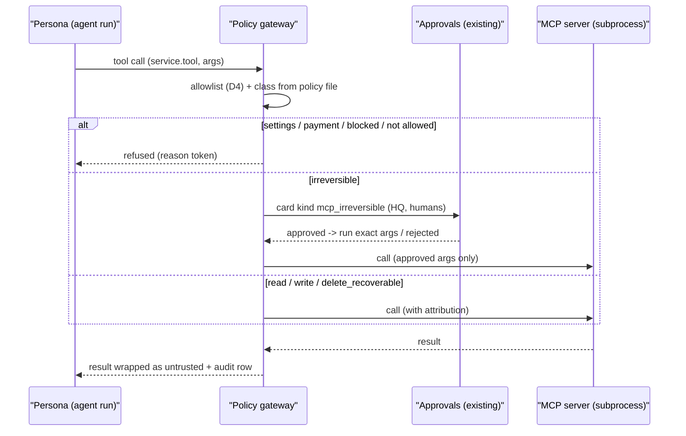

# Phase 2A — company tool integrations (design)

## Contents
- 1. Intent — L20
- 2. Owner decisions — L28
- 3. Goals, non-goals, anti-goals — L45
- 4. Approaches — L64
- 5. Design — L72
- 6. Constraints — L137
- 7. Calls made by the main thread (owner may change) — L144
- 8. Left to the builder (sa/spec) — L160

## 1. Intent

PRD Phase 2 is "self-management: agents create tools, MCP servers, plugins and skills". It is split in two:
- **Phase 2A (this design):** connect the company's existing services so the AI team can do real work in them.
- **Phase 2B (later, separate design):** let agents build their own tools, MCP servers, skills and plugins in an OS sandbox, each disabled until a human approves it.

The owner wants the team to work in the company's tools with as few limits as possible.

## 2. Owner decisions (2026-11-24)

- **D1 Full working access.** Agents may read, create, update and delete data in the connected services.
- **D2 Two hard exclusions.** Agents never change settings or configuration, and never pay or buy anything (billing, purchases, payments).
- **D3 Deletes (option B).**
  - A delete that can be undone, such as closing an issue or moving a file to trash, runs without approval.
  - An action that cannot be undone needs an approval card first, using the existing approvals system. Examples: deleting a repository, permanently deleting a file, destroying a VPS.
- **D4 Who has access.**
  - Praw has every service.
  - Each department head has only the services related to their department, and uses them only for their own department's work.
  - Team members have no direct access; they go through their head.
- **D5 Identity.** One central company account (or app) per service, but every action is attributed to the persona that did it. For example, a commit authored "Tek (AI)", and a comment prefixed `**Tek:**`.
- **D7 No Gmail in Phase 2A.** Google is Calendar, Drive, Docs and Sheets only.
- **D8 Reading vs writing.** Heads may read company-wide where a service cannot be scoped per department, for example Drive search. Writes and deletes stay inside their own department's scope wherever the service supports scoping.
- **D9 Outward actions are allowed in any run**, whether or not a human started it, as long as the call passes the gateway. Examples: comments on a public repo, sharing an event invite. The untrusted wrapper and the audit remain the mitigations.
- **D6 Approach A.** Use existing, trusted MCP servers, run as stdio subprocesses behind our own policy gateway, to keep the build small.

## 3. Goals, non-goals, anti-goals

**Goals**
- Praw and department heads can work in ClickUp, GitHub, Google Workspace (Calendar, Drive, Docs, Sheets; no Gmail, D7) and Hostinger from Discord conversations and tasks.
- Every tool call passes one gateway, which enforces three things: the persona allowlist (D4), the exclusions (D2) and the irreversible-action approval (D3).
- Every call is attributed (D5) and audited.

**Non-goals**
- Agents building their own tools (Phase 2B).
- File and code editing in a workspace (PRD Phase 3).
- Discord server management. Creating channels and roles counts as settings under D2; the bots already chat in Discord.
- Deploying to the VPS. The owner keeps that for later; Phase 2A must run on the Mac dev setup.

**Anti-goals** — failure even if it works:
- Any path to a settings change or a payment, including through an MCP tool we did not classify.
- An irreversible action that runs without a decided approval card.
- A secret (service token) reaching a model, a log, Discord or a lesson overlay.
- Text from a service (an issue body, an email, a doc) being treated as instructions.

## 4. Approaches

| | Approach | Trade-off | Picked |
| :--- | :--- | :--- | :--- |
| A | Existing MCP servers behind our policy gateway | Least code, full feature coverage, updates come from the vendor. We must trust and pin the external servers and classify every tool they expose. | **Yes** (owner, D6) |
| B | Write our own MCP server per service | Full control, but a very large build, and the agents can only do what we had time to write. That conflicts with D1. | No |
| C | Call the REST APIs directly from the built-in tool registry | Fastest at first, but against the PRD (MCP) and a poor base for Phase 2B. | No |

## 5. Design

### 5.1 Components

- **MCP host (`core/mcp/`).** It starts each configured MCP server as a stdio subprocess through the existing subprocess and job conventions, using the official `mcp` Python SDK client.
  - Each server gets only its own service token, passed in its environment. The bot process keeps the tokens; models never see them.
  - It restarts a crashed server, so a server crash never takes the bot down (PRD §6.6).
- **Server config (`mcp/<name>/`).** One folder per service holds the pinned server package and version, the launch command, the env variable names (names only) and the **policy file**.
- **Policy file (`mcp/<name>/policy.toml` or similar).** It maps every tool name the server exposes to one class: `read`, `write`, `delete_recoverable`, `irreversible`, `settings` or `payment`.
  - Any tool missing from the file is `blocked`. Unknown means denied.
  - At startup, the host compares the server's live tool list with the policy file. A new or renamed tool stays blocked, and the System bot logs it to `#bot-log` until a human classifies it.
- **Policy gateway.** Every MCP tool is offered to agents through the existing tool registry. Each call is decided as follows:
  1. The persona is not allowed this service (D4): refuse.
  2. Class is `settings`, `payment` or `blocked`: refuse, always.
  3. Class is `irreversible`: create an approval card with kind `mcp_irreversible`. HQ, humans, AI-Admin decide, using the fixed route rules that already exist. The call runs only after approval, with the exact arguments that were approved.
  4. Class is `read`, `write` or `delete_recoverable`: run it, adding the attribution (5.3).
  5. Every outcome is written to the audit log (service, tool, class, persona, decision, a hash of the arguments) and logged. Tool output goes back to the agent wrapped as untrusted (`wrap_tool_result`).
- **Persona allowlist.** It lives in settings or config, maps service → personas, and is checked by the gateway. Persona frontmatter `tools:` still names which MCP services a persona may be offered.

### 5.2 Services and first access map (main-thread call, owner may change)

| Service | Server (to confirm in spec) | Personas | Notes |
| :--- | :--- | :--- | :--- |
| GitHub | GitHub's official MCP server | Praw, Tek (Dev), Pim (Product) | Deleting a repo, deleting a branch with no merged copy, force-push → `irreversible`. Repo, org, webhook and secret settings → `settings`. |
| ClickUp | Official or well-maintained ClickUp MCP server | Praw + all department heads, each for their own department's lists | Deleting a task with no trash or restore → `irreversible`. Workspace settings → `settings`. |
| Google Calendar | Google Workspace MCP server | Praw + all heads | Deleting an event → `delete_recoverable` where the API keeps a copy, otherwise `irreversible`. |
| Google Drive / Docs / Sheets | Google Workspace MCP server | Praw + all heads | Trash → `delete_recoverable`. Permanent delete or emptying the trash → `irreversible`. Sharing and permission changes → `settings`. |
| Hostinger | Hostinger's official MCP server | Praw, Phupha (IT) | Start, stop, restart and metrics → `write`/`read`. Recreating or deleting a VM, or restoring a snapshot → `irreversible`. Firewall, DNS, SSH keys and OS → `settings`. Any purchase, renewal or billing → `payment`. |

"Uses it only for their own department's work" (D4) is enforced in three ways:
- the persona prompt, plus a gateway reminder line;
- where the service has scoping, the head's calls are limited to their own department's lists, folders or repos, through a per-department scope in config;
- audit review.

Prompt text alone is not trusted as a control. Where scoping exists, it is used.

### 5.3 Attribution (D5)

- **Writes.** The gateway prefixes `**<Name>:**` to fields that hold human-readable text (comments, descriptions).
- **Commits.** Where the tool takes an author or a message, the author name is set to "<Name> (AI)".
- **Fallback.** If a tool has no field that can carry attribution, the audit row is the attribution of record.

### 5.4 Flow

## 6. Constraints

- **Reuse what exists.** Approvals (codes, cards, HQ route, audit), settings, the tool registry and allowlist, the subprocess and job runner, log masking, the System log bot and the untrusted wrapper.
- **Platforms.** It must run on the dev Mac now and on Linux later. No Docker.
- **Secrets.** Tokens come only from the environment, are given only to the server that needs them, and are never shown. The owner fills them in.
- **Security gates.** Security Gate 1 is required on the spec, and Gate 2 before release.

## 7. Calls made by the main thread (owner may change)

- The access map in 5.2: who gets which service.
- DNS, firewall, sharing and permission changes count as `settings`.
- A default event delete on Calendar counts as `delete_recoverable` only if the API keeps a copy.
- Unknown and new tools are blocked until classified.
- Irreversible approvals always go to HQ (humans), never to a department AI head.
- Discord server management is excluded. The empty `mcp/discord` folder stays unused, and `mcp/calender` is replaced by the Google server config.
- **Access is keyed by role, not by name.** Praw is identified by id. A head is resolved at call time from the setting `approval.head.<dept>`, so `/move`, `/fire` and `/hire` change access automatically. A new department gets no service until one is added to the map.
- **Policy rules may look at arguments.** A tool's class may depend on its arguments, for example `force` on a push, a branch that is not merged, or a permission or sharing field inside an update call. Where a field cannot be inspected, the tool is classed at its worst case. The argument-inspection code is security-critical and must have its own tests.
- **The line between write and settings:**
  - Work structure inside a project counts as `write`: labels, milestones, lists, folders, new calendars, creating or archiving a repo.
  - These count as `settings`: access, permissions, sharing, branch protection, webhooks, integrations, secrets, and organisation, workspace or account configuration.
- **Least privilege as a second layer.** Each central token is created with the smallest scope the service allows, for example a GitHub App without admin rights, and Google scopes without sharing admin. A service whose token cannot exclude billing (possibly Hostinger) relies on the gateway classification alone. The spec must state this for each service.

## 8. Left to the builder (sa/spec)

- Which MCP server package and version to use for each service: verify that it is maintained and official, check its licence, and pin it.
- The complete per-tool classification for each chosen server.
- The policy file format; where the allowlist and department scopes live (settings vs config); and the env variable names.
- The MCP host lifecycle: start, health check, restart backoff, timeouts and output caps.
- How the approval card shows the exact action and its arguments, and how an approved call is replayed safely (idempotency).
- Rate limits per persona and per service, and budget accounting for tool calls if any are billable.
- The test plan: fake MCP servers for unit and acceptance tests, and one optional live smoke test per service once the owner adds tokens.
