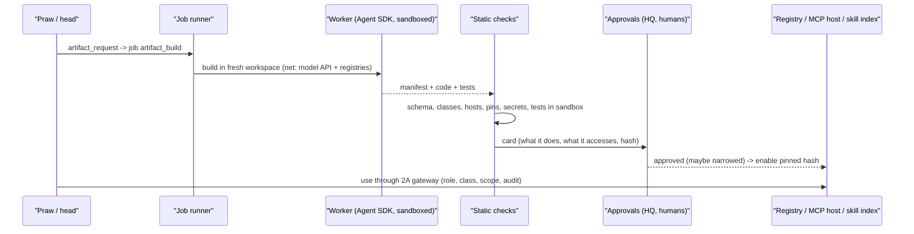

# Phase 2B — self-built artifacts (design)

## Contents
- 1. Intent — L20
- 2. Owner decisions — L26
- 3. Goals, non-goals, anti-goals — L35
- 4. Approaches — L55
- 5. Design — L63
- 6. Constraints — L144
- 7. Calls made by the main thread (owner may change) — L152
- 8. Left to the builder (sa/spec) — L187

## 1. Intent

PRD Phase 2 says agents create their own tools, MCP servers, plugins and skills. Phase 2A connected the company's existing services. Phase 2B lets the team **build what it is missing**. Every new artifact stays disabled until a human approves it, and the approval card shows what the artifact does and what it can access.

The owner asked for the most flexible version, following the PRD and the main thread's recommendations (2026-11-24).

## 2. Owner decisions

- **O1** Follow the PRD design, the main thread's recommendations, and "as flexible as possible".
- **Carried over from Phase 2A** (still binding):
  - **Allowed:** full working access, except settings and payments.
  - **Irreversible actions:** they need an HQ card.
  - **Who:** Praw and the department heads, each working within their own department.
  - **Identity:** central accounts, with actions attributed to the acting persona.

## 3. Goals, non-goals, anti-goals

**Goals**
- Praw or a department head can request a new artifact of any of the 4 types. A worker builds it in a sandbox, and a human approves it. After approval it works for the personas allowed to use it.
- **One pipeline:** request → build → static checks → approval card → enable → use → change or disable.
- **One sandbox layer** that runs on macOS now and on Linux later. It runs self-built code, and it is also used to wrap the Phase 2A GitHub and Google servers, which closes the Gate 2 TASK-040 residual.
- Every self-built tool goes through the Phase 2A policy gateway. Classes, allowlist, approvals, attribution and audit all stay the same.

**Non-goals**
- Free file and code editing in company repos, and shell commands (`tools/CMD`). Those are PRD Phase 3. In Phase 2B the worker writes only inside its own build workspace.
- Agents changing their own main prompts or the core code in `core/` (the G2 rule from Phase 1 still stands).
- Docker. Deploying to the VPS.

**Anti-goals** — failure even if it works:
- Self-built code runs before a human has approved that exact version, identified by hash.
- Self-built code reads secrets (`.env.local`, tokens, the DB, `~/.ssh`), or reaches any network host it did not declare and get approved.
- An approved artifact changes later and keeps running without new approval.
- An artifact grants itself a settings or payment capability, or raises its own class.
- The worker's own API key leaks into the artifact it builds.

## 4. Approaches

| | Approach | Trade-off | Picked |
| :--- | :--- | :--- | :--- |
| A | One artifact pipeline for all 4 types, with a shared sandbox layer and the existing 2A gateway | Most flexible; types share review, enabling, versioning and audit. The sandbox must work on macOS and Linux. | **Yes** (main thread, O1) |
| B | A separate pipeline per type | Simpler per type, but 4 copies of the review, enabling and audit logic | No |
| C | Skills only now, code later | Fast and needs no sandbox, but does not meet the PRD or O1 | No |

## 5. Design

### 5.1 Artifact types

| Type | Folder | What it is | Runs code? | How agents use it |
| :--- | :--- | :--- | :--- | :--- |
| skill | `skills/<name>/` | `SKILL.md`: instructions and steps, plus metadata (name, description, which personas or depts, triggers) | No | A meta-tool `skill_use(name)`, same idea as `mcp_use`, adds the skill text to the run as advisory, untrusted guidance. It never adds tools or permissions. |
| tool | `tools/<name>/` | A small Python program plus `manifest.toml`: name, description, JSON input schema, declared network hosts, class (read/write/delete_recoverable/irreversible) | Yes, one sandboxed subprocess per call | It is offered through the registry like an MCP tool, and every call passes the 2A gateway. |
| mcp | `mcp/<name>/` (self-built) | A stdio MCP server, plus `server.toml` and a draft `policy.toml` written by the worker | Yes, a long-running sandboxed subprocess | It runs under the 2A MCP host. The class of each tool is set by the human on the approval card, never by the worker. |
| plugin | `plugin/<name>/` | A bundle of skills, tools and MCP servers, with a manifest | Its parts do | It is approved as one card that lists every part; each part keeps its own hash. |

### 5.2 Pipeline

1. **Request.** Praw or a head calls the tool `artifact_request(type, name, purpose, needs)`. A human can ask through them. The request becomes a task with a code like `ART-<DEPT>-NNNN` (reusing the task and code system).
2. **Build.** A job of kind `artifact_build` runs the worker:
   - **Engine:** Claude Agent SDK, as PRD §5.1 approach C sets out.
   - **Isolation:** it runs inside the sandbox, with a fresh workspace (`<data_dir>/artifacts/build/<id>/`).
   - **Network:** only to the model API and the package registries named by the build.
   - **Limits:** time, budget and size.
   - **Key:** the worker's API key goes only into the worker process. It is never written into the workspace, and it is never available to the artifact at runtime.
3. **Static checks**, all in code, no AI involved:
   - the manifest follows its schema;
   - name rules apply;
   - no settings or payment class is declared;
   - declared hosts are plain hostnames;
   - dependencies are pinned and hash-locked;
   - size caps are met;
   - secret scan using the existing masking patterns;
   - forbidden imports or calls for tools, where they can be detected (best effort; the sandbox is the real boundary);
   - the tests the worker wrote are run inside the sandbox.
4. **Approval card.** It goes to HQ, where humans decide, always. It shows:
   - type, name and purpose;
   - every tool with its class;
   - declared network hosts and secret names (no file paths, B5);
   - what it can access;
   - dependency list;
   - the content hash, and for skills the full text.

   The card links the build artifacts as a file attachment or a thread. The human can approve, reject, or approve with lower classes or fewer hosts.
5. **Enable.**
   - The approved content is copied to its folder and the hash is pinned.
   - The artifact is registered with the registry, the MCP host or the skill index, with an allowlist: the requesting department's head plus Praw by default; the card can widen or narrow this.
   - The System bot logs it to `#bot-log`.
6. **Use.** Every call goes through the 2A gateway: role, class, scope, rate limits, attribution and audit.
7. **Change.** Any change to an enabled artifact, by an agent or by hand, changes its hash, so it is disabled until it is re-approved. An agent can request an update, which runs the same pipeline as a new version.
8. **Disable or delete.** AI-Admin can do this with `/artifact disable|enable|list|show` in the settings channel. Delete is soft (archived). Every change is audited.

### 5.3 Sandbox layer (`core/sandbox/`)

- **One interface, two backends:**
  - **macOS:** `sandbox-exec` with a generated profile. It is deprecated by Apple but still works on current macOS; Gate 1 must check this.
  - **Linux:** follows the already-approved Phase 1 §11.12.3 model, not bubblewrap, which §11.12.3 rejected (RestrictNamespaces, AppArmor). That means a socket-activated `DynamicUser=yes` unit with `PrivateNetwork=yes`, plus the egress proxy socket. It is built later with the VPS work; this phase builds and tests the macOS backend only (see §7).
- If neither backend works, code artifacts cannot be enabled, and the failure is logged. Skills still work.
- **Rules the profile enforces:**
  - read: the artifact's own folder and the interpreter/runtime only;
  - write: its own `<data_dir>/artifacts/run/<name>/` only;
  - no access to the repo, `.env*`, the DB, `~/.ssh` or the home directory;
  - a minimal environment: no secrets except the ones the card approved, injected only into that artifact;
  - CPU/memory/time limits where the platform allows them;
  - **network:** denied except to a local egress proxy (`core/sandbox/proxy.py`, an HTTP CONNECT proxy) that allows only the approved hostnames for that artifact. This works the same way on both platforms.
- The 2A GitHub and Google servers run under this sandbox, each allowed only its own vendor host. This closes the 2A residual.

### 5.4 Flow

## 6. Constraints

- **Reuse what exists:**
  - from Phase 1: job runner, approvals and codes, tasks, settings, System bot, masking, untrusted wrapper;
  - from Phase 2A: policy gateway, the MCP host, the `mcp_use` pattern, the audit scope.
- **No Docker.** It must run on the dev Mac now and on Linux later.
- **Security gates.** Gate 1 is required on the spec, and Gate 2 before release. The sandbox layer is the most security-critical part, so it needs tests that prove real denials (run a real sandboxed process and check that the forbidden reads, writes and network calls fail). Argv checks alone do not count.

## 7. Calls made by the main thread (owner may change)

- All 4 types are in Phase 2B, through one pipeline (approach A).
- **Approvals.** Every artifact approval goes to HQ, to humans; never to a department AI head.
- **Who.** Praw and heads may request builds. Other team members ask their head.
- **Default allowlist** for a new artifact: Praw plus the requesting department's head. The card can change it.
- **Classes.** The worker may only propose classes. The human sets them on the card. Settings and payment classes cannot be declared at all.
- **Skill text** is advisory and untrusted, like the growth overlay. It never adds tools or permissions.
- **Sandbox backends.** `sandbox-exec` on macOS, built and tested now. On Linux, the Phase 1 §11.12.3 DynamicUser unit, built with the VPS work. Network goes through the local allowlist proxy on both.
- **2A wrapping.** The 2A GitHub and Google servers move under the sandbox in this phase.
- **Out of scope.** Shell commands (`tools/CMD`) and editing company repos stay in Phase 3.
- **Language.** Self-built tools are Python only in the first version. MCP servers may be Python or Node, both pinned and hash-locked.

- **Builder-check answers** (main thread, owner said to use recommendations):
  - **B1, Linux:** follows §11.12.3, as above. The macOS backend satisfies the job-runner merge rule on the dev Mac. Linux deploy needs the §11.12.3 unit before code artifacts are enabled there.
  - **B2, secrets:**
    - Self-built artifacts may **never** receive Phase 2A central tokens (`MCP_*`), the model keys, Discord tokens or any other core secret. The static check and the card both refuse them.
    - A new secret is added by the owner to `.env.local` as `ART_<NAME>_<KEY>`. The card lists it by name only, and it is injected only into that artifact.
    - An artifact that needs a company service must ask through the existing MCP tools (the persona calls both), not through a token of its own.
  - **B3, department boundary:**
    - The card's allowlist is keyed by role, like 2A: Praw by id, plus "current head of <DEPT>" for each listed department, resolved at call time, so `/move` and `/fire` apply at once.
    - A self-built tool has scope kind `artifact`, meaning the whole artifact is the scope.
    - The allowlist on the card is the department boundary for its writes.
  - **B4, 2A servers:**
    - All four 2A servers (GitHub, Google, ClickUp, Hostinger) run under the sandbox.
    - Owner-written server configs may grant a per-server write directory, for example Google credentials, and multi-host or `*.` wildcard allowlists, for example `*.googleapis.com`.
    - Agent-built artifacts get plain hostnames only.
    - `python -m core.mcp google-auth` (owner, interactive) runs outside the sandbox.
  - **B5, files:** artifacts receive input only through call arguments/stdin and return output on stdout. There are no declared file paths in v1, so the card shows hosts, secrets, classes and dependencies, not files.
  - **B6, worker key and spend:**
    - The worker uses `ARTIFACT_WORKER_ANTHROPIC_KEY` if set, otherwise the main Anthropic key.
    - Build spend is recorded through the existing budget module against the requesting persona.
    - Settings set a per-build cap and builds per day per department.
  - **B7, no pre-build approval:** `artifact_request` starts the build within those limits. The human decides on the final card. The owner may add a pre-build card later.

## 8. Left to the builder (sa/spec)

- **Claude Agent SDK.** The package and version to pin; how the worker is driven (a prompt template per artifact type); and its tool permissions inside the sandbox.
- **Formats.** The exact manifest schemas per type, and how a plugin bundles its parts.
- **macOS sandbox.** The profile (sandbox-exec SBPL) and probes on the current macOS. The bwrap argument set for Linux.
- **Egress proxy.** Its design, plus how package installs during a build reach registries (pip/npm through the proxy, with hash checks).
- **Card.** How the build artifacts are shown without breaking Discord limits (file attachment vs thread); approve-with-narrowing UX.
- **Versioning and rollback** for artifacts, and how a re-approval replaces the running version.
- **Limits.** Build budget, timeouts and sizes, as settings keys.
- **Test plan.** A fake worker for unit tests; real sandbox denial tests; one live build per type once a model key and the platform are available.
