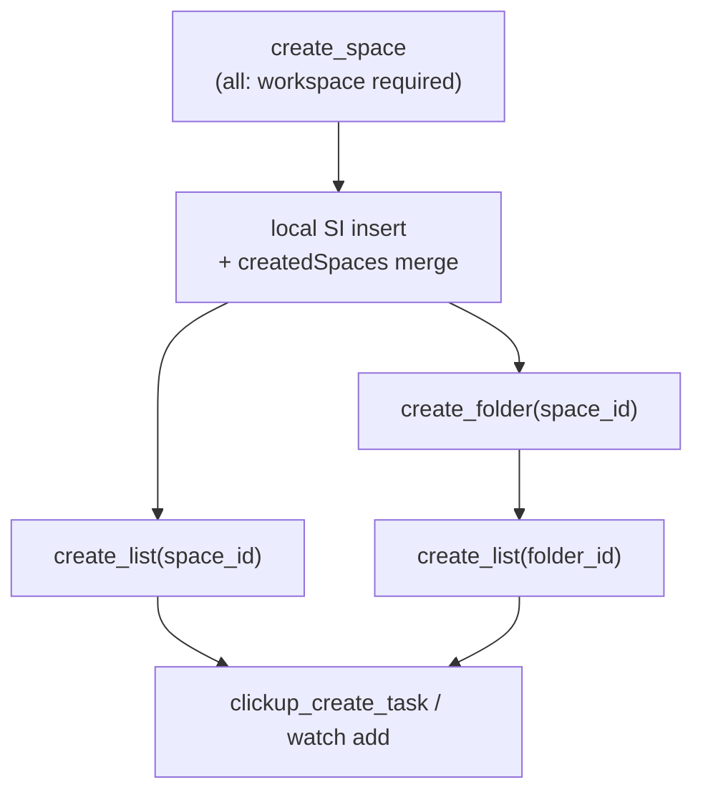

# CLICKUP-HIER-1 — ClickUp create space / folder / list (design)

Owner request 2026-11-09: bots should create ClickUp projects themselves (space, folder, list); every create still needs approval. Defaults taken: OQ-2 max 2 space cards per run; OQ-4 no per-space #bot-log notice.

SPECIFICATION HANDOFF BRIEF (for document + security) — CLICKUP-HIER-1
======================================================================
PLAN REF: none. This extends docs/superpowers/specs/2026-11-08-clickup-workspace-design.md (C1–C12) and docs/superpowers/specs/2026-11-09-clickup-multi-workspace-design.md (CM-C1..C8, G2CM-*).
TARGET TEMPLATE: freeform, in the same style as CLICKUP-MULTI-1.
OUTPUT DESTINATION: BOT/Assistant/docs/superpowers/specs/2026-11-09-clickup-hierarchy-create-design.md
REQUIRES SECURITY GATE 1: yes. These are new write endpoints, and a created space is visible to the whole workspace.

1. MODULE: CLICKUP-HIER-1. Three tools: `clickup_create_space`, `clickup_create_folder`, `clickup_create_list`.
- Files touched: tools/plugins/clickup/{client,workspace-write}.ts, discord/embeds/approval.ts, tests/fakes/clickup-workspace.ts, README.md.
- Unchanged: write.ts (list mode), index.ts, config/defaults.ts, tree-grant files.

2. ACTORS AND BOUNDARIES
- Actors are the same as CLICKUP-ALL-1.
- Who gets the tools:
- Praw has `tools: ["*"]` (prompts/heads/praw.md), so it gets the new tools automatically.
- The heads' byDept lists only `CLICKUP_READ` (config/defaults.ts:19,84-88), so no other bot gets them.
- A skill or a bot_tools change could still grant them (R4).
- No change is needed.
- Workspace mode only, both numeric and `all`. In list mode the tools are not registered.
- No delete, rename, move or archive tool is added.

3. LOGIC AND FLOWS
3.1 Inputs. Every schema is strict zod.
- `clickup_create_space`:
- `{ name, workspace?, in_workspace? }`.
- `workspace` exists only in all mode, and there it is REQUIRED: exact name, at most 100, passes `clean()`. It resolves through `teamByName` (client.ts:474), which gives E.NO_TEAM or E.AMBIG_TEAM.
- After that, `sc.collide.has(tid)` → E.NAME_COLLISION before any card exists. teamByName compares only the full key; the display-key collisions live only in `collide` (client.ts:429-434).
- Numeric mode targets T through `resolveTeam`.
- `clickup_create_folder`: `{ space_id: CLICKUP_ID, name, in_space_id?, parent_path?, in_workspace?(all) }`.
- `clickup_create_list`:
- `{ space_id? | folder_id?` (exactly one, enforced by superRefine)`, name, description?: text(1500), in_space_id?, in_folder_id?, parent_path?, in_workspace?(all) }`.
- `description` maps to the API field `content` (plain text, never `markdown_content`).
- Folder and list take no `workspace` input: ids are global, the team comes from SI, and the card shows the label.
- `name`, shared rule `hierName`. Validation only; the input is never rewritten after the card (the digest covers it). A name is accepted only if all of these hold:
- 1–100 UTF-16 units;
- passes `clean()`;
- contains no `\n` or `\t`;
- contains no character that `HIDDEN_CTRL` (client.ts:130) matches;
- has no leading or trailing whitespace and no run of 2 or more whitespace characters;
- contains none of `/ \ [ ]` (they would spoof the path separator and the `[h6]` hash on the card);
- has a `workspaceNameKey` that is not `?`.
- A name that fails gives the fixed text WE.BAD_NAME.

3.2 Precheck. It shares the request path and the replay path, and returns no card on any refusal.
- Steps, in order:
1. the run cap;
2. C5 redaction;
3. resolve the parent;
4. collision;
5. compare pins (a mismatch is E_MOVED);
6. the sibling duplicate check (early UX only);
7. `cardShowsWhole(syntheticCard)`.
- Resolving the parent:
- `spaceInScope(id)`: `GET /space/{id}`, then the id matches, `archived !== true`, and the owner comes from ownerOf or inSpaces.
- `folderInScope(id)`: `GET /folder/{id}`, then the id matches, it is not archived and not `hidden`, and `space.id` is in scope.
- A 404 or 403 is refused with a fixed text (no existence oracle).
- Pins:
- `in_space_id`, `in_folder_id`;
- `parent_path` = `parentPathText()`. It is built like listPathText (client.ts:148): segments of 30 units, a hash over the full ids and names, at most 74 units;
- `in_workspace` = workspaceLabelText.
- Card target (no team ids):
- `Workspace <label> · new space`, or `This workspace · new space` in numeric mode;
- `Workspace <label> · <parent_path> (space|folder <id>)`.
- Change text: `create space|folder|list "<name>"[ with an N-character description]`.
- These targets are shorter than WORST_TARGET_LEN (workspace-write.ts:70), so SYNTHETIC_REASON_LEN stays at 500. A test asserts this.

3.3 Run (the client). This is also the approved replay. Everything up to step 5 happens before `beforeWrite`.
1. Take the per-parent mutex. The key is `team:<tid>`, `space:<id>` or `folder:<id>`, an in-process promise chain. It is held across steps 2–7.
2. Resolve the parent again (as in 3.2).
3. All mode: re-resolve the team.
 - Space: `teamByName(workspace)`.
 - Folder and list: SI.
 - Then `collide` → NAME_COLLISION, and a label that differs from `in_workspace` → E_MOVED.
4. Check the parent pins: `in_*_id` must equal the input id, and `parentPathText` must equal `parent_path`. A mismatch is E_MOVED. This is the C10 analogue.
5. Sibling duplicate check: a FRESH read that bypasses every cache.
 - Space: `GET /team/{t}/space?archived=false`.
 - Folder: `GET /space/{s}/folder?archived=false`.
 - List in a folder: `GET /folder/{f}/list?archived=false`. List in a space: `GET /space/{s}/list?archived=false`.
 - If any sibling has the same `workspaceNameKey` OR the same `workspaceDisplayKey` → E.DUPLICATE.
 - A read that fails → refuse (fail closed).
 - Spaces: 100 or more → E.SPACE_CAP. A new space beyond MAX_SPACES would fall out of scope (client.ts:200, 311, 406).
 - This check is also the idempotency guard. After a POST timeout the counter is spent and no id came back, so a retry is refused as a duplicate. The POST is never retried automatically.
6. `w.beforeWrite()`: the daily take.
7. POST. The body is built from typed fields only and never spreads the input.
 - `POST /team/{t}/space`: `{name, ...SPACE_DEFAULTS}`, where SPACE_DEFAULTS is a frozen code constant (see OQ-1).
 - `POST /space/{s}/folder`: `{name}`. No `parent_folder_id`.
 - `POST /folder/{f}/list` or `POST /space/{s}/list`: `{name, content?}`. No assignee, due_date, priority or status.
8. Validate the response.
 - `id` must pass CLICKUP_ID, else 'ClickUp returned an unexpected response'.
 - Folder and list: if `space.id` differs from the parent space → log.warn, counts only.
9. Cache, after a 2xx.
 - create_space inserts the id locally:
   - all mode: into `scopeAll.si`, `spacesOf[tid]` and `teamSpaces[tid]`, and only if no other team owns that id;
   - numeric mode: into `spaces`.
 - Every create invalidates `teamHier.delete(tid)` (all mode) or `hierAt = -Infinity` (numeric).
 - Race: an in-flight `doRefresh` (client.ts:340) can overwrite SI. Keep a `createdSpaces: Map<sid, {tid, at}>` (TTL 10 min). doRefresh merges it in only when that team's space GET succeeded without the id AND the team is still in 𝒯. Alternative: apply the insert after `await inflight`.
 - New lists need no cache: `listInScope` already does a fresh `GET /list/{id}` plus SI. So create_task and `/clickup watch add` work at once.
10. Result text has ids only (C4):
  - `Created space <id>.`
  - `Created folder <id> in space <sid>.`
  - `Created list <id>; use list_id <id> with clickup_create_task.`
  - The approved replay's result reaches the model's next turn (agents/approved-tools.ts:20-26), so the space → folder → list → task chain is sequential across approvals. Dependent creates cannot share one batch, because the ids are unknown until the parent exists.

3.4 Caps (recommended)
- Each create counts against the SAME run cap of 5. The new tools must be built inside `workspaceWriteTools` so they share `filed` (workspace-write.ts:94).
- Each create also counts against the same global daily cap of 50 (clickup_write_usage).
- Extra: at most 2 `clickup_create_space` cards per run (in-memory, same runKey). See OQ-2.
- No separate daily cap, so no migration. 036 stays unused.

3.5 Exceptions
- Parent archived, deleted or moved to another workspace → refusal or E_MOVED.
- Workspace renamed → E_MOVED.
- Workspace collides → NAME_COLLISION.
- Duplicate created by a human between the card and the run → E.DUPLICATE, nothing taken.
- ClickUp 4xx on the POST (plan space limit, guest token, permission):
- E.CREATE_REFUSED 'ClickUp refused to create it (plan limit or permission); nothing was created';
- the counter is NOT given back (existing policy).
- 429 → the existing pause and E.BUSY.

4. MERMAID
```mermaid
sequenceDiagram
participant M as Model
participant W as workspace-write
participant C as client
participant A as Approver
M->>W: clickup_create_list {folder_id, name, description?}
W->>C: folderInScope(folder_id)
C-->>W: folder, space, teamId or E_SCOPE
W->>W: pins in_folder_id, parent_path, in_workspace; dup check; cardShowsWhole
W->>A: card: Workspace label · parent_path · name · Body
A-->>W: approve (digest incl. pins)
W->>C: run: lock(parent); re-resolve; pins equal; fresh sibling check
C->>C: beforeWrite (daily take)
C->>C: POST /folder/{id}/list {name, content}
C-->>W: id or E_MOVED / E_DUPLICATE / E_DAY_CAP
C->>C: invalidate hierarchy cache
```


5. CONTRACTS
- New ClickUpClient methods (workspace only; list mode → wsOnly):
- `createSpace({name, workspace?}, g: HierGuard)`
- `createFolder({spaceId, name}, g)`
- `createList({parent: {kind: 'space'|'folder', id}, name, content?}, g)`
- `describeParent(kind, id)`, which returns `CuParentInfo {kind, id, name, spaceId, space, teamId?, teamName?, teamCollides?}`.
- `HierGuard = {parentId?: string; parentPath?: string; workspace?: string; beforeWrite()}`. WriteGuard.listId is required today, so it is not reused.
- New fixed texts:
- E.DUPLICATE 'ClickUp: something with that name already exists there; use it (see clickup_list_projects) or choose another name'
- E.SPACE_CAP 'ClickUp: that workspace already has 100 spaces, the most the bots can see; nothing was done'
- E.SCOPE_SPACE / E.SCOPE_FOLDER 'ClickUp: that space/folder is not in this workspace'
- E.CREATE_REFUSED (see 3.5)
- WE.BAD_NAME 'ClickUp: a name is 1-100 characters on one line, without / \ [ ] or invisible characters'
- approval.ts:
- add `in_space_id`, `in_folder_id`, `parent_path` to PIN_KEYS (:79);
- `pinned` (:135) and the Body gate (:129) become: any of `in_list_id`, `in_space_id`, `in_folder_id` or `in_workspace` is a string;
- FULL_BODY_TOOLS (:88) adds `clickup_create_list`. Its `description` key is already handled by bodyKey;
- the list-mode rendering is unchanged.
- Storage: no migration.
- Audit:
- the registry `tool` row (tools/registry.ts:91) already records the tool name and outcome;
- add `clickup.hierarchy.created` with outcome `space|folder|list` only. Never ids or names (C12).
- Rate: each create is at most 4 GETs plus 1 POST, within the 80/min bucket.

6. SECURITY NOTES (Gate 1)
- R9: ClickUp offers no `private` field on create, so a new space or list is probably visible to every member of the workspace. This needs live verification and owner sign-off.
- R10: SPACE_DEFAULTS toggles features for the new space. It is a fixed constant the model never controls.
- R3 widened: a tricked run can now create structure (at most 5 per run, 50 per day). No delete exists, so cleanup is manual in ClickUp.
- What stays out of the model's reach: members, permissions, sharing, privacy, statuses, assignee, parent_folder_id.
- Mask: team ids and space ids are absent from audit, logs and errors (C12, CM-C7).
- treeGrantCovers stays false (requiresApproval returns a reason), and the tools stay non-sensitive, so they can batch.
- Validation points: `hierName`, `clean()`, C5 sanitize, the cardShowsWhole C1b check, and the fixed refusal texts.

TESTS
- Unit (workspace-write.test.ts, workspace.test.ts, clickup.test.ts, approval-body.test.ts):
- schemas: list mode registers none of the three tools (tools/plugins/index.test.ts snapshot unchanged); numeric mode has no `workspace` or `in_workspace`; all mode requires `workspace`.
- names: `/`, `[`, NBSP-only, U+2800, a leading space, `\n`, 101 units → refused, no card.
- a duplicate under the fold (`R&D` vs `r&d`, Cyrillic look-alike, same first 30 units) → E.DUPLICATE at precheck AND at run, with no take().
- two approved replays of the same name in parallel → exactly one POST (the mutex).
- parent renamed, moved or archived between card and run → E_MOVED or a refusal, with no take().
- forged pins → E_MOVED with no card.
- workspace label changed → E_MOVED.
- collide, including display-key-only collisions → NAME_COLLISION with no card.
- 100 spaces → E.SPACE_CAP.
- sibling GET fails → refusal, no take.
- POST body equals exactly the typed fields (no spread; SPACE_DEFAULTS snapshot).
- the create_space response is added to SI, and `listInScope` of a list in it succeeds with no refresh inside 60 s.
- a racing doRefresh keeps the created space.
- after a create, `hierarchy` refetches.
- a 6th write in the run → RUN_CAP; a 3rd space card → refusal.
- DAY_CAP is shared with the task writes.
- results contain ids only.
- no team id or space id appears in audit or logs.
- 1500-character worst-case description card: cut false, solo only.
- a 4xx on the POST → CREATE_REFUSED, counter spent.
- Int:
- clickup-workspace.int: create space → list → task in a two-team fake;
- `/clickup watch add` of the new list succeeds.
- Fake: the POST routes, plus `GET /space/{id}`, `/folder/{id}` and `/folder/{id}/list` per team.

7. OPEN QUESTIONS
- OQ-1: the ClickUp docs mark `multiple_assignees` and `features` as REQUIRED for Create Space.
- Proposed constant: multiple_assignees true; due_dates on (start_date and remaps off); tags, checklists and custom_fields on; time_tracking, time_estimates, remap_dependencies, dependency_warning and portfolios off.
- The developer verifies against a test workspace before Gate 2.
- OQ-2: the per-run cap of 2 for space creates. Should it be 1, 2, or none?
- OQ-3: the owner signs R9 and R10.
- OQ-4: should a #bot-log notice go out for each created space (count only)? Default: no.

8. BOOK CHAPTERS AFFECTED: the BOT/Assistant ClickUp chapter (not opened), and the README.md ClickUp rows.

MISSING CONTEXT:
- The team sa.md, both global and project, is absent.
- The project .claude/rules/sa.md is absent.
- I did not read the Book 00-INDEX (the brief named the files).
- I did not open tests/fakes/clickup-workspace.ts.

LEARNINGS:
- fact project: approval.ts keys both the pin exemption and Body chunking on `in_list_id`, so any ClickUp write without a list needs that predicate widened. | proposed rule: none
- decision project: name-uniqueness under a run-time lock is the idempotency guard for vendor creates that cannot be retried. | proposed rule: none

BOOK_UPDATES:
- docs/superpowers/specs/2026-11-08-clickup-workspace-design.md: needs a pointer to CLICKUP-HIER-1 ("no delete" still holds).

## Amendments after Gate 1 (2026-11-09, docs/security/2026-11-09-gate1-clickup-hier.md)

Verdict: CONDITIONAL_APPROVE. CH-C1..CH-C9 are binding. Where they differ from the text above, they override it.

- §3.1: the three schemas use `.strict()`. This corrects "strict zod": the existing schemas are plain `z.object`.
  - `in_space_id` and `in_folder_id` must match CLICKUP_ID. `parent_path` has `.max(80)`.
  - Numeric mode: `clickup_create_space` ALSO takes `in_workspace` = workspaceLabelText(T, teamName), and `run()` compares it (CH-C5). This is the one exception to "numeric has no in_workspace".
  - Emoji sequences with ZWJ or VS16 are refused by `hierName`. Thai names must pass (CH-C9).
- §3.2 / §3.3: for each parent kind, the refusal text is ONE fixed text (E.SCOPE_SPACE or E.SCOPE_FOLDER) for all of: 404, 403, out of scope, archived, hidden, id mismatch. Precheck and run use the same text. E_MOVED only for a pin mismatch on a parent that is still in scope (CH-C4).
- §3.3 step 4 and §5 HierGuard: in the client and the tool's `run()`, a guard field that this kind requires but that is absent or empty is E_MOVED before `beforeWrite()`, never a skipped check (CH-C1). This does not cover the registry replay path, where precheck refills the pins; that needs a registry `approved` flag passed to precheck and is out of scope.
- §3.3 step 7: the space POST body is exactly `{ name, multiple_assignees, features }`, built by a literal from a deep-frozen SPACE_DEFAULTS. It never contains `private`, `admin_can_manage` or members. The toggle values may change after the live check; a new top-level key needs security review (CH-C7, OQ-1).
- §3.3 step 9:
  - The `createdSpaces` TTL merge is REMOVED. Insert the new space after awaiting any in-flight refresh (all mode: `inflight`; numeric mode: add a shared in-flight promise to `loadSpaces`).
  - A later successful space GET that leaves the id out removes it from scope.
  - An id that another team also lists is in no scope (CH-C2).
- §3.3 step 9 and §3.5:
  - Invalidate the hierarchy cache and mark the spaces cache for refresh after a 2xx, a timeout, a 5xx, a network error or an unparsable response. Only a definite 4xx skips this.
  - A timeout, a 5xx, a network error, an unparsable response, or a 2xx whose `id` fails CLICKUP_ID returns the fixed text E.CREATE_UNKNOWN: "ClickUp did not confirm the create; check clickup_list_projects before trying again", and the cache is invalidated.
  - A 4xx keeps E.CREATE_REFUSED and a 429 keeps E.BUSY (CH-C3).
- §3.4: the space counter is a second WeakMap per runKey. It is incremented in `onApprovalTask` for `clickup_create_space` only and checked in precheck after RUN_CAP. Refused calls and approved replays never count against it, and replays are never refused by it (CH-C6). OQ-2 is ruled: 2.
- §6: the tools spread `base`, so approval is unconditional, direct Praw chat included. They are not in TREE_GRANT_TOOLS, NO_APPROVAL_TOOLS or the bot-talk list (CH-C8).
- §7:
  - OQ-1 is ruled as above.
  - OQ-2 is 2.
  - OQ-4 is no notice.
  - OQ-3 (R9, R10, widened R3 and R4, R11 creator attribution) waits for owner sign-off.
  - R9 is partly verified: per the vendor docs, Create Space has no privacy field. Live default visibility is still to be confirmed.
- TESTS: add the tests named in CH-C1..CH-C9. Batch: a create_list with a 1500-unit description is not batch-eligible (`compactItemFits`), and a short one renders whole as a batch item.
