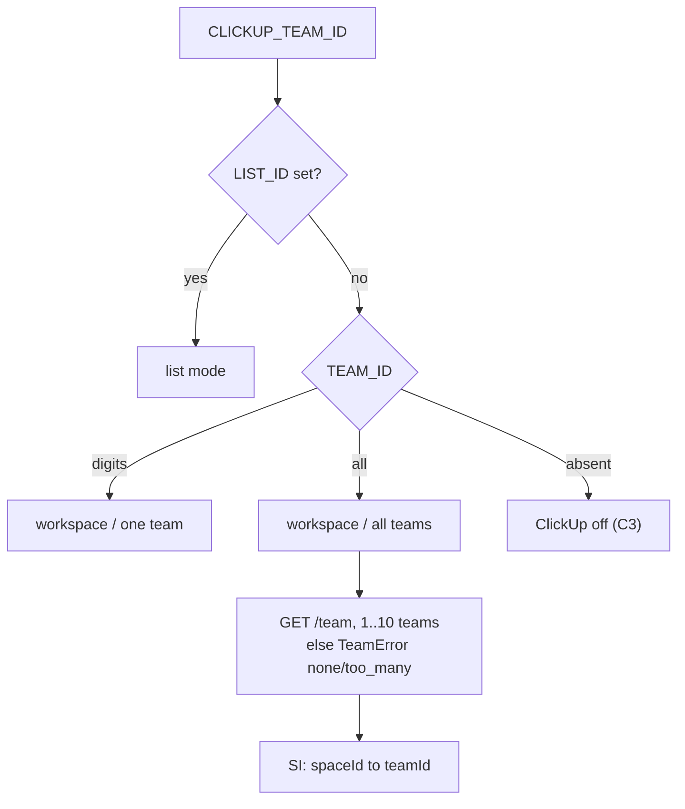

# CLICKUP-MULTI-1 — ClickUp all-workspaces mode (design)

Owner request 2026-11-09: reach every ClickUp workspace the token can see. Owner chose CLICKUP_TEAM_ID=all (explicit opt-in), every write still needs approval.

SPECIFICATION HANDOFF BRIEF (for document + security) — CLICKUP-MULTI-1
======================================================================
PLAN REF: none (extends docs/superpowers/specs/2026-11-08-clickup-workspace-design.md + Gate 1 C1–C12)
TARGET TEMPLATE: freeform (same style as the CLICKUP-ALL-1 spec)
OUTPUT DESTINATION: /Users/pakawat.tan/Desktop/Labworkspace/BOT/Assistant/docs/superpowers/specs/2026-11-09-clickup-multi-workspace-design.md
REQUIRES SECURITY GATE 1: yes. Writes can now land in any workspace the token can see, and the read scope widens.

1. MODULE: CLICKUP-MULTI-1. ClickUp all-workspaces scope. Files touched: core/env.ts, app.ts, tools/plugins/clickup/{client,index,workspace-write,poller}.ts, discord/commands/plans.ts (watch), dashboard/envfile.ts, scripts/set-tokens.sh, .env.example, README.md, tests/fakes/clickup-workspace.ts.

2. ACTORS AND BOUNDARIES: the same actors as CLICKUP-ALL-1.
- The scope is now the set 𝒯 of teams from GET /team, at most 10.
- The space index SI is a map spaceId → teamId. It is built from GET /team/{t}/space for every t in 𝒯.
- A task or list is in scope only when its space.id is in SI.
- All ClickUp ids (task, list, space) are global, so a call on an existing id needs no team argument: its team is SI[space.id].
- Team ids never appear in tool output, error texts, audit outcomes or logs (C12 extended). The model sees workspace names only.

3. LOGIC AND FLOWS

3.1 Config (keeps C3: a token alone stays off)
- In env.ts, around line 73, the regex for CLICKUP_TEAM_ID becomes `/^(?:\d{1,20}|all)$/`.
  - The value is trimmed first and must then match exactly, lowercase. `ALL` or `All` throws an error that names the key and never the value.
  - Note: `all` matches CLICKUP_ID (`/^[a-z0-9]{1,32}$/`, services/ids.ts:5). So `all` must never travel as a teamId string, or it would reach `/team/all/...`.
- Env type, around env.ts:27, gets a third branch: `{ apiToken; teams: 'all'; listId?: undefined; teamId?: undefined }`.
- Precedence, at the `clickup:` ternary around env.ts:167:
  1. a token and LIST_ID → list mode;
  2. a token and a numeric TEAM_ID → workspace mode, one team (today's behaviour);
  3. a token and TEAM_ID=`all` → workspace mode, all teams;
  4. anything else → off.
- Client: `createClickUpClient({..., teamId?, allTeams?: true})`. `mode` stays `'workspace'`; do NOT add a mode value. Gates that check `mode === 'workspace'`: app.ts:448, :782, :908, plans.ts:459, index.ts:150.
  - Add `readonly teamScope: 'one' | 'all'`. It is `'one'` in list mode and numeric mode.
  - Numeric mode stays byte-identical: same schemas, card and tests.
- The disabled text at index.ts:138 becomes 'CLICKUP_API_TOKEN / CLICKUP_LIST_ID (or CLICKUP_TEAM_ID = a workspace id or all) not set'. clickup.test.ts:125 still passes because it uses stringContaining.

3.2 Team resolution (all mode)
- `resolveTeams()` calls GET /team.
- Results by team count:
  - 0 teams → TeamError('none');
  - more than 10 → TeamError('too_many'). Never truncate: that would be an auto-pick, which C3 rejected;
  - otherwise, store `teams: Map<id, {name, members}>`.
- Caching:
  - a success is cached for 10 min (TEAMS_TTL_MS);
  - a failure is not cached, and is retried at most once per 60 s;
  - if a refresh fails after an earlier success, the last good set is kept (ClickUp itself enforces revoked access) and log.warn is emitted.
- A refresh that changes the team count writes audit `clickup.teams.changed` with outcome `count:<a>-><b>`, and posts one #bot-log notice with the count only.
  - Scope widens automatically when the token joins a workspace (R7). A team that disappears drops out at the next refresh, together with its spaces.
- SI: the spaces of each team (MAX_SPACES 100 per team), cached 10 min. A space id seen under two teams is dropped (fail closed).
- C6, multi-team version: a miss forces at most ONE refresh per 60 s across the process. That refresh is GET /team plus N space GETs, so at most 11 requests.
- `scope`:
  - keep `team()` for numeric mode; in all mode it throws ClickUpError(E.WORKSPACE_ONLY);
  - add `teamsReady(): Promise<number>`, which returns the count. app.ts:911 calls whichever matches teamScope.
  - The boot audit `clickup.mode` gets outcome `workspace-all`.
  - The boot #bot-log notice says "ClickUp all-workspaces mode: the bots can read every project of N workspace(s) this token can see; every write needs approval." (count only).

3.3 Scope checks (all mode)
- listInScope: `/list/{id}`, then `l.id === id`, then `SI.has(space.id)`, and records `teamId = SI[space.id]` in the returned CuListInfo as a new field. It is never rendered and never logged.
- taskInScope: `owner = SI[task.space.id]` must exist, and `task.team_id` must be absent or equal to `owner`. This replaces the comparison with t0 at client.ts:298.
- describeTask: also requires `list.teamId === owner`. Otherwise it refuses with E.SCOPE_TASK.
- Refusal texts stay the same (no existence oracle).

3.4 Reads
- `clickup_list_projects` gains an optional `workspace` input (exact name, case-insensitive, at most 100 characters). This input exists in all mode only.
  - Lines read `- <Workspace> / <Space> / [Folder /] <List> (id: X)`.
  - Teams are ordered by name, then by id.
  - The cap of 20 spaces is global across teams. That costs at most 40 GETs per fill, cached 10 min per team.
  - The truncation note adds "name a workspace to see more".
- `clickup_search_tasks` gains `workspace?` (all mode only).
  - Team selection:
    - list_id → listInScope, which gives the team;
    - space_id → SI, which gives the team;
    - workspace → name match.
  - If more than one of these is given and they disagree → E.SCOPE_LIST.
  - One team: at most 3 pages, as today. No team narrowed: 1 page per team, at most 10 requests in total. Results merge sorted by date_updated descending. `truncated` is true when any team had a further page.
  - The C8 re-filter on our side checks that SI[space.id] equals the team being queried.
  - The truncation note becomes "(searched N workspaces, first page each; narrow with workspace, list, space, status or assignee)".
  - Assignee: exact match over the members of the teams searched, union deduplicated by user id. The match must give exactly one id, else E.ASSIGNEE.
- resolveList by exact name now covers every team's hierarchy. More than one hit → E.AMBIG_LIST (as today).
- Workspace name matching: no hit → E.NO_TEAM; more than one hit → E.AMBIG_TEAM.

3.5 Writes (all mode)
- New pin `in_workspace: z.string().max(60).optional().describe(PIN)`. It exists ONLY when teamScope === 'all', so numeric-mode schemas are unchanged.
  - The label comes from `workspaceLabelText(teamId, name)` = `seg(cleanVendorText(name))` (30 units plus …) followed by ` [h6(teamId+'\n'+name)]`. That is at most 40 units.
- `list_path` (listPathText) is unchanged, so the C2 cap of 110 still holds. The workspace is a separate field, shown whole.
- precheck compares `i.in_workspace` with the fresh label and returns E.MOVED on a mismatch. The pin includes it.
- The target becomes `Workspace ${label} · ${path} (list ${id})[ task …]`. Build check: recompute the worst-case approvalFor reason. If it can exceed the 300 used by syntheticCard (workspace-write.ts:72), raise the synthetic value to the new maximum.
- The digest binds the team through the hash in `in_workspace`, and also through the spaceId already inside the list_path hash.
- WriteGuard gains `workspace?: string`. In run(), after scope and before `beforeWrite()`: if `workspaceLabelText(list.teamId, teams.get(..).name) !== w.workspace` → E.MOVED, with no write and no counter taken (the C10 extension).
- Unchanged:
  - approval on every call, the run cap of 5, the daily cap, no delete in workspace mode, batchable;
  - not in SENSITIVE_TOOL;
  - task-grant and TREEGRANT do NOT cover ClickUp writes (tools/tree-grant-scope.test.ts:8 lists only clickup_delete_task as destructive). Keep it that way: `requiresApproval` always returns a reason, so no grant can skip the card.

3.6 Poller and watch
- `teamTasks(ids)` groups the watched lists by team through a list→team cache. The cache is filled by listInScope, 10 min TTL, at most 10 GETs on a cold miss.
  - It then calls `/team/{t}/task?list_ids[]=…` once per team.
  - Pages per team = `min(5, max(1, floor(10 / k)))`, where k is the number of teams that have watched lists. Any team that hits its cap → truncated.
  - Any team request that fails → the whole call throws, and the tick backs off (existing behaviour).
- Return shape gains `skipped: string[]`: watched lists that are now out of scope (listInScope refused).
  - poller.ts:121 must remove `skipped` from `ids` BEFORE the fresh/baseline logic at :137. Otherwise an unreadable list is baselined empty and floods notices later.
  - It also calls alertOnce('clickup.poll.watch_out_of_scope') with a count only.
- `/clickup watch add` (plans.ts:470) is unchanged: listInScope against the union. The reply/plan label becomes `ClickUp watched lists` and shows the workspace label next to each id. The refusal is E.SCOPE_LIST (fixed text).
- The error text at plans.ts:459 adds "or CLICKUP_TEAM_ID=all".

3.7 Exceptions
- A team is removed while a card is pending → scope refusal at replay.
- A workspace is renamed → E.MOVED.
- GET /team returns 429 → the pause applies to every team (shared bucket).
- A space moves between workspaces (not possible in ClickUp, `assumed`) → the hash on SI and the label → E.MOVED.

4. MERMAID

```mermaid
sequenceDiagram
  participant M as Model
  participant W as workspace-write
  participant C as client
  participant A as Approver
  M->>W: clickup_add_comment {task_id, text}
  W->>C: describeTask(task_id)
  C-->>W: task, list(teamId) or E_SCOPE_TASK
  W->>W: pin {in_list_id, list_path, in_task, in_workspace}; cardShowsWhole
  W->>A: card: Workspace label · path · Body
  A-->>W: approve (digest incl. pins)
  W->>C: run: describeTask again, list.id==in_list_id, label==in_workspace
  C->>C: beforeWrite (daily take)
  C-->>W: ok or E_MOVED / E_DAY_CAP
```

5. CONTRACTS
- Env: `CLICKUP_TEAM_ID?: /^(?:\d{1,20}|all)$/`. Env.clickup is one of `{apiToken,listId} | {apiToken,teamId} | {apiToken,teams:'all'}`.
- `TeamReason = 'mismatch' | 'unavailable' | 'none' | 'too_many'`.
- New fixed texts:
  - E.TEAMS "ClickUp: no workspace is available (the token sees none or more than 10, or ClickUp cannot be reached)"
  - E.NO_TEAM "ClickUp: no workspace this token can see has that name (see clickup_list_projects)"
  - E.AMBIG_TEAM "ClickUp: several workspaces have that name, use a list_id or space_id"
  - E.TEAM is unchanged (numeric mode).
- Tool inputs (all mode only): list_projects `{workspace?: string≤100}`; search adds `workspace?: string≤100`; writes add `in_workspace?: string≤60`.
- Storage: no migration (036 is NOT used).
  - clickup_write_usage stays global per day. A per-team cap would multiply the limit by N, and the cap protects the token.
  - clickup_seen is keyed by global ids.
  - Audit rows carry counts, never team ids.
- Rate budget against the 80/min bucket:
  - boot: at most 11;
  - forced refresh: at most 11 per 60 s;
  - unfiltered search: at most 10;
  - hierarchy: at most 40 per 10 min;
  - poller: at most 10 page requests per tick, plus at most 10 cold lookups. At the 30 s minimum interval that is at most 20 per minute, comments excluded.
- set-tokens.sh:
  - CLICKUP_TEAM_RE becomes `'^([0-9]{1,20}|all)$'`.
  - Local (around :183): if the list prompt is empty, ask "ClickUp workspace id (digits), or all for every workspace the token can see (CLICKUP_TEAM_ID)". A staged value clears the list id (existing line :187).
  - VPS (:266–268): ask the list first. Track the set keys with a new `SET_KEYS` array that `ask` appends to on success in VPS mode (`ask` returns 0 on a skip too).
    - Only if CLICKUP_LIST_ID was not given, ask TEAM_ID.
    - If TEAM_ID was given → `ssh "$HOST" "lw env unset $APP CLICKUP_LIST_ID"` and echo "✓ CLICKUP_LIST_ID cleared".
- dashboard/envfile.ts:23 regex: the same. The warning at :51 adds "or all: every workspace the token can see".
- .env.example: add a line for `all` mode. README: update the CLICKUP rows.

6. SECURITY NOTES (Gate 1)
Residuals that need owner sign-off:
- R7: a workspace the token joins later is included automatically (within 10 min). A count notice and an audit row are written.
- R8: one tricked run can carry text from workspace A into a write to workspace B. The card shows the workspace label, and the binding plus E_MOVED cover it.
- R1 widened: the reads of every workspace (including client or personal ones) reach Discord rooms and the notice channel.
- R2: member emails of every workspace.
Mitigations: as above, plus the 5/run and global 50/day caps, no delete. Strongly repeat the recommendation of a dedicated ClickUp member token with limited access. Mask: token (secretsOf), team ids (never in logs, audit or errors), emails. Validation: the workspace input passes through clean() (no HIDDEN), and labels go through cleanVendorText and escapeCardText.

TESTS
Unit:
- env matrix: `all` gives teams:'all'; `ALL` throws naming the key; token alone is disabled (unchanged); list wins over all.
- teams 0, 1, 3, 11: none, ok, ok, too_many. 11 never truncates.
- A task in team A whose team_id is B → refused. A list of team A under a task of team B → refused.
- 20 misses → at most 1 forced refresh per 60 s.
- Unfiltered search: 1 page per team, merged by date, at most 10 requests.
- workspace name: no hit → NO_TEAM, two hits → AMBIG_TEAM.
- Workspace renamed between card and replay → E_MOVED, no take(). A forged in_workspace → E_MOVED with no card.
- Worst-case 4-field card: cut false.
- in_workspace is absent in numeric mode (snapshot unchanged).
- Poller: two teams; a list that has become out of scope is skipped and not baselined; page split for k=10; a team that fails → backoff.
- Watch refuses a list of a team the token cannot see.
- Team ids are absent from every result, error, audit and log (C12).
- set-tokens --dry-run: empty list prompt then `all` stages TEAM and clears LIST; `ALL` refused.
Int:
- poller.workspace.int with two teams.
- clickup-workspace.int boot audit `workspace-all`.
- envfile `all` accepted.
Fake: tests/fakes/clickup-workspace.ts:18,65-68 routes one `state.teamId` only. It needs `teams[]` each with its own spaces, tasks and routes.

7. OPEN QUESTIONS
- OQ-A: confirm the strict lowercase `all` (alternative: case-insensitive).
- OQ-B: is the cap of 10 teams acceptable (over 10 = off, with E.TEAMS)?
- OQ-C: the owner signs R7, R8 and widened R1/R2.
- OQ-D: should the #bot-log notice also list the workspace names (escaped, 30 characters each)? Default: count only.
- Existing assertions that change (rule 4):
  - plans.ts:459 text, if a commands test asserts the full string (grep discord/commands/clickup.test.ts);
  - index.ts:138 disabled text (clickup.test.ts:125 uses stringContaining, so it is safe).
- Assertions kept unchanged on purpose: env.test.ts:132-133, acceptance.workspace.test.ts:139, workspace.test.ts:31 (numeric mode is kept).

8. BOOK CHAPTERS AFFECTED: the labworkspace Book chapter on BOT/Assistant ClickUp integration (not opened). README.md:403-484 rows.

MISSING CONTEXT:
- `/Users/pakawat.tan/.claude/team/rules/labworkspace/sa.md` is absent.
- I did not read the Book 00-INDEX (the brief named the files).
- The project `.claude/rules/sa.md` is absent.

LEARNINGS:
- fact project: `all` matches CLICKUP_ID, so any literal sentinel in an id-typed env must be parsed into its own type, never passed as an id. | proposed rule: none
- decision project: multi-team bindings go in a separate pin rather than an extra list_path segment, to keep the C2 110-unit cap. | proposed rule: none

BOOK_UPDATES:
- docs/superpowers/specs/2026-11-08-clickup-workspace-design.md §3.1 and the C3 amendment: needs a pointer to CLICKUP-MULTI-1.


## Amendments after Gate 1 (2026-11-09, security)

Gate 1 report: docs/security/2026-11-09-gate1-clickup-multi.md. Verdict: CONDITIONAL_APPROVE. Conditions CM-C1..CM-C8 are binding and override the text above wherever the two conflict.

- OQ-A decided: strict lowercase `all` only, in env.ts, dashboard/envfile.ts and set-tokens.sh.
- OQ-B decided: cap of 10. More than 10 at boot means off. After a good boot, more than 10 keeps the last good set (CM-C3 d).
- OQ-D decided: count only. Change detection uses the id set difference, and the outcome is `count:a->b,+x,-y` (CM-C4). This replaces "a refresh that changes the team count".
- §3.2 "keep the last good set": replaced by the CM-C3 classification. A transport failure keeps the set for at most 60 min. A 401 or 403 drops it at once. 0 teams drops it. A failed space GET never borrows another team's spaces.
- §3.4 `resolveList` by name: refuses when the hierarchy searched was truncated (CM-C2).
- §3.5 writes: refused into any team whose normalised name collides with another team's (CM-C1). The synthetic card reason models the real `REASON_MAX` (500) worst case, and the 4 pins never make `cut` true (CM-C6).
- §2 "team ids never in tool output": made true by rebuilding `Url:` from the task id (CM-C7 a). The client refuses a `teamId` of `all` or a non-digit `teamId`, and team ids from GET /team must match `/^\d{1,20}$/` (CM-C7 b, c).
- §5 set-tokens: setting CLICKUP_LIST_ID clears CLICKUP_TEAM_ID in both modes. A boot warning is emitted when a list id and `all` are both set (CM-C5).
- §5 rate budget: comment checks are counted. In all mode the poller reuses the scoped task, or the effective interval is at least 60 s (CM-C8).
- OQ-C is still open: the owner signs R7, R8, the widened R1/R2 and the lockout at restart (see the report).

## Amendment (Gate 2 fix round 1, 2026-11-09)

- **CM-C7a covers numeric workspace mode too.** The `Url:` line of a task is rebuilt from the task id (`https://app.clickup.com/t/<id>`, only when the id matches `CLICKUP_ID`) in numeric workspace mode as well as in `all` mode; the vendor `url` field is never echoed in either.
- **Pins and `MAX_SUMMARY_FIELDS`.** The 4 pinned approval fields (`PIN_KEYS`) are excluded from `MAX_SUMMARY_FIELDS` and are always shown (CM-C6 allows this); only the other fields count toward the cap.
- **CM-C1 hardening (G2CM-01).** `cleanVendorText` also blanks Default_Ignorable code points and U+2800. The name key folds Cyrillic and Greek Latin look-alikes (NFKC handles fullwidth). A second key, the key of the 30-unit displayed segment, also causes a collision. There is no mixed-script refusal (Thai+Latin names are legitimate).
- **TST-01.** A GET /team body that is not an object with a `teams` array is a transport failure (E.TEAMS, last good set kept per CM-C3 a); non-object entries are skipped.
- **G2CM-02.** A team with no space list (space GET failed, no last good) makes the hierarchy `truncated`.
