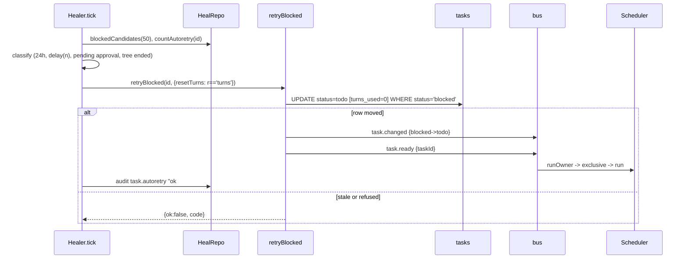
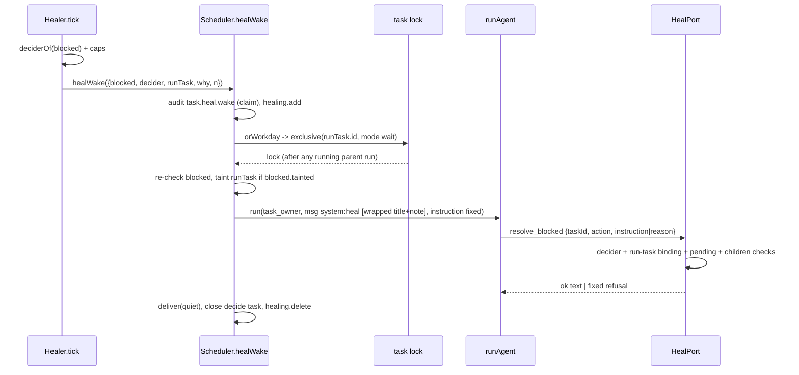
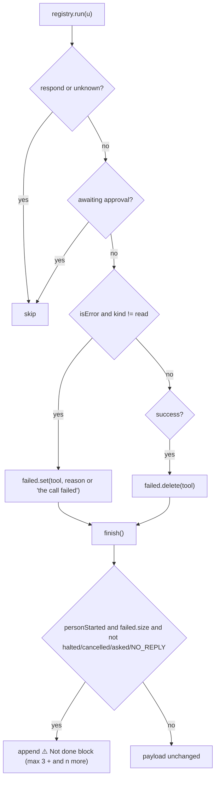

# HEAL-1: self-healing for blocked tasks, the warroom stall and failed tool calls

Date: 2026-11-09. Status: owner decisions taken in chat; awaiting spec review, then Gate 1.

## 1. Goal and evidence

The owner wants the company to keep working without a person unblocking it. On 2026-11-09 the bots went quiet for hours:

- 9 open tasks were `blocked` and nobody retried them. 7 were blocked by their own owner via `update_task` (`blocked_reason` `owner`, or NULL for rows blocked before migration 036), 2 by `error`.
- At 18:22 the CEO called `warroom_say` and `respond` in the same model step; the say returned `tool_error` ("the warroom conversation is stalled until a person writes there") but the answer, written before the result was known, told the owner "I sent the message to R&D and CTO". Nothing was sent, so no reply and no summary ever came. (At 17:42 the same refusal came in an earlier step and the CEO reported it correctly.) The CEO's conversation task 5060c624 is tainted.
- The `ClickUp all-workspaces mode` notice is posted on every boot (5 boots on 2026-11-09).

Owner decisions (2026-11-09, binding):

| # | Decision |
| :--- | :--- |
| H1 | Transient blocks (`error`, `turns`) are retried by code: at most 2 times, 30 min then 2 h after the block. `turns` gets 1 retry with the turn counter reset. Budget and cost limits apply as today. |
| H2 | Self-blocks (`owner`, legacy NULL) and transient blocks that used up their retries wake the head that asked for the work, which decides: retry with a clearer instruction, cancel, or ask the person. At most 2 wakes per blocked task. |
| H3 | The warroom stall also lifts (a) when a person-started, untainted run of a head calls `warroom_say`, and (b) after 60 minutes with no bot turn in the room. |
| H4 | When a non-read tool fails in a run, code appends a fixed warning line to the final answer naming the tool and the reason. The model cannot change or remove it. |

Also in scope (small): the ClickUp mode notice is posted only when the mode changes (H5); heads see why a task is blocked (H6).

Out of scope: A (AI approver), C (Brave), D (skill proposals), E (dev jobs). A self-block caused by a missing tool (for example the software members have no code tool until E) will still end at the deciding head; H2 bounds how often that happens.

## 2. Components

All code timers follow the existing `askTick` pattern: one `setInterval` of 60 s in `app.ts`, a no-op while halted, on an off day, or while the switch is off.

### 2.1 Healer (`agents/tasks/healer.ts`, new)

`Healer.tick()` runs every 60 s and handles at most 3 tasks per tick (oldest `updated_at` first) so a backlog never bursts.

**Retry (H1).** Eligible: `status = 'blocked'`, `blocked_reason IN ('error','turns')`, blocked within the last 24 h (`updated_at >= now - 24 h`), the parent and root not ended (same check as `/task retry`), no pending approval on the task. Older transient blocks are never retried blindly: they go to the wake path. (On 2026-11-09 the two `error` rows belong to an abandoned idea and are days old, so they are woken, not retried.)

- Attempt count = number of `task.autoretry` audit rows for the task id.
- `error`: attempt 1 when `updated_at <= now - 30 min`; attempt 2 when `updated_at <= now - 2 h`. `turns`: attempt 1 only, after 30 min, with `reset_turns`.
- The move is the same code as `/task retry` (`discord/commands/task.ts`: guarded update blocked → todo with optional turn reset, then the `task.changed` and `task.ready` bus events that make the scheduler start it), extracted to one shared function `retryBlocked(taskId, { resetTurns, by })` in `agents/tasks/` used by the slash command, the healer and `resolve_blocked`. The function includes both events, so a retried task never sits in `todo`.
- Audit: `actor: 'system:healer'`, `action: 'task.autoretry'`, `task_id`, `outcome: 'ok #<n> <reason>'`.
- Retries used up and the task blocks again → it becomes eligible for a wake (below) with the fixed reason `gave up after automatic retries`.

**Wake (H2).** Eligible: `status = 'blocked'` and (`blocked_reason = 'owner'` or NULL, or a transient block whose retries are used up), fewer than 2 `task.heal.wake` audit rows for the task, and no wake for it in the last 30 min.

- Decider: the owner of the parent task when the parent exists and is open (status `todo`, `doing`, `review` or `awaiting_approval`; not `done`, `cancelled` or `blocked`); otherwise the CEO (hq head). If the decider would be the blocked task's own owner, the CEO decides instead. If the CEO would decide about its own task, nobody is woken: the task is listed in the daily heal summary (2.5) for the owner.
- The decider is resumed through the existing owner-resume path (`Scheduler`, the one ASKBACK-1 uses with `ASK_RESUME_INSTRUCTION`, which already handles the task lock, taint and budget), so a parent already running is not started twice: the wake waits for the lock like an ask resume does. With no parent, the CEO is resumed on a new hq task "Decide on blocked task <id8>" in the CEO's work room. The instruction is fixed text built by code: the blocked task id, title (untrusted, wrapped), owner, reason code and the stored blocked note (redacted, cut to 300, untrusted, wrapped), and the list of choices below. The run is a normal metered run (budget, limits, taint as today; a tainted blocked task taints the wake run).
- Choices, through one new tool `resolve_blocked { taskId, action: 'retry' | 'cancel', instruction?: string(1..1000), reason?: string(1..300) }`:
  - `retry`: appends the instruction to the blocked task as a message from the decider (the task's next run sees it), then calls `retryBlocked` (no turn reset). A child that blocked already counted as ended for its parent's roll-up (`scheduler.ts`, the `ended` rule); a retried child that later finishes reports to the parent again as a new report (tested);
  - `cancel`: cancels the blocked task with the reason (same path as an owner cancel);
  - to ask the person the head uses the existing `ask_requester`; to give the work to someone else it cancels and uses the existing delegation tools.
- `resolve_blocked` refuses (tool_error, fixed text) unless: the caller is the task's decider as defined above, the task is still blocked, and the caller is a head. It is `kind: 'write'` with no approval (it only moves a task inside the company).
- Audit: `task.heal.wake` (decider, task id) and the tool's own rows.
- Daily cap: at most 10 wakes per decider per Bangkok day; over the cap the task waits for the next day and is listed in the heal summary.

**Legacy rows.** The 7 rows blocked with NULL reason are handled as `owner` on the first ticks (3 per tick).

### 2.2 Warroom stall lift (`agents/team/warroom.ts`, `agents/scheduler/scheduler.ts`)

Today a stall lifts only when a person writes in #ai-warroom (`guard.humanMessage(key)`), and the stall survives a restart (WS4).

- **H3a, person-driven say** (helps only untainted runs; the 18:22 case ran on a tainted conversation, so there only H3b would have lifted the stall). In `Scheduler.warroomSay`, before the stall check: when the run was started by a person's message (route reason is a direct message, mention or channel message from a human, not a schedule, task continuation, bot message or wake) and the run is not tainted, call `guard.humanMessage(AI_WARROOM_CHANNEL_ID)`. The run carries a new boolean `personStarted`, set by code where the run is created; the model cannot set it. The daily warroom quota (`guard.paused()`) and the per-head hourly say limit are unchanged.
- **H3b, quiet lift.** In `WarroomGuard`, when a stalled key is checked and its last successful bot turn is at least `warroom.stallQuietMinutes` (default 60) ago, the stall is cleared exactly as `humanMessage` clears it. The rest of the stall rule (`stallTurns`, WS3 one task-write reset) is unchanged, so a loop still stalls again after `stallTurns` turns. "Last successful bot turn" is a new timestamp set only when a bot run in the room actually starts or a say actually posts; refused `start()` calls and refused says do not update it (today's `touched` moves on reads too, so it is not reused). It is written through to `guard_state` with the counters (the existing `touched_at` column is reused for this value only if no other code reads it for retention; otherwise one nullable column is added).
- Audit: `warroom.stall.lift` with outcome `person_run` or `quiet`.

These change the TW1/TW3/WS3 rulings of Gate 1 (teamtalk/warroom) and need security sign-off.

### 2.3 Failed tool footer (H4, `agents/loop/loop.ts`)

- The loop records each tool call of the run whose result is a `toolError` and whose tool `kind` is not `read`; a tool with no declared kind counts as not-read (for example `warroom_say`, `forward_to`, `create_task`, `update_task`, ClickUp writes). Calls that end `awaiting_approval` are not failures. A later successful call of the same tool in the same run clears that tool's failure (for example an `update_task` refused for a missing reason and then retried correctly).
- Tools in one model step run in order before the step's `respond` ends the run (`loop.ts`, the batch loop), so a failure in the same step as the answer is recorded before the footer is built (the 18:22 case; tested).
- When the run ends with an answer to a person (direct, mention, channel; not warroom roll-ups or post-only runs), code appends one block after the model's text: `⚠️ Not done:` followed by up to 3 lines `- <tool>: <reason>`. The reason is the tool error text, redacted with the literal secret list, folded to one line, stripped of mentions and invisible characters, cut to 160 characters. More than 3 failures add `- and <n> more`.
- Appended after the model output and after any streaming has finished, as the last part of the final payload; the model never sees or edits it.

### 2.4 ClickUp mode notice once (H5, `app.ts`)

At boot, before posting, read the latest `clickup.mode` audit row. Post the notice and write a new row only when the mode (`workspace` / `workspace-all`) differs from that row or no row exists. The workspace-count part of the all-mode notice is not compared.

### 2.5 Visibility (H6)

- The task tools that list or read tasks for heads (`/task list` already does) show `blocked_reason` and the stored blocked note (masked, cut to 300) so the CEO can say why a task is blocked.
- One heal summary per day at 18:00 Asia/Bangkok in bot-log by the hq bot, only when something happened: retries (count, how many unblocked), wakes (count, decisions), and tasks still blocked that need the owner (id, title cut to 60, reason code). Built from audit rows and the tasks table; fixed text plus counts and titles. When A ships, its digest is posted in the same embed. (Superseded by AI-APPROVE-1 Amendment SA-1 C13: the AI digest is a separate embed.)

## 3. Controls

- `heal.enabled` (boolean, default `true`), in `/settings`, Bot Admin only, live. Off = no retries, no wakes, no stall quiet lift, no summary. H4 and H5 are not behind the switch.
- `heal.maxRetries` (int 0–5, default 2), `heal.maxWakesPerTask` (int 0–5, default 2), `heal.maxWakesPerDeciderDay` (int 1–50, default 10), `warroom.stallQuietMinutes` (int 15–1440, default 60): psql only.
- Halt and off days: the healer does nothing; the existing halt resume path stays as is.

## 4. Error handling

Every healer step is wrapped like the other ticks (`safe(...)`, log the error name only). A failed retry or wake writes no audit row, so it is tried again on a later tick; the time windows keep that from spinning. `resolve_blocked` refuses with fixed texts. The footer code never throws into the reply path: on any error the answer is posted without the footer and the error is logged.

## 5. Testing

- Unit, healer: eligibility per reason (error, turns, owner, NULL, halt, budget, approval excluded), transient blocks older than 24 h go to wake not retry, the 30 min / 2 h windows at the boundary, attempt counting from audit rows, turns reset once, 3-per-tick cap, decider choice (parent owner, CEO fallback, own-task → CEO, CEO own task → summary only), wake caps per task and per decider per day, switch off, halted, off day.
- Unit, `resolve_blocked`: retry appends the instruction and moves the task; cancel; refusals (not the decider, not blocked, persona caller, task in another tree).
- Unit, warroom: person-started untainted say lifts a stall; tainted or bot-started say does not; quiet lift at 59 and 60 minutes; refused starts and says do not move the quiet clock; a lifted key stalls again after `stallTurns` bot turns; quota and hourly say limit still refuse.
- Unit, footer: a failed `warroom_say` in the same step as `respond` adds the line; a failed then successful `update_task` adds nothing; a failed read tool does not; `awaiting_approval` does not; 4 failures show 3 lines and "and 1 more"; a mention or secret in the error text is removed; a warroom roll-up gets no footer.
- Unit, ClickUp notice: same mode as last row → no post; changed or no row → post and row.
- Integration (DB): blocked `error` task → retried after 30 min (and the scheduler starts it), again after 2 h, then a wake of the parent owner; a wake for a parent already `doing` waits for its lock and runs once; a retried child of a parent conversation that already rolled up reports again; a self-blocked child → parent head woken once, `resolve_blocked retry` → task back in `todo` with the instruction message; restart does not repeat a wake inside 30 min.
- Tester acceptance includes the original situation: a CEO run started by the owner that calls `warroom_say` while the room is stalled now posts; a failed send shows `⚠️ Not done`; the 9 blocked tasks are retried or woken without the owner typing a command.

## 6. Residual risks for Gate 1

- R1: a person-started run lifts the stall, so a person chatting with a head can restart a bot loop once per stall window; the loop still stalls after `stallTurns` turns.
- R2: retries and wakes spend budget without a person asking (bounded by H1/H2 caps, the daily wake cap and the normal budget limits).
- R3: a wake run reads the blocked note, which may hold model or page text; it is wrapped as untrusted, and a tainted blocked task taints the wake run, so later outward actions still ask for approval.
- R4: a head can cancel another member's blocked task through `resolve_blocked`; limited to tasks it is the decider for, and audited.

## Amendment SA-1 (binding, 2026-11-09)

Where this amendment and the sections above disagree, this amendment wins.

3.0 Spec statements contradicted by code, with the decided correction
| # | Spec says | Code fact | Correction (binding) |
|---|---|---|---|
| C1 | resolve_blocked `kind: 'write'`, no approval | registry.ts:135 `tool.kind ? approvalFor(...)`; policy-approval.ts:38 asks for a card on any write unless the run is direct and untainted; the tool's own `false` cannot remove it (:133) | Declare **no kind**, with `requiresApproval: () => false`. This is the update_task/create_task precedent. Security note S4. |
| C2 | The wake reuses the ASKBACK owner-resume path (`ASK_RESUME_INSTRUCTION`) | resumeOwner and resumeRun are keyed to a question row (`markResumed`, :2014, :2038) and require the task to be `doing` (:2016, :2034) | New `Scheduler.healWake`, modelled on rollupJob/rollUp (:1561–1597). It uses `exclusive(runTask.id, fn, {actor, mode:'wait'}, botRooted?'bot':'human')`, so it waits on the same per-task lock (`locks.run`, :1685) and never double-starts. |
| C3 | A parent in `awaiting_approval` counts as open and gets the wake | NO_ROLLUP includes awaiting_approval (:128); runMessage (:1072) and rollUp (:1576) refuse it | Parent in awaiting_approval: skip the task this tick and write no row. The parent owner is still the decider for resolve_blocked. |
| C4 | "Append the instruction as a message" | No task-message store exists (018 only adds card id columns). A post by the decider in the child's thread routes to the owner (router.ts:165–166, requester → owner), which races `task.ready` | Append a code-framed block to `tasks.description` in the same guarded UPDATE as the retry. The next run sees it wrapped untrusted (prompts/assemble.ts:145–151). |
| C5 | H6: "task tools that list or read tasks for heads" | No head task tool exists. ownTasksHeader (loop.ts:656–668) omits text on purpose (TW7). listOpenAdmin is "the only reader of blocked_note" (TA-C15, tasks.ts:309) | Heads see the reason code only: openOf (tasks.ts:482–485) returns `blocked-<reason>`. The note reaches only the decider's wake message, which makes the healer a second reader and needs a TA-C15 amendment (S7). |
| C6 | Quiet lift "when a stalled key is checked" | `isStalled` is a pure getter (warroom.ts:172); `start()` reads `t.stalled` directly (:225) | Add private `liftIfQuiet(key,t)` and call it from both `isStalled` and `start`. |
| C7 | Reuse `touched_at` if unused | Retention reads it: guard.ts:30 `DELETE FROM guard_state WHERE touched_at < $1` | Migration 037 adds the nullable `last_bot_turn_at`. |
| C8 | `stallQuietMinutes` 15–1440 | prune drops keys idle more than 6 h (IDLE_PRUNE_MS, warroom.ts:17, :82–86, guard.ts:30), which already lifts a stall | Range is **15–360**. |
| C9 | Quiet lift clears "exactly as humanMessage" | humanMessage gives back the WS3 reset (`resetUsed = false`, :137), so the next stall can take 2×stallTurns, which contradicts R1 | New `lift()` resets the count and stall and sets **resetUsed = true**. The next stall then comes after exactly stallTurns. Used by both H3a and H3b. |
| C10 | `warroom_say`, `forward_to` have "no declared kind" | warroomSay.ts:36 and forwardTo.ts declare `kind: 'write'` | Wording fix only. Behaviour is the same (not read). |
| C11 | `retryBlocked(taskId,{resetTurns, by})` audits | /task retry audits refusals with `tool = reason` (task.ts:228) | retryBlocked does **no** audit. Callers audit. See the signature in §5. |
| C12 | A failed wake writes no row | A slow lock wait would re-queue on every tick | The `task.heal.wake` row is written when the wake is queued, before spawn, plus an in-memory `healing` set. A wake that is queued and then fails counts toward the cap. |
| C13 | Gate 1 TW1/TW3/WS3 are in gate1-teamtalk.md | grep finds no TW or WS in that file. The rulings were in the deleted 2026-11-02 teamwork and 2026-11-03 work-style gates; the text survives in warroom.ts:4–14 and scheduler.ts:543, :610, :665 | Security cites the code comments. |
| C14 | H3a not listed under the switch (§3) | n/a | H3a, H3b, retry, wake, summary and resolve_blocked all sit behind `heal.enabled`. H4 and H5 do not. |
| C15 | resolve_blocked `instruction?` / `reason?` optional | n/a | `retry` requires `instruction`; `cancel` requires `reason` (zod superRefine). |

3.1 Pre-conditions for every healer step
- `scheduler.canRun()` (:272).
- Not an off day (`calendar.isOffDay`).
- `cfg.get('heal.enabled') === true`; a read error counts as off.
- A `running` flag prevents overlapping ticks.
- Each step is wrapped in `safe()` and logs `errName` only.

3.2 Healer.tick (new file agents/tasks/healer.ts)
1. `HealRepo.blockedCandidates(50)`: `SELECT <taskCols>, updated_at FROM tasks WHERE status='blocked' AND (blocked_reason IN ('error','turns','owner') OR blocked_reason IS NULL) ORDER BY updated_at, id LIMIT 50`.
2. For each row, `classify()`; act on at most 3 rows. Non-actionable rows do not count toward the 3.
3. classify:
   - `r = reason ?? 'owner'`.
   - A pending approval on the task (`pendingApprovals(id) > 0`, SchedulerDeps :66) → none.
   - Parent or root done/cancelled → wake, with why `its parent or root task has ended`.
   - r ∈ {error, turns}:
     - `cap = r==='turns' ? min(1,maxRetries) : maxRetries`.
     - `n = count(task.autoretry rows)`.
     - If `n < cap` and `updated_at >= now-24h`: retry when `now - updated_at >= delay(n+1)`, else wait. `delay(1)=30 min`, `delay(k≥2)=2 h`.
     - If `n >= cap` → wake, why `gave up after automatic retries`.
     - If the block is older than 24 h → wake, why `blocked for more than 24 hours`.
   - r = owner (NULL included) → wake, with no why.
4. Retry:
   - `retryBlocked(id,{resetTurns: r==='turns'})`.
   - On ok, audit `{actor:'system:healer', action:'task.autoretry', taskId, tool:r, outcome:'ok #<n+1> <r>'}`, with ` reset_turns` added for turns.
   - On a refusal, write no row.
5. Wake gate, all required:
   - `wakes(id) < maxWakesPerTask`.
   - No `task.heal.wake` row in the last 30 min.
   - `decider.today < maxWakesPerDeciderDay`.
   - Not in `scheduler.healing`.
   - `deciderOf()` is runnable.
   - Then call `scheduler.healWake(...)`.
6. deciderOf(t), shared with resolve_blocked:
   - The parent exists, is a head, has a `threadId`, and status ∈ {todo, doing, review} → the parent owner, with `runTask = parent`.
   - Parent owner equals `t.owner` → the CEO path.
   - Parent is in awaiting_approval → decider is the parent owner, not runnable.
   - Anything else (no parent, parent ended or blocked, persona parent, no thread) → the CEO path.
   - CEO path: if `t.owner` is the hq head → `none` (summary only); otherwise HQ with a new decide task.

3.3 Scheduler.healWake({blocked, decider, runTask|null, why, n})
- If `runTask` is null:
  - Check `limits.checkOpenTasks()`. If full, return `open_tasks` and write no row; the task is listed in the summary.
  - Create the decide task:
    - title: `Decide on blocked task <id8>`
    - description: fixed text with the full blocked id
    - deptId and owner: hq
    - requester: HQ
    - origin: `'delegated'`
    - tainted: `blocked.tainted`
    - status: `todo`
  - Emit `task.created`.
- Write the claim row: `{actor:'system:healer', action:'task.heal.wake', taskId: blocked.id, tool: actorKey(decider)}`. Outcome is `ok #<n> <runTaskId>` (actorKey is governance/budget.ts:92 `head:<dept>`). Add the id to `healing`.
- Start through `orWorkday(start, runTask.id, undefined, runTask.rootId)` (:352), using `spawn('heal wake')`.
- Inside `exclusive(...)`:
  1. Re-read both tasks. If the blocked task is not blocked any more, or `runTask` is in NO_ROLLUP, return.
  2. `ensureThread` for a decide task. `reopen` if `isConversationTask`.
  3. If `blocked.tainted` and `runTask` is not tainted, call `update(runTask,{tainted:true})` (AB6 pattern, :1981).
  4. `history`, then `approved(runTask, decider)`; return if it is null.
  5. Build `msg = healWakeMessage(...)`.
  6. `run({route:{actor:decider, reason:'task_owner', taskId:runTask.id}, msg, task:runTask, history, ...approved, instruction: HEAL_WAKE_INSTRUCTION[parent|ceo], ...pool})`.
  7. `parkInterrupted`, then `deliver(decider, where, outcome, undefined, true)`. Do not call noteFinal.
  8. Decide task: if still open and not awaiting_approval, set `done` (expected status = current) and emit `task.changed`.
  9. `closeUnlessHeld` for a conversation.
- The `finally` block removes the id from `healing`.
- healWakeMessage (agents/scheduler/notices.ts, beside resumeMessage at :219):
  - author: `{id:'system:heal', name:'heal', kind:'head'}` with no actor
  - id: `heal-<blockedId>-<n>`
  - content: `Blocked task <fullId> (owner <actorLabel>, reason <code>[, <why>]): "<title folded, cut 100>". Note from its owner: <reasonLine(note, secrets, 300) | (none)>` (reasonLine is :145).
  - The note comes from the new reader `HealRepo.blockedNote(id)`.

3.4 resolve_blocked (tools/builtin/resolveBlocked.ts → HealPort in agents/tasks/heal-actions.ts)
- Refusal order, first match wins:
  1. `heal.enabled` off
  2. halted
  3. not a head
  4. not found
  5. not blocked
  6. `!sameActor(deciderOf(t).actor, caller)`
  7. `ctx.task?.id` is neither `t.parentId` nor any run-task id named in this task's `task.heal.wake` rows
  8. pending approval
- `retry` calls `retryBlocked(id,{resetTurns:false, append: frame, taint: ctx.tainted() || ctx.task.tainted})`. The frame is `\n\n---\nInstruction from <actorLabel> after the block (<YYYY-MM-DD HH:mm schedule.timezone>): <redactText(neutralise(text),secrets) one line>`. Total description is cut to 6000 characters by trimming the original part.
- `cancel`:
  - `countOpenChildren > 0` → refuse.
  - Otherwise `update(id,{status:'cancelled'},'blocked')`.
  - Emit `task.changed {from:'blocked', to:'cancelled'}`; this drives reportEnded, askTaskEnded and the tree-grant root revoke (app.ts:415).
  - If it was a root, also `webGrants.revokeRoot(rootId,'system:heal')` (web-grants.ts:155), best effort.
- Audit: `{actor: actorKey(caller), action:'task.heal.resolve', taskId, tool: ctx.task.id, outcome:'retry'|'cancel'|'refused:<CODE>'}`.

3.5 Warroom
- **H3a** in `Scheduler.warroomSay` (:678):
  - After the `paused()` refusal: `stalled = isStalled(W)` (this includes H3b).
  - `canLift = stalled && req.personStarted===true && req.tainted===false && healOn`.
  - If stalled and not canLift → today's refusal.
  - Later, just before `this.post` (:700): if canLift, call `guard.lift(W,'person_run')`. So a say refused by the hourly limit, the private-room check or the length check does not lift.
  - After a successful post, call `guard.noteBotPost(W)`.
- **H3b**:
  - Stamp `t.lastBotTurn = now` on the ok path of `start()` (before persist at :242) and in `noteBotPost`.
  - Refused starts, stall turns and reads do not stamp.
  - `liftIfQuiet` lifts when `limits().quietMs !== null && now - lastBotTurn >= quietMs`. The limits closure is scheduler.ts:206; `quietMs` is null when heal is off.
  - In `ensure()`, a row with NULL `last_bot_turn_at` uses the load time.
  - Constructor gets an optional 5th parameter `onLift(key, why)`, which the Scheduler wires to the `warroom.stall.lift` audit.
- **personStarted**, computed in runAgent after `dtrigger` (loop.ts:283):
  - `dtrigger.kind==='human_message' && (origin chat|slash) && !adminRun && !trigger.postOnly && !trigger.askWake && !trigger.inMeeting && !trigger.pool`.
  - Put it on ToolContext. warroomSay.ts:58 passes `personStarted: ctx.personStarted===true`. WarroomSayPort.say (tools/types.ts:48) gains `personStarted?: boolean`.
  - It comes out false for schedule, task_owner, owner, roll-up, wake, stall, meeting, voice and admin runs.

3.6 Footer (loop.ts)
- Before `finish` (:196), declare `let footerOn=false; const failed=new Map<string,string>()`. Set `footerOn = personStarted`.
- After `registry.run` (:383), skip `respond` and `!registry.has(name)` (new method).
  - `awaiting = run.pending.length` grew → neither add nor clear.
  - `isError && kindOf !== 'read'` → `failed.delete(n); failed.set(n, registry.untrustedOf(n) ? 'the call failed' : r.content)`. `untrustedOf` is a new method; untrusted results arrive already wrapped (registry.ts:210).
  - Success → `failed.delete(n)`.
  - The loop's synthetic results (:375, :380) never reach this code.
- In `finish`, after the awaiting lines (:199), and under the same guards (not halted, not cancelled, not asked, not NO_REPLY, `footerOn`, `failed.size`):
  - Append `\n\n⚠️ Not done:` and up to 3 lines `- <word(tool)>: <escapeCardText(fold(reason),160,deps.secrets)>`, then `- and <n> more`.
  - escapeCardText (discord/embeds/approval.ts:101) redacts, escapes control and hidden characters, and defangs `@`. Defanging keeps the outbound handle pass from turning the footer into routing mentions.
  - The builder sits in a try/catch; on error it logs and returns the payload without the footer.
- Streaming takes the full payload (`rs.finalize(outcome.payload)`, scheduler.ts:1200), so the footer lands last.
- AgentDeps gains `secrets`, wired in app.ts.

3.7 H5 (app.ts:925–935)
- `last = AuditRepo.latestOutcome('clickup.mode')` (new; `ORDER BY ts DESC, id DESC LIMIT 1` on audit_log_action_ts_idx).
- If `last === mode`, skip both the audit row and the post.
- Still call `team()` / `teamsReady()` for the resolution check and keep its unresolved audit.

3.8 H6 / summary
- openOf SQL: `CASE WHEN status='blocked' THEN 'blocked-'||COALESCE(blocked_reason,'owner') ELSE status END`.
- Summary:
  - Runs in the healer tick when the local time is at least 18:00 in `schedule.timezone` and `dailyRuns.claim(day,'heal')` succeeds (board.ts:39).
  - Posts from hq to BOT_LOG as `{type:'alert', origin:'governance', title:'Heal summary'}`, and only if something happened.
  - Counts come from today's `task.autoretry`, `task.heal.wake` and `task.heal.resolve` rows. "Needs owner" lists rows that classify as none/capped: at most 10, each id8, `escapeCardText(title,60)` and the reason code.

Exception flows:
- A stale guarded update returns `E_STALE` and writes no row.
- A halt landing mid-wait: `exclusive` checks `canRun`.
- Restart: wake rows persist, so the 30-min gap holds. An in-flight wake is lost and counts toward the cap. A decide task left `todo` is re-run by recovery with its description.
- An audit append failure is swallowed (audit.ts:31), so a cap can be undercounted (residual).

4. MERMAID DIAGRAMS


```mermaid
sequenceDiagram
  participant M as warroom_say tool
  participant S as Scheduler.warroomSay
  participant G as WarroomGuard
  participant D as Discord
  M->>S: say({actor, text, task, tainted, personStarted})
  S->>G: ensure(W); paused()?
  S->>G: isStalled(W) [liftIfQuiet first]
  alt stalled and not (personStarted and untainted and heal.enabled)
    S-->>M: refuse "stalled until a person writes there"
  else ok
    S->>S: hourly, private, length checks
    S->>G: lift(W, 'person_run') if canLift -> onLift audit
    S->>D: post #ai-warroom
    S->>G: noteBotPost(W) -> persist last_bot_turn_at
    S-->>M: ok
  end
```


5. DATA, API & ERROR CONTRACTS
```ts
// agents/tasks/retry.ts
export type RetryCode = 'E_NOT_FOUND'|'E_HALTED'|'E_NOT_BLOCKED'|'E_TREE_ENDED'|'E_TURNS'|'E_STALE';
export async function retryBlocked(d: { tasks: Pick<TaskRepo,'get'|'update'>; bus: EventBus<AppEvents>; isHalted(): boolean; turnsCap(): number },
  taskId: string, o: { resetTurns: boolean; append?: string; taint?: boolean }):
  Promise<{ ok: true; task: Task; reason: BlockReason } | { ok: false; code: RetryCode; reason?: BlockReason; status?: TaskStatus }>;
// tools/builtin/resolveBlocked.ts
export const resolveBlockedInput = z.object({
  taskId: z.string().trim().toLowerCase().regex(/^[0-9a-f-]{36}$/),
  action: z.enum(['retry', 'cancel']),
  instruction: z.string().trim().min(1).max(1000).optional(),
  reason: z.string().trim().min(1).max(300).optional(),
}).strict().superRefine((v, c) => {
  if (v.action === 'retry' && !v.instruction) c.addIssue({ code: 'custom', path: ['instruction'], message: 'retry needs an instruction' });
  if (v.action === 'cancel' && !v.reason) c.addIssue({ code: 'custom', path: ['reason'], message: 'cancel needs a reason' });
});
```
- Config (config/schema.ts + defaults.ts). All five keys go in HANDLER_KEYS (admin/keys.ts:12):
  - `heal.enabled`: `z.boolean()`, default true. `/settings` case → `planHealEnabled`, modelled on planOtEnabled (plans.ts:120), with `risk: v===true`.
  - `heal.maxRetries`: int 0–5, default 2.
  - `heal.maxWakesPerTask`: int 0–5, default 2.
  - `heal.maxWakesPerDeciderDay`: int 1–50, default 10.
  - `warroom.stallQuietMinutes`: int 15–360, default 60.
  - The settings default text (settings.ts:148) gains `heal.*`/stallQuiet → "the owner sets the heal caps in the database".
- Migration (flag: `db/migrations/` is NON_SELF_MODIFIABLE, devjob/paths.ts:58). PASTE VERBATIM:
```sql
-- db/migrations/037_heal.up.sql
ALTER TABLE guard_state ADD COLUMN last_bot_turn_at timestamptz NULL;
UPDATE guard_state SET last_bot_turn_at = touched_at;
ALTER TABLE daily_runs DROP CONSTRAINT daily_runs_kind_check;
ALTER TABLE daily_runs ADD CONSTRAINT daily_runs_kind_check CHECK (kind IN ('goal','report','heal'));
-- db/migrations/037_heal.down.sql
DELETE FROM daily_runs WHERE kind = 'heal';
ALTER TABLE daily_runs DROP CONSTRAINT daily_runs_kind_check;
ALTER TABLE daily_runs ADD CONSTRAINT daily_runs_kind_check CHECK (kind IN ('goal','report'));
ALTER TABLE guard_state DROP COLUMN IF EXISTS last_bot_turn_at;
```
- Related type and SQL changes:
  - GuardRow gains `lastBotTurnAt?: number|null`; the repo put writes `$6`.
  - DailyKind gains `'heal'` (board.ts:32).
  - Decider-day SQL: `SELECT count(*)::int FROM audit_log WHERE action='task.heal.wake' AND tool=$1 AND outcome LIKE 'ok %' AND ts >= (date_trunc('day', now() AT TIME ZONE $2) AT TIME ZONE $2)`, with $2 = `schedule.timezone`. It runs on audit_log_action_ts_idx; no new index is needed.
- Audit actions and outcomes:

| action | actor | task_id | tool | outcome |
|---|---|---|---|---|
| task.autoretry | system:healer | id | reason | `ok #n reason[ reset_turns]` |
| task.heal.wake | system:healer | id | decider key | `ok #n <runTaskId>` |
| task.heal.resolve | caller key | id | run task id | `retry`, `cancel` or `refused:CODE` |
| warroom.stall.lift | system:warroom | null | key | `person_run head:<dept>` or `quiet <min>` |

- resolve_blocked fixed refusals:
  - R_DISABLED "automatic healing is switched off"
  - R_HALTED "the company is halted"
  - R_NOT_HEAD "resolve_blocked is for department heads only"
  - R_NOT_FOUND "no task has that id"
  - R_NOT_BLOCKED "that task is not blocked any more"
  - R_NOT_DECIDER "you are not the one who decides about that task"
  - R_NOT_HERE "resolve_blocked works only from the parent task or the decision task of that blocked task"
  - R_PENDING "that task has a pending approval; wait for the decision"
  - R_TREE_ENDED "its parent or root task has ended"
  - R_TURNS "that task used all its turns; cancel it or ask the person"
  - R_OPEN_CHILDREN "that task has open subtasks; it cannot be cancelled here"
  - R_STALE "the task changed meanwhile; nothing was done"
- /task retry text and codes are unchanged (task.ts:226–242) and map from RetryCode.
- Edge cases:
  - Lifetime attempt counts: a later block of the same task reuses the old counts.
  - A `turns` task after its single retry can only be cancelled through resolve_blocked.
  - A decide task on hq draws on the warroom pool (botRooted, :1689–1692).
  - The 7 legacy NULL rows are treated as owner and worked 3 per tick.

6. SECURITY & PRIVACY NOTES (requires security gate)
- S1 (TW3 widened): any guild member counts as a person (inbound.ts:45). Bounds per person message: SAY_CALLS_PER_RUN 2, the per-head hourly say limit, and `paused()`. `lift()` sets resetUsed=true, so the next stall comes after exactly stallTurns turns (R1 now holds).
- S2 (H3b): the worst case per key per day is (24h / quiet) × stallTurns, which is 480 turns at the defaults. The hourly rates are lifted on the local provider (WS1, warroom.ts:235), so there only the stall and warroom pools bound it. Gate to rule (G1-b).
- S3 (injection): title and note go only in wrapped `msg.content`, masked with literal secrets and cut to 100/300. The instruction is fixed text. A tainted blocked task taints the run task. A retry instruction from a tainted run taints the child (`taint`) and lands in a description that is shown wrapped.
- S4 (authority): the decider is derived by code, bound to the parent or a wake-row decide task, head only, blocked only, refused with a pending approval or open children, and audited. Kindless means never a card. Gate to rule (G1-a) whether `cancel` from a tainted run is refused.
- S5 (footer): built after the model; model text never enters it except masked error text. Untrusted errors get fixed text; unknown tool names are excluded; `@` is defanged. Logs carry errName only.
- S6 (spend, R2): bounded by maxRetries, maxWakesPerTask, the decider-day cap and `checkOpenTasks`. Code-made decide tasks bypass TW6 botRoots.
- S7: TA-C15 needs an amendment, because the healer is a new reader of blocked_note. The TW7 header gains a closed reason word only.
- S8: personStarted cannot be forged (code-derived; ToolContext is never built from tool input).

7. OPEN QUESTIONS: none for backend. The Gate 1 rulings G1-a and G1-b do not block the build; the default is the spec R4 behaviour.

Existing tests this invalidates (sa rule 4):
- db/migrate.int.test.ts:26 and :28: append `'037_heal'` to the up list and prepend it to the down list.
- prompts/loader.test.ts:58: heads get `'resolve_blocked'` after `'answer_subtask'` (for hq, before `'meeting_start'`). It is added to prompts/heads/*.md; :67 (members) is unchanged.
- agents/team/warroom.say.test.ts:122–131 stays green, because it calls the port directly without personStarted (:56). Add sibling tests.
