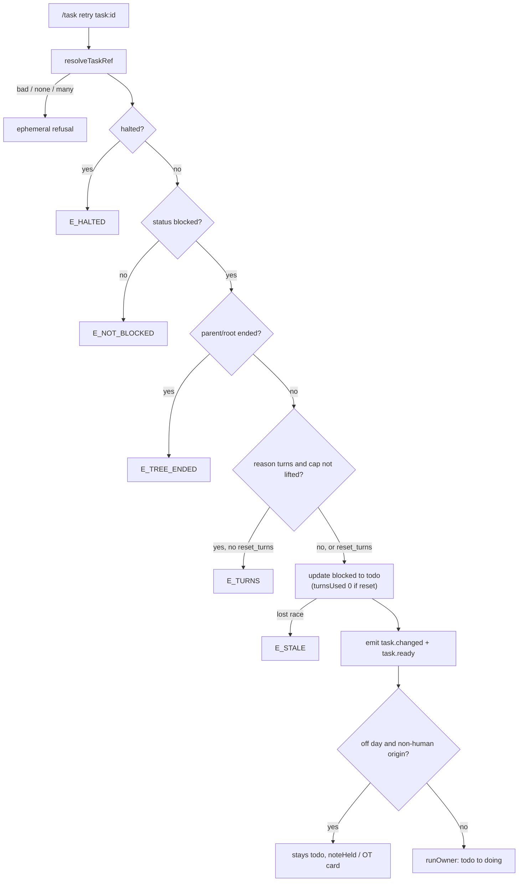

# TASKADMIN-1 — Bot Admin task administration (design)

Owner request 2026-11-09: build /task cancel (plus list/retry) to clear stuck tasks clogging limits.openTasks and childrenPerTask.

SPECIFICATION HANDOFF BRIEF (for document + security)
======================================================================
PLAN REF: none (task TASKADMIN-1, Stage 3 Spec)
TARGET TEMPLATE: freeform, in the style of BOT/Assistant/docs/superpowers/specs/2026-11-09-tree-grant-design.md
OUTPUT DESTINATION: /Users/pakawat.tan/Desktop/Labworkspace/BOT/Assistant/docs/superpowers/specs/2026-11-09-task-admin-design.md
REQUIRES SECURITY GATE: yes. It adds new admin state changes, a new button prefix, and a new abort path into running agent loops.

1. MODULE IDENTIFIER: TASKADMIN-1. Bot Admin task administration: `/task list|cancel|retry` and the blocked-reason fix. No migration in the recommended design.

2. ACTORS & BOUNDARIES
- **Actor:** a human with the Bot Admin role, in #⚙️-setting only. The existing `decide()` guard in `discord/commands/index.ts` covers this: guild, then `CONFIG_CHANNEL_ID`, then `adminRoleId` on the live `memberRoleIds`.
- **Processes:** the main app (hq client interaction path in `app-start.ts`, "The only interaction path: ClientManager listens on hq only"). The Praw path (`handlePrawInteraction`) never sees these commands. `PRAW_COMMANDS` (`discord/praw/definitions.ts`) has no `task` command, so there is no name clash.
- **Trust boundary:** models have no path to these actions.
- No tool is added.
- Nothing is added to `admin/ops.ts`, `ADMIN_TOOL_NAMES` or `MOD_TOOL_NAMES` (`admin/names.ts`).
- No new config key, so nothing is added to HANDLER_KEYS or ADMIN_CONFIG_KEYS.
- The confirm step deliberately does not use `admincfg:` cards. Those cards are proposable through `admin_op_propose`, which is a model path.
- **Data touched:** `tasks`, `approvals`, `approval_batches`, `web_grants` and `audit`. The `task_grants` revoke already exists.

3. DETAILED LOGIC & FLOWS

3.0 Shared id resolution (`resolveTaskRef`)
- Normalise the input: trim, lowercase. It must match `^[0-9a-f-]{6,36}$`; otherwise the result is E_BAD_ID. This also keeps `%` and `_` out of the LIKE pattern.
- Query `SELECT … FROM tasks WHERE id LIKE $1 || '%' ORDER BY created_at LIMIT 6`.
- 0 rows: E_NOT_FOUND.
- More than 1 row: E_AMBIGUOUS, listing up to 5 rows as `id8 dept status`.
- Exactly 1 row: the match.
- Task ids are UUIDs (`TaskRepo.create`: "const id = t.id ?? randomUUID()").

3.1 `/task list [status]`
- **Pre-conditions:** the `decide()` guard has passed. The reply is ephemeral: add `commandName === 'task'` to `deferEphemeral`.
- **Status option:** choices `open` (the default: todo, doing, review, blocked, awaiting_approval), `blocked`, `review`, `doing`, `todo`, `awaiting_approval`.
- **Header line:** `Open 19/20 (limits.openTasks) · todo n · doing n · review n · blocked n · awaiting n`.
- **One line per task**, at most 25, stalest first (`updated_at ASC`):
`5060c624 · hq · review · idle 3h12m · open children 5/5 · root|d1 · <title>`
- For a blocked task the status shows the reason: `blocked:turns|error|budget|approval|halt`. It shows `blocked:owner` when `blocked_reason` is NULL; only `update_task` produces NULL.
- Title: `redactText`, folded to one line, cut to 40 characters, markdown and mentions escaped (`escapeCardText`), `allowedMentions {parse:[]}`.
- Shows `… and N more` when the list is cut. Not audited (read-only, like `/holiday list`).
- **New repo methods:** `TaskRepo.listOpenAdmin(statuses, limit)` returns `updatedAt` (not in `taskCols`) plus an open-children count subquery. `TaskRepo.countByStatus()`.

3.2 `/task cancel task:<id> [cascade:children]`. Two steps.

Step A, the slash command:
1. Resolve the id (3.0). If the task is done or cancelled: E_ENDED.
2. Compute the open subtree S with the CTE below.
3. Refuse in these cases:
 - Without `cascade:children` and S has open descendants: E_OPEN_CHILDREN. This avoids orphans; their roll-ups would hit a `NO_ROLLUP` parent.
 - |S| > 50 (`TASK_CANCEL_MAX`, a code constant): E_TOO_MANY.
4. Compute `digest` = sha256 over the sorted `id:status` lines of S plus the cascade flag, first 12 hex.
5. Store a nonce in process memory: `{nonce16hex → userId, targetId, cascade, digest, expiresAt now+5min}`, at most 100 entries, single use. Nothing is persisted, so no migration is needed.
6. Ephemeral confirm reply listing:
 - target `id8`, dept, status, owner, title (masked as above);
 - descendants, up to 10 as `id8 dept status`;
 - the number of pending approvals that will expire;
 - "root: task and web grants end" when the target is the root;
 - "running now" from `TaskRuns.active`.
 - Buttons: `taskadm:cancel:<nonce>` (Danger) and `taskadm:dismiss:<nonce>`.

Step B, the click:
1. Routing: add `taskadm:` to `route()` and to `deferEphemeral`. It goes through the #setting and admin-role checks of `decide()`, but not the approvals-room branch.
2. Validate the nonce: it must exist, be unexpired, and its `userId` must equal the clicker; otherwise E_STALE. Delete it either way.
3. Run `Approvals.adminCancel(...)` (the new method below), in one transaction:
 1. Lock the root `FOR UPDATE`, the same order as `decide()` and `expireOld`.
 2. Recompute S under the lock and compare digests (mismatch: E_STALE).
 3. Lock the S rows `ORDER BY id FOR UPDATE`.
 4. Expire the pending approvals of S.
 5. Move S to `cancelled` with `move()`.
 6. Run `blockWaiters` for expired cap approvals. This only reaches waiters outside S, because S is already cancelled.
 7. Dissolve or close the batches of S.
4. After COMMIT:
 1. `emitChanges` emits `task.changed` with the new event field `admin: { cascadeIds }`. No `task.ready` is emitted.
 2. `TaskRuns.abort(S)`.
 3. Revoke the live web grants of the root with reason `admin`, only when the root is in S.
 4. Close the posted batch cards: `cards.close(channel, message, 'Closed: the task was cancelled by a Bot Admin.')`.
 5. Write the audit rows.
 6. Reply `Cancelled N task(s): id8…`.
- Cancel is allowed while halted. It only reduces work and never starts a run. Discord posts follow the existing halt gating: the parent-thread notice is skipped while halted (`reportEnded` "!(tt && this.d.halt.isHalted())").

Effects through existing handlers (cite these; no new code):
- Thread card, #📋-tasks log, H1 handoff edit, room line and boards: `Scheduler.reportEnded`.
- Open ask questions close: `askTaskEnded(task, 'cancelled')` in `handleChanged`.
- Task grant plus its companion web grant are revoked with `root_ended` and audited when the root is cancelled: `app.ts` "TG-C18: the root of a task tree ending revokes its grant".
- OT:
- A live OT grant on that root is revoked with `root_ended` by the next hourly `OtService.sweep`.
- A pending OT click refuses with `root_ended` (`ot-requests.ts` "return refuse('root_ended')").
- Queued work is skipped:
- `runOwnerInner` needs status `todo`.
- `rollUp` checks `NO_ROLLUP`, which includes cancelled.
- The router gives no run to a cancelled task (R31).

Parent behaviour:
- The parent owner gets the "Subtask cancelled" post (fixed text, extended to "… was cancelled by a Bot Admin."). It is skipped when the parent is itself in `cascadeIds`, so a cascade does not flood the threads.
- There is no roll-up run, because only `done` spawns one.
- A non-conversation parent is never auto-closed (`settleReviewLocked` returns for non-conversation tasks).
- A conversation parent in `review` whose last open child was just cancelled IS closed, or gets a `finalRollup` model run. This is existing behaviour (`handleChanged` → `settleReview(parent)`). See OQ-2.

Running loops (new code: `agents/task-runs.ts`, class `TaskRuns`):
- Methods: `track(taskId, ac) → untrack`, `abort(ids) → count`, `cancelled(id)`, `active(id)`.
- The cancelled set is in memory, cleared on boot.
- `agents/call.ts`: next to `const untrack = deps.halt.track(ac);`, call `deps.taskRuns?.track(task.id, ac)` when `task` is set. This covers owner runs, roll-ups and mention runs, because every run with a task registers.
- `agents/loop.ts` gets three changes:
1. At `if (call.aborted) return finish(halted());`: when not halted and `taskRuns.cancelled(task.id)`, return `finish({ payload: alertPayload('Task cancelled', 'A Bot Admin cancelled this task. Nothing more will run.'), stopped: 'cancelled' })`. Otherwise keep the halted path, so the shutdown abort is unchanged.
2. At the top of each iteration, after the halt check: the same stop if the task is cancelled.
3. Inside the tool batch, before each `registry.run(u.name, …)`: if cancelled, push `{isError, content: 'task cancelled'}` and do not run the tool.
- Add `'cancelled'` to `AgentOutcome.stopped` (currently `'halted' | 'budget' | 'turns'`). Check every `stopped ===` site; `parkInterrupted` acts only on `'halted'`.
- Verify that an aborted STREAM-1 preview is finalised exactly as on the halt path.

3.3 `/task retry task:<id> [reset_turns:true]`
- No confirm step: retry is a single reversible move, and every retry is a separate human action.
- **Refusals**, checked in this order:
1. Halted: E_HALTED.
2. Status is not `blocked`: E_NOT_BLOCKED.
3. The parent or root is done or cancelled: E_TREE_ENDED.
4. Then by reason:

| blocked_reason | Behaviour |
|---|---|
| `turns` | E_TURNS unless `reset_turns:true` (then `turnsUsed: 0`, audited) or `liftsCap('limits.turnsPerTask')` applies; otherwise `checkTurn` blocks it again at once |
| `budget`, `approval` | Allowed; the run hits the tree or local cap again and asks for a cap approval (`onTreeCapHit`), so a human still decides |
| `halt` (while not halted) | Allowed; resume normally clears these |
| `error`, NULL (owner) | Allowed |

- **Move:** `tasks.update(id, { status: 'todo', ...(reset ? { turnsUsed: 0 } : {}) }, 'blocked')`. The `update` rule clears `blocked_reason`. A null result means E_STALE. Then emit `task.changed` (blocked→todo) and `task.ready`; `Scheduler.onTaskReady` → `runOwner` moves the task todo→doing.
- **Limits:** retry does not change `countOpen` or `countOpenChildren`, because blocked already counts in both. The budget, department cap, turn and OT gates apply as on any run.
- **Off day:** for a non-human origin, `runOwnerInner` keeps the task `todo`, calls `noteHeld` (which may raise an OT card) and runs it on the next workday. The reply says "Queued; it starts on the next workday or after overtime is approved."

3.4 Blocked-reason fix (item 5)
- **Cause:** `update_task` writes `{ status: input.status }`, and `TaskRepo.update` sets `blocked_reason = NULL` ("A reason belongs to one blocked spell"). The summary is optional, and the card never shows a reason.
- **Recommended (a), no migration:**
- `updateTaskInput.superRefine`: when status is `blocked`, require `summary` with at least 5 characters after trim. Otherwise the tool returns `blocked needs a short reason in summary`.
- Change the tool description only. Leave `prompts/*.md` unchanged to avoid the protected-prompt hash check (K6).
- Show the reason from the event: `redactText`, one line, cut to 300, defanged. Places:
  - "Subtask blocked" post (`reportEnded`, the `['Subtask blocked', …]` branch);
  - room line (`tt.ended(..., e.summary, task.blockedReason)`, which already passes it);
  - a "Blocked because" field on the thread card and the #tasks log. `refreshCard` and `upsertTaskLog` take an optional event-only extra.
- The Discord card keeps the text until the next status edit, which ends the blocked spell anyway. `/task list` shows `blocked:owner`.
- **Optional (b), migration 036:** persist the note so `/task list` can show it. See section 5.

3.5 Item 6 (review counting). Owner decision; recommendation: keep counting.
- The model moves its own task to `review` through `update_task`. If review were excluded from the caps, a model could free up its own fan-out limit.
- A review task can still be re-run, because R31 does not exclude it.
- Root cause of the clog: nothing moves a non-conversation task out of `review` except its owner's next run.
- `reportEnded`'s `ended` excludes review, so the parent is never told.
- `settleReview` handles conversation tasks only.
- Proposed follow-up, `/task done task:<id>`: an admin accept, review→done. It reuses the normal done roll-up.

4. MERMAID DIAGRAMS

```mermaid
sequenceDiagram
  participant A as "Bot Admin (#setting)"
  participant D as "decide() guard"
  participant H as "taskCancel handler"
  participant P as "Approvals.adminCancel"
  participant DB as "PostgreSQL"
  participant R as "TaskRuns"
  participant S as "Scheduler handlers"
  A->>D: /task cancel task:5060c6 cascade:children
  D->>D: guild, channel, admin role (live)
  D->>H: handler
  H->>DB: prefix lookup LIMIT 6 + subtree CTE
  alt invalid / ambiguous / ended / too many
      H-->>A: ephemeral fixed refusal
  else ok
      H->>H: digest(S), nonce {userId, digest, 5 min}
      H-->>A: ephemeral confirm + taskadm:cancel:nonce
  end
  A->>D: click taskadm:cancel:nonce
  D->>H: role + channel re-checked
  H->>H: nonce valid, same user, single use
  H->>P: adminCancel(target, cascade, digest, user)
  P->>DB: BEGIN; root FOR UPDATE; recompute S; compare digest
  P->>DB: S FOR UPDATE; approvals pending to expired; S to cancelled; blockWaiters; batches closed
  P->>DB: COMMIT
  P->>S: task.changed (admin.cascadeIds) per row
  S->>S: cards, log, handoff, ask close, grant revoke (root)
  H->>R: abort(S)
  R-->>S: loop stops: "Task cancelled" (stopped cancelled)
  H->>DB: audit rows
  H-->>A: ephemeral "Cancelled N task(s)"
```



5. DATA, API & ERROR CONTRACTS

Command definitions (`discord/commands/definitions.ts`; add `task` to `COMMANDS` and three rows to `COMMAND_TABLE`):
- `task list` with `status?`: string, choices `open|blocked|review|doing|todo|awaiting_approval`.
- `task cancel` with `task`: string, required, min length 6, max 36; and `cascade?`: string, choice `children`.
- `task retry` with `task`: string, required, min length 6, max 36; and `reset_turns?`: boolean.
- Autocomplete: not in v1. `toInteractionLike` returns null for autocomplete ("if (!i.isChatInputCommand() && !i.isButton() …) return null"). Adding it needs the adapter change, the same guard returning `[]` for non-admins, the 3 s deadline and a 25-choice cap. Short ids from `/task list` cover the need.

Button: `taskadm:(cancel|dismiss):[0-9a-f]{16}`, matched by an exact regex; anything else answers 'Unknown action.'.

Event change (`core/events.ts`): `'task.changed'` gets `admin?: { cascadeIds: readonly string[] }`, set only by `adminCancel`.

SQL, PASTE VERBATIM (open subtree, at most 51 rows read so the 50 limit can be detected):
```sql
WITH RECURSIVE sub(id, lvl) AS (
SELECT id, 0 FROM tasks WHERE id = $1
UNION ALL
SELECT t.id, s.lvl + 1 FROM tasks t JOIN sub s ON t.parent_id = s.id WHERE s.lvl < 10
)
SELECT t.id, t.status, t.parent_id AS "parentId"
FROM tasks t JOIN sub ON sub.id = t.id
WHERE t.status NOT IN ('done','cancelled')
ORDER BY t.id
LIMIT 51;
```
SQL, PASTE VERBATIM (inside `adminCancel` after the locks; `$1` = id array of S, `$2` = admin user id):
```sql
UPDATE approvals SET status = 'expired', decided_at = now(), decided_by = $2
WHERE task_id = ANY($1) AND status = 'pending'
RETURNING id, task_id, kind, tool_name;
```
```sql
UPDATE approval_batches
SET state = CASE WHEN state = 'posted' THEN 'closed' ELSE 'dissolved' END
WHERE task_id = ANY($1) AND state IN ('open','sealed','posted')
RETURNING id, state, channel_id AS "channelId", message_id AS "messageId";
```
Task move: `move(c, changes, 'cancelled', "t.id = ANY($1) AND t.status NOT IN ('done','cancelled')", [ids])`. Then `blockWaiters(c, changes, capIds)` for the expired rows whose kind is `tree_cap` or `local_cap`.

Developer must verify: how the batch sealer and poster handle a batch flipped to `dissolved` or `closed` by another writer.

Web grant revoke (new repo method `WebGrantRepo.revokeRoot(rootId, by)`):
`UPDATE web_grants SET revoked_at = now(), revoked_by = $2, revoke_reason = 'admin' WHERE root_id = $1 AND revoked_at IS NULL`.
The reason is `admin` because the CHECK in migration 027 allows only `admin|halt|superseded`. Consume already refuses an ended root (`root_ended` in `web-grants.ts`), so this revoke is housekeeping, not the security boundary.

Storage: no schema change in design (a).

Optional migration 036 (option b, only if the owner chooses it). Developer must check the actual constraint name with `\d tasks` first; `tasks_blocked_reason_check` is assumed. PASTE VERBATIM:
```sql
ALTER TABLE tasks DROP CONSTRAINT tasks_blocked_reason_check;
ALTER TABLE tasks ADD CONSTRAINT tasks_blocked_reason_check CHECK (blocked_reason IN ('halt','approval','budget','turns','error','owner'));
ALTER TABLE tasks ADD COLUMN blocked_note text CHECK (blocked_note IS NULL OR char_length(blocked_note) <= 300);
```
Down for 036:
```sql
UPDATE tasks SET blocked_reason = NULL WHERE blocked_reason = 'owner';
ALTER TABLE tasks DROP COLUMN blocked_note;
ALTER TABLE tasks DROP CONSTRAINT tasks_blocked_reason_check;
ALTER TABLE tasks ADD CONSTRAINT tasks_blocked_reason_check CHECK (blocked_reason IN ('halt','approval','budget','turns','error'));
```
With option (b), `TaskRepo.update` must also clear `blocked_note` whenever it clears `blocked_reason`.

Error mapping (all ephemeral fixed text; the only DB-sourced text in a reply is id8, dept and status):

| Code | Command | Text |
|---|---|---|
| E_BAD_ID | cancel, retry | Give at least 6 characters of the task id (0-9, a-f). |
| E_NOT_FOUND | cancel, retry | No task matches that id. |
| E_AMBIGUOUS | cancel, retry | Several tasks match: … Give more characters. |
| E_ENDED | cancel | That task is already done or cancelled. |
| E_OPEN_CHILDREN | cancel | That task has N open subtasks. Add cascade:children to cancel them too. |
| E_TOO_MANY | cancel | Refused: more than 50 tasks would be cancelled. |
| E_STALE | cancel, retry | The task changed or the confirmation expired. Run the command again. |
| E_HALTED | retry | The company is halted. Use /resume first. |
| E_NOT_BLOCKED | retry | Only a blocked task can be retried (it is <status>). |
| E_TREE_ENDED | retry | Its parent or root task has ended. |
| E_TURNS | retry | This task used all its turns (n/m). Add reset_turns:true. |
| (throw) | any | The existing `handleInteraction` reply: "That failed; nothing was changed or the change is unconfirmed." |

Audit rows (`AuditEntry`; ids and codes only, never titles):
- `task.cancel`: actor `user:<id>`, taskId = target, tool `cascade:<n>`, outcome `ok` | `refused:<code>` | `stale` | `error`.
- `task.cancel.cascade`: one per other row of S, outcome `ok #<target id8>`.
- `approval.expire`: one per expired row, tool = tool name or kind, outcome `task_cancelled #<approvalId>`.
- `web_grant.revoke`: outcome `admin #<gid>`.
- `task.cancel.abort`: outcome `runs <n>`.
- `task.retry`: tool = previous reason (`halt|approval|budget|turns|error|owner`), outcome `ok` | `ok reset_turns` | `refused:<code>`.
- Task-grant revokes are already audited (`task_grant.revoke root_ended #gid`).

6. SECURITY & PRIVACY NOTES (security gate)
- **AuthZ:**
- The slash command and the button click both pass `decide()`: guild, then #⚙️-setting, then the live Bot Admin role id.
- The nonce is bound to the invoking user id, single use, valid for 5 minutes, and held in memory, so a restart invalidates it.
- Buttons are never accepted in approvals rooms.
- **No model access:** no tool, no AdminOp, no config key, and no Praw command. The only text a model or a room sees is fixed: the "Task cancelled" alert and "Subtask cancelled by a Bot Admin."
- **Input validation:** the id prefix regex runs before SQL, and all SQL is parameterised. LIKE is safe because the regex excludes `%`, `_` and `\`.
- **Output masking:**
- Titles are model-written and may be tainted: `redactText`, one line, 40 characters, `escapeCardText`, `allowedMentions {parse:[]}`, ephemeral, admin only.
- The blocked reason is masked and defanged before any cut (G2TT-02 order), at most 300 characters.
- Logs carry ids and codes, never titles or reasons.
- **Resource limits:** cascade at most 50, list at most 25 rows, prefix lookup LIMIT 6, CTE depth at most 10, nonce map at most 100 entries.
- **Concurrency:** the root lock is taken first, matching `decide()`, `decideBatch` and `expireOld`. Status moves are conditional. Events are emitted only after COMMIT.
- **Threat model:**
- T1: a non-admin invokes the command. Refused by `decide()`.
- T2: text planted on a card lures the admin into acting on the wrong task. The confirm step lists ids, departments and statuses.
- T3: retry is used to burn spend. Each retry is a human action, a turn reset is explicit and audited, and the budget, department-cap and cap approvals still apply.
- T4: cancel races an approval click. The lock order serialises them, and the later click answers "already decided".
- T5 (residual): a tool that is already executing when cancel lands finishes, for example `write_file`. Only later tools in the batch are refused.
- T6 (residual): a solo approval card is not stored (`postApprovalCard`'s return value is dropped at the scheduler "await postApprovalCard(this.d.port, a, …)"). The card stays visible, and a click answers "This approval was already decided." This matches `expireOld` today. The same applies to the Revoke button of a web grant card ("Already revoked.").
- T7: expiring a cap approval blocks its waiters outside S with reason `approval`, the same as an expiry. Those waiters can then be retried.

7. OPEN QUESTIONS
- OQ-1: Choose blocked-reason option (a) (no migration; reason shown on cards from the event) or (b) (migration 036, reason persisted and shown in `/task list`).
- OQ-2: After an admin cancel, a conversation parent in `review` with no other open child auto-closes or runs `finalRollup` (existing `settleReview`). Accept this, or suppress it for `admin` events, which leaves the parent in review?
- OQ-3: Item 6. Keep counting `review` (recommended), or exclude it from `childrenPerTask` only? Also, add `/task done` (admin accept, review→done)?
- OQ-4: Refuse a non-cascade cancel when open children exist (recommended), or allow it and leave the children orphaned?
- OQ-5: Should cancel take an optional admin `reason` (at most 200 characters, shown in the Subtask cancelled post and the audit)?
- Rule 4 check: the recommended design invalidates no existing test assertion.
- The only `update_task` blocked call in tests passes `summary: 'need input'` (`tests/integration/praw-schedule.int.test.ts`, `turn({ name: 'update_task', … status: 'blocked', summary: 'need input' })`), which is 10 characters and above the minimum of 5.
- `db/repos/tasks.int.test.ts` "update(t.id, { status: 'blocked' }) … blockedReason: null" is repo-level and stays valid under (a). Under (b) the repo rule is unchanged too.
- The shutdown-abort test (`agents/loop.test.ts` "extra retry holds are released exactly once when the call is aborted") has `task: null`, so it keeps the halted path.

Test plan:
- **Unit:**
- `resolveTaskRef`: regex refusals, 0/1/many matches, `%` and `_` refused.
- The `taskadm:` regex and nonce behaviour: wrong user, expired, reused.
- `/task list` formatting and masking (a secret and a mention in a title), the 25-row cut, `blocked:owner`.
- `update_task` blocked without a summary is refused; with a summary the event carries it; the card field is masked and cut to 300.
- Loop: an abort with `taskRuns.cancelled` posts "Task cancelled" with `stopped: 'cancelled'`; a halt abort still says Halted; the batch check refuses the second tool.
- **Integration (PostgreSQL 54329):**
- Cascade over 3 levels: S is cancelled, pending approvals are expired, batches are closed or dissolved, and audit rows are written.
- Digest mismatch after a concurrent child create gives E_STALE.
- A cap approval waiter outside S is blocked with `approval`.
- Cancelling the root revokes the task grant (`root_ended`) and the web grant (`admin`).
- Non-cascade cancel with open children gives E_OPEN_CHILDREN; more than 50 gives E_TOO_MANY.
- Cancel while halted works and starts no runs.
- Retry per reason (turns refused, and accepted with reset; budget re-asks for a cap; NULL runs). Retry while halted is refused.
- Retry on an off day stays todo and calls `noteHeld`. A retry race gives E_STALE.
- Parent notification is suppressed when the parent is in the cascade.
- Non-admin and wrong channel are refused for both the command and the button.
- **Live probe:** cancel root `5060c624`'s stuck children with cascade, and check that the open count drops below 20 and that `forward_to` works again.

8. BOOK CHAPTERS AFFECTED: `/Users/pakawat.tan/.claude/team/knowledge/labworkspace/modules/assistant.md` (new section "TASKADMIN-1"; module map `agents/task-runs.ts`; pitfalls: `update_task` blocked needs a summary). `/Users/pakawat.tan/.claude/team/knowledge/labworkspace/00-INDEX.md` (spec and gate rows).

MISSING CONTEXT: `<PROJECT_ROOT>/CLAUDE.md` (deleted 2026-11-08), `~/.claude/team/rules/labworkspace/sa.md` and `<PROJECT_ROOT>/.claude/rules/sa.md` do not exist; I used the defaults. Not verified: the batch sealer's handling of an external `dissolved`/`closed` flip, STREAM-1 preview finalisation on a non-halt abort, and the name of the blocked_reason CHECK constraint (assumed `tasks_blocked_reason_check`).

LEARNINGS (0-3):
- [fact] project After `update_task` sets `blocked`, the run keeps going, because `ENDS_TURN` (`agents/loop.ts`) excludes blocked; a self-blocked run can keep calling tools in later rounds. | proposed rule: none
- [fact] project `web_grants.revoke_reason` CHECK allows only admin, halt and superseded (027), while `task_grants` and `ot_requests` allow `root_ended`; a spec that revokes all grant kinds must pick the reason per table. | proposed rule: Before naming a revoke or status reason in a spec, grep the CHECK constraint of every table it is written to.
- [fact] project Non-conversation tasks in `review` have no exit except their owner's next run, and their parent is never notified (`reportEnded` `ended` excludes review); this is the main clog on openTasks. | proposed rule: none

BOOK_UPDATES:
- modules/assistant.md: the "Migrations 025 to 035" table has an empty line between rows 033 and 034 that splits the markdown table. Also add the fact that `limits.childrenPerTask` counts only open children (2026-11-08 owner change, `governance/limits.ts` `checkChildren`), which the chapter does not state.

## Owner decisions (2026-11-09)
- OQ-1: option (b) — migration 036 persists the blocked note (`blocked_note`, `blocked_reason='owner'`), shown in /task list.
- OQ-3: keep counting `review` in limits; ADD `/task done task:<id>` (Bot Admin accept, review→done, normal done roll-up; same guard/audit pattern; refuse unless status review).
- Defaults taken: OQ-2 accept existing settleReview behaviour; OQ-4 refuse non-cascade cancel with open children; OQ-5 optional admin `reason` (≤200 chars, masked) on cancel — include.

## Amendments after Gate 1 (2026-11-09, security)

Gate 1 verdict: CONDITIONAL_APPROVE (`docs/security/2026-11-09-gate1-task-admin.md`, conditions TA-C1 to TA-C24). Where the text above disagrees with the points below, these points win.

- Storage. The line "No migration in the recommended design" is superseded by the owner's choice of option (b). Migration 036 is required.
  - Drop the constraint `tasks_blocked_reason_check`. It is the auto-name of migration 003's unnamed column CHECK. Do not use `IF EXISTS`.
  - Add the backstop `CONSTRAINT tasks_blocked_note_owner CHECK (blocked_note IS NULL OR (status = 'blocked' AND blocked_reason = 'owner'))`. The down migration drops it first.
  - Every writer of `blocked_reason` also writes `blocked_note`: `TaskRepo.update`, `TaskRepo.unblockHalted` and `approvals.ts` `move()`.
  - The note is masked before the 300-character cut and before storage. It is not added to `taskCols`/`Task`. Only `listOpenAdmin` reads it. The stored column never reaches model input. The event summary may reach the parent's roll-up only through `reportEnded`, after the existing taint copy. (TA-C13 to TA-C16)
- Batch SQL. The CASE `ELSE 'dissolved'` violates `approval_batches_digest_check` for `open` batches.
  - Set `items_digest` (computed as in `sealIn`) when moving an open batch out of `open`.
  - Lock the batches of S `ORDER BY id FOR UPDATE` before expiring approvals. (TA-C7)
- adminCancel lock order: root, CTE, S rows `FOR UPDATE`, CTE again plus the digest compare, batches, approvals, move, `blockWaiters`, batch update. (TA-C6)
- CTE depth bound: at least the schema maximum of `limits.depth` (20). Refuse with E_TOO_DEEP when a row at the bound still has children. (TA-C5)
- Orphans. `TaskRepo.insert` with a `parentId` refuses when the parent is `cancelled`, and re-checks under a row lock (`FOR SHARE`). A done parent is still allowed, which keeps today's done-then-create behaviour. A refused insert becomes a tool error. A run-start orphan sweep is only an owner option; see the gate report Recommendations. (TA-C8)
- After COMMIT, `TaskRuns.abort(S)` runs first. `taskRuns` is a required dependency. The loop also checks the fresh row status `cancelled`. `'cancelled'` skips the pending-approval footer and ends a STREAM-1 preview with a fixed line. (TA-C9 to TA-C11)
- Cancel `reason` (OQ-5):
  - at most 200 characters, masked before the cut;
  - allowed only in the ephemeral reply, the audit and the posted "Subtask cancelled" message (through `escapeCardText`, `noHandles`);
  - never in `noteReport`, `rolledText`, `logDirect` or any model input. (TA-C12)
- Retry table correction. For `budget` and `approval`, the run blocks again with `budget` at once when the tree's last decided cap approval was rejected or expired (`capHit`); it does not ask again. The reply says so. (TA-C17)
- `/task list`:
  - the whole reply stays under 2000 characters;
  - the note is cut to 80 characters in the list;
  - every model-written field goes through `escapeCardText(..., secrets)`. (TA-C4)
- `/task done task:<id>`, specified in full (TA-C18 to TA-C24):
  - It uses the `decide()` guard, a `COMMAND_TABLE` row and `deferEphemeral`.
  - It has a two-step nonce confirm with `taskadm:done:<nonce>`.
  - Refusals, in order: E_HALTED, E_NOT_REVIEW, E_OPEN_CHILDREN, E_PENDING, E_RUNNING (`TaskRuns.active`, or the task's `KeyedLock` is busy; add `busy(key)`), E_STALE.
  - `Scheduler.adminAccept` runs under `locks.run(taskId)`. It re-checks the open children, then runs `update(id, {status:'done'}, 'review')`, then emits `task.changed` with the fixed summary "Accepted by a Bot Admin.".
  - Roll-up follows the normal `reportEnded` path, including the taint copy, `NO_ROLLUP` and the off-day hold.
  - Root done also calls `WebGrantRepo.revokeRoot` with `admin`.
  - No model path is added.
  - Audit `task.done`: outcome `ok | refused:<code> | stale | error`.
