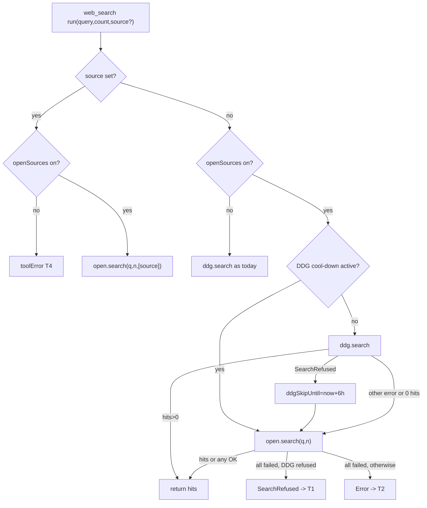
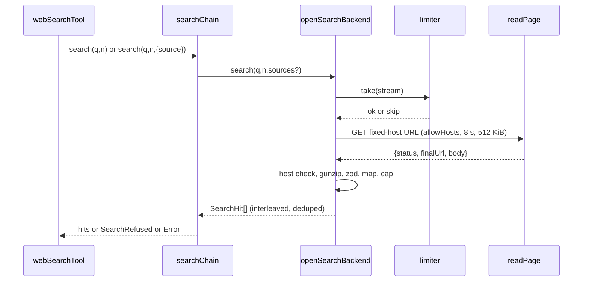

# SEARCH-1: web_search that works without a paid key

Date: 2026-11-10. Status: owner approved the direction in chat ("do C"; no paid search API); standing instruction to proceed without waiting.

## 1. Goal and evidence

`web_search` uses DuckDuckGo's HTML page. Since 2026-11-09 DDG answers the bot with HTTP 202 and a bot-check page, so every search fails with `SearchRefused` (22 `web_search` tool errors in 7 days). R&D's pricing research and the software spike were blocked on it. The owner dropped Brave (no paid key) and asked to use Chrome; automated searching of Google/Bing/DDG through Chrome is bot-checked too, and evading those checks is out of bounds.

This sub-project makes `web_search` useful again from public, keyless JSON search APIs that are meant for programs, and keeps DDG as the first try.

## 2. Design

### 2.1 Backends (all keyless, documented public APIs, read-only GET)

| Source | Endpoint | Good for |
| :--- | :--- | :--- |
| Wikipedia | `https://en.wikipedia.org/w/api.php?action=query&list=search&srsearch=…&format=json` (plus `th.wikipedia.org` when the query has Thai script) | concepts, companies, background |
| Hacker News (Algolia) | `https://hn.algolia.com/api/v1/search?query=…` | tech products, launches, discussions, competitor mentions |
| Stack Exchange | `https://api.stackexchange.com/2.3/search/advanced?q=…&site=stackoverflow` | programming answers |
| npm registry | `https://registry.npmjs.org/-/v1/search?text=…` | packages, libraries |
| GitHub | `https://api.github.com/search/repositories?q=…` (unauthenticated; 10 requests/min) | repos, starter kits, competitors |

Each backend returns `SearchHit { title, url, snippet }` (snippets stripped of HTML, cut to 300 characters), with a source label in the title (`[Wikipedia] …`). A fixed `User-Agent` names the bot generically (no personal data). Timeouts 8 s per backend.

### 2.2 Chain

- `web_search` keeps its name, input and approval rules. Backend order: DDG first; if DDG throws `SearchRefused` (or is in cool-down), the open-source aggregator answers.
- DDG cool-down: after a `SearchRefused`, skip DDG for 6 hours (in memory), so runs do not hit the bot check repeatedly.
- Aggregator: query all sources in parallel (or only the ones an optional `source` input names: `wikipedia|hackernews|stackoverflow|npm|github`), interleave results by rank, de-duplicate by URL, return up to `count`.
- If every source fails, the tool returns the existing fixed error text pointing to `fetch_page`.

### 2.3 Network and safety

- Requests go through the existing guarded HTTP path used by web tools (same egress rules and response size limits); only the five hosts above are added to an allowlist for the aggregator.
- Output stays untrusted (`untrustedOutput: true`, source `web`): it taints the run as today. The tainted-query approval and the invisible-character refusal stay unchanged, so the AI approver (when on) decides as for DDG.
- Query length and character rules unchanged; the query is URL-encoded; no other user data is sent.
- Per-source rate limits honoured with a small in-memory limiter (GitHub 10/min, Stack Exchange 30/min, others 60/min); a limited source is skipped for that call.

### 2.4 Prompt

The fixed refusal text and the tool description mention that results come from Wikipedia, Hacker News, Stack Overflow, npm and GitHub when the general search is unavailable, and that `fetch_page` reads a result.

## 3. Controls

`web.search.openSources` (default true) in `/settings`; when false the tool behaves as today.

## 4. Testing

Unit tests per backend with recorded JSON fixtures (parsing, HTML stripping, cuts, labels), chain behaviour (DDG ok → DDG results; DDG refused → aggregator; cool-down; `source` filter; de-dup; partial failures; all fail → fixed error), limiter, allowlist, taint and approval unchanged. A live opt-in probe (`*.net.test.ts`) queries each source once.

## 5. Residual risks

- R1: public APIs can change or rate-limit; results degrade to fewer sources.
- R2: results are outside text (taint and approval rules apply as for DDG).
- R3: coverage is narrower than a general web search (no general news or vendor pricing pages); vendor pages still need `fetch_page` on known URLs.

## Amendment SA-1 (binding, 2026-11-10)

Where this amendment and the sections above disagree, this amendment wins.

1. MODULE: SEARCH-1, web_search keyless open-source fallback (web group).

2. ACTORS & BOUNDARIES
- Actors: the model (calls web_search), the registry (approval, taint), the chain backend, the DDG backend, and the open backend with six streams (wikipedia-en, wikipedia-th, hackernews, stackoverflow, npm, github).
- Trust boundary: every upstream response is untrusted. The registry wraps it (`registry.ts:221-228` "if (tool.untrustedOutput)"), and result URLs go into knownUrls through `URL_SOURCES` (`registry.ts:22`), the same as with DDG.
- **HTTP path (decided): `readPage`, the same port DDG uses (`webSearch.ts:94`).**
  - Local mode is Chrome-only ("Nothing falls back to plain HTTP", `boot.ts:13-15`; `browser.ts:5-6`). In local mode, readPage → `ChromeBrowser.fetch`: `checkUrl` pre-check, then the guard proxy (`chrome.ts:190-192`). JSON comes back raw through `TEXTUAL` (`chrome.ts:114,280`), and Chrome decodes gzip itself.
  - VPS and tests: readPage → `safeFetch` (`browser.ts:17-18`, `net/guard.ts:9`).
  - No direct safeFetch in local mode. That would break G2C-07.
  - If the web group is disabled (`index.ts:14` browserDisabled), the fallback is gone with it.

3. LOGIC
Pre-conditions:
- The registry has passed zod, precheck (the HIDDEN refusal) and requiresApproval. All three are unchanged in kind.
- `web.search.openSources` is read live on every call. A read error counts as false.

Chain, `searchChain(ddg, open, {enabled, now})` implementing `SearchBackend`:
1. `source` is set:
   - enabled false → throw `SourceOff`. The tool returns the fixed text T4.
   - Otherwise skip DDG and run `open.search(q, n, [source])`.
2. enabled false → `ddg.search(q, n)` exactly as today. No cool-down.
3. enabled true and `now < ddgSkipUntil` → go to the open backend (step 5). Remember "refused" (from the cool-down) so a total failure can give T1.
4. Otherwise call DDG:
   - Hits > 0 → return them.
   - `SearchRefused` → set `ddgSkipUntil = now + 6 h` and remember "refused".
   - Any other error, or 0 hits → fall through, no cool-down.
5. Open backend, all streams:
   - Hits > 0 → return them.
   - At least one stream answered OK but there are 0 hits → return [] (the tool says "No results.").
   - Every stream failed or was skipped → throw `SearchRefused` if DDG was refused or in cool-down, otherwise a plain Error.

Open backend, `openSearchBackend(o, {now})`:
- Streams: the `sources` argument, or all of them.
  - `wikipedia` means en plus th; th is added only when `/\p{Script=Thai}/u.test(q)`.
  - A query longer than a stream's limit skips that stream: GitHub 256 characters, Wikipedia 300.
- Limiter check per stream. A stream that is limited or cooling down is skipped for this call. It never waits.
- Fetching:
  - Browser mode: at most 2 streams at a time (a per-call semaphore; Chrome has `Slots(2,8)` at `chrome.ts:123`), with a 20 s overall deadline.
  - HTTP mode: all streams in parallel.
  - Every stream has an 8 s race timer.
- Each stream's fetch: build the URL → `readPage(o, url, {allowHosts:[host], timeoutMs:8000, maxBytes:524288, headers})`. Then:
  - Browser mode: `new URL(res.finalUrl).hostname === host`, otherwise the stream fails.
  - `res.truncated` → the stream fails.
  - HTTP mode: if the body starts with 0x1f 0x8b, run `zlib.gunzipSync(body,{maxOutputLength:1048576})`. If content-encoding is deflate, run `inflateSync` with the same cap. Uses node:zlib, no new dependency.
  - Status mapping, then JSON.parse, then a zod `safeParse` of the envelope. Items that fail item validation are skipped.
- Interleave:
  - Stream order: wikipedia-th first for a Thai query; otherwise wikipedia-en, wikipedia-th, hackernews, stackoverflow, npm, github.
  - Round-robin by rank, dedupe by `urlKey` (`tools/urls.ts:5`), stop at n.
- Alternate flows: a partial failure returns what it has. Upstream error text and bodies are never shown or logged. No new log lines; the registry audit is the record.

4. MERMAID

5. CONTRACTS

**webSearch.ts changes**
- `export type SourceId = 'wikipedia'|'hackernews'|'stackoverflow'|'npm'|'github'`
- `SearchBackend.search(q: string, n: number, opts?: { source?: SourceId }): Promise<SearchHit[]>` (additive).
- `run` calls `backend.search(q, n)` with exactly two arguments when there is no source, and `backend.search(q, n, { source })` otherwise. This keeps `webSearch.test.ts:24,33,35` `toHaveBeenCalledWith('q',10)` valid.
- Input gains `source: z.enum([...]).optional().describe('Search only this open source: wikipedia, hackernews, stackoverflow, npm or github')`. The ToolPlugin generic gains `source?: SourceId | undefined`. Gemini converts enums (`providers/gemini/convert.ts:78`).
- Description: `'Search the web. Returns titles, urls and snippets; read a result with fetch_page. When the general search is unavailable, results come from Wikipedia, Hacker News, Stack Overflow, npm and GitHub (each title starts with its [source]); set source to search only one of them.'`
- requiresApproval reason, which keeps the "N results" substring:
  - Without source: `` `tool web_search: send the query below to the search backend (DuckDuckGo; Wikipedia, Hacker News, Stack Exchange, npm and GitHub when it is blocked) (${n} results)` ``
  - With source: `` `tool web_search: send the query below to ${LABEL[source]} (${n} results)` ``
- Fixed texts:
  - **T1** (SearchRefused): `"web search failed: blocked by the search provider (bot check), and no open source (Wikipedia, Hacker News, Stack Overflow, npm, GitHub) answered; it will not work in this run, so do not retry it. Read known pages directly with fetch_page instead (for example a vendor's official pricing or docs page)."`
  - **T2**: unchanged, `'web search failed: the search backend is unavailable, try again later'`.
  - **T4**: `'web search failed: the source option is off (web.search.openSources is false); call web_search without source'`.
- SNIPPET_MAX stays 400 and TITLE_MAX stays 200. The `[Label] ` prefix counts inside TITLE_MAX.

**New file tools/plugins/web/openSearch.ts**
- Exports `openSearchBackend`, `searchChain`, `SourceOff`, the parsers `parseWiki`, `parseHn`, `parseSe`, `parseNpm` and `parseGh` (pure, for fixtures), and `UA`.
- Text helpers:
  - `fold(s) = s.replace(/[\p{Cc}\s]+/gu,' ').trim()`
  - `flat(s) = fold(htmlToText(s))` (`net/html.ts:97`)
- `UA = 'PrawAssistant/1.0 (keyless open search; bot)'`. It is sent only on the HTTP path; Chrome keeps its own UA (`chrome.ts:261-262`).
- `headers = { 'user-agent': UA, accept: 'application/json' }`. GitHub instead gets `accept: 'application/vnd.github+json'` and `'x-github-api-version': '2022-11-28'`.
- `q` is always added with `URLSearchParams` (n = 1–10).

| Stream | Label | GET | Envelope → item | title / url / snippet |
|---|---|---|---|---|
| wikipedia-en, wikipedia-th | `[Wikipedia]`, `[Wikipedia TH]` | `https://{en,th}.wikipedia.org/w/api.php?action=query&list=search&srsearch=Q&srlimit=n&srprop=snippet&format=json&formatversion=2&utf8=1` | `query.search[]` `{title:string, snippet:string}` | title fold. URL `https://{lang}.wikipedia.org/wiki/`+`encodeURIComponent(title.replaceAll(' ','_'))`. Snippet flat (strips searchmatch spans and entities). |
| hackernews | `[Hacker News]` | `https://hn.algolia.com/api/v1/search?query=Q&tags=story&hitsPerPage=n` | `hits[]` `{objectID:string /^\d{1,12}$/, title:string, url?:string\|null, points?:number\|null, num_comments?:number\|null, created_at?:string}` | URL: `urlKey(url)` if https?, else `https://news.ycombinator.com/item?id=${objectID}`. Snippet `"${points??0} points, ${num_comments??0} comments, ${created_at.slice(0,10)}"`. |
| stackoverflow | `[Stack Overflow]` | `https://api.stackexchange.com/2.3/search/advanced?order=desc&sort=relevance&q=Q&site=stackoverflow&pagesize=n&filter=default` | `{items[], backoff?:int, quota_remaining?:int}`; item `{question_id:int>0, title:string, score:int, answer_count:int, is_answered:bool, tags:string[]}` | title `fold(decodeEntities(title))`. URL `https://stackoverflow.com/questions/${question_id}`. Snippet `"score ${score}, ${answer_count} answers${is_answered?' (answered)':''}; tags: ${tags.slice(0,5).join(', ')}"`. |
| npm | `[npm]` | `https://registry.npmjs.org/-/v1/search?text=Q&size=n` | `objects[].package` `{name: /^(@[a-z0-9~-][a-z0-9._~-]*\/)?[a-z0-9~-][a-z0-9._~-]*$/ ≤214, version:string, description?:string}` | title name. URL `https://www.npmjs.com/package/${name}`. Snippet `fold("v"+version+" - "+(description??''))`. |
| github | `[GitHub]` | `https://api.github.com/search/repositories?q=Q&per_page=n` | `items[]` `{full_name: /^[A-Za-z0-9-]{1,39}\/[A-Za-z0-9._-]{1,100}$/, description?:string\|null, stargazers_count:int, language?:string\|null}` | title full_name. URL `https://github.com/${full_name}` (built, never the upstream html_url). Snippet `fold("${stars} stars, ${language??'-'}: "+(description??''))`. |

URLs are always built by code from validated fields, except a valid HN story URL.

**Status mapping per stream** (other status → fail; JSON or envelope invalid → fail):
- 200 → parse.
- github 403/429 → cool-down until `x-ratelimit-reset` if the header is present (HTTP mode only; Chrome returns `headers:{}` at `chrome.ts:283`), else 60 s.
- stackoverflow 400 with `error_id` 502 (throttle) → cool-down until the next UTC midnight. `backoff>0` in any body → cool-down `backoff` s. `quota_remaining===0` → until the next UTC midnight.
- Others 429 → 60 s.

**Limiter**
- In-memory sliding window per stream plus a cool-down timestamp, with an injected `now`.
- Limits: github 8/min; stackoverflow 25/min and 250 per UTC day; wikipedia-en and wikipedia-th 60/min each; hackernews 60/min; npm 60/min.
- State lives in the backend closure, which is built once at boot (`app.ts:605` registerGroups).

**browser.ts**
- `readPage(o, url, opts?: { allowHosts?: readonly string[]; timeoutMs?: number; maxBytes?: number; headers?: Record<string,string> })`.
- The HTTP path spreads `opts` into safeFetch (`allowHosts` at `fetch.ts:38-39,162-166`). The browser path ignores `opts`; the doc comment says so.
- Existing callers are unchanged.

**index.ts**
- `webSearchTool(searchChain(ddgBackend(o), openSearchBackend(o), { enabled: () => { try { return deps.cfg.get('web.search.openSources') === true; } catch { return false; } } }))`

**Config**
- `config/schema.ts`: `'web.search.openSources': z.boolean()`.
- `defaults.ts`: `true`.
- `admin/keys.ts` HANDLER_KEYS: add it next to the web.taskGrant line, with a comment.
- `plans.ts`: `planOpenSourcesEnabled`, a copy of `planWsEnabled` (`plans.ts:146-152`) with `risk: v === true`.
- `settings.ts` handlerSet: `case 'web.search.openSources': return run(planOpenSourcesEnabled(text, deps));`
- No migration.
- **Error mapping in the tool:** `SearchRefused` → T1, `SourceOff` → T4, anything else → T2.

6. SECURITY NOTES (requires security gate)
- Egress: six fixed hosts, URLs built by code, the query URL-encoded, GET only. The HTTP path is pinned with `allowHosts` on every hop. The Chrome path is guarded by checkUrl and the proxy and post-checks the final host. A redirect hop inside Chrome is not allowlisted before it is sent (residual).
- One tainted approval can now send the query to up to six third parties; the reason text says so. The AI-approver query heuristic is unchanged (`ai-approver.ts:114-117`), and `storedInputOk` passes `source` (`tree-grant-scope.ts:26-34`). The card shows `source` as a plain field (`approval.ts:148`).
- Never log the query or upstream bodies. Upstream text is untrusted; fields are length-capped before output.
- Caps: 512 KiB per response, 1 MiB after gunzip (`maxOutputLength`), 8 s per stream, 20 s overall in Chrome mode.
- Chrome capacity: at most 2 slots per search. A busy browser fails only that stream.
- `default true` breaks the recent pattern where new egress switches default to off (`ws.enabled` false, `defaults.ts:139`). The owner directed it; recorded as a residual for Gate 1.

7. OPEN QUESTIONS: none for backend. These are Gate 1 decisions: accept the Chrome redirect residual, `default true`, and the wording of the reason string.

CONTRADICTIONS (spec → binding resolution)
1. §2.3 "existing guarded HTTP path" → in local mode that is Chrome (`boot.ts:13-15`). Use readPage.
2. §2.3 "allowlist" → no web tool uses one today. HTTP path: `allowHosts`. Chrome path: final-host post-check.
3. §2.1 "fixed User-Agent" → HTTP path only; Chrome sets its own UA (`chrome.ts:261-262`).
4. §2.1 snippet 300 → 400 (`SNIPPET_MAX`, `webSearch.ts:17`).
5. §2.1 "8 s per backend" → Chrome timeout is fixed at 25 s (`chrome.ts:82`). Use a race timer; the slot is freed later.
6. §2.3 Stack Exchange 30/min → 25/min plus 250/day plus `backoff` and quota. The daily IP quota (about 300) is **assumed**; the probe verifies it.
7. §2.2 fallback only on SearchRefused → also on other DDG errors and on 0 hits, with no cool-down for those. The cool-down applies only when the switch is on.
8. §2.2 "keeps its input" → `source` is optional and additive. With `source` set, DDG is skipped.
9. §2.4 new refusal text → it must still match `/blocked by the search provider/` and `/fetch_page/`, and not "try again later" (`webSearch.test.ts:52-54`).
10. GitHub 10/min → 8/min. Reset headers are only readable on the HTTP path.
11. §4 `*.net.test.ts` → that vitest project is loopback-only (`vitest.config.ts:27-28`). This probe deviates: it is opt-in with `OPEN_SEARCH_PROBE=1`, otherwise `it.skip`, like `scripts/ai-judge-probe.net.test.ts:3`.
12. Stack Exchange gzip even with identity (`fetch.ts:157` forces identity) is **assumed** (secondhand sources). Detect by magic bytes; the probe verifies it.
13. The brief named `net/fetch.ts`; tools import `safeFetch` from `net/guard.ts:9`.

TESTS INVALIDATED / KEPT
- `webSearch.test.ts:17-36,38-46,57-60` and the taint block `63-122`: keep, given the two-argument call rule.
- `:48-55`: keep (T1 keeps the phrases).
- `registry.test.ts:414-420`, `praw-m2.int.test.ts:191-205` (DDG fake answers 200 → DDG path), `chrome.web.test.ts:44-72` and `index.test.ts:59-64`: keep.
- No test asserts the description or the reason beyond "3 results" (`webSearch.test.ts:84`).

9. TASK LIST (one backend dispatch)
- BE1: `browser.ts` readPage opts. `openSearch.ts`: parsers, limiter, backend, chain. `webSearch.ts`: signature, input, texts. Wiring in `index.ts`.
- BE2: config key in schema, defaults, HANDLER_KEYS, plan and settings case.
- BE3, tests:
  - `openSearch.test.ts` with fixtures in `tests/fakes/open-search.ts` for each stream: mapping, HTML and entity stripping, caps, labels, rejected items (bad npm name, bad full_name, a javascript: HN URL becomes the item URL).
  - Chain: DDG ok; refused → open, then cool-down 6 h and expiry; other error and 0 hits → open with no cool-down; switch off → today's behaviour; read error → off; source filter skips DDG; source with switch off → T4; dedupe and interleave order; Thai adds th first; partial failure; all fail → T1 or T2.
  - Limiter, cool-downs, backoff, SE 400/502, GitHub 403 with reset.
  - Gzip (fake transport sends gzip bytes) and the 1 MiB bomb fails.
  - `allowHosts` refusal on a cross-host redirect (HTTP); Chrome final-host mismatch fails (fake WebBrowser); the Chrome path never runs more than 2 at once.
  - `settings.opensearch.test.ts` (copy `settings.heal.test.ts`) and `admin/keys.opensearch.test.ts`.
  - `tools/plugins/web/openSearch.net.test.ts`: live, opt-in, one query per stream; asserts the envelope fields, the SE gzip and quota fields, and that a Wikipedia slash title URL resolves.
- Acceptance: `npx vitest run --project unit` is green; `npx tsc --noEmit` is clean; there is one grep hit for T1 and for the description; the probe passes once with `OPEN_SEARCH_PROBE=1`.
