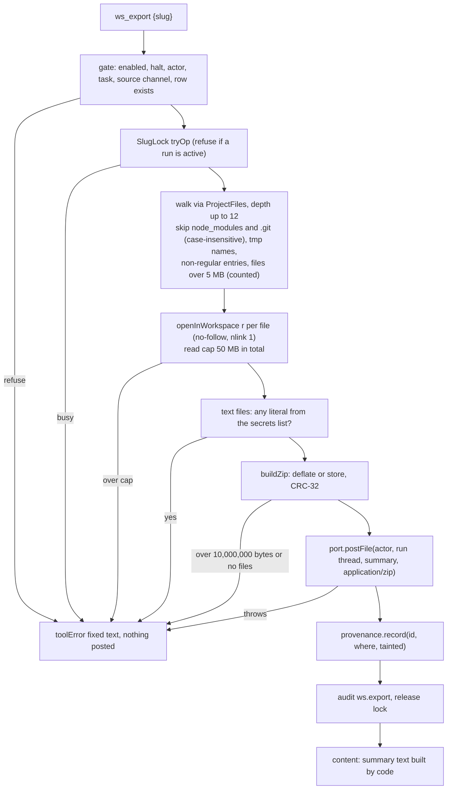

# WS-1: project workspaces for the software team

Date: 2026-11-10. Status: draft for owner review, then Gate 1.

## 1. Goal and evidence

The owner wants the bots to do the work without the owner fixing things. On 2026-11-10 the CTO's task "Build Chrome MV3 starter kit MVP F1-F5" (e3250dd4, and parent fd02a2a8, due 2026-11-17) is blocked: "No file-write or shell tool in this session (only docs, diagrams, web, GitHub read, ClickUp read). I cannot create the repo, run npm install/build, load in Chrome, or run mock tests." The CEO's report asks a Bot Admin to choose a build route.

The existing dev-job system (SELF-CODE, `docs/self-code.md`) changes the bot's own repository, is started only by a Bot Admin, needs a separate paid API key, and has not been set up. It does not fit product work in a separate project. This sub-project gives the software team a sandboxed workspace per project, reusing the dev-job sandbox pieces (registry proxy, network-less containers).

Owner direction (2026-11-10, "as you see fit"; recommended options taken): deliver results as a zip in Discord (GitHub push stays a separate, approved step with the existing GitHub tools); `ws_run` reaches only the npm registry through the proxy; start now.

## 2. Design

### 2.1 Workspaces

- A workspace is a directory `WS_ROOT/<slug>` on the host (`WS_ROOT` from the env, outside every repository and outside `~/.claude`; default `~/.config/assistant/workspaces`, mode 0700). `slug` `^[a-z][a-z0-9-]{1,39}$`.
- Table `workspaces` (slug, title, dept `software`, created_by, status active|archived, bytes, created_at). Limits: 5 active workspaces, 300 MB each (excluding `node_modules`), 2 000 files.
- `ws_create { slug, title }` (software head only) creates one. `/ws list` and `/ws archive slug` for Bot Admins; archive keeps the files read-only, delete is a manual owner action.

### 2.2 File tools (software head and software personas)

- `ws_list { slug, path? }`, `ws_read { slug, path, offset?, limit? }` (text only, 64 KB per call), `ws_write { slug, path, content }` (≤ 200 KB per file), `ws_delete { slug, path }`.
- Paths are relative, normalised, no `..`, no absolute paths, no NUL; every open uses no-follow semantics and a realpath check under the workspace, because code run in the sandbox can create symlinks (a symlink pointing outside is refused on read, write and list).
- Writes are internal: no approval card. They are audited (`ws.write` with slug, path, size; never content).

### 2.3 `ws_run`

- `ws_run { slug, command }` where `command` is one of a fixed allowlist parsed by code, never a shell string: `npm ci`, `npm install [<pkg>@<version> ...]`, `npm test`, `npm run <script>` (script must exist in package.json), `npx tsc [--noEmit]`, `node <path.js|.mjs>`. Arguments are validated (package names by the npm name rule, no URLs, no git or file specs).
- Each call starts a fresh container from a pinned image (node 22, no git credentials), user 1000, read-only root, `--cap-drop ALL`, no new privileges, memory 2 GB, 2 CPUs, 256 pids, the workspace mounted at `/work` and nothing else, timeout 5 min.
- Network: `npm ci` / `npm install` run on the dev-job prep network that reaches only the registry proxy (GET/HEAD to registry.npmjs.org, as today); every other command runs with no network. Install scripts are disabled (`--ignore-scripts`).
- Output: exit code plus the last 8 000 characters of stdout/stderr, redacted with the secret list, wrapped as untrusted for the model. The run is marked tainted when the command was `npm install`/`npm ci` (package text is outside content).
- Caps: 40 runs per task tree, 200 per day; one run at a time per workspace.

### 2.4 Export

- `ws_export { slug }` builds a zip (excluding `node_modules`, `.git`, files over 5 MB; total ≤ 20 MB) and posts it as an attachment in the task's thread with a code-built summary (file count, size, sha256). No approval: it stays in the company's Discord.
- Pushing to GitHub stays with the existing GitHub tools and their approval cards (out of scope here).

### 2.5 Grants

- `tools.byDept.software` gains the `ws_*` tools; software personas get them through their department. Not other departments, not Praw's `*` list (code refuses non-software actors).
- The software head prompt gains a short fixed guide: create a workspace per product, write files, run tests, export the zip when a milestone is done, never claim a run passed without the `ws_run` result.

## 3. Controls

`ws.enabled` (default false until Gate 2, then the owner turns it on in `/settings`), `ws.maxRunsPerTree` (40), `ws.maxRunsPerDay` (200): psql only for the caps. Halt: every `ws_*` tool refuses.

## 4. Error handling

Every refusal is a fixed text. A container that fails to start, times out or exceeds memory returns a fixed error with the exit status; nothing is retried automatically. A failed export posts nothing.

## 5. Testing

Path rules (`..`, absolute, symlink inside pointing out, symlink loop, NUL, case tricks), size and file caps, allowlist parsing (every allowed form, rejected shell metacharacters, URLs, git specs), container flags asserted from the spawned argv, network per command, timeout, output redaction and cut, taint after install, caps, export contents and exclusions, grants (only software), switch off, halt. Acceptance: in an integration test with Docker, the software head creates a workspace, writes a minimal MV3 extension with a test, runs `npm install` + `npm test` successfully, and exports a zip whose files match.

## 6. Residual risks for Gate 1

- R1: code the model writes runs on the owner's Mac inside a container; a container escape would reach the host.
- R2: `npm install` fetches third-party packages (scripts off, network limited to the registry); a malicious package can still run during `npm test` or `node` with no network.
- R3: a model fooled by web content can write misleading code into a product; exports and any GitHub push are reviewed by people before release.
- R4: workspace files live under the owner's home directory (outside repositories and `~/.claude`).
- R5: browser testing in real Chrome is not covered; F1-F5 are verified by build and mock tests only.

## Amendment SA-1 (binding, 2026-11-10)

Where this amendment and the sections above disagree, this amendment wins.

### 0. ALREADY BUILT (drop WS-BE4)
The probe-pin alert already exists:
- `localRefusedAlert` in app-start.ts:247-257 posts once per boot (WeakSet `alerted`), with fixed text and `bash scripts/probe-local-cli.sh --yes`.
- It is fed by `localRefusedCode` (app.ts:285-290, 940).
- Tests: agents/incidents.wiring.test.ts:180-213.
- No work is left. Plan WS-BE4 should be marked done.

### 1. CONTRADICTIONS (spec / code fact / binding correction)

C1. Reuse devjob_prepnet + registryproxy
- Code: docker-compose.devjob.yml:26-29 requires DEVJOB_* secrets through `${…:?}`. Dev jobs were never set up (config/defaults.ts:94, `devjob.enabled` false; app.ts:816). So the stack cannot come up, and no devjob container is running.
- Binding: new file docker-compose.ws.yml (project `assistant-ws`). It has one service, `registryproxy`, with the same hardening as devjob lines 38-51.
  - Network `ws_prepnet`: internal, subnet 10.88.80.0/24. The proxy sits at 10.88.80.2.
  - Network `ws_egress_registry`: normal, for the proxy only.
  - Image: `assistant-ws-registryproxy:local`.
  - Add a `scripts/dev.sh ws up|down` branch, copied from the chrome branch (no env file). Add npm scripts `local:ws` and `local:ws:down`.

C2. Proxy byte cap
- Code: `createRegistryProxy` keeps `let bytes` for the life of the process, with a 512 MiB cap (registryproxy.ts:21-22). registryproxy-main.ts:20 passes no `maxBytes`. A long-running proxy therefore starts returning 429 on every install after about 10 fresh installs.
- Binding: new entry workspaces/registryproxy-main.ts. It imports `createRegistryProxy` from ../devjob/registryproxy.js, copies the `upstream` function from devjob/registryproxy-main.ts:8-19, and builds a fresh handler at each UTC hour with `maxBytes: 1 GiB`.
- New docker/ws/registryproxy.Dockerfile: same base and stripping as docker/devjob/registryproxy.Dockerfile. It copies dist/devjob/registryproxy.js to /app/devjob/ and dist/workspaces/registryproxy-main.js to /app/workspaces/.
- devjob/ stays untouched (X10).

C3. "pinned image (node 22)"
- Code: the repo pins `node:24-alpine@sha256:8a32c8cf…2f85` (prep.Dockerfile:3). test.Dockerfile:4 deletes npm and npx. The prep image has git and `ENTRYPOINT prep.sh`.
- Binding: new docker/ws/runner.Dockerfile:
  - FROM the same node:24 digest.
  - Same npm 12.2.1 / undici 6.29.1 patch as prep.Dockerfile:5-10.
  - No git. Remove corepack and yarn. `mkdir /work /home/ws`.
  - `ENTRYPOINT []`, no USER line.
- New docker/ws/build.sh builds runner and proxy and writes docker/ws/images.json as `{"runner":"sha256:…","proxy":"sha256:…"}`.
- Do not touch docker/devjob/build.sh or images.json. `loadImages` checks only three keys (devjob/boot.ts:43-46).

C4. Container `user 1000`
- Code: devjob uses 65534 on volumes. A bind mount of a 0700 owner directory needs the owner's uid on Linux hosts.
- Binding: `--user ${process.getuid()}:${process.getgid()}`. Refuse at boot if the uid is 0. Set HOME to a tmpfs. Inside the VM the uid has no host meaning.

C5. Reusing launcher.ts
- Code:
  - `baseline()` throws for any volume that is not devjob (launcher.ts:40). It hard-codes uid 65534 and `devjob=1`.
  - `killAll` filters `label=devjob=1`.
  - `-v`/`--volume` is FORBIDDEN (launcher.test.ts:15).
  - `realDocker` uses execFile `maxBuffer`. On overflow it kills the child and reports `timedOut`.
  - SIGKILL of the docker client does not stop the container.
- Binding: a new argv builder and spawner in workspaces/runner.ts (§5.3).
  - Labels `ws=1` and `ws.slug=<slug>`.
  - `--mount type=bind`.
  - `spawn` with a 64 KiB tail ring buffer.
  - No `--rm`. Inspect, then `docker rm -f` in `finally`.
  - Import nothing from launcher.ts except the `DockerResult` type shape.

C6. Taint only after install
- Code: the registry ties wrapping and tainting to one static `untrustedOutput` flag (registry.ts:221-228).
- Binding: `untrustedOutput: true` on `ws_run`, `ws_read` and `ws_list`. Container code can write any file content or file name. Precedent: read_file (tools/plugins/workspace/index.ts:64).

C7. Tool kinds / approval
- Code: a plugin tool with no kind throws (tools/plugins/index.ts:63). skill-grant.ts:25 treats kindless tools as unsafe. Any `write` kind gives a card when not direct, or when tainted (policy-approval.ts:38).
- Binding:
  - `ws_list` and `ws_read` are kind `read`.
  - `ws_create`, `ws_write`, `ws_delete`, `ws_run` and `ws_export` are kind `write` and are appended to `NO_APPROVAL_TOOLS` (policy-approval.ts:21).
  - That list is checked before taint, and its existing consumers already make these names ungrantable by skills (skill-grant.ts:31) and keep them out of tree grants (tree-grant-scope.ts:83).
- Requires security gate.

C8. "Not Praw's * list"
- Code: the wildcard expands to every registered name (policy.ts:36). /bot tools and tool_request can add plugin tools to any department.
- Binding: tools/policy.ts gets `export const DEPT_ONLY: Readonly<Record<string,string>>`, with each `ws_*` name mapped to `'software'`.
  - `effective()` drops a DEPT_ONLY name for any other department, from every source (wildcard, byDept, skills).
  - Every tool still checks the actor in code.

C9. Defaults are enough for the grant
- Code: a stored `tools.byDept` replaces the defaults (README.md:84; migration 024:30).
- Binding: migration 040 appends the 7 names to any stored `software` list, and defaults.ts:84 gains a `WS` const.

C10. Zip ≤ 20 MB
- Code: Discord's upload limit is 10 MB (`MEDIA_MAX_BYTES = 10_000_000`, media/pins.ts:35). There is no zip library (package.json:28-49).
- Binding:
  - Zip ≤ 10,000,000 bytes.
  - Writer in workspaces/zip.ts using `zlib.deflateRawSync` and a table-based CRC-32 (no `zlib.crc32` dependency).
  - Store the entry when deflate does not shrink it. DOS date 1980-01-01. No ZIP64. No directory entries.

C11. Export "no approval, stays in Discord"
- Code: `postFile` masks only text-like content types (port.ts:655). A zip goes out as is.
- Binding: refuse the export if any included file without NUL bytes contains a literal from the app `secrets` list (precedent: vps/static.ts:31). Literal list only; the regex patterns would false-positive on code such as `token=`.

C12. Path rules via sandbox
- Code: `validateRel` hard-codes depth 6, 120 characters and the `[\w.\- ]` charset. `usage()` counts node_modules, `LIST_MAX` is 200, and the lock is per instance (sandbox.ts:19-47, 186-249). The TOCTOU residual at sandbox.ts:14-17 ("no tool can create a symlink") is now reachable.
- Binding:
  - Add an optional `o?: {depth?:number; relLength?:number}` to `validateRel` and `openInWorkspace`. Defaults stay as today, so Praw is unchanged.
  - ws uses depth 12 and 240 characters.
  - A new `ProjectFiles` class does its own walks.
  - One per-slug lock (§5.2) means no container runs during any file operation or export.
  - A reserved prefix is matched case-insensitively (APFS is case-insensitive).

C13. Halt
- Code: the registry checks halt only on approved replay (registry.ts:108).
- Binding: every `ws_*` tool checks `deps.halt.isHalted()` (agentHalt) first.
  - `halt.onHalted` → `scheduler.track('ws.halt', () => ws.killAll())`, registered after the scheduler exists.
  - `app.stop()` awaits `ws.killAll()`.

C14. `npx tsc`
- Code: npx can fall back to the registry.
- Binding: argv `/usr/local/bin/node /work/node_modules/typescript/bin/tsc [--noEmit]`. The file must open through the sandbox. If it does not, refuse with E_TSC.

C15. Spec omissions, now bound
- node_modules cap of 1 GiB, measured after an install run and stored as `nm_bytes`.
- A run can fill the host disk within 5 minutes. This is residual R6; the next run or write refuses while over quota.

### 2. ACTORS & BOUNDARIES
- Actors: software head (all 7 tools) and software personas (all except `ws_create`). Bot Admin uses `/ws` in #⚙️-setting (the guard at discord/commands/index.ts:128-129). The owner uses psql.
- Trust boundaries:
  - Model input → zod and the code parser.
  - Host fs ↔ container through a bind mount of `WS_ROOT/<slug>` only.
  - Container → ws_prepnet → proxy → registry.npmjs.org (GET/HEAD only, `pathAllowed`).
  - Output → registry untrusted wrapper.

### 3. LOGIC

#### 3.1 Boot: `bootWorkspaces()` in workspaces/boot.ts
Awaited in app.ts before `registerGroups` (app.ts:581), with a 20 s overall timeout.
- Root:
  - `WS_ROOT` comes from env (core/env.ts: `WS_ROOT: z.preprocess(blankToUndef, z.string().refine(s=>s.startsWith('/')&&!s.includes('\0')).optional())`, giving `Env.wsRoot?`).
  - Default is `${HOME}/.config/assistant/workspaces`.
  - `mkdir -p` with mode 0700. The path must be a directory, not a symlink, owned by `getuid()`. Chmod to 0700 if the mode is wider.
  - The realpath must match `^/[A-Za-z0-9._/-]{1,200}$`.
  - It must not be under realpath(`$HOME/.claude`) or realpath(cwd).
  - No ancestor up to `/` may contain a `.git` entry.
- Docker:
  - `docker version --format {{.Server.Version}}` with a 10 s timeout. Env is `{PATH, HOME, DOCKER_HOST?}`, as at launcher.ts:72.
  - `docker image inspect --format {{.Id}} <runner id from docker/ws/images.json>` must equal that id.
- Sweep: `docker ps -aq --filter label=ws=1`, then `rm -f` each.
- On failure: PluginDeps gets `wsDisabled: <fixed reason>`, plus `wsFailed: true` when WS_ROOT was set or Docker answered with an error. The group shows in the tool-groups alert (app-start.ts:259).

#### 3.2 Per-call gate, in order, before any side effect
Each step refuses with a fixed text:
1. `ws.enabled`
2. halted
3. actor is software (head: `dept==='software'`; persona: `ctx.org.persona(id)?.deptId==='software'`); for `ws_create`, head only
4. zod / parse
5. workspace row exists; status `active` for write, delete and run (archived allows list, read and export)
6. lock

#### 3.3 ws_run happy path: §4 diagram A.

#### 3.4 Alternate and exception paths
- A run is already active in the slug → E_BUSY. Waiting is never allowed.
- No `ctx.task` → E_NOTASK. The tree cap needs a rootId.
- `.npmrc` at the workspace root → E_NPMRC. `ws_write` also refuses that path.
- A package.json dependency value matches `^(git|git\+|https?:|file:|link:|github:|gitlab:|bitbucket:|npm:|workspace:)` or contains `/` → E_SPEC (for ci/install only).
- Quota exceeded at start → E_QUOTA.
- Proxy down (`docker network inspect ws_prepnet -f {{.Internal}}` ≠ true, or `docker inspect -f {{.State.Running}} assistant-ws-registryproxy-1` ≠ true) → E_PROXY. This is checked for install verbs only, before the claim.
- Timeout after 300 s → `docker rm -f <name>` (which ends `docker run`). SIGKILL the client after a further 10 s. Return E_TIMEOUT.
- Inspect shows `OOMKilled=true` → E_MEMORY.
- `StartedAt` is the zero time, exit 125, or spawn ENOENT → E_START.
- Halted during the run → container killed → E_HALTED.
- `rm -f` verify fails 3 times → the lock stays held, `incidents.report({source:'tool',stage:'ws.cleanup'})`, then E_STUCK. The next boot sweep clears it.
- Nothing is retried automatically. A claimed slot is never refunded.

### 4. MERMAID

A. ws_run
```mermaid
sequenceDiagram
    participant M as "Model (software actor)"
    participant R as "ToolRegistry"
    participant T as "ws_run tool"
    participant L as "SlugLock"
    participant DB as "PostgreSQL"
    participant D as "docker CLI"
    participant C as "Runner container"
    participant P as "registryproxy 10.88.80.2"
    M->>R: ws_run {slug, command}
    R->>R: toolsFor, zod, approvalFor -> false (NO_APPROVAL_TOOLS)
    R->>T: run(value, ctx)
    T->>T: gate: enabled, halt, actor, task, row active, parseCommand
    alt any refusal
        T-->>R: toolError(fixed text)
    end
    T->>L: tryRun(slug)
    alt busy
        T-->>R: toolError(E_BUSY)
    end
    T->>T: prechecks (.npmrc, package.json, file exists, quota, proxy for install)
    T->>DB: BEGIN; claim tree; claim day; COMMIT
    alt cap reached
        T->>L: release
        T-->>R: toolError(E_CAP_TREE or E_CAP_DAY)
    end
    T->>D: spawn run argv (network none or ws_prepnet)
    D->>C: create and start
    opt install verbs
        C->>P: GET package docs and tarballs
        P-->>C: bodies (GET/HEAD only)
    end
    C-->>D: exit code, tail output
    T->>D: inspect OOMKilled ExitCode StartedAt
    T->>D: rm -f name, verify gone
    T->>T: usage walk, setUsage, audit ws.run
    T->>L: release
    T-->>R: exit code plus last 8000 chars, redacted
    R->>R: markTainted, wrapUntrusted
    R-->>M: wrapped result
```

B. ws_export


### 5. CONTRACTS

#### 5.1 Tools (tools/plugins/ws/index.ts, `wsGroup`, appended to `pluginGroups`)
Shared: `Slug = z.string().regex(/^[a-z][a-z0-9-]{1,39}$/)`. `Rel` is the lexical check in zod using `validateRel(p,{depth:12,relLength:240})`.

| Tool | Input | Kind | Untrusted | Limits / result |
| :--- | :--- | :--- | :--- | :--- |
| ws_create | `{slug, title: z.string().trim().min(1).max(80), no [\x00-\x1f]}` | write | no | Head only. 5 active. |
| ws_list | `{slug, path?: ''\|Rel}` | read | yes | ≤500 entries, sorted. Format as list_files. tmp names hidden. |
| ws_read | `{slug, path: Rel, offset?: int 0..314572800, limit?: int 1..65536 (default 65536)}` | read | yes | Byte window. Partial UTF-8 cut at both ends. NUL means "binary, not shown". Footer `[bytes a-b of n]`. |
| ws_write | `{slug, path: Rel, content: z.string().max(204800)}` | write | no | Byte length ≤ 204800. Create or replace. Parent directories 0700. Refuses `.npmrc` (any case). |
| ws_delete | `{slug, path: Rel, recursive?: boolean}` | write | no | File, empty directory, or a symlink entry itself (unlink never follows). Recursive uses `fs.rm` after a no-follow chain check. A symlink anywhere in a parent component is refused. |
| ws_run | `{slug, command: z.string().min(1).max(600)}` | write | yes | §5.3 |
| ws_export | `{slug}` | write | no | §4B |

- Quota checked before write and run: bytes (excluding node_modules) ≤ 314,572,800; files (excluding node_modules) ≤ 2000; `nm_bytes` ≤ 1,073,741,824.
- After a run, `ProjectFiles.usage()` updates `bytes`. After an install verb it also updates `nm_bytes`.

#### 5.2 SlugLock (workspaces/lock.ts, in memory, single process)
- State per slug: `{run:boolean, ops:number}`.
- `tryRun`: allowed when `!run && ops===0`.
- `tryOp` (list, read, write, delete, export): allowed when `!run`, then `ops++`.
- Writes within a slug are serialised by a per-slug promise chain.

#### 5.3 Command parser (workspaces/command.ts) and argv (workspaces/runner.ts)
- Refuse when `/[^A-Za-z0-9@\/._:= -]/` matches. Split with `trim().split(/ +/)`. Exact forms only:
  - `npm ci`
  - `npm install` followed by 0..10 specs matching `^(@[a-z0-9][a-z0-9._-]{0,213}\/)?[a-z0-9][a-z0-9._-]{0,213}@\d{1,6}\.\d{1,6}\.\d{1,6}(-[0-9A-Za-z.-]{1,64})?$`
  - `npm test`
  - `npm run <s>` with `s` matching `^[A-Za-z0-9][A-Za-z0-9:._-]{0,63}$` and `Object.hasOwn(pkg.scripts,s)`
  - `npx tsc` and `npx tsc --noEmit`
  - `node <Rel ending .js|.mjs>` (a regular file)
- `package.json` is read through the sandbox, ≤ 1 MiB, then `JSON.parse`.

Exact argv:
```text
run --init --name ws-<slug>-<8hex> --label ws=1 --label ws.slug=<slug>
 --user <uid>:<gid> --read-only --cap-drop=ALL --security-opt=no-new-privileges
 --pids-limit 256 --memory 2g --memory-swap 2g --cpus 2
 --tmpfs /tmp:rw,noexec,nosuid,nodev,size=512m --tmpfs /home/ws:rw,noexec,nosuid,nodev,size=512m
 --network <none|ws_prepnet>
 --mount type=bind,src=<WS_REAL>/<slug>,dst=/work
 -w /work -e HOME=/home/ws -e CI=1 -e NO_UPDATE_NOTIFIER=1 -e npm_config_update_notifier=false
 <runner image id> <cmd...>
```

cmd per verb:
- ci / install (network ws_prepnet):
  ```text
  /usr/local/bin/npm <ci|install> --ignore-scripts --no-audit --no-fund --registry http://10.88.80.2:4873 --userconfig /dev/null --globalconfig /dev/null --replace-registry-host=always [specs...]
  ```
  The flags copy prep.sh:15.
- test: `/usr/local/bin/npm test` (network none)
- run: `/usr/local/bin/npm run <s>` (network none)
- tsc: `/usr/local/bin/node /work/node_modules/typescript/bin/tsc [--noEmit]` (network none)
- node: `/usr/local/bin/node /work/<rel>` (network none)

Before the run, `src` must lstat as a directory and not a symlink. Its dev/ino must match the value recorded when the lock was taken.

Inspect: `inspect --format '{{.State.OOMKilled}} {{.State.ExitCode}} {{.State.StartedAt}}' <name>`.

Output, in this order:
1. Strip ANSI and C0 control characters except `\n` and `\t`.
2. `redactText(tail, secrets)`.
3. Keep the last 8000 characters.
4. Header: `ws_run <verb> in <slug>: exit <n> (<s>s)`.

#### 5.4 Storage (PASTE VERBATIM: db/migrations/040_workspaces.up.sql)
```sql
-- WS-1: project workspaces for the software team. Additive, plus a data update of stored tools.byDept.software.
CREATE TABLE workspaces (
  slug        text PRIMARY KEY CHECK (slug ~ '^[a-z][a-z0-9-]{1,39}$'),
  title       text NOT NULL CHECK (char_length(title) BETWEEN 1 AND 80),
  dept        text NOT NULL DEFAULT 'software' CHECK (dept = 'software'),
  created_by  text NOT NULL CHECK (created_by ~ '^head:[a-z_]{1,32}$'),
  status      text NOT NULL DEFAULT 'active' CHECK (status IN ('active','archived')),
  bytes       bigint NOT NULL DEFAULT 0 CHECK (bytes >= 0),
  nm_bytes    bigint NOT NULL DEFAULT 0 CHECK (nm_bytes >= 0),
  created_at  timestamptz NOT NULL DEFAULT now(),
  archived_at timestamptz,
  archived_by text CHECK (archived_by IS NULL OR archived_by ~ '^[0-9]{17,20}$'),
  CONSTRAINT workspaces_archived CHECK ((status = 'archived') = (archived_at IS NOT NULL AND archived_by IS NOT NULL))
);
CREATE INDEX workspaces_active_idx ON workspaces (status) WHERE status = 'active';
CREATE TABLE ws_run_counts (
  scope     text NOT NULL CHECK (scope IN ('tree','day')),
  scope_key text NOT NULL CHECK ((scope = 'tree' AND scope_key ~ '^[0-9a-f-]{36}$') OR (scope = 'day' AND scope_key ~ '^[0-9]{4}-[0-9]{2}-[0-9]{2}$')),
  used      integer NOT NULL CHECK (used >= 0),
  PRIMARY KEY (scope, scope_key)
);
UPDATE config
SET value = (
  SELECT jsonb_object_agg(k, CASE
    WHEN jsonb_typeof(v) <> 'array' OR k <> 'software' OR jsonb_array_length(v) > 93 THEN v
    ELSE v || COALESCE((SELECT jsonb_agg(to_jsonb(n)) FROM unnest(ARRAY['ws_create','ws_list','ws_read','ws_write','ws_delete','ws_run','ws_export']) AS n WHERE NOT v ? n), '[]'::jsonb)
  END)
  FROM jsonb_each(value) AS e(k, v)
), version = version + 1, updated_by = 'migration:040'
WHERE key = 'tools.byDept' AND jsonb_typeof(value) = 'object' AND value <> '{}'::jsonb;
```

040_workspaces.down.sql (PASTE VERBATIM):
```sql
DROP TABLE ws_run_counts;
DROP TABLE workspaces;
UPDATE config
SET value = (
  SELECT jsonb_object_agg(k, CASE WHEN jsonb_typeof(v) <> 'array' OR k <> 'software' THEN v
    ELSE COALESCE((SELECT jsonb_agg(x) FROM jsonb_array_elements(v) x WHERE NOT (x #>> '{}') = ANY (ARRAY['ws_create','ws_list','ws_read','ws_write','ws_delete','ws_run','ws_export'])), '[]'::jsonb) END)
  FROM jsonb_each(value) AS e(k, v)
), version = version + 1, updated_by = 'migration:040-down'
WHERE key = 'tools.byDept' AND jsonb_typeof(value) = 'object' AND value <> '{}'::jsonb;
```

Repo db/repos/workspaces.ts. Every read inside a transaction uses the transaction client (PASTE VERBATIM):
```sql
-- create (one tx): returns 0 rows when 5 are active
SELECT pg_advisory_xact_lock(hashtext('ws.create'));
INSERT INTO workspaces (slug, title, created_by)
SELECT $1, $2, $3 WHERE (SELECT count(*) FROM workspaces WHERE status = 'active') < 5
RETURNING slug;
-- unique_violation 23505 on slug -> E_EXISTS
-- claim (one tx, tree then day; no row returned -> ROLLBACK and refuse)
INSERT INTO ws_run_counts (scope, scope_key, used) VALUES ($1, $2, 1)
ON CONFLICT (scope, scope_key) DO UPDATE SET used = ws_run_counts.used + 1 WHERE ws_run_counts.used < $3
RETURNING used;
-- archive
UPDATE workspaces SET status = 'archived', archived_at = now(), archived_by = $2 WHERE slug = $1 AND status = 'active' RETURNING slug;
-- usage
UPDATE workspaces SET bytes = $2, nm_bytes = COALESCE($3, nm_bytes) WHERE slug = $1;
```
- The day key is the UTC `YYYY-MM-DD` (as media_usage). The tree key is `ctx.task.rootId`.
- Caps are read from cfg just before the claim. The service refuses when a cap is below 1.
- `ws_create` order: DB insert first, then `mkdir(WS_REAL/slug, 0o700)` non-recursive.
  - EEXIST: delete the row, then E_DIR.
  - Any other mkdir error: delete the row, then E_IO.

#### 5.5 Config
schema.ts, defaults.ts and admin/keys.ts HANDLER_KEYS gain:
- `'ws.enabled': z.boolean()`, default `false`. It has a `/settings` path through `planWsEnabled` (copy `planHealEnabled`, plans.ts:137; risk when turned on).
- `'ws.maxRunsPerTree': z.number().int().min(1).max(200)`, default 40.
- `'ws.maxRunsPerDay': z.number().int().min(1).max(1000)`, default 200.
- The caps are psql only. Add a `key.startsWith('ws.')` arm, "the owner sets the ws caps in the database", to settings.ts:152.

#### 5.6 /ws (discord/commands/ws.ts)
- definitions.ts: subcommands `list` and `archive slug:(3–40 chars)`. Add to COMMANDS and to the `deferEphemeral` name list.
- index.ts: `'ws:list'` and `'ws:archive'`.
- CommandDeps gains `ws?: {list(); archive(slug, userId)}`.
- Audit `ws.archive` with outcome = slug.

#### 5.7 Errors (each one is a fixed `toolError` text; no model text, path or docker stderr except the validated path)
- E_OFF: "Workspaces are switched off."
- E_HALTED: "The company is halted; nothing was run."
- E_DEPT: "Workspaces are for the software team only."
- E_HEAD: "Only the software head can create a workspace."
- E_SLUG: "No such workspace."
- E_ARCHIVED: "That workspace is archived (read-only)."
- E_LIMIT: "At most 5 active workspaces."
- E_EXISTS: "A workspace with that name exists."
- E_DIR: "A folder with that name already exists on disk; ask the owner."
- E_BUSY: "A run is in progress in this workspace; try again after it ends."
- E_NOTASK: "ws_run and ws_export work only inside a task."
- E_CMD: "That command is not allowed. Allowed: npm ci, npm install [name@x.y.z ...], npm test, npm run <script>, npx tsc [--noEmit], node <file.js|.mjs>."
- E_SCRIPT, E_TSC, E_NPMRC, E_SPEC, E_QUOTA
- E_PROXY: "The package proxy is not running (owner: npm run local:ws)."
- E_CAP_TREE / E_CAP_DAY: "The run limit for this task / for today is reached."
- E_START: "The sandbox could not start (exit <n>)."
- E_TIMEOUT: "The run hit the 5-minute limit and was stopped (exit 137)."
- E_MEMORY: "The run used more than 2 GB and was stopped (exit <n>)."
- E_STUCK
- E_EXPORT_SIZE / E_EXPORT_SECRET ("<path> contains a company secret; remove it") / E_EXPORT_POST ("The zip was not posted (the bot may lack Attach Files here).")
- E_IO: "The workspace operation failed."

SandboxError messages pass through, as `guarded()` does (workspace/index.ts:28-36).

Audit: the helper swallows errors, so nothing depends on it.
- `ws.write`: outcome `<slug>:<path>:<bytes>`.
- `ws.delete`
- `ws.create`
- `ws.run`: `<slug>:<verb>:exit=<n>|timeout|oom|start|halted`.
- `ws.export`: `<slug>:files=<n>:bytes=<n>:sha=<16hex>`.
- Never content, command arguments beyond the verb, or model text. Logs give the error name only.

#### 5.8 Wiring
- PluginDeps gains `ws?: WsService`, `wsDisabled?`, `wsFailed?`, and `secrets` passed as `wsSecrets`.
- Software head prompt (WS-P1, ai-prompt): a guide section only. Do not put `ws_*` in the frontmatter `tools:` list; only byDept grants plugin names (policy.ts:37-39).

### 6. SECURITY & PRIVACY NOTES (requires security gate)
- Mask/never log: file content, command arguments, container output (it reaches only the model, redacted with `redactText(…, secrets)`), the secrets list.
- Validation points: zod `Rel`, the command allowlist, the package.json spec check, the `.npmrc` refusal, the no-follow chain plus nlink 1 plus dev/ino recheck, the mount src regex and lstat.
- AuthZ: department check in each tool, `DEPT_ONLY` in policy, head-only create, Bot Admin for /ws, NO_APPROVAL_TOOLS (a named list).
- Resource limits: 2 g memory, 2 CPUs, 256 pids, tmpfs 512m ×2, 5 min, 1 run per slug, caps 40 per tree and 200 per day, proxy 1 GiB per hour, quotas above.
- Isolation: read-only rootfs, cap-drop ALL, no-new-privileges, no network or internal net only, no secrets in env, no git, uid ≠ 0.
- OD-1 from Gate 1 self-code applies: the app uid can already reach the Docker socket, so the argv builder is damage limitation, not a boundary (launcher.ts:7-8).
- Residuals:
  - R1–R5 as in the spec.
  - R6: disk fill on the host within one run.
  - R7: a symlink planted by the container is refused, but a race by the owner's own processes stays (sandbox.ts:14-17).
  - R8: an exported zip is binary and unmasked; only the literal-secret check guards it.

### 7. OPEN QUESTIONS
None for backend.

`assumed` items. Give these probes to the tester, run with no Bash access:
- P1 Docker reachable from the app env: `env -i PATH="$PATH" HOME="$HOME" docker version --format '{{.Server.Version}}'`. The CLI is at /Applications/Docker.app/Contents/Resources/bin/docker, context desktop-linux. dev.sh:168 and dev.sh:211 already call docker.
- P2 bind and uid:
  ```bash
  mkdir -p ~/.config/assistant/workspaces/probe && docker run --rm --user "$(id -u):$(id -g)" --read-only --cap-drop=ALL --network none --mount type=bind,src="$HOME/.config/assistant/workspaces/probe",dst=/work node:24-alpine@sha256:8a32c8cf649a49915a66e81e7a609223c708d0adabf288ee3f4077d765542f85 sh -c 'touch /work/x && ln -s /etc/passwd /work/l && ls -ln /work'
  ```
  Then run `ls -ln` on the host.
- P3: `docker compose -f docker-compose.devjob.yml config` fails without the DEVJOB_* variables (confirms C1).
- P4: after `npm run local:ws`, a runner container on ws_prepnet can fetch `http://10.88.80.2:4873/react` and cannot reach `https://example.com`.

### Tests invalidated (file:line, old value → required value)
- tools/policy.test.ts:58: skip list of 5 names → add `ws_create`, `ws_write`, `ws_delete` (the WRITE regex at :54 matches them).
- tools/plugins/docs/diagram.test.ts:138: `toEqual(['diagram_create'])` → `['diagram_create','ws_create','ws_write','ws_delete','ws_run','ws_export']`.
- discord/commands/commands.test.ts:64: the command list → add `'ws'`.
- tests/integration/praw-m3.int.test.ts:151: the stale exclusion → add `&& !n.startsWith('ws_')` (the group is off without Docker).
- tests/integration/praw-m2.int.test.ts:258: the disabled allowlist → add `&& d.id !== 'ws'`.
- Still valid: skill-grant.test.ts:64 (iterates the list), github.test.ts:95, CH-C8 policy test (:134-145; the Praw `*` assertion is only for the HIER names).

Probe results (main thread, 2026-11-10): P1 Docker server 29.9.3 reachable from a clean env; P2 bind mount with the owner uid works, and a container can create a symlink inside the mount that is a real symlink on the host.
