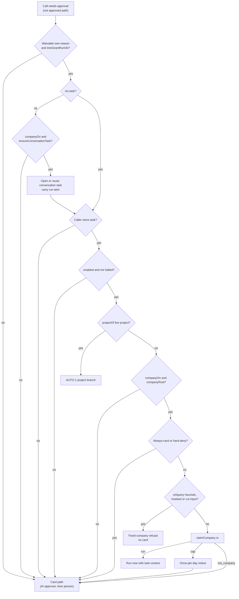

# AUTO-2: always-on autopilot (no project card)

Date: 2026-11-12. Status: owner decision in chat; standing instruction to proceed without waiting.

## 1. Goal

Owner (2026-11-12, translated): "Make it work all the time, with no waiting for approval at all." Asked how far, the owner chose: **autopilot for every task, cards only for dangerous work** (destructive, sensitive/admin/deploy/config, money/tax/offer documents, cost or long-lived tools, unknown tools).

AUTO-1 gives this behaviour only inside a project a Bot Admin approved once. AUTO-2 makes it the company default: no project, no start card.

## 2. Design

### 2.1 Company scope

- New config `autopilot.scope`: `project` (AUTO-1 behaviour, the default in code) or `company`. The owner's decision sets it to `company` on this install (written at deploy with an audit row `autopilot.scope` naming the owner decision). `/settings` can change it (Bot Admin; `company` is flagged as risk).
- In `company` scope every task tree that is not in a project is an autopilot tree. A tree in a project keeps its project rules and budget (AUTO-1 unchanged).
- Runs with no task (plain chat) get the same decisions through an implicit task: when a chat run of a head or Praw needs a task-only or approval-needing tool, the conversation task the run already opens (or opens for this purpose) carries the call. No `/task create` and no `project_task` is needed. The "Bot Admin asked" requirement of `project_task` does not apply here: any person the bots already serve can start work; taint rules still apply.

### 2.2 Decisions (same engine as AUTO-1)

`AutopilotService.decide` gains the company branch: when the task is in no active project and scope is `company`:

- hard-deny → today's card (unchanged list, code only);
- `AUTOPILOT_ALWAYS_CARD` and tools with their own approval reason outside `AUTOPILOT_OWN_WAIVE` → card;
- `treeGrantRunOk` fails (tainted publish source, forward to a wider audience) → card;
- exfiltration heuristics, masked input, cut input → fixed refusal, no card;
- otherwise claim and run in the same run.

The claim is counted against company caps instead of a project budget:

- `autopilot.company.maxApprovalsPerDay` (default 600, per `schedule.timezone` day) and `autopilot.company.maxApprovalsPerTree` (default 80);
- money and model-call spend stay under the existing budgets (`budget.*`, `limits.localCallsPerTask`, daily local caps, spend controls). Nothing lifts them.
- When a cap is reached: calls fall back to today's card path (AI approver, then a person) and ONE notice per day goes to bot-log. No task is blocked by the cap itself.

### 2.3 No asking, everywhere

- The autopilot code note (company wording: "You work under the owner's standing approval…") is added to every non-admin run in company scope.
- `ask_requester` to a human is refused in company scope with the same fixed text, except when the run was started by that person's own message in the same conversation and the question is about the goal itself (kind `clarify_goal`, one per conversation task) — the owner must still be able to be asked what they want.
- Estimate approvals for delegated tasks are skipped in company scope (budgets still apply).
- Tree-cap and local-cap cards (`treeCap`, `localCap`) stay: they are spend controls, not work approvals. To keep work moving, their existing defaults are not changed here.

### 2.4 Tool requests

In company scope a `tool_request` that passes rule G and is not a name-level hard-deny is granted to the requesting department for the current task tree only (same `project_tools`-style scoping, stored per root task, cap 5 per tree, gone when the root ends). A department-wide permanent grant still needs the Bot Admin card.

### 2.5 Visibility

Daily digest "Autopilot" part gains a company section (approved without a card per tool, refusals per code, cap hit). `/project list` shows the scope line. `/settings` shows `autopilot.scope`.

## 3. Controls

`autopilot.enabled` false or `autopilot.scope=project` restores AUTO-1/previous behaviour at once. Halt stops everything. Hard-deny, always-card and own-waive lists are code.

## 4. Testing

Company branch decisions per class; caps per tree/day with one notice; scope switch live; project trees unaffected; chat run without a task runs a ClickUp write and tainted web tools with no card; hard-deny still one card; ask_requester rules; tree-scoped tool grant; digest. Acceptance: replay of the owner's 14:17–15:05 log with NO project: R&D web tools, CTO ws_run, Praw ClickUp from chat, CEO decides without asking, no card posted except a seeded hard-deny call.

## 5. Residual risks

- R1: with no project card there is no stated goal, deadline or project budget bounding the autonomy; only daily/tree caps, existing spend budgets, hard-deny and heuristics.
- R2: any person who can talk to the bots can start autopilot work (ClickUp writes, forum posts, forwards, outside reads) with no reviewer.
- R3: tainted runs can perform internal writes up to 4000 characters per field without review.
- R4: tree-scoped tool grants happen without a person.

## Amendment SA-1 (binding, 2026-11-12)

Where this amendment and the sections above disagree, this amendment wins.

### SA-1.1 Module identifier

AUTO-2, company autopilot. It extends AUTO-1: governance/autopilot.ts, db/repos/projects.ts, tools/registry.ts, agents/loop/loop.ts and migration 043.

### SA-1.2 Actors and boundaries

- Actors: any person the bots serve; Praw; heads; personas (as task owners only); Bot Admin (`/settings`); owner (psql).
- Trust boundary: model text never reaches a decision. The decision is made inline in the MAIN registry, which is built with `autopilot: true` (app.ts, asserted in agents/autopilot.wiring.test.ts:12). The admin registry and the approved path strip the port (registry.ts:110 "(approved || this.opts.autopilot !== true) && ctx.autopilot"). AP-C3 is unchanged.

### SA-1.3 Detailed logic and flows

#### 3.1 Definitions (binding)

- `companyOn()`: true only when all three hold: `autopilot.enabled === true`, `autopilot.scope === 'company'`, and not halted. A read error on any of them gives false. The call is synchronous and never throws.
- "Company tree" (repo `companyRoot(taskId)`): the task's root is open (status not done or cancelled) and has NO projects row with `status='active'`.
- CONTRADICTION FIX: `projectOf` is not a valid test for "not in a project". It returns null for paused, exhausted and past-deadline projects too (db/repos/projects.ts:371 "NOT p.paused AND p.exhausted_at IS NULL AND p.deadline >= $2"). Keying on that null would let a pause or the budget card be bypassed. Every company gate therefore uses `companyRoot`, never `!projectOf`.
- Projects that are done or cancelled no longer bind their tree, so such a tree is a company tree.

#### 3.2 decide (governance/autopilot.ts `decide`)

1. Gate as today.
2. `p = projectOf(taskId)`. When `p` is null:
   - `!companyOn()` → CARD.
   - `!(await repo.companyRoot(taskId))` → CARD.
   - otherwise mode = company.
3. `AUTOPILOT_ALWAYS_CARD` → CARD.
4. precheckCall: `hard_deny:*` → CARD. url_heuristic and query_heuristic → refuse.
5. inputFlags: masked_input and input_cut → refuse.
6. Claim:
   - Project mode: today's path.
   - Company mode: `repo.claimCompany(taskId, tool)`.
     - `run` → RUN.
     - `cap` → `await this.d.capNotice(which)` (never throws) → CARD.
     - `not_company` → CARD.
7. In company mode every refuse returns `{kind:'refuse', code, company:true}`.
8. Any throw → CARD, logging errName only. This is unchanged.

The registry preconditions are unchanged and stay in the registry:
- the caller is the owner (`sameActor`);
- own reason waived only when `own === false || (!ownThrew && AUTOPILOT_OWN_WAIVE.includes(name))` (AP-C1, G2-02);
- `treeGrantRunOk` (AP-C2).

#### 3.3 Runs without a task (chat)

Facts:
- The autopilot branch requires `ctx.task` (registry.ts:199).
- `ensureConversationTask` is called only on the card path (registry.ts:216 "ctx.task ?? (await ctx.ensureConversationTask?.())").
- The loop rebuilds ctx each round with `task` and never with `openedTask` (loop.ts:411 "{ ...toolBase, task, direct:").
- The hook exists only for (conversation.ts:136–139):
  - Praw, on a human message;
  - a head, on a human chat or slash message routed by mention, reply, dept_channel or goal_channel (`HEAD_CONVERSATION_REASONS`, conversation.ts:47).
- The memoised `opened ??=` means one task per run.

Change (registry `exec`, replacing the AUTO-1 block that starts "AUTO-1: inside an active project tree"), PASTE VERBATIM:
```ts
      // AUTO-2: a chat run with no task gets the conversation task the card path would open (same memoised promise), so company autopilot decides here.
      const waivable = own === false || (!ownThrew && AUTOPILOT_OWN_WAIVE.includes(name));
      let apTask: Task | null = ctx.task;
      if (approval && !approved && !apTask && waivable && ctx.autopilot?.companyOn?.() === true && ctx.ensureConversationTask) {
        try { apTask = await ctx.ensureConversationTask(); } catch { apTask = null; } // the card path below meets the same failure (today's behaviour)
        if (apTask && ctx.run.tainted() && !apTask.tainted) { await ctx.tasks.update(apTask.id, { tainted: true }); apTask = { ...apTask, tainted: true }; }
      }
      const apCtx: ToolContext = apTask && apTask !== ctx.task ? { ...ctx, task: apTask } : ctx;
      let runCtx: ToolContext = ctx;
      if (approval && !approved && ctx.autopilot && apTask && sameActor(apTask.owner, ctx.actor) && waivable && (await treeGrantRunOk(name, value, apCtx))) {
        let d: AutopilotDecision;
        try { d = await ctx.autopilot.decide({ taskId: apTask.id, tool: name, input: value }); } catch { d = { kind: 'card' }; }
        if (d.kind === 'refuse') { await audit(`autopilot_refused:${d.code}`); return toolError((d.company === true ? AUTOPILOT_REFUSAL_COMPANY : AUTOPILOT_REFUSAL)[d.code]); }
        if (d.kind === 'run') {
          if (this.opts.halt.isHalted()) { await audit('halted'); return toolError('the company is halted; the call was not run'); }
          try { tool.onApprovalTask?.(value as never, apCtx, { id: apTask.id, rootId: apTask.rootId }); } catch { /* a hook never blocks */ }
          approval = false;
          runCtx = apCtx; // same task context an approved replay would get
        }
      }
```
After that block:
- `tool.run(value, ctx)` becomes `tool.run(value, runCtx)`.
- The taint write that follows ("if (!was && ctx.task && !ctx.task.tainted)") uses `runCtx.task`.
- The card path stays as is.

Effect: "Praw creates ClickUp tasks from chat" needs no card and no `/task create`. Praw has the hook, `clickup_*` writes are in `AUTOPILOT_OWN_WAIVE`, and the claim lands on the conversation root. No `project_task` is involved.

Not covered: head runs with no hook (bot-talk, warroom bot messages, taskless scheduled runs). They keep `approval_needs_task`. This is stated as a limit.

ws_run and ws_export (tools/plugins/ws/index.ts:175 and :204, "if (!ctx.task) return toolError(WS_TEXT.E_NOTASK)"):
- They never reach the approval branch (`requiresApproval: () => false`).
- Change to `const t = ctx.task ?? (ctx.autopilot?.companyOn?.() === true && ctx.ensureConversationTask ? await ctx.ensureConversationTask().catch(() => null) : null); if (!t) return E_NOTASK;` and use `t.rootId`.
- Why not change loop.ts to `task ?? openedTask`: that would change `direct`, ownership and parent semantics for every tool in later rounds, which is too wide.

#### 3.4 Autopilot note (agents/context.ts, new export `COMPANY_AUTOPILOT_NOTE`, a fixed text with no variables), VERBATIM:

"AUTOPILOT (code note, company scope): You work under the owner's standing approval for all company work. You own your decisions. Never ask the owner, a Bot Admin or the person who asked to choose between options; pick the option you recommend, record it in the task notes when you have a task, and proceed. The one exception: when a person wrote to you directly and their message does not say what they want, ask them in your reply. Calls that need approval run at once without a card, except destructive, sensitive, admin, deploy, config, money/tax/offer document, cost or long-lived, and unknown tools, which still wait for a person. A call refused as data-like must be rephrased, not escalated. Spend limits still apply; when a limit stops you, report it and stop. When you report, list the decisions you took; never end with a request for the owner to choose."

loop.ts (the `const project = …` block, around :277–280): the note is added when all of these hold:
- `!adminRun && !trigger.postOnly && !project && deps.autopilot?.companyOn?.() === true`;
- AND (`!task`, or `await deps.autopilot.inCompany(task.id)`).

The project note wins when `project` is set. The AUTO-1 warroom-wait sentence is left out on purpose: the C15 wait stays project-only (scheduler.ts:820 is unchanged).

#### 3.5 ask_requester (tools/builtin/askRequester.ts:50)
- Add: `|| (task.requester.kind === 'human' && ctx.autopilot?.inCompany && await ctx.autopilot.inCompany(task.id).catch(() => false))` → `ASK_REFUSALS.autopilotCompany` = "You work under the owner's standing approval: do not ask a person. Pick the option you recommend, record it in the task notes, and proceed."
- A head requester can still be asked, as in AUTO-1.
- Decision: the `clarify_goal` exception is dropped. It needs a new input kind, a per-conversation counter and a started-by-that-person check. It is also unnecessary: ask_requester is offered only when the run owns a task (loop.ts:295 `askOffered`), and a person-started chat run asks through its own reply, which the note allows.

#### 3.6 Estimate skip (tools/builtin/createTask.ts:175, `inProject`)

`skip = parent ? (inProject || await ctx.autopilot?.inCompany?.(parent.id).catch(() => false)) : ctx.autopilot?.companyOn?.() === true`. Budgets are unchanged.

#### 3.7 Tree-scoped tool grants (§2.4)

- `AutopilotService.projectGrant`: when `!p && companyOn() && companyRoot(taskId)`, the result is `repo.grantTreeTool` → `{kind:'granted_tree'}` or a refusal. The name-level hard-deny check is unchanged.
- ToolRequestService (grow/tool-requests.ts:110–121) still runs only with an owned task and after the taint refusal (:102). New text: "Granted for this task tree only: ${dept} may use ${tool} in this tree's tasks from its next run there. No card was sent."
- Refusals: "Your department already has that tool in this task tree." and "This task tree already has 5 granted tools."
- Offer (loop.ts:278): `projTools = project ? toolsFor(...) : (companyOn && task ? treeToolsFor(task.id, actor) : [])`.
- Replay: `AutopilotService.toolsForTask` returns the project grants plus, when `companyOn()`, the tree grants. app.ts:19 is unchanged.
- "Gone when the root ends": rows are kept and filtered at read time.

#### 3.8 Cap reached

- The call goes to the card path: AI approver if enabled, then a person.
- Exactly one notice per day in schedule.timezone (dedupe: `daily_runs` kind `autopilot_cap`, the same store as ai-digest.ts:87).
- Title "Company autopilot cap reached". Body: "The company autopilot cap was reached (${which==='day'?'the daily cap':'a task tree cap'}). Calls that need approval now go to the card path (AI approver, then a person) until the cap resets. Nothing is blocked by the cap itself. The caps are autopilot.company.maxApprovalsPerDay and autopilot.company.maxApprovalsPerTree (psql)."
- Posted to BOT_LOG_CHANNEL_ID as hq, alert, origin governance.

#### 3.9 What does not change

- treeCap and localCap cards.
- WEBGRANT: the consume in fetch_page precheck still runs before approval (fetchPage.ts:44).
- TREEGRANT: its consume still runs before the autopilot block (registry.ts:175), so a human tree grant is spent first.
- The AI approver handles every card still filed: hard-deny, always-card, own reason not waived, ownThrew, treeGrantRunOk false, cap reached, faults. Its own caps apply.

#### 4. Mermaid diagram



#### 5. Data, API and error contracts

#### 5.1 Config (config/schema.ts, config/defaults.ts, admin/keys.ts HANDLER_KEYS, all three keys)
- `autopilot.scope`: z.enum(['project','company']), default 'project'.
- `autopilot.company.maxApprovalsPerDay`: int 1–10000, default 600.
- `autopilot.company.maxApprovalsPerTree`: int 1–1000, default 80.
- Only `autopilot.scope` has a `/settings` path: plans.ts `planAutopilotScope` accepts `project|company` and refuses anything else with "Give project or company."; settings.ts adds `case 'autopilot.scope'`; `risk: v === 'company'`, which triggers the existing risk notice (app.ts:830).
- The caps are psql only. No boot check is needed: no bound depends on them.

Deploy step, decided: a documented one-off psql statement, not a migration data step. A data step would flip every freshDb integration DB and every new install, and its down could not know the previous value. Run it after the 043 deploy and restart. PASTE VERBATIM:
```sql
BEGIN;
INSERT INTO config (key, value, updated_by) VALUES ('autopilot.scope', '"company"'::jsonb, 'owner-decision:AUTO-2')
  ON CONFLICT (key) DO UPDATE SET value = EXCLUDED.value, version = config.version + 1, updated_by = EXCLUDED.updated_by, updated_at = now();
INSERT INTO audit_log (actor, action, tool, outcome) VALUES ('system:deploy', 'config.set', 'autopilot.scope', 'ok company (owner decision 2026-11-12, AUTO-2)');
COMMIT;
SELECT pg_notify('config_changed', 'public:autopilot.scope');
```
The pattern is README.md:633–638. Revert: the same statements with '"project"', or `/settings set autopilot.scope project`.

#### 5.2 Migration 043 (db/migrations/043_autopilot_company.up.sql), PASTE VERBATIM:
```sql
-- AUTO-2: company autopilot counters and task-tree tool grants. Additive, plus the daily_runs kind list.
CREATE TABLE autopilot_company_counts (
  scope text NOT NULL CHECK (scope IN ('day','tree')),
  scope_key text NOT NULL,
  used integer NOT NULL DEFAULT 0 CHECK (used >= 0),
  updated_at timestamptz NOT NULL DEFAULT now(),
  PRIMARY KEY (scope, scope_key),
  CONSTRAINT autopilot_company_counts_key CHECK ((scope = 'day' AND scope_key ~ '^[0-9]{4}-[0-9]{2}-[0-9]{2}$') OR (scope = 'tree' AND char_length(scope_key) BETWEEN 1 AND 64))
);
CREATE TABLE tree_tools (
  root_task_id text NOT NULL REFERENCES tasks(id),
  dept_id text NOT NULL CHECK (dept_id ~ '^[a-z_]{1,32}$'),
  tool text NOT NULL CHECK (tool ~ '^[a-z0-9_]{1,64}$'),
  task_id text,
  granted_at timestamptz NOT NULL DEFAULT now(),
  PRIMARY KEY (root_task_id, dept_id, tool)
);
ALTER TABLE daily_runs DROP CONSTRAINT daily_runs_kind_check;
ALTER TABLE daily_runs ADD CONSTRAINT daily_runs_kind_check CHECK (kind IN ('goal','report','heal','ai_digest','autopilot_cap'));
```
043_autopilot_company.down.sql, PASTE VERBATIM:
```sql
DELETE FROM daily_runs WHERE kind = 'autopilot_cap';
ALTER TABLE daily_runs DROP CONSTRAINT daily_runs_kind_check;
ALTER TABLE daily_runs ADD CONSTRAINT daily_runs_kind_check CHECK (kind IN ('goal','report','heal','ai_digest'));
DROP TABLE IF EXISTS tree_tools;
DROP TABLE IF EXISTS autopilot_company_counts;
```
The latest kind list is the one in 038_ai_approver.up.sql:4. `project_tools` cannot be reused: its PK `(project_id, dept_id, tool)` (042 line 46) cannot hold a null project.

#### 5.3 ProjectRepo, new methods. All reads in a tx use the tx client. Every counted audit row is a throwing insert in the same tx. Nothing logs.

- `companyRoot(taskId): Promise<string|null>`. Never throws (null on error). Query:
  `SELECT t.root_id AS "rootId" FROM tasks t JOIN tasks r ON r.id = t.root_id WHERE t.id = $1 AND r.status NOT IN ('done','cancelled') AND NOT EXISTS (SELECT 1 FROM projects p WHERE p.root_task_id = t.root_id AND p.status = 'active')`.
- `claimCompany(taskId, tool): Promise<{kind:'run';day:number;tree:number}|{kind:'cap';which:'day'|'tree'}|{kind:'not_company'}>`.
  - Before the tx: `on()`, `halted()` and scope; any doubt → not_company.
  - In the tx:
    1. `SELECT root_id FROM tasks WHERE id=$1`.
    2. `SELECT status FROM tasks WHERE id=$root FOR UPDATE`. If ended → not_company.
    3. Re-read root_id; if it changed → not_company (the AUTO-1 adoption-race pattern, projects.ts:401–405).
    4. Active project on the root → not_company.
    5. Tree counter: `INSERT INTO autopilot_company_counts (scope, scope_key, used) VALUES ('tree',$root,1) ON CONFLICT (scope, scope_key) DO UPDATE SET used = autopilot_company_counts.used + 1, updated_at = now() WHERE autopilot_company_counts.used < $maxTree RETURNING used`. No row → return cap tree (nothing written).
    6. The same upsert for ('day', today in schedule.timezone) with $maxDay. No row → throw the internal `CompanyCap('day')` so the tree increment rolls back.
    7. Re-check on, halted and scope; any doubt → throw not_company.
    8. Audit: actor 'system:autopilot', action 'approval.autopilot.company', taskId, tool, outcome `ok d${d}/${maxDay} t${t}/${maxTree}`.
  - Lock order: root row, then tree row, then day row (the same order as workspaces.ts:72). Other errors are rethrown, and decide turns them into CARD.
- `claimCapNotice(which): Promise<boolean>`. In one tx: `INSERT INTO daily_runs (day, kind) VALUES ($today,'autopilot_cap') ON CONFLICT DO NOTHING`. If rowCount is 1, write the throwing audit 'autopilot.company.cap' with outcome `day|tree` and return true.
- `grantTreeTool({taskId, deptId, tool}): Promise<{ok:true;rootId:string}|{ok:false;code:'not_company'|'exists'|'cap'}>`. In a tx:
  1. Lock the root FOR UPDATE and re-check the companyRoot conditions on the tx client.
  2. exists → 'exists'.
  3. count ≥ `TREE_TOOLS_MAX = 5` → 'cap'.
  4. insert.
  5. Throwing audit 'tool.tree_grant', outcome `ok ${dept} ${tool}`.
- `treeToolsFor(taskId, deptId): Promise<string[]>`. Joins the root, the open status and no active project. Empty on error.
- `day(tz)` adds an optional `company?: { total: number; tools: {tool:string;n:number}[] (top 10); capHit: 'day'|'tree'|null; treeGrants: {root8:string;dept:string;tool:string}[] (≤25) }` read from audit actions 'approval.autopilot.company' and 'autopilot.company.cap' and from `tree_tools.granted_at`, all for today.

#### 5.4 Ports and types (tools/types.ts:69–73)
- `AutopilotDecision` refuse gains `company?: true`.
- `AutopilotPort` gains optional `companyOn?(): boolean` and `inCompany?(taskId): Promise<boolean>`.
- `AgentDeps.autopilot` (loop.ts:175) gains `companyOn?`, `inCompany?` and `treeToolsFor?(taskId, actor)`.
- toolContextBase (loop.ts:626) spreads `companyOn` and `inCompany` into the port only when they are present.
- AutopilotDeps adds `capNotice(which): Promise<void>`. app.ts wires it as repo.claimCapNotice followed by a bot-log post; it never throws.

#### 5.5 Refusal texts (tools/autopilot.ts, new frozen `AUTOPILOT_REFUSAL_COMPANY`)

The AUTO-1 texts with "Refused in this project:" replaced by "Refused under company autopilot:". The audit outcome stays `autopilot_refused:<code>`. The digest refusal line is shared by project and company.

#### 5.6 Digest (agents/tasks/ai-digest.ts:62–70), when `auto.company?.total || capHit || treeGrants.length`:
- "Company autopilot (no project):"
- "Approved without a card: N"
- "Per tool:" list
- "Cap reached today: daily cap|a task tree cap"
- "Tools granted to a task tree today:" `- <root8> <dept> <tool>`
`autoEmpty` treats `company` as optional.

#### 5.7 `/project list` (discord/commands/project.ts:45)

The description gets a first line "Autopilot scope: company (task trees outside a project run without cards, except dangerous work)" or "Autopilot scope: project". The empty case shows this line plus "No projects yet." A read error shows "project".

#### 5.8 Error mapping (all fixed texts)

| Case | Result |
|---|---|
| Company refuse | `toolError(AUTOPILOT_REFUSAL_COMPANY[code])` |
| ensure throws | today's card path (the same throw → 'tool failed' + incident, as today) |
| Cap | card + one notice per day |
| Any fault | card |
| ws in chat with no hook or not company | E_NOTASK |

### SA-1.4 Security and privacy notes (requires security gate)

- Store all three keys in HANDLER_KEYS. If they are missing, ADMIN_CONFIG_KEYS (admin/keys.ts:53) lets the model-reachable `config_propose` write the scope.
- A scope read error counts as 'project'. Halt and `autopilot.enabled=false` stop company mode immediately.
- The hard-deny, always-card and own-waive lists stay code-only. The hard-deny classes come from the registry's `describe` (AA-C1).
- Logs carry errName only. Never log input, titles or model text. Audit outcomes are codes and counts only.
- The ensure-before-decide step can open a conversation task that ends up refused or carded. It carries the run's taint before decide (G2-02 parity).
- treeGrantRunOk runs on `apCtx`, so the task taint counts for write_file.
- Tree grants need: an owned task, an untainted run (tool-requests.ts:102), rule G, not a name-level hard-deny, a cap of 5, and no person.
- Residuals R1–R4 (spec §5) stand. Add R5: the bot-to-bot and taskless head paths keep cards, and a tree's counter rows are never pruned (counts only, no text).
- Masking: there are no new sensitive fields.

### SA-1.5 Open questions and contradictions

Open questions: none for backend. Contradictions with the spec are resolved here and listed for Gate 1:

| # | Spec | Resolution |
|---|---|---|
| C1 | §2.2 "not in a project" | No `status='active'` project row on the root. Paused, exhausted and past-deadline trees stay on cards. |
| C2 | §2.1 implicit task for "a head or Praw" | Only runs that have the conversation hook. Others keep `approval_needs_task`. |
| C3 | §2.3 `clarify_goal` | Dropped; the note's reply exception replaces it. |
| C4 | §2.1 "written at deploy" | psql one-off (5.1), not a migration. |
| C5 | §2.5 company refusals per code | Shared refusal line; the audit row carries no scope. |
| C6 | AUTO-1 note's warroom-wait sentence | Left out; the C15 wait stays project-only. |
| C7 | §2.4 "gone when root ends" | Filtered at read; rows kept. |
| C8 | §4 "CTO ws_run" in chat | ws fallback through ensure, company scope only. |
| C9 | §2.2 decision order | A live human TREEGRANT is consumed before company decide (registry order unchanged). |

Tests invalidated (rule 4):
- agents/autopilot.wiring.test.ts:16: the exact `autopilot: { projectOf…, decide: … }` string. The required string appends `, companyOn: () => autopilot.companyOn(), inCompany: (id) => autopilot.inCompany(id), treeToolsFor: (id, a) => autopilot.treeToolsFor(id, a)` before ` }`.
- Still hold:
  - loop.autopilot.test.ts:76 (keys ['decide','projectOf']): holds because the spread is conditional and the rig has no companyOn.
  - ws.run.test.ts:104 and :140 (E_NOTASK): hold, no companyOn.
  - autopilot-acceptance.int.test.ts:228–233: holds, its ctxFor has no ensure.
  - admin/keys.autopilot.test.ts:6–18: holds; new keys get a new test.
  - autopilot.settings.test.ts:29: holds.
  - ai-digest.autopilot.test.ts EMPTY: holds, `company` is optional.
  - migrate.int.test.ts:379: holds; add a 043 case.
- Int tests that `DELETE FROM tasks` must first `DELETE FROM tree_tools` and `autopilot_company_counts` if they create rows (FK).

### SA-1.6 Task list

#### 9. TASK LIST (2 sequential backend dispatches)
- BE1, engine and data:
  - migration 043 up and down;
  - the 3 config keys (schema, defaults, HANDLER_KEYS);
  - ProjectRepo: companyRoot, claimCompany, claimCapNotice, grantTreeTool, treeToolsFor, day().company;
  - AutopilotService: companyOn, inCompany, the decide company branch, capNotice dep, toolsForTask union, treeToolsFor, projectGrant tree branch;
  - AUTOPILOT_REFUSAL_COMPANY; the types in 5.4.
  - Tests: unit for each decide class; int for the claim (tree then day rollback, concurrency at the cap, root moved, active or paused project → not_company), one notice per day, tree grant cap 5 with root end, migration 043.
- BE2, integration:
  - the registry block (3.3); the ws fallback; the loop note, tree tools and port;
  - COMPANY_AUTOPILOT_NOTE; askRequester; the createTask skip; the tool-requests texts; the digest;
  - planAutopilotScope and the settings case; the `/project list` scope line; app.ts wiring;
  - README psql recipe (5.1);
  - acceptance int test: replay of the 14:17–15:05 log with no project (R&D web tools, CTO ws_run in chat, Praw ClickUp from chat, CEO with no ask, the seeded hard-deny gives exactly 1 card), plus scope switch live and project trees unaffected.
