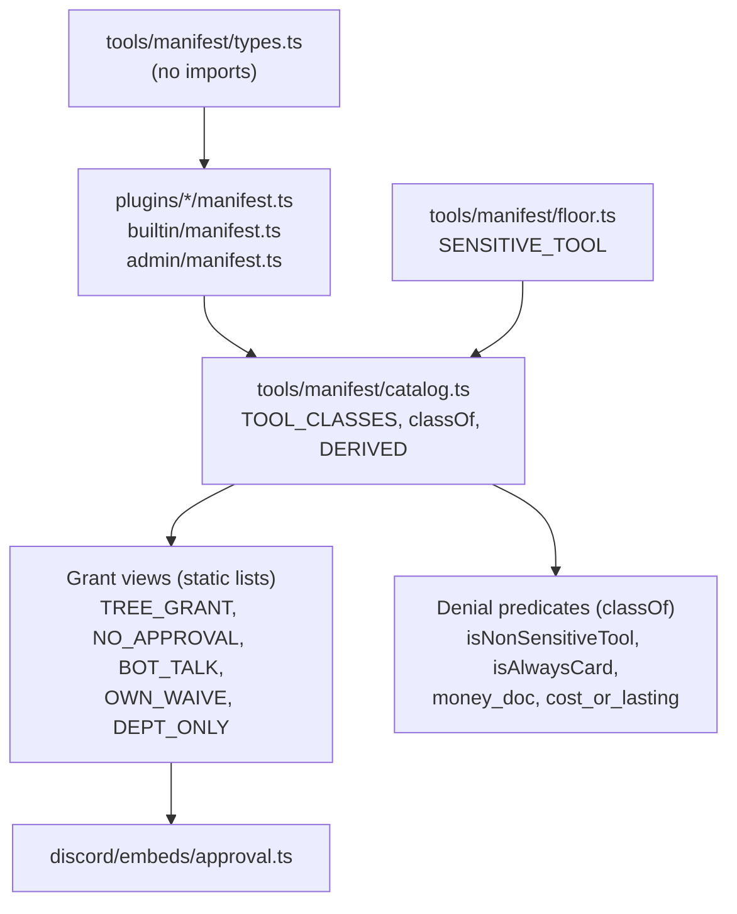
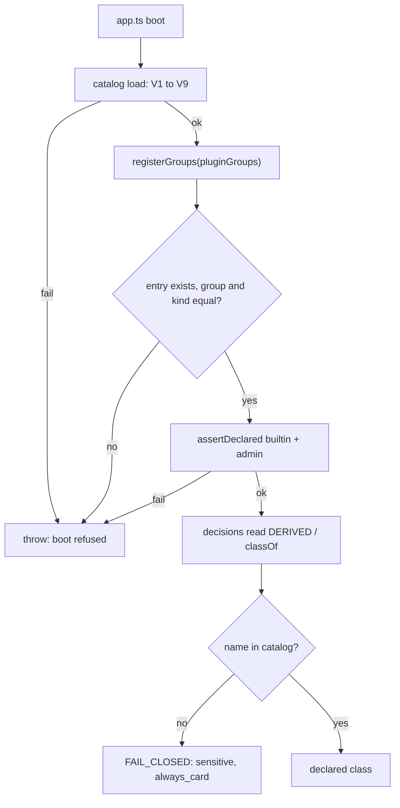

# R4 PLUGIN-MANIFEST: one manifest per tool (GROWTH-1)

Date: 2026-11-12. Status: design + handoff brief by sa under the owner-approved growth roadmap; binding for the build, subject to Gate 1.

======================================================================
SPECIFICATION HANDOFF BRIEF (for document + security)
======================================================================
PLAN REF: docs/plans/2026-11-12-growth-roadmap.md (item R4)
TARGET TEMPLATE: freeform
OUTPUT DESTINATION: /Users/pakawat.tan/Labworkspace/BOT/Assistant/docs/superpowers/specs/2026-11-12-plugin-manifest-design.md

1. MODULE IDENTIFIER: GROWTH-1 / R4 PLUGIN-MANIFEST. Requires the security gate (it touches every approval, autopilot and sensitivity decision).

2. ACTORS & BOUNDARIES
- Actors: the developer or reviewer who adds a tool; the boot sequence (app.ts); the decision points that read a tool's class.
- Decision points: approvalFor, the tree grant, autopilot, the AI approver, approval rooms and batching, skill grant, and DEPT_ONLY.
- Trust boundary: only code that is checked in may declare a class. Nothing can set a class at runtime in R4. Model text, config and stored rows cannot set one either.

3. DETAILED LOGIC & FLOWS

3.1 What the lists encode today (verified)
| List | Anchor | Members | Effect |
|---|---|---|---|
| SENSITIVE_TOOL (regex) | discord/approval/approval-rooms.ts:13 `/^(github_\|devjob\|code_\|…\|skill_)/i` | Matching registered names: github_* (14), save_lesson, delete_lesson, knowledge_propose, prompt_propose, skill_propose, and the admin names except discord_read | Card stays in #setting (`routable` :49); never batched; never skill-granted (skill-grant.ts:27); never tree-granted (tree-grant-scope.ts:17); AI hard-deny (ai-approver.ts:106); autopilot gives a card |
| DEPT_ONLY | tools/policy.ts:13 | ws_* (7) → 'software' | Dropped by `effective()` (:49) |
| BOT_TALK_TOOLS | tools/policy-approval.ts:13 | warroom_say | A write never asks (:39) |
| NO_APPROVAL_TOOLS | tools/policy-approval.ts:21 | diagram_create, ws_create, ws_write, ws_delete, ws_run, ws_export | A write never asks (:40) |
| TREE_GRANT_TOOLS | tools/tree-grant-tools.ts:6 | write_file, pin_message, forum_post, forward_to, doc_create, music_play, music_skip, music_stop, music_volume | The tree grant may waive the central approval |
| AUTOPILOT_OWN_WAIVE | tools/autopilot.ts:9 | web_search, fetch_page, plus CLICKUP_WORKSPACE_WRITE_NAMES (clickup/workspace-write.ts:18, 7 names) | Autopilot may waive the tool's own reason (registry.ts:201) |
| AUTOPILOT_ALWAYS_CARD | tools/autopilot.ts:27 | clickup_add_comment, jira_add_comment | Always a card (governance/autopilot.ts:82) |
| MONEY_DOC_TOOLS | governance/ai-approver.ts:31 | sheets_append_receipt | hard_deny:money_doc (:107) |
| COST_OR_LASTING_TOOLS + PREFIX | ai-approver.ts:32-33 | add_reminder, cancel_reminder, image_generate, meeting_start, video_generate, watch_add, watch_remove, plus any name starting `schedule_` (a second prefix hole) | hard_deny:cost_or_lasting (:109) |

Not touched: ADMIN_TOOL_NAMES and MOD_TOOL_NAMES (admin/names.ts:7,9). They are the admin registry's grant lists, an `as const` type source. discord_read is admin, but the regex marks it non-sensitive (skill-grant.test.ts:47).

3.2 Manifest shape (`tools/manifest/types.ts`, NO imports)
```ts
export type DeclKind = 'read' | 'write' | 'destructive' | null; // null = no kind (most builtins, all admin tools)
export interface ToolClass {
  readonly group: string;      // plugin folder name = factory id; 'builtin' | 'admin'
  readonly kind: DeclKind;     // must equal ToolPlugin.kind ?? null
  readonly sensitive: boolean; // REQUIRED in every entry (no preset supplies it)
  readonly approval: 'central' | 'no_approval' | 'bot_talk';
  readonly deptOnly: string | null;
  readonly treeGrant: boolean;
  readonly autopilot: 'default' | 'own_waive' | 'always_card';
  readonly aiReview: 'judge' | 'money_doc' | 'cost_or_lasting';
}
export type ManifestEntry = Omit<ToolClass, 'group'>;
type Preset = Omit<ManifestEntry, 'sensitive'>;
export const READ: Preset;  export const WRITE: Preset;  export const DESTRUCTIVE: Preset;  export const NOKIND: Preset;
// presets: kind set; approval 'central', deptOnly null, treeGrant false, autopilot 'default', aiReview 'judge'
// (= exactly today's behaviour for a name absent from every list)
export function defineManifest(group: string, m: Readonly<Record<string, ManifestEntry>>): Readonly<Record<string, ToolClass>>;
export const FAIL_CLOSED: ToolClass = { group: '', kind: null, sensitive: true, approval: 'central', deptOnly: null, treeGrant: false, autopilot: 'always_card', aiReview: 'cost_or_lasting' };
```
Example entry: `pin_message: { ...WRITE, sensitive: false, treeGrant: true }`.

Every field other than the default appears exactly when the name is on the matching old list. There is one exception: every name starting `schedule_` (schedule_add, schedule_list, schedule_remove) is set to `cost_or_lasting`.

3.3 Files
- `tools/manifest/floor.ts` (leaf): holds the SENSITIVE_TOOL regex, moved verbatim and frozen ("never extended; new tools declare `sensitive`"). approval-rooms.ts re-exports it under the same name.
- One `manifest.ts` per plugin folder (16): web, reminders, schedule, watch, lessons, workspace, pin, forum, clickup (both modes, including clickup_delete_task), jira, github, ocr (including sheets_append_receipt), music, docs, media (including video_generate), ws. They use type and preset imports only.
- `tools/builtin/manifest.ts`: create_task, respond, update_task, answer_subtask, ask_requester, resolve_blocked, meeting_start, forward_to, warroom_say, kb_search, knowledge_propose, prompt_propose, skill_propose, project_propose, project_task, tool_request, tool_idea.
- `admin/manifest.ts`: the 11 ADMIN names. kind is null. `sensitive` follows the regex, so discord_read is false.
- `tools/manifest/catalog.ts`: imports floor and all manifests only. It exports:
  - `TOOL_CLASSES` (a frozen Map)
  - `classOf(name)` (returns FAIL_CLOSED when the name is absent)
  - `DERIVED = { treeGrant, noApproval, botTalk, ownWaive, alwaysCard, moneyDoc, costOrLasting, deptOnly }`. Each array is sorted and Object.freeze'd; the record is frozen.
  - `CATALOG_DIGEST`: sha256 of the canonical JSON, for R5.
  - `EXTERNAL_PREFIX = 'mcp_'`.
- Load-time validation. A failure throws, so boot fails closed:
  - V1: the name matches `^[a-z][a-z0-9_]{0,63}$`.
  - V2: no name is declared twice across manifests.
  - V3: no name starts with `mcp_`.
  - V4: `sensitive:false` is not allowed when SENSITIVE_TOOL matches the name.
  - V5: treeGrant requires kind write, not sensitive, and approval central.
  - V6: approval other than central requires kind write and no treeGrant.
  - V7: own_waive requires not sensitive.
  - V8: deptOnly is null or a non-empty string.
  - V9: a name starting `schedule_` requires aiReview cost_or_lasting.
- `tools/manifest/assert.ts`: `assertDeclared(reg, names, group)`. For each registered name in `names`, the entry must exist, its group must match, and its kind must equal `reg.kindOf(n) ?? null`. Otherwise it throws.

3.4 Consumers (BE2). Rule: grants read the static derived lists; denials read `classOf`, which fails closed.
- approval-rooms.ts:13-16: `isNonSensitiveTool = n => !SENSITIVE_TOOL.test(n) && classOf(n).sensitive === false`
- policy.ts:13: `DEPT_ONLY = DERIVED.deptOnly`
- policy-approval.ts:13, :21: `= DERIVED.botTalk` and `= DERIVED.noApproval`
- tree-grant-tools.ts:6: `= DERIVED.treeGrant` (it still imports only the leaf chain)
- autopilot.ts:9, :27: `= DERIVED.ownWaive` and `= DERIVED.alwaysCard`. Add `isAlwaysCard = n => classOf(n).autopilot === 'always_card'` and drop the CLICKUP import.
- governance/autopilot.ts:82: `if (isAlwaysCard(r.tool)) return CARD;`
- ai-approver.ts:31-32: lists become `DERIVED.*`. Line 107 becomes `classOf(name).aiReview === 'money_doc'`. Line 109 becomes `classOf(name).aiReview === 'cost_or_lasting' || name.startsWith(COST_OR_LASTING_PREFIX)` (the prefix check stays as a floor).
- tools/plugins/index.ts `registerGroups` (next to the kind check at :64): when the factory is a member of `pluginGroups`, throw unless `TOOL_CLASSES.get(t.name)` exists, has group equal to g.id and kind equal to t.kind. This matches today's "no kind → throw". Factories passed through `o.groups` are only for tests (app.ts:650, tests/integration/helpers.ts:230). They are not checked, and their tools get FAIL_CLOSED.
- app.ts after :652: `assertDeclared(tools, builtinNames, 'builtin')`. After :914: `assertDeclared(adminRegistry, adminRegistry.names(), 'admin')`.
- Unchanged: `GroupFactory` stays synchronous; PluginDeps; the `pluginGroups` order (it fixes registration order and the order of `names()`); assertTreeGrantScope.

3.5 Registration after the change
`pluginGroups` stays an explicit array. Folder discovery or code generation would change registration order or add a build step.

A new plugin needs:
- a folder `tools/plugins/<x>/` with `index.ts` (the factory) and `manifest.ts`;
- one line in `pluginGroups` (tools/plugins/index.ts:33) and one line in catalog.ts;
- an optional PluginDeps field plus app.ts:650 wiring, only if it needs a new dependency;
- a deliberate `tools.byDept` grant (config/defaults.ts). It is never automatic.

A completeness test fails and names the missing line when:
- a folder has no manifest.ts;
- a manifest is not in the catalog;
- the number of `pluginGroups` entries differs from the number of folders.

3.6 Builtins and admin tools: in scope
The derived lists name them: forward_to (tree grant), meeting_start (cost), warroom_say (bot talk), and the knowledge_, prompt_ and skill_ tools plus the admin names (regex). Fail-closed is impossible if they are left undeclared.

3.7 Exception and failure flows
- An undeclared or mismatched plugin tool: boot throws.
- An undeclared builtin or admin tool: assertDeclared throws.
- An unknown name in a stored approval or a lookup gets FAIL_CLOSED: the card goes to #setting, it is not batched, the AI hard-denies it, autopilot gives a card.
- Validation errors are thrown at module load.
- The process is single-threaded and frozen at load, so there is no concurrency or retry concern.

4. MERMAID DIAGRAMS



5. DATA, API & ERROR CONTRACTS
- No migration, no config key, no DB change.
- `CATALOG_DIGEST` is a 64-char hex string.
- Boot errors use fixed texts containing a code-constant tool name, e.g. `tool <name> in group <id> is not declared in tools/plugins/<id>/manifest.ts`, `tool manifest: <name> <rule>`.

5.1 Tests (all new ones in BE1)
- `tools/manifest/privileged.json`: the old literals at `6e85f0f`, sorted, plus the `schedule_*` additions. After R4 it stays as the reviewed membership file. The test asserts every `DERIVED.*` deep-equals it.
- Sensitivity domain test. For every catalog name: `classOf(n).sensitive === SENSITIVE_TOOL.test(n)`. For every name in ADMIN and the sample names at approval-rooms.test.ts:168-170: `isNonSensitiveTool` is false, except discord_read, which is true. For unknown names (BE2 onward): false.
- Kind and group equality for every registered name, against the real registry. The real registry harness moves from the goldens into `tools/autopilot.golden.harness.ts` as a pure move.
- `NOT_IN_REAL_SET = [diagram_create, video_generate, sheets_append_receipt, clickup_delete_task]` plus the admin names are checked against their code anchors (docs/index.ts:284, clickup/write.ts:100, the media and ocr files, admin/tools.ts:100-278). Any catalog name in neither set fails the test.
- Completeness test (3.5). Tests for V1 to V9.

5.2 Goldens (BE3)
- The two literal tables have identical entries (autopilot.golden.test.ts:94-190, autopilot.company.golden.test.ts:56-152).
- They become one committed file, `tools/__golden__/autopilot-classes.json`: keys sorted, 2-space indent, trailing newline.
- Both tests read it with `existsSync` + `JSON.parse` + `toEqual`. Vitest snapshots are not used.
- `GOLDEN_UPDATE=1` (refused when `CI` is set) writes the observed values, then fails with "golden updated; review the diff".
- Expected values are observed run-path classes. They are never computed from the manifest.

5.3 Test assertions invalidated (old → new)
| file:line | old | new |
|---|---|---|
| tools/tree-grant-scope.test.ts:14 | declared order | `['doc_create','forum_post','forward_to','music_play','music_skip','music_stop','music_volume','pin_message','write_file']` |
| tools/policy.ws.test.ts:61, tools/plugins/docs/diagram.test.ts:138 | `[diagram_create, ws_create, ws_write, ws_delete, ws_run, ws_export]` | `['diagram_create','ws_create','ws_delete','ws_export','ws_run','ws_write']` |
| tools/registry.autopilot.test.ts:175 | `['web_search','fetch_page',...CLICKUP_WORKSPACE_WRITE_NAMES]` | sorted 9: `clickup_assign_task, clickup_create_folder, clickup_create_list, clickup_create_space, clickup_create_task, clickup_update_status, clickup_update_task, fetch_page, web_search` |
| discord/approval/approval-rooms.test.ts:176 | `stub_write` is eligible | `jira_create_issue` is eligible |
| tools/skill-grant.admin.test.ts:10, :17-20 | the mock adds `future_admin_tool`; `future_plain_tool` is allowed | the mock adds `forum_post` to ADMIN (refused, SENSITIVE_TOOL false); `jira_create_issue` is allowed |
| tests/integration/{tool-approval, tool-approval.batching, approval-batch-app, task-admin.tester, praw-schedule, web-grant-acceptance, approvals}.int.test.ts (`stub_write`), ai-approver.int.test.ts:118 (`stub_wait`) | the stub is non-sensitive through fail-open | assertions unchanged; add a file-local `vi.mock('<rel>/tools/manifest/catalog.js', …withTestClasses(orig, {stub_write: {...WRITE, sensitive:false, group:'test'}}))` from the new `tests/fakes/tool-classes.ts`. It wraps `classOf` only, so stubs never join a DERIVED list, and it refuses names that collide with the catalog |
| autopilot golden tables (BE3) | literal GOLDEN | JSON file, byte-equal content |

Any other failure is a stop-and-report. Never patch it by changing FAIL_CLOSED, the floor or privileged.json.

6. SECURITY & PRIVACY NOTES (Gate 1)
- Invariant: no registered tool's effective class changes. Three pieces of evidence:
  - (a) privileged.json equals the old literals;
  - (b) the golden tables pass unchanged through BE2, then as byte-equal JSON;
  - (c) the sensitivity domain test.
- One intended change: an unknown name is now sensitive, always gets a card and is AI hard-denied. This closes the fail-open prefix hole at approval-rooms.ts:13 and the `schedule_` hole at ai-approver.ts:33. No production name is unknown, because boot asserts every registered name is declared.
- New risk: any folder could declare `treeGrant` or `own_waive`. Today the comments at tree-grant-tools.ts:2-3, autopilot.ts:5-6 and policy-approval.ts:10-21 promise that this needs a reviewed list edit. Mitigation: privileged.json must change in the same diff, and V5 to V7 apply. BE3 updates those comments to say so.
- Seams:
  - `o.groups` is only for tests. Its tools get FAIL_CLOSED.
  - vi.mock is limited to the files listed in 5.3.
  - There is no runtime setter in R4.
- Logging: no new log fields; tool names are code constants. Gate history anchors still apply: AP-C1, TG-C1, WS-C18, WS-C19, AA-C1, SK8, B7, WS7.

7. OPEN QUESTIONS: none for backend.

7.1 What R5, R6 and R7 need (so the manifest does not change again)
- R5 shows `CATALOG_DIGEST` plus a hash of the golden and privileged files on the release card.
- R6 adds a boot-time extension, set once, that only `classOf` consults. It applies only to names with the `mcp_` prefix (V3 keeps the static catalog off it). The allowlist entry supplies kind, sensitive, autopilot ('default' or 'always_card') and aiReview, and never approval ≠ central, treeGrant or own_waive. The DERIVED lists stay static.
- R7 plugins are MCP servers that go through R6. They never edit the static catalog.

7.2 Contradictions with the roadmap and the brief
| Source text | Decision |
|---|---|
| "one folder + one line" | One folder plus two lines (pluginGroups and catalog), enforced by the completeness test. The `tools.byDept` grant and PluginDeps wiring stay separate steps. |
| "golden tests derived from the manifest" | Goldens are observed behaviour (anything derived would be a tautology). The manifest-derived check is privileged.json. |
| `policy` on ToolPlugin | A separate leaf manifest.ts keyed by name. Reason: an ESM cycle clickup/index.ts:3 → embeds/approval.ts:8 → tree-grant-tools; also disabled groups would drop names. |
| sensitivity normal/sensitive/admin | A boolean. Admin and mod stay literal lists (discord_read). |
| approval policy/never | central / no_approval / bot_talk (two separate gate histories). |
| `cost?` nullable | `aiReview` required. |
| fail-closed default | Lookups get FAIL_CLOSED; an undeclared production tool refuses boot (stronger). |
| remove the regex hole | The regex is kept as a frozen floor; fail-closed comes from the catalog. |
| discovery by folder | It stays an array (deterministic order, no codegen). |
| snapshot | A JSON file with an explicit writer; no auto-write. |

7.3 Backend dispatches (sequential; each one green)
- BE1 (additive): types, floor (re-exported), 18 manifests, catalog plus validation, assert.ts, privileged.json, the harness move, the 5.1 tests. No consumer changes.
- BE2 (swap): the 3.4 changes, the registerGroups and assertDeclared checks, the 5.3 fixes except the goldens. The literal golden tables must pass unchanged.
- BE3: goldens to JSON with the GOLDEN_UPDATE writer, `CATALOG_DIGEST` test, comment updates (tree-grant-tools.ts, autopilot.ts, policy-approval.ts, approval-rooms.ts:9-13, ai-approver.ts:30, plugins/index.ts:29-32).

8. BOOK CHAPTERS AFFECTED: ~/.claude/team/knowledge/labworkspace/modules/assistant.md (new R4 section; AI-APPROVE-1, AUTO-1, AUTO-2, WS-1 and TREEGRANT-1 list anchors move to `tools/manifest/catalog.ts`)
MISSING CONTEXT: <PROJECT_ROOT>/CLAUDE.md, .claude/rules/sa.md, team rules labworkspace/sa.md (all absent)
LEARNINGS (0-3):
- fact project: many int tests rely on the stub name `stub_write` being non-sensitive only through the prefix fail-open; a fail-closed class change needs file-local catalog mocks | proposed rule: none
- decision project: grant lists are static views derived from the manifest; denial predicates read classOf, which fails closed | proposed rule: a new privilege list is a DERIVED view plus a privileged.json entry, never a name literal
- mistake global: "derive the golden from the manifest" would prove nothing; goldens must stay observed behaviour | proposed rule: none
BOOK_UPDATES:
- modules/assistant.md: after build, add the R4 section and the new plugin-authoring steps (3.5); the policy-list anchors listed in the 3.1 table move
======================================================================


## Amendment G1 (binding, 2026-11-12)

Gate 1 (docs/security/2026-11-12-gate1-plugin-manifest.md) conditions PM-C1 to PM-C12 are part of this spec and win over the sections above where they differ. In particular: the catalog Map is private and every value is deep-frozen (PM-C1); BE1 adds a test against the live old constants and a decision-matrix golden recorded from the old code before any consumer is swapped (PM-C2); `privileged.json` gains a `sensitiveFalse` list (PM-C3); the declaration check covers the whole main registry and the admin registry (PM-C4).
