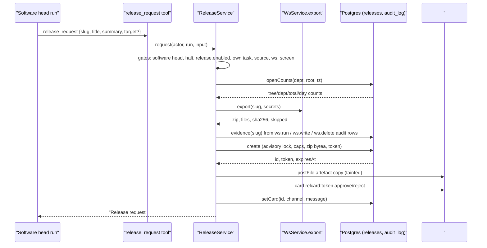
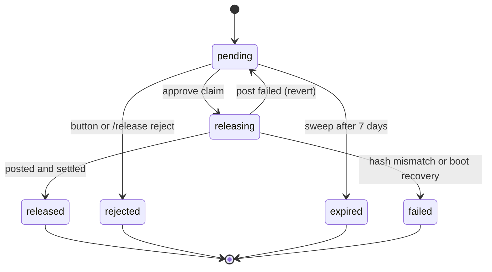

# R5 RELEASE-1: the release card (GROWTH-1)

Date: 2026-11-12. Status: design + handoff brief by sa under the owner-approved growth roadmap; binding for the build, subject to Gate 1.

======================================================================
SPECIFICATION HANDOFF BRIEF (for document + security)
======================================================================
PLAN REF: docs/plans/2026-11-12-growth-roadmap.md (item R5 RELEASE-1)
TARGET TEMPLATE: freeform (same shape as docs/superpowers/specs/2026-11-12-plugin-manifest-design.md)
OUTPUT DESTINATION: /Users/pakawat.tan/Labworkspace/BOT/Assistant/docs/superpowers/specs/2026-11-12-release-design.md

Code is cited by content anchor plus a line hint (global sa rule 15). Line numbers are from HEAD 506edd2.

1. MODULE IDENTIFIER
GROWTH-1 / R5 RELEASE-1: the release card. Needs the security gate: it adds a Bot Admin approval card, stores artefact bytes, and posts a zip as a bot.

2. ACTORS & BOUNDARIES
- Requester: the software head only, inside a task it owns.
  - Personas, Praw (who sees it through "*") and other heads are refused by the service.
  - The tool is offered only through the software head's prompt meta.
- Decider: a live Bot Admin in #⚙️-setting. decide() checks the guild, the channel and the role on this click (discord/commands/index.ts `decide`, :133-145). route() is the only place `relcard:` is handled.
- Never deciders: the AI approver, autopilot (project or company), the skill judge and any model.
  - The guarantee is structural: release_request has no kind, so it never creates an `approvals` row, and the card has its own table and token.
  - The manifest class is defence in depth only (§5.6).
- Code actors:
  - ReleaseService builds the export through `WsService.export` (workspaces/service.ts:258-294).
  - It reads the evidence from `audit_log`, pins the bytes in Postgres, posts the card, and on approval posts the pinned zip as the requesting head.
- Trust boundaries:
  - The zip bytes come from container code and bots: untrusted.
  - title and summary are bot text: untrusted, escaped on the card.
  - Evidence comes only from code-written audit rows parsed by a strict regex.
  - The Bot Admin's reject reason is human text, screened for secrets.

3. DETAILED LOGIC & FLOWS

3.1 Pre-conditions
- `release.enabled` is true (a new handler key, default true, psql only).
- Not halted.
- ws is set up (`wsService` exists, app.ts:643-650) and `ws.enabled` is true.
- The caller is head:software with `ctx.task` present and `sameActor(ctx.task.owner, ctx.actor)`.
- `ctx.source.channelId` is present.

3.2 `release_request` (happy path; refusals in this order, each audited `release.request` / `refused:<code>`)
1. Not head:software → `not_software`.
2. halted → `halted`.
3. `release.enabled` is not true (a read error counts as off) → `off`.
4. No ctx.task, or the caller does not own it → `no_task`. There is no ensureConversationTask fallback, unlike ws_run (tools/plugins/ws/index.ts `taskOf`, :75-81).
5. No ctx.source.channelId → `no_source`.
6. No ws service, or `ws.enabled` is not true → `ws_off`.
7. Screen title and summary: fold whitespace, then `screenText(.., {max:100|600, secrets, multiline:false})`. Failure → `screen`. zod in the registry has already refused anything outside the schema.
8. Pre-check of the caps: `repo.openCounts(dept, rootId, tz)` → `tree_pending` | `dept_cap` | `total_cap` | `day_cap`. This avoids a needless export; the repo re-checks under its lock in step 11.
9. `ws.export(slug, [...secrets])`. The secrets are read now, because the array grows at boot (precedent ws/index.ts:216).
   - A WsError or SandboxError → its own fixed WS_TEXT message (E_SLUG, E_BUSY, E_EXPORT_SIZE, E_EXPORT_SECRET, E_IO).
   - Then assert `zip.length <= RELEASE_ZIP_MAX` (=10_000_000, the same as ZIP_MAX at service.ts:45, under Discord's 10 MiB bot upload). Otherwise → E_EXPORT_SIZE text.
10. `repo.evidence(slug)` (§5.3).
11. `repo.create(...)` inside one transaction with `pg_advisory_xact_lock(hashtext('releases'))`.
    - It re-counts: 1 open per tree, 2 open per dept, 5 open in total, 5 requests per dept per local day.
    - It inserts: status pending, token = 32 hex from randomBytes(16), expires_at = now() + 7 days, `catalog_digest = CATALOG_DIGEST`, `tainted = ctx.tainted() || task.tainted`, `project_id = projects.byRoot(task.rootId)?.id ?? null`.
    - A unique violation on `releases_one_open_per_tree` → `tree_pending`.
12. Audit `release.request` with outcome `#<id> <slug> <sha16>`.
13. Card (§3.5): first postFile the artefact copy to #setting as hq, then postCard. Then `repo.setCard`. If the card post fails, the row stays pending without a card: it is listed in /release list and expires.
14. Return the fixed success text (§5.5).

3.3 Approve (`relcard:<token>:approve`). This mirrors ToolRequestService.decide (grow/tool-requests.ts:148-173).
1. Token regex; byToken; the stored channel_id and message_id must equal the click, and the channel must equal CONFIG_CHANNEL_ID. Otherwise → `wrong_card`.
2. status ≠ pending → `not_pending`. Not live (expires_at ≤ now) → `expired`.
3. halted → `halted`. `release.enabled` is not true → `off`. In both cases the row stays pending.
4. `repo.claim(token, userId)` is a CAS from pending to releasing (decided_by, decided_at; requires expires_at > now()) and returns the zip. No row → `not_pending`.
5. Re-hash: `sha256(zip) === sha256 && zip.length === bytes`. Otherwise:
   - `repo.fail(id,'hash_mismatch')` (the zip is purged);
   - card note, head notice, audit `release.decide #id failed:hash_mismatch` → `hash_mismatch`.
   - Precedent: executor/deploy.ts:155, executor/code-service.ts:107.
6. Target `handoff`:
   - `postFile({kind:'head',dept}, {channelId: source_channel_id, threadId?: source_thread_id}, {type:'chat', noHandles:true, body: HANDOFF_BODY}, {name:'<slug>.zip', data: zip, contentType:'application/zip'})`.
   - On throw: `repo.revert(id)` (status back to pending, decided_* set NULL) → `post_failed`. Nothing was released.
7. `provenance.record(msgId, thread ?? channel, true, null)`. The post is always tainted (WS-C15d precedent, ws/index.ts:226-227).
8. `repo.settleReleased(id, msgId)` sets status released, zip NULL, released_at, released_message_id, outcome `ok`.
   - If this throws after the post: return `SETTLE_UNSETTLED_TEXT`. The row stays releasing, and boot recovery handles it (§3.6).
9. Audit `release.decide` with outcome `#id released <sha16>`. Close the card (released note), notify the head (released text).

3.4 Reject
- By button: `repo.reject(token, userId, null)` is a CAS on pending. It purges the zip, closes the card and sends the head notice without a reason. It is allowed while halted.
- By `/release reject id:<n> reason:<1-200>` from a Bot Admin in #setting:
  - The reason goes through `screenText(max 200, multiline:false)`; failure → `REASON_SCREEN`.
  - `repo.rejectById(id, userId, reason)` does the same with a reason, and the head notice carries it.
- Audit `release.decide` with outcome `#id rejected`.

3.5 The card (one message; built by code)
- Payload: `{type:'approval', origin:'governance', title:'Release request', releaseCardId: token, body, fields}`.
- Body lines in order (`esc = escapeCardText(s, max, secrets)`):
  1. `**${esc(title,100)}**`
  2. `Release #${id} from the software head. Target: handoff (post the zip in the task thread and mark it released).`
  3. Project line:
     - with a project: `Project #${p.id} ${esc(p.title,60)} (${p.status}).`
     - without: `Project: none (task tree ${root8}).`
  4. `Artefact: workspace ${slug}, ${files} file(s), ${bytes} bytes, sha256 ${sha}.`, plus ` ${skipped} entr(y|ies) skipped (not exportable).` when skipped > 0.
  5. `Pinned: these exact bytes are stored; Approve releases them even if the workspace changes later.`
  6. `The files were written by bots and container code.`
  7. Only when tainted: `The requesting run read outside content (tainted). Review the files before approving.`
  8. `Artefact copy: posted just above this card.` or `Artefact copy: could not be posted here.`
  9. `Tool catalog ${CATALOG_DIGEST.slice(0,16)}.`
  10. `Expires <t:${unix}:R>.`
- Fields:
  - `Summary (written by the bot, untrusted)` = esc(summary,600);
  - `Evidence (recorded by code)` = §5.3 lines.
- A test builds the maximum-length card through buildMessage and asserts 1 message. The button row sits on the last message; port.post returns the last id (port.ts:568 `last`).
- The artefact copy message, posted as hq in #setting, file `<slug>-release-<id>.zip`:
  - body `Release #${id} artefact for review: ${slug}, ${files} file(s), ${bytes} bytes, sha256 ${sha}. Written by bots and container code; open with care.`;
  - provenance tainted.

3.6 Sweeps and boot (app.ts next to toolRequests, :1047 and :1069)
- At boot: `void releases.recover().then(() => releases.sweep())`. Then `releaseSweep = setInterval(() => void releases.sweep(), 60_000)`, cleared next to `clearInterval(toolReqSweep)` (:1142).
- `recover()`: every row in releasing → `repo.fail(id,'interrupted')`, card note INTERRUPTED, head notice. It NEVER re-posts. This is "mark unknown, never re-post"; precedent GW-C20.
- `sweep()`: `repo.expire()` (pending past expiry → expired, zip purged) → card note EXPIRED, head notice, audit `release.expire` from `system:release`.
- Neither ever throws.

3.7 Alternate and exception flows
- Workspace archived: export allows it (`row(slug,'any')`, service.ts:260).
- A ws_run is active: E_BUSY (the export takes the write lock).
- Thread deleted or denied at approve: post_failed, the row reverts, and the admin may Reject.
- Two clicks: the CAS lets one win; the other gets not_pending.
- A click on a stale or forwarded card: wrong_card.
- Approve exactly at expiry: the claim's `expires_at > now()` fails → not_pending (or expired on the earlier check).
- The project closed meanwhile: the release still posts (it releases a deliverable, not project state).
- The root task finished: same.
- A tainted run may request; the card says so.

3.8 What bots do meanwhile (code note). `RELEASE_NOTE` in agents/context.ts, a fixed text with no variables:
`RELEASE (code note): When a deliverable in a workspace is finished, call release_request with the workspace, a short title and a summary instead of saying it is shipped. Only a Bot Admin approves a release; until you are told, say it is waiting for approval. Do not push, publish or deploy it with other tools. A ws_export post is a review copy, not a release.`
- It is appended in loop.ts:293 right after the autopilot or company note term:
  `+ ((project || companyNote) && actor.kind === 'head' && actor.dept === 'software' && releaseOn(deps.cfg) ? `\n\n${RELEASE_NOTE}` : '')`.
- `releaseOn` is a try/catch read of `release.enabled`; a read error counts as off.
- COMPANY_AUTOPILOT_NOTE, autopilotNote and the hash-pinned prompts/fragments/approval-request.md are NOT edited.
- No existing tool is made to refuse or to raise a card (see the contradictions table):
  - ws_export, github_*, deploy, site and code tools are unchanged;
  - their existing sensitive and hard-deny cards stay.

3.9 Extension point (only named)
- `releases/targets.ts`: `RELEASE_TARGETS: Readonly<Record<ReleaseTarget, (r: ClaimedRelease, d: TargetDeps) => Promise<{ok:true; messageId:string}|{ok:false}>>>` with `handoff` only.
- Later:
  - R6 adds `install_mcp`;
  - R7 adds `install_plugin`;
  - a later item may add `github`.
- Each needs a migration that widens `releases_target_check`, a zod enum entry and its own Gate.

4. MERMAID DIAGRAMS

```mermaid
sequenceDiagram
    participant B as "Bot Admin"
    participant C as "commands decide() + route()"
    participant S as "ReleaseService.decide"
    participant D as "Postgres"
    participant P as "Task thread"
    B->>C: click relcard:token:approve
    C->>C: guild, #setting, live Bot Admin role
    C->>S: decide {token, action, userId, channelId, messageId}
    S->>D: byToken; stored card equal; pending; live
    S->>D: claim CAS pending to releasing (returns zip)
    S->>S: sha256(zip) == sha256 and length == bytes
    alt mismatch
        S->>D: fail(hash_mismatch), zip NULL
    else ok
        S->>P: postFile zip as software head (tainted provenance)
        alt post throws
            S->>D: revert to pending
        else posted
            S->>D: settleReleased(msgId), zip NULL
            S->>B: card closed with release note
        end
    end
```


5. DATA, API & ERROR CONTRACTS

5.1 Migration 045 (PASTE VERBATIM)
`db/migrations/045_release.up.sql`:
```sql
-- R5 RELEASE-1: one Bot Admin approval per deliverable; the approved bytes are the released bytes. Additive only.
CREATE TABLE releases (
  id bigserial PRIMARY KEY,
  token text NOT NULL UNIQUE CHECK (token ~ '^[0-9a-f]{32}$'),
  dept_id text NOT NULL CHECK (dept_id ~ '^[a-z_]{1,32}$'),
  requester text NOT NULL CHECK (requester ~ '^head:[a-z_]{1,32}$'),
  task_id text NOT NULL CHECK (task_id ~ '^[0-9a-f-]{36}$'),
  root_id text NOT NULL CHECK (root_id ~ '^[0-9a-f-]{36}$'),
  project_id bigint REFERENCES projects(id) ON DELETE SET NULL,
  target text NOT NULL CONSTRAINT releases_target_check CHECK (target IN ('handoff')),
  title text NOT NULL CHECK (char_length(title) BETWEEN 1 AND 100),
  summary text NOT NULL CHECK (char_length(summary) BETWEEN 1 AND 600),
  slug text NOT NULL CHECK (slug ~ '^[a-z][a-z0-9-]{1,39}$'),
  sha256 text NOT NULL CHECK (sha256 ~ '^[0-9a-f]{64}$'),
  bytes integer NOT NULL CHECK (bytes BETWEEN 1 AND 10000000),
  files integer NOT NULL CHECK (files BETWEEN 1 AND 2000),
  skipped integer NOT NULL DEFAULT 0 CHECK (skipped BETWEEN 0 AND 100000),
  zip bytea,
  evidence jsonb NOT NULL CHECK (jsonb_typeof(evidence) = 'object' AND pg_column_size(evidence) <= 2048),
  tainted boolean NOT NULL,
  catalog_digest text NOT NULL CHECK (catalog_digest ~ '^[0-9a-f]{64}$'),
  source_channel_id text NOT NULL CHECK (source_channel_id ~ '^[0-9]{17,20}$'),
  source_thread_id text CHECK (source_thread_id IS NULL OR source_thread_id ~ '^[0-9]{17,20}$'),
  status text NOT NULL DEFAULT 'pending' CHECK (status IN ('pending','releasing','released','rejected','expired','failed')),
  channel_id text CHECK (channel_id IS NULL OR channel_id ~ '^[0-9]{17,20}$'),
  message_id text CHECK (message_id IS NULL OR message_id ~ '^[0-9]{17,20}$'),
  created_at timestamptz NOT NULL DEFAULT now(),
  expires_at timestamptz NOT NULL,
  decided_by text CHECK (decided_by IS NULL OR decided_by ~ '^[0-9]{17,20}$'),
  decided_at timestamptz,
  reason text CHECK (reason IS NULL OR char_length(reason) BETWEEN 1 AND 200),
  released_message_id text CHECK (released_message_id IS NULL OR released_message_id ~ '^[0-9]{17,20}$'),
  released_at timestamptz,
  outcome text CHECK (outcome IS NULL OR outcome ~ '^[a-z_]{1,32}$'),
  CONSTRAINT releases_expiry CHECK (expires_at > created_at AND expires_at <= created_at + interval '7 days 1 hour'),
  CONSTRAINT releases_zip CHECK ((status IN ('pending','releasing')) = (zip IS NOT NULL) AND (zip IS NULL OR octet_length(zip) = bytes)),
  CONSTRAINT releases_decided CHECK (status IN ('pending','expired') OR (decided_by IS NOT NULL AND decided_at IS NOT NULL)),
  CONSTRAINT releases_released CHECK ((status = 'released') = (released_at IS NOT NULL AND released_message_id IS NOT NULL))
);
CREATE UNIQUE INDEX releases_one_open_per_tree ON releases (root_id) WHERE status IN ('pending','releasing');
CREATE INDEX releases_open_dept_idx ON releases (dept_id) WHERE status IN ('pending','releasing');
CREATE INDEX releases_expiry_idx ON releases (expires_at) WHERE status = 'pending';
CREATE INDEX releases_dept_created_idx ON releases (dept_id, created_at);
```
`db/migrations/045_release.down.sql`:
```sql
DROP TABLE releases;
```

5.2 Repo `db/repos/releases.ts` (`ReleaseRepo`; no read ever selects `zip` except `claim`)
- `openCounts(dept, rootId, tz): Promise<{tree:number; dept:number; total:number; today:number}>`. "Open" means status IN ('pending','releasing'). `today` counts created_at in the local day of `tz`.
- `create(r: NewRelease, tz): Promise<{ok:true; id:number; token:string; expiresAt:Date} | {ok:false; code:'tree_pending'|'dept_cap'|'total_cap'|'day_cap'}>`.
  - Inside the transaction: the advisory lock, then the re-count with the constants `OPEN_PER_TREE=1, OPEN_PER_DEPT=2, OPEN_TOTAL=5, REQUESTS_PER_DEPT_DAY=5`, then the insert.
  - `NewRelease` = {token, deptId, requester, taskId, rootId, projectId|null, target:'handoff', title, summary, slug, sha256, bytes, files, skipped, zip:Buffer, evidence:Evidence, tainted, catalogDigest, sourceChannelId, sourceThreadId|null}.
- `setCard(id, channelId, messageId)`.
- `byToken(token)` and `byId(id)` return `ReleaseRow & {live:boolean}`. `ReleaseRow` is every column except zip, in camelCase.
- `claim(token, userId)` → `(ReleaseRow & {zip:Buffer}) | null`.
- `revert(id)` (WHERE status='releasing').
- `settleReleased(id, messageId)` (WHERE status='releasing').
- `fail(id, outcome)` (WHERE status='releasing').
- `reject(token, userId, reason|null)` and `rejectById(id, userId, reason)` (WHERE status='pending') → row | null.
- `expire()` → rows.
- `releasing()` → rows.
- `list(limit=25)`, newest first.
- `day(tz)` → `ReleaseDay = {requested, released, rejected, expired, failed, waiting}`, each a number for today local; waiting = open now.
- `evidence(slug)` → `Evidence`. It asserts SLUG_RE first; the slug has no LIKE metacharacters.
  - `SELECT ts, outcome FROM audit_log WHERE action='ws.run' AND tool='ws_run' AND outcome LIKE $1 ORDER BY ts DESC, id DESC LIMIT 3` with $1 = `${slug}:%`.
  - `SELECT max(ts) FROM audit_log WHERE action IN ('ws.write','ws.delete') AND outcome LIKE $1`.
  - The index `audit_log_action_ts_idx` exists (migration 014). ws.* rows are not purged (db/repos/exec.ts:12 MEMBER_AUDIT_PREFIXES).

5.3 Evidence
- The ws_run audit outcome is `${slug}:${verb}:${tag}` (tools/plugins/ws/index.ts:186-187).
- Parse each row with `^([a-z][a-z0-9-]{1,39}):(ci|install|test|run|tsc|node):(exit=-?\d{1,5}|timeout|oom|start|halted|stuck)$`. Keep a row only when group 1 === slug; drop anything else.
- Stored shape: `type Evidence = { runs: { verb: Verb; result: string; at: string /* ISO */ }[]; changedAfter: boolean | null }`.
  - At most 3 runs.
  - changedAfter is null when there are no runs; otherwise lastChange > runs[0].at.
- Card lines:
  - `- ws_run ${verb}: exit ${n} (<t:${unix}:f>)` or `- ws_run ${verb}: ${outcome} (<t:${unix}:f>)`;
  - with no runs: `No test run recorded for this workspace.`;
  - with runs: `Files changed after the last recorded run: yes|no`.

5.4 Tool contract (`tools/builtin/releases.ts`)
```ts
export const RELEASE_TOOL_NAMES = ['release_request'] as const;
export const ReleaseRequestInput = z.object({
  slug: z.string().regex(SLUG_RE),
  title: z.string().trim().min(1).max(100),
  summary: z.string().trim().min(1).max(600),
  target: z.literal('handoff').optional(),
}).strict();
export function releaseTools(svc: { releases: Pick<ReleaseService, 'request'> }): ToolPlugin<never>[];
```
- The plugin has NO `kind` and `requiresApproval: () => false`.
- run → `svc.releases.request(ctx.actor, { tainted: ctx.tainted(), task: ctx.task ? { id, rootId, tainted } : null, ownsTask: !!ctx.task && sameActor(ctx.task.owner, ctx.actor), source: ctx.source }, input)` → `{content}` or `toolError(text)`.
- Description (fixed):
`Ask a Bot Admin to release a finished deliverable from a project workspace: give the workspace slug, a short title and a summary (at most 600 characters). Code zips the workspace now, pins those exact bytes, attaches the last recorded ws_run results and posts one card in #setting. Nothing is released until a Bot Admin approves; then the zip is posted in this task thread. Only inside a task you own. Never say it is released before you are told.`
- Export it from tools/builtin/index.ts next to growTools.

5.5 Fixed texts (`releases/service.ts`)
REQUEST_TEXT:
- not_software: 'Only the software head can request a release.'
- halted: 'The company is halted; try again after /resume.'
- off: 'Releases are switched off.'
- no_task: 'release_request works only inside a task you own.'
- no_source: 'There is no thread here to release into.'
- ws_off: 'Workspaces are switched off or not set up.'
- screen: 'The title or summary was refused (a secret-like value or control characters).'
- tree_pending: 'This task tree already has a release waiting for a decision.'
- dept_cap: 'Your department already has 2 releases waiting for a decision.'
- total_cap: 'There are already 5 releases waiting for a decision.'
- day_cap: 'Your department has requested 5 releases today; try again tomorrow.'
- exception: 'That could not be done now; nothing was changed.'
- WsError and SandboxError keep their WS_TEXT message (workspaces/errors.ts).

Success:
`Release request #${id} for ${slug} was sent to the Bot Admins (${files} file(s), ${bytes} bytes, sha256 ${sha16}). NOTHING is released yet; you will be told in your room. Do not say it is released, and do not push or publish it with other tools.`
- When the card failed, append: ` The card could not be posted; a Bot Admin can see it in /release list.`

DECIDE_TEXT:
- wrong_card: 'That button does not belong to this card.'
- not_pending: 'Already decided.'
- expired: 'This release request has expired.'
- halted: 'The company is halted; approve after /resume.'
- off: 'Releases are switched off.'
- not_found: 'No release with that number.'
- hash_mismatch: 'The stored artefact does not match its sha256; nothing was released and the request was closed.'
- post_failed: 'The zip could not be posted in the task thread; nothing was released. Press Approve again or Reject.'
- exception: 'That could not be done now; nothing was changed.'

Other texts:
- SETTLE_UNSETTLED_TEXT: 'The zip was posted, but the record could not be updated; it will be closed at the next restart.'
- REASON_SCREEN: 'The reason was refused (a secret-like value or control characters).'

Ephemeral button replies:
- approve: `Released #${id}: posted in the task thread.`
- reject: 'Rejected. Nothing was released.'

HANDOFF_BODY (the post in the task thread, as the software head, noHandles):
`Release #${id} approved by a Bot Admin - ${title}: ${slug}, ${files} file(s), ${bytes} bytes, sha256 ${sha}.\nSummary: ${summary}`

Card notes:
- released: `Released by <@${uid}>. Posted in the task thread (sha256 ${sha16}).`, followed by either
  - ` Project #${p}: if its work is finished, close it with /project close id:${p}.`, or
  - ` Root task ${root8}: when its work is finished it can be accepted with /task done.`
- rejected by button: `Rejected by <@${uid}>. Nothing was released.`
- rejected by command: `Rejected by <@${uid}> with a reason. Nothing was released.`
- expired: 'Expired after 7 days without a decision.'
- hash_mismatch: 'Closed: the stored artefact did not match its sha256. Nothing was released.'
- interrupted: 'Interrupted during the release (restart). Check the task thread; nothing more will be posted.'

Head notices (notifyHead('software', …); code text only):
- released: `Release #${id} (${slug}) was approved by a Bot Admin and posted in the task thread. You may now report it as released; if this finishes the task, mark it done.`
- rejected: `Release #${id} (${slug}) was rejected by a Bot Admin. Nothing was released.`, plus ` Reason: ${reason}` when a reason was given.
- expired: `Release #${id} (${slug}) expired after 7 days without a decision. Nothing was released.`
- hash_mismatch: `Release #${id} (${slug}) was closed: the stored artefact did not match its sha256. Nothing was released.`
- interrupted: `Release #${id} (${slug}) was interrupted by a restart; check the task thread before asking again.`

5.6 Manifest (R4)
- tools/builtin/manifest.ts adds `release_request: { ...NOKIND, sensitive: false, autopilot: 'always_card', aiReview: 'cost_or_lasting' },` and updates the line-2 comment.
- sensitive MUST be false:
  - catalog.test.ts:77 asserts sensitive === floor for every name in decision-matrix.json;
  - decision-matrix.test.ts:24 forces every catalog name into that file;
  - the floor is frozen (tools/manifest/floor.ts:8).
  - Precedent: tool_request and project_propose.
- tools/manifest/privileged.json, sorted:
  - add "release_request" to `alwaysCard` (after jira_add_comment);
  - add it to `costOrLasting` (after meeting_start);
  - add it to `sensitiveFalse` (after read_image).
- The V-rules pass (V7 concerns own_waive only).
- CATALOG_DIGEST changes. The test recomputes it, so no pinned value changes.

5.7 Wiring (BE2)
- agents/loop/payload.ts: `releaseCardId?: string` (system-only; toPayload drops it).
- discord/embeds/approval.ts: `RELEASE_CARD_ID = /^relcard:([0-9a-f]{32}):(approve|reject)$/` and `releaseCardRow(token)` with labels 'Approve release' / 'Reject'.
- discord/embeds/index.ts: add to the :77 predicate and add a branch after :168.
- discord/port.ts:568: add `|| p.releaseCardId !== undefined` to `last`.
- discord/commands/release.ts:
  - `releaseCardButton` (the toolreq.ts pattern);
  - `release:list`, `release:show`, `release:reject` in COMMAND_TABLE (commands/index.ts:105).
- route() (:114): add `relcard:` there only.
- deferEphemeral (:131): add `relcard:` and commandName `release`.
- definitions.ts:
  - builder `release` with `list`; `show` with an integer `id` (min 1, required); `reject` with `id` and a `reason` string (1-200, required);
  - add it to COMMANDS (:184).
- discord/commands/types.ts: `releases?: Pick<ReleaseService,'decide'|'list'|'show'|'reject'>`. A missing dependency → 'Releases are not available.'
- config:
  - schema.ts adds `'release.enabled': z.boolean()`;
  - defaults.ts adds `true`;
  - admin/keys.ts adds it to HANDLER_KEYS (psql only, no /settings path).
- app.ts:
  - :544 builtinNames becomes `[..., ...PROJECT_TOOL_NAMES, ...RELEASE_TOOL_NAMES, ...GROW_TOOL_NAMES]`, so GROW stays last and grow/tool-grow.wiring.test.ts:12 keeps passing;
  - build `ReleaseService` and register `releaseTools` AFTER wsService (:650) and BEFORE `coreToolNames` (:652), so it is declared in 'builtin'. The postCard, closeCard and notifyHead lambdas follow :557-565. `postFile: (a,t,p,f) => port.postFile(a,t,p,f)`; `provenance: botMessages`; `projects` (ProjectRepo: byRoot); `ws: wsService`; `catalogDigest: CATALOG_DIGEST`;
  - AiDigest (:780) gains `releases: releaseRepo`;
  - CommandDeps gains `releases`;
  - boot sweeps as in §3.6.
- agents/tasks/ai-digest.ts:
  - deps `releases?: Pick<ReleaseRepo,'day'>`; payload's 4th param `rel?: ReleaseDay`;
  - the :54 emptiness gate also requires the counts to be zero;
  - line: `'', 'Releases:', `Requested ${n}, released ${n}, rejected ${n}, expired ${n}, failed ${n}; waiting now ${n}.``.
- prompts/heads/software.md:6: append `release_request` after `project_task` (only software).
- devjob/paths.ts:54 area (NON_SELF_MODIFIABLE): add `'releases/', 'db/repos/releases.ts', 'tools/builtin/releases.ts'`. agents/context.ts is already listed.

5.8 Error mapping summary
| Path | Code | Reply |
|---|---|---|
| tool | refusal codes in §5.5 | toolError(fixed) and audit `refused:<code>` |
| tool | WsError | WS_TEXT message |
| button | DecideCode | ephemeral DECIDE_TEXT |
| /release reject | not_found, not_pending, screen | ephemeral fixed |
| any | throw | log `{errName}` only, then `exception` |

5.9 Tests
BE1:
- releases.int:
  - every CHECK (zip iff open, octet_length, target, expiry, decided, released);
  - one open per tree under concurrent create;
  - the caps;
  - the claim CAS has exactly one winner;
  - revert, reject, expire;
  - evidence: a `proj` row never matches `proj-2:`; malformed outcomes are dropped; changedAfter.
- Service unit:
  - the refusal order (each code), with no side effect before step 9;
  - tainted runs are allowed and flagged on the card;
  - the export error mapping;
  - the exact card and notice strings;
  - hash_mismatch purges the zip;
  - post failure reverts to pending;
  - a settle failure gives the unsettled text;
  - recover marks failed and never calls postFile;
  - the reject reason is screened;
  - an import allowlist: releases/*.ts never imports governance/ai-approver, governance/autopilot, governance/judge-call, governance/skill-judge or tools/autopilot.
- Plugin unit: no kind, requiresApproval false, strict schema.
- Manifest and goldens:
  - the manifest entry; privileged.json;
  - tools/autopilot.golden.harness.ts:19 adds `...releaseTools({ releases: {} as never })`;
  - decision-matrix.harness.ts:40 builtinNames adds RELEASE_TOOL_NAMES;
  - GOLDEN_UPDATE=1 then review: decision-matrix.json gains a release_request row; autopilot-classes.json gains `"release_request": "plain/plain"`.

BE2:
- toPayload drops releaseCardId.
- `relcard:` is reachable only through route(); outside #setting or without the role it is refused.
- The maximum card is 1 message.
- Wiring: registered before coreToolNames.
- Loop: RELEASE_NOTE appears only for the software head under a project or company note, and not when the switch is off.
- Digest.
- Int acceptance: request → card → approve → a zip with the same sha in the thread → released, zip NULL. Also reject with a reason, and expiry.

5.10 Existing assertions that change (old → new)
| file:line | old | new |
|---|---|---|
| db/migrate.int.test.ts:13 | APP_TABLES | + 'releases' |
| db/migrate.int.test.ts:27, :29 | up list ends '044_learn_loop'; down list starts with it | + '045_release' at the end of up and at the start of down |
| discord/commands/commands.test.ts:64 | 23 names | + 'release' (sorted after 'provider') |
| prompts/loader.test.ts:58 | software = the common head list | software: [...common, 'release_request'] (hq and the others unchanged) |
| tools/manifest/privileged.json | no release_request | in alwaysCard, costOrLasting, sensitiveFalse |
| tools/__golden__/decision-matrix.json, autopilot-classes.json | no key | the new key via GOLDEN_UPDATE=1, reviewed |
| tools/autopilot.golden.harness.ts:19; tools/manifest/decision-matrix.harness.ts:40 | without release tools | with them (else registry.test.ts:48 reports an orphan) |
Unchanged:
- grow/tool-grow.wiring.test.ts:12, because GROW stays last.
- autopilot.prompts.test.ts:13, because the tool is appended after project_task.
Any other failure is stop-and-report.

6. SECURITY & PRIVACY NOTES (Gate 1; requires security gate)
- Approval integrity:
  - one live Bot Admin click in #setting, checked in decide() and again against the stored channel and message;
  - a 128-bit token with no data in the custom id; routed only in route();
  - the status CAS; a 7-day expiry.
  - No AI or autopilot path exists: the tool is kindless and has no approvals row, and the import allowlist test proves the service never imports them. The manifest always_card plus cost_or_lasting is a backstop.
- Bytes:
  - pinned in bytea, re-hashed on approve, purged at every terminal state (enforced by the DB CHECK `releases_zip`);
  - at most 5 open × 10 MB = 50 MB.
- Masking:
  - title and summary go through screenText at the input and escapeCardText(secrets) on the card;
  - logs carry errName only, never title, summary or reason;
  - audit outcomes are code values (id, slug, sha16, codes).
- Taint:
  - a tainted run may request, and the card says so;
  - both zip posts are recorded tainted; the head notices are clean code text.
- Validation: strict zod, SLUG_RE, the evidence regex, the snowflake CHECKs.
- Limits: 1 open per tree, 2 per dept, 5 in total, 5 requests per dept per day, 10 MB, 7 days.
- Residuals to accept:
  - R1: the zip is container- and bot-written; a Bot Admin reviews the copy in #setting.
  - R2: the literal-secret scan runs at request time only; a secret added later is not re-scanned before the post.
  - R3: a crash between the post and the settle marks the release failed/interrupted although it was posted. It is never re-posted.
  - R4: the reject reason (Bot Admin text, screened) reaches the head as clean text.
  - R5: evidence is missing when an audit append failed; the card then shows "No test run recorded".
- Gate anchors still in force: GW-C17/C19 (card pattern), AP-C11, WS-C15d, PM-C1, PM-C11, AC-C3 (notes not edited).
- Scoped exception to GW-C22 (Gate 1 RL-C10, recorded at Gate 2): `Scheduler.notifyHead` normally carries code text only. The one exception is the Bot Admin's `/release reject` reason: it is `screenText({max:200, multiline:false, secrets})` output with PII masking, stored as screened, and delivered as `Reason from a Bot Admin: "<reason>"` with `noHandles`. No other caller may pass non-code text to notifyHead.

7. OPEN QUESTIONS: none for backend. Decisions taken:
| Brief text | Decision |
|---|---|
| "for heads" | The software head only: the artefact is a ws export and ws is software-only (ws/index.ts:54-56 `gate`). Praw and personas are refused. The CEO is reached through the card's /project close offer. |
| "inside a task" | A real ctx.task owned by the caller. No company chat fallback. |
| github target in v1 | Not in v1. The GitHub tools write one file per call (github/write.ts:154 `github_create_or_update_file`). Recording an approval for a later push would be a grant the existing GitHub cards never read. It is named as an extension point. |
| "hard-deny class" | sensitive:false (forced by tests and the frozen floor), plus always_card and cost_or_lasting; the real guarantee is structural. |
| R4 §7.1: card shows golden and privileged hashes | CATALOG_DIGEST only. privileged.json is test-bound to DERIVED (catalog.test.ts:24), so the digest commits to it. The goldens are test-time observations. Build-input hashes move to the R6/R7 install targets. |
| handoff vs ws_export | ws_export is unchanged (the WS-1 owner direction; a review copy inside the company's Discord). The release adds the approval, the pinned bytes, the evidence and the notices. |
| tools that refuse outside a release | None. The GitHub, deploy, site and code cards stay as they are. |
| reject reason | Buttons carry no reason; `/release reject id reason` does. |
| mark the deliverable released | The row becomes `released`. Tasks and projects are not auto-closed; the close is offered. |
| kill switch | `release.enabled`, a handler key, default true. |

7.1 Backend dispatches (sequential, each green)
- BE1 (additive): migration 045, ReleaseRepo, releases/service.ts, releases/targets.ts, tools/builtin/releases.ts, the manifest, privileged.json, the harness edits, the goldens, the §5.9 BE1 tests.
- BE2 (wiring): §5.7 in full, the §5.10 updates, the BE2 tests, the int acceptance.

8. BOOK CHAPTERS AFFECTED: ~/.claude/team/knowledge/labworkspace/modules/assistant.md (a new R5 RELEASE-1 section; GROWTH-1 roadmap status; migration table row 045; AUTO-1/AUTO-2 code-note list)
MISSING CONTEXT: <PROJECT_ROOT>/CLAUDE.md, <PROJECT_ROOT>/.claude/rules/sa.md, team rules labworkspace/sa.md (all absent). The Book chapter was not read beyond grep: the code was read directly.
LEARNINGS (0-3):
- fact project: a new manifest entry's `sensitive` must equal the frozen floor regex, because catalog.test.ts:77 checks every name and decision-matrix.json must cover the catalog. Hard-deny intent for a new non-floor name goes into autopilot/aiReview, never sensitive:true | proposed rule: none
- fact project: a new builtin tool needs tools/autopilot.golden.harness.ts and decision-matrix.harness.ts edits plus a reviewed GOLDEN_UPDATE run; both files are devjob-protected | proposed rule: list the harness and golden updates in every spec that adds a tool
- decision project: ws_run evidence is read from audit_log `ws.run` rows (code-written outcome), not from a new table | proposed rule: none
BOOK_UPDATES:
- modules/assistant.md: after the build, add an R5 section (table `releases`, `relcard:`, `/release`, `release.enabled`, RELEASE_NOTE, digest line); 00-INDEX row for the R5 spec and gates.
======================================================================

## Binding amendment (Gate 1, 2026-11-12)

Gate 1 verdict: CONDITIONAL_APPROVE (`docs/security/2026-11-12-gate1-release.md`). Conditions RL-C1..RL-C14 in that report are binding and override this spec wherever they conflict. In short:

- RL-C1: the import boundary is an allowlist of the modules that may import the release code; the tool receives a closure exposing only `request` (not a `Pick<>` of the service).
- RL-C2: `always_card` is an inert label for this kindless tool, not a backstop; a test proves a release never creates an `approvals` row.
- RL-C3: after the approve claim, revert only on a certain refusal (resolve failure or HTTP 4xx); a timeout or 5xx becomes `failed` with reason `post_unknown` and is never re-posted.
- RL-C4: evidence is bounded to the workspace's current life (`created_at` floor) and to the export time; file changes made by runs count as changes; the card says the test script is bot-written.
- RL-C5: boot recovery takes `bootTime` from database time and touches only rows older than it.
- RL-C6: `discord/commands/release.ts` and the boundary tests are protected from dev-job edits.
- RL-C7..C14: as written in the report (dept-only software, card wording, markdown escaping, the reject-reason exception, and the rest); checked at Gate 2.

Residual risks R1-R8 in the report are accepted under the owner's standing instruction (roadmap approval, 2026-11-12).
