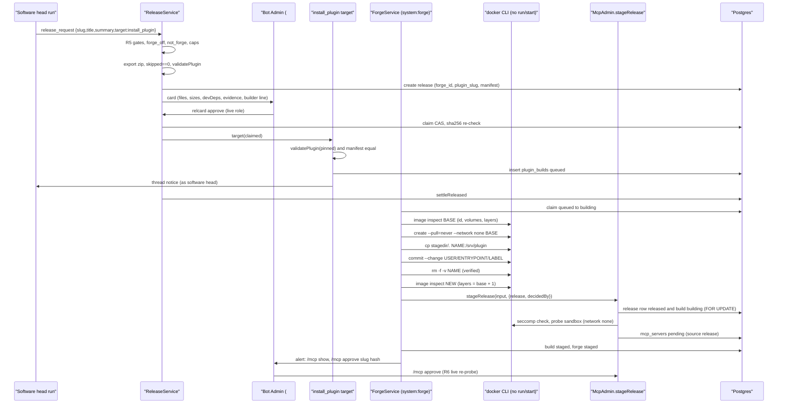
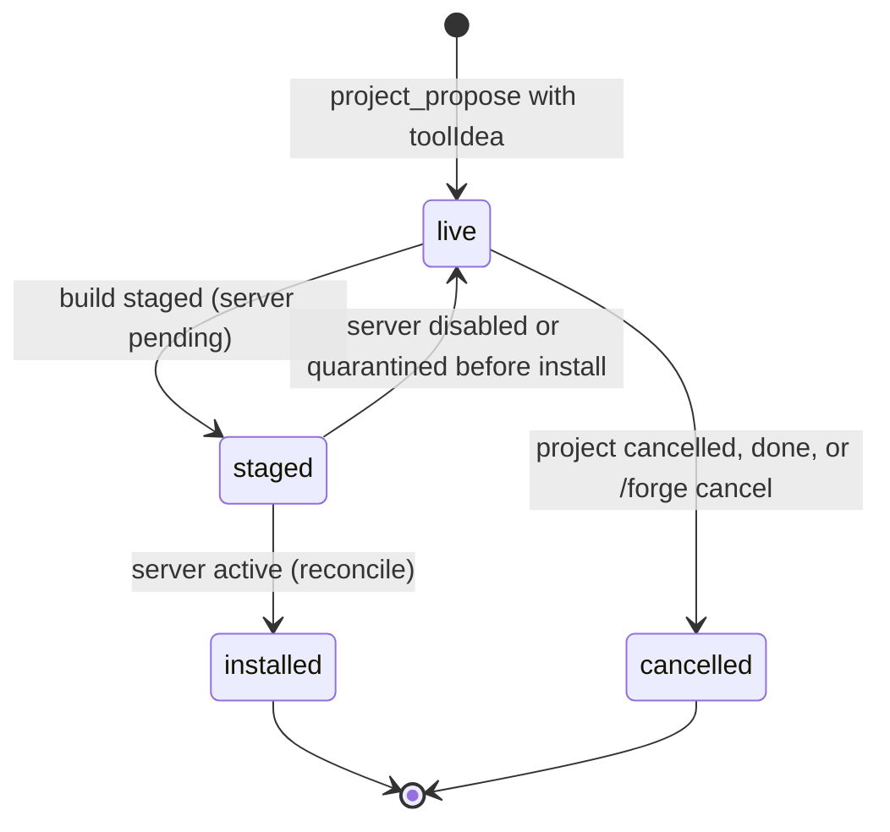
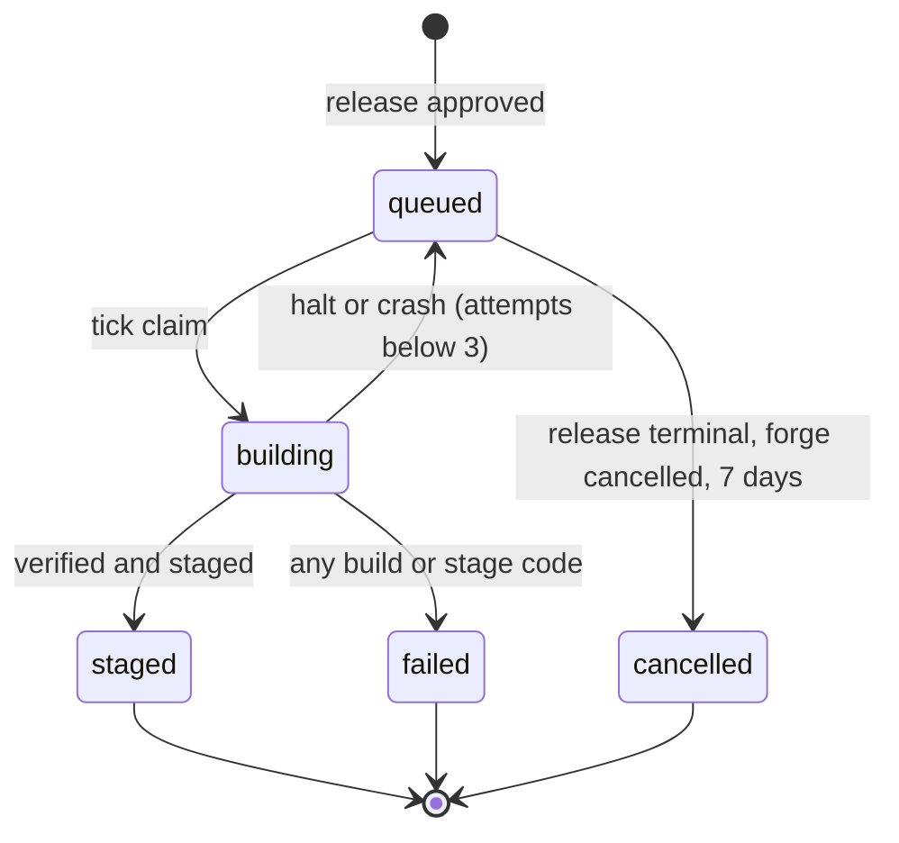

# R7 PLUGIN-FORGE: bots build their own tools (GROWTH-1)

Date: 2026-11-13. Status: design + handoff brief by sa under the owner-approved growth roadmap; binding for the build, subject to Gate 1.

======================================================================
SPECIFICATION HANDOFF BRIEF (for document + security)
======================================================================
PLAN REF: /Users/pakawat.tan/Labworkspace/BOT/Assistant/docs/plans/2026-11-12-growth-roadmap.md (row R7 PLUGIN-FORGE, approved once)
TARGET TEMPLATE: freeform (same shape as docs/superpowers/specs/2026-11-12-mcp-client-design.md)
OUTPUT DESTINATION: BOT/Assistant/docs/superpowers/specs/2026-11-13-plugin-forge-design.md; Gate 1 at BOT/Assistant/docs/security/2026-11-13-gate1-forge.md

Code is cited by content anchor. Line numbers are hints only (global sa rule 15). I read HEAD 386d808.

1. MODULE IDENTIFIER: PLUGIN-FORGE (GROWTH-1 R7). Bots build their own tools.
- New folder `forge/`, repo `db/repos/forge.ts`, command `discord/commands/forge.ts`, `docker/forge/*`, `tests/fixtures/forge/hello/*`, migration 048.
- Extends R5 (a new release target `install_plugin`), R6 (a release-kind stage), GROW-1 (idea consumer) and LEARN-1 (a new incident kind).
- REQUIRES SECURITY GATE.

2. ACTORS & BOUNDARIES
- CEO (head:hq), AI: links an open, untainted tool idea to a project proposal (`project_propose` + `toolIdea`).
- Software head, AI: builds the plugin in a WS-1 workspace, tests it with `ws_run`, and calls `release_request {target:'install_plugin'}` inside a task of the forge project.
- Bot Admin (live role, #setting), human. Three steps, and no AI path reaches any of them:
  1. Project card Approve (the existing AUTO-1 card): "do the work".
  2. Release card Approve: "build and stage".
  3. `/mcp approve slug hash`: "install". The admin sees the tool list the built server really reports.
- Code actors:
  - `ForgeService` (queue, builder, reconcile, GC): actor `system:forge`.
  - The builder is code-owned. No tool and no model drives it.
  - Builder input: the pinned release bytes, the checked-in base id, and fixed docker argv.
- Trust boundaries:
  - The zip and everything in it are bot- and container-written: untrusted.
  - The built image is untrusted code. It runs only inside the R6 sandbox.
  - Idea text is bot text. GW-C24 ("any future consumer treats them as untrusted data and needs its own gate", grow/tool-ideas.ts class doc): R7 is that consumer and this is its gate. v1 consumes only rows with `tainted = false`.
- What a workspace can do today: `ws_run` verbs are `ci|install|test|run|tsc|node`, run in the runner image (node:24-alpine + npm) with `/work` bind-mounted. Only install verbs get `ws_prepnet` (registry proxy); everything else gets `--network none` (workspaces/runner.ts `buildArgv`).
- What a workspace cannot do: it has no Docker socket and cannot build images. R7 does not change WS-1 at all. The export skips `node_modules` and `.git` at any depth without counting them as skipped (workspaces/files.ts "node_modules and .git skipped at any depth").

3. DETAILED LOGIC & FLOWS

3.0 Recorded decisions (each is the recommended option; none needs the owner)
- F1 Builder shape: `docker create --pull=never <baseImageId>` + `docker cp` + `docker commit --change …`. I evaluated a COPY-only checked-in Dockerfile and rejected it:
  - A Dockerfile needs BuildKit/frontend resolution of `FROM`. Whether `--pull=false` with a local `name@sha256` base never contacts a registry is unproven (`assumed`).
  - `--network none` on `docker build` limits RUN steps only, not the daemon's base resolution.
  - create/cp/commit takes the base by image id, exactly as R6 pins. It never starts a container, runs no plugin code and uses no frontend.
  - The fixed, checked-in parts are `docker/forge/base.Dockerfile` (the base, built by the owner) and the argv constants in `forge/builder.ts` (golden test).
- F2 Two human steps after the work: release card = build and stage; `/mcp approve` = install. The card is decided before the tool list exists, so a card click never activates. `McpAdmin.activate` stays callable only from the `/mcp approve` route (R6 §3.7 question answered: no).
- F3 Class: write only (DB CHECK, §5.1). Every call is a human card (R6 `MCP_WRITE`, autopilot `always_card`, AI approver `hard_deny:sensitive`).
  - `/mcp add` also refuses class `read` for any image labelled `assistant.forge=1` (E_CLASS).
  - Read class needs a later gate.
- F4 Language: Node ESM only, zero runtime dependencies (plain JS on Node built-ins).
  - The brief's "vendored" option cannot work because export drops `node_modules` (above).
  - A `vendor/` folder of plain `.js`/`.mjs`/`.json` source is allowed within caps. It is ordinary shipped source and is listed on the card.
  - `devDependencies` are allowed for workspace tests and are never shipped.
  - `package-lock.json` is required (rules in §5.4).
- F5 Asynchronous build:
  - The `install_plugin` target only validates, enqueues and posts a thread notice. That gives the `released_message_id` that `releases_released` requires.
  - Release `released` here means "accepted for build". The build runs in `ForgeService` (up to 180 s plus the R6 probe), outside the button interaction.
  - A build is idempotent and has no external effect, so a crash re-queues it. R5's "never re-post" is untouched.
- F6 Reuse `release_request` with a new target value; no new tool.
  - Reused as is: the requester rule, task ownership, caps, export, pinning, hash re-check, card, live-admin decide and expiry.
  - A new tool would duplicate all of that and add a manifest row, goldens and a second card table.
- F7 Idea → project: `project_propose` gains optional `toolIdea`, and `/project start` gains an optional `idea`. The forge row is inserted in the same transaction as the project. A tainted idea is refused (`idea_invalid`).
- F8 Plugin slug: `forge.json.slug` must match R6 `^[a-z][a-z0-9]{1,15}$`. It is never derived from the ws slug or the idea name.
  - It is refused when any `mcp_servers` row has that slug.
  - Exception: that row is `disabled` or `quarantined` AND it came from a release of the same forge (a retry after a failed install).
- F9 Departments: the idea's `dept_id` only. A Bot Admin widens later with `/mcp depts`. Command `[]`, env `{}`, timeout 60 s, daily 100. The plugin chooses none of these.
- F10 `forge.enabled`: a handler key, default false, with a /settings path, and `configRisk` true for false→true. A read error counts as off.
  - `install_plugin` requests need forge, `release.enabled` and `ws.enabled`.
  - Builds need forge.
  - Staging and `/mcp approve` work with `mcp.enabled` off (as in R6). Calls need `mcp.enabled`.
- F11 Image GC is code only. No bot and no command deletes an image (§3.7).

3.1 Pre-conditions
- `docker/forge/images.json` `{"base":"sha256:<64hex>"}` exists, the image is present, `Config.Volumes` is empty, and Os is linux. This is an owner-environment step: `docker/forge/build.sh`.
- Not halted. `forge.enabled` true.

3.2 End-to-end flow and idea lifecycle

| Step | Who | What | Idea / forge state |
|---|---|---|---|
| 1 | any head (AI) | `tool_idea` (unchanged) | idea `open` |
| 2 | CEO (AI) | FORGE_NOTE_HQ lists eligible ideas; CEO calls `project_propose {…, toolIdea:n}` | forge row `live` (project `proposed`) |
| 3 | Bot Admin | project card Approve (AUTO-1) | project `active`; forge `live` |
| 4 | CEO, software (AI) | `project_task` to software; ws_create/write; `ws_run test`; FORGE_NOTE_SOFTWARE guides | — |
| 5 | software (AI) | `release_request {slug,title,summary,target:'install_plugin'}`; code validates (§5.4) and posts the card (§5.6) | release `pending` |
| 6 | Bot Admin | release card Approve → target enqueues the build and posts the thread notice | release `released`; build `queued` |
| 7 | code | ForgeService builds (§3.4) then calls `stageRelease` | build `staged`; server `pending`; forge `staged` |
| 8 | code | notices: #setting alert with `/mcp show` and `/mcp approve` lines; software head notice | — |
| 9 | Bot Admin | `/mcp show` then `/mcp approve slug hash` (R6, live re-probe) | server `active` |
| 10 | code (reconcile) | forge `installed`; idea closed with `closed_by` = mcp `approved_by`, reason `Installed as MCP server <slug>.`; notices to the idea dept and software | idea `closed` |

Alternate:
- Project rejected or expired → forge `cancelled` (`project_cancelled`).
- Project done or cancelled while the forge is `live` → `cancelled` (`project_closed`). Queued builds are cancelled.
- Build failed → forge stays `live`. The team fixes and requests again, at most 3 builds per forge.
- Pending server disabled or quarantined before install → forge back to `live`.
- `/forge cancel` → `cancelled` (`admin_cancel`). It is refused while a build is `building`.

3.3 `release_request` with `target:'install_plugin'`
Refusal order. Steps 1–7 are R5 unchanged (not_software, halted, off, no_task, no_source, ws_off, screen). Then:
- 8a. `forge.enabled` not true → `forge_off`.
- 8b. `projects.byRoot(task.rootId)` is not `active`, or `forgeRepo.byProject(id)` is not `live` → `not_forge`.
- 8c. Builds for this forge (status ≠ cancelled) ≥ 3 → `forge_attempts`. Builds created today (tz) ≥ 3 → `forge_day_cap`. Retained images (image_id set, not removed) ≥ 8 → `image_cap`.
- 9. R5 counts, then export (R5 step 9). Then `skipped > 0` → `plugin_skipped`.
- 10. `validatePlugin(zip, {forgeIdeaId})` (§5.4) → `plugin_<code>`. Slug rule F8 → `plugin_slug_taken`.
- 11. `repo.create` adds `forge_id`, `plugin_slug` and `plugin_manifest_sha256`.
- Audit `release.request` keeps its R5 shapes. Refusals are `refused:<code>`.

3.4 Approve (relcard), the `install_plugin` target
- R5 decide is unchanged up to the hash re-check. Before the claim, for this target only, a forge off switch → `off` (the row stays pending).
- Target steps:
  1. `forge.enqueue({releaseId, forgeId, pluginSlug, sha256, bytes, manifestSha256, decidedBy, zip})`. It re-runs `validatePlugin` on the pinned bytes and requires `manifestSha256` equality. Then `INSERT plugin_builds … ON CONFLICT (release_id) DO NOTHING` with status `queued`.
     - Invalid → `{ok:false, certain:true, fail:'plugin_invalid'}`. The service calls `repo.fail(id,'plugin_invalid')`, writes the card note and the head notice.
     - Exception → `{ok:false, certain:true}` → revert to pending. The inert build row is reused on re-approve.
  2. `post({kind:'head',dept}, thread, {type:'chat', noHandles:true, body: FORGE_HANDOFF_BODY}, {nonce: handoffNonce(r)})`.
     - certain refusal → revert;
     - unknown → `fail('post_unknown')` (R5 RL-C3).
  3. ok → `settleReleased`.
- The builder takes only builds whose release is `released` (JOIN). The reconcile cancels queued builds whose release is `failed`, `rejected` or `expired`.

3.5 Builder (`forge/builder.ts`; argv built only here; `shell:false`; env = `dockerEnv()`; an injected `DockerCli` (exec only); argv golden test)
- Claim, in one transaction: `UPDATE plugin_builds SET status='building', started_at=now(), attempts=attempts+1 WHERE id=$1 AND status='queued'`. The unique index `plugin_builds_one_building` makes this single-flight.
- Steps, with the halt polled between steps and an overall deadline of 180 s:
  1. Base check: `['image','inspect','--format','{{json .}}', BASE]`.
     - Parse with the forbidden-key guard (§5.4 J1).
     - `Id === BASE`; `Config.Volumes` null or {}; `Os === 'linux'`; `RootFS.Layers` is an array of sha256 strings. Keep `baseLayers` and `baseSize`.
     - Failure → `base_missing`.
  2. Staging:
     - `mkdtemp(join(tmpdir(),'assistant-forge','b-'))` with mode 0700. The path must match `^/[A-Za-z0-9._/-]{1,200}$`, else `stage_dir`.
     - Write only the shipped entries (§5.4) from the pinned zip: dirs 0755, files 0644, `open(...,'wx')`.
     - Re-walk with lstat: regular files and dirs only, and the count and bytes must equal the manifest. Otherwise `stage_dir`.
  3. Create: `['create','--pull=never','--network','none','--log-driver=none','--name',NAME, BASE]`.
     - NAME matches `^forge-b[0-9]{1,12}-[0-9a-f]{8}$`.
     - stdout must be 64 hex, else `create_failed`.
     - No `--label`: commit would copy container labels into the image.
  4. Copy: `['cp', `${dir}/.`, `${NAME}:/srv/plugin`]` (60 s) → `copy_failed`.
  5. Commit: `['commit','--change','USER 65534:65534','--change','WORKDIR /srv/plugin','--change','ENTRYPOINT ["node","/srv/plugin/server.mjs"]','--change','CMD []','--change','ENV NODE_ENV=production','--change','LABEL assistant.forge=1','--change',`LABEL assistant.forge.build=${id}`,'--change',`LABEL assistant.forge.sha256=${sha256}`, NAME]` (60 s).
     - stdout must match `^sha256:[0-9a-f]{64}$`, else `commit_failed`.
  6. `finally`: `removeVerified(docker, NAME, {volumes:true})` and `rm -rf dir`.
     - A removal failure → `stuck` plus an in-memory latch that refuses builds until restart, and a #bot-log incident.
  7. Verify: inspect the new id.
     - `Layers.length === baseLayers.length + 1` and the prefix equals baseLayers;
     - User `65534:65534`; Entrypoint deep-equal; Cmd null or []; WorkingDir `/srv/plugin`;
     - Volumes, ExposedPorts and OnBuild empty; the three labels present;
     - `Size - baseSize ≤ 8 MiB` (else `image_too_big`).
     - Any other mismatch → `verify_failed`.
     - On any failure after commit, the new image is removed (§3.7 rule).
  8. Stage: `stageRelease({slug, image:newId, class:'write', departments:dept, title, ref:`forge:release-${releaseId}`}, {kind:'release', releaseId, decidedBy})`.
     - The McpAdmin codes map to `stage_probe|stage_seccomp|stage_tools|stage_schema|stage_screen|stage_name|stage_exists|stage_max|stage_image|stage_state|stage_other`. E_HALTED → requeue.
     - Idempotency: before staging, if `mcp_servers.release_id = releaseId` exists, adopt it, mark the build staged and remove the new image.
  9. One transaction: build `staged` (image_id, base_image_id, image_bytes, finished_at, zip NULL), forge `staged` with server_id. Audit, then notices.
- Halt during a build → abort at the next step boundary, clean up, `building → queued`. At `attempts = 3` the build becomes `failed` with code `attempts`.
- Exec timeouts: inspect 15 s, create 30 s, cp 60 s, commit 60 s, rm 30 s.
- The builder never calls `run`, `start`, `exec`, `build`, `pull`, `push` or `tag` (grep test).

3.6 Boot, ticks, recover (`ForgeService`; never throws)
- Boot:
  - `building` → `queued` when attempts < 3, else `failed:interrupted`;
  - sweep containers `name=forge-b` with removeVerified;
  - remove `tmpdir()/assistant-forge/*`;
  - base check. On failure: no builds and one #bot-log alert `Plugin forge: the base image is missing or changed; builds wait.`
- Tick every 30 s:
  - skipped when halted or the switch is off;
  - claim and build the oldest eligible queued build;
  - reconcile (§3.2);
  - queued builds older than 7 days → `cancelled:expired` (zip purged).
- GC every 10 min, skipped while halted.

3.7 Image GC (only `ForgeService.gc`)
- Remove image X only when ALL of these hold:
  - (a) X is a `plugin_builds.image_id` with `image_removed_at IS NULL`;
  - (b) inspect shows label `assistant.forge=1` and `assistant.forge.build` = that build id;
  - (c) no `mcp_servers` row with status `pending|active|quarantined` has `image_id = X`;
  - (d) the build failed, OR its server row is `disabled` with `disabled_at < now() - 7 days`, OR it has no server row 1 h after finishing.
- Command: `['image','rm',X]` with no `-f`, then verify that inspect fails. Record `image_removed_at` and audit `forge.gc`.
- Never removed: the base, the ws images, admin-added images, any unlabelled image.

3.8 What the AI may do alone vs never
- Alone: file ideas; link an untainted idea to a proposal; write and test plugin code in a workspace; request the release.
- Never:
  - approve a project, a release or an install;
  - choose the base, user, entry point, class, departments, env, command, network or secrets;
  - trigger, retry or cancel a build;
  - delete an image;
  - update a live plugin.

4. MERMAID DIAGRAMS




5. DATA, API & ERROR CONTRACTS

5.1 Migration 048. PASTE VERBATIM
`db/migrations/048_forge.up.sql`:
```sql
-- R7 PLUGIN-FORGE: tool idea -> project -> release -> code-built image -> staged MCP server. Additive; widens named CHECKs only (047 owns the quarantine CHECK).
CREATE TABLE plugin_forges (
  id bigserial PRIMARY KEY,
  idea_id bigint NOT NULL REFERENCES tool_ideas(id) ON DELETE RESTRICT,
  project_id bigint NOT NULL UNIQUE REFERENCES projects(id) ON DELETE RESTRICT,
  dept_id text NOT NULL CHECK (dept_id ~ '^[a-z_]{1,32}$'),
  proposer text NOT NULL CHECK (proposer ~ '^(head:hq|user:[0-9]{17,20})$'),
  status text NOT NULL DEFAULT 'live' CHECK (status IN ('live','staged','installed','cancelled')),
  server_id bigint REFERENCES mcp_servers(id) ON DELETE RESTRICT,
  created_at timestamptz NOT NULL DEFAULT now(),
  updated_at timestamptz NOT NULL DEFAULT now(),
  closed_at timestamptz,
  close_reason text CHECK (close_reason IS NULL OR close_reason IN ('project_cancelled','project_closed','admin_cancel','installed')),
  CONSTRAINT plugin_forges_server CHECK (status NOT IN ('staged','installed') OR server_id IS NOT NULL),
  CONSTRAINT plugin_forges_closed CHECK ((status IN ('installed','cancelled')) = (closed_at IS NOT NULL AND close_reason IS NOT NULL)),
  CONSTRAINT plugin_forges_installed CHECK ((status = 'installed') = (close_reason IS NOT DISTINCT FROM 'installed'))
);
CREATE UNIQUE INDEX plugin_forges_one_live_per_idea ON plugin_forges (idea_id) WHERE status IN ('live','staged');
CREATE INDEX plugin_forges_open_idx ON plugin_forges (status) WHERE status IN ('live','staged');
CREATE TABLE plugin_builds (
  id bigserial PRIMARY KEY,
  forge_id bigint NOT NULL REFERENCES plugin_forges(id) ON DELETE RESTRICT,
  release_id bigint NOT NULL UNIQUE REFERENCES releases(id) ON DELETE RESTRICT,
  status text NOT NULL DEFAULT 'queued' CHECK (status IN ('queued','building','staged','failed','cancelled')),
  plugin_slug text NOT NULL CHECK (plugin_slug ~ '^[a-z][a-z0-9]{1,15}$'),
  sha256 text NOT NULL CHECK (sha256 ~ '^[0-9a-f]{64}$'),
  bytes integer NOT NULL CHECK (bytes BETWEEN 1 AND 10000000),
  manifest_sha256 text NOT NULL CHECK (manifest_sha256 ~ '^[0-9a-f]{64}$'),
  zip bytea,
  attempts integer NOT NULL DEFAULT 0 CHECK (attempts BETWEEN 0 AND 3),
  decided_by text NOT NULL CHECK (decided_by ~ '^[0-9]{17,20}$'),
  base_image_id text CHECK (base_image_id IS NULL OR base_image_id ~ '^sha256:[0-9a-f]{64}$'),
  image_id text CHECK (image_id IS NULL OR image_id ~ '^sha256:[0-9a-f]{64}$'),
  image_bytes bigint CHECK (image_bytes IS NULL OR image_bytes BETWEEN 0 AND 8388608),
  image_removed_at timestamptz,
  code text CHECK (code IS NULL OR code ~ '^[a-z_]{1,40}$'),
  created_at timestamptz NOT NULL DEFAULT now(),
  started_at timestamptz,
  finished_at timestamptz,
  CONSTRAINT plugin_builds_zip CHECK ((status IN ('queued','building')) = (zip IS NOT NULL) AND (zip IS NULL OR octet_length(zip) = bytes)),
  CONSTRAINT plugin_builds_code CHECK ((status IN ('failed','cancelled')) = (code IS NOT NULL)),
  CONSTRAINT plugin_builds_staged CHECK (status <> 'staged' OR (image_id IS NOT NULL AND base_image_id IS NOT NULL AND finished_at IS NOT NULL)),
  CONSTRAINT plugin_builds_removed CHECK (image_removed_at IS NULL OR image_id IS NOT NULL)
);
CREATE UNIQUE INDEX plugin_builds_one_building ON plugin_builds ((true)) WHERE status = 'building';
CREATE INDEX plugin_builds_queue_idx ON plugin_builds (created_at) WHERE status = 'queued';
CREATE INDEX plugin_builds_image_idx ON plugin_builds (image_id) WHERE image_id IS NOT NULL AND image_removed_at IS NULL;
CREATE INDEX plugin_builds_forge_idx ON plugin_builds (forge_id);
CREATE INDEX plugin_builds_created_idx ON plugin_builds (created_at);
ALTER TABLE releases DROP CONSTRAINT releases_target_check;
ALTER TABLE releases ADD CONSTRAINT releases_target_check CHECK (target IN ('handoff','install_plugin'));
ALTER TABLE releases ADD COLUMN forge_id bigint REFERENCES plugin_forges(id) ON DELETE RESTRICT;
ALTER TABLE releases ADD COLUMN plugin_slug text CHECK (plugin_slug IS NULL OR plugin_slug ~ '^[a-z][a-z0-9]{1,15}$');
ALTER TABLE releases ADD COLUMN plugin_manifest_sha256 text CHECK (plugin_manifest_sha256 IS NULL OR plugin_manifest_sha256 ~ '^[0-9a-f]{64}$');
ALTER TABLE releases ADD CONSTRAINT releases_plugin CHECK ((target = 'install_plugin') = (forge_id IS NOT NULL AND plugin_slug IS NOT NULL AND plugin_manifest_sha256 IS NOT NULL));
ALTER TABLE mcp_servers DROP CONSTRAINT mcp_servers_source_check;
ALTER TABLE mcp_servers ADD CONSTRAINT mcp_servers_source_check CHECK (source IN ('admin','release'));
ALTER TABLE mcp_servers ADD CONSTRAINT mcp_servers_release_write CHECK (source <> 'release' OR tool_class = 'write');
CREATE UNIQUE INDEX mcp_servers_release_once ON mcp_servers (release_id) WHERE release_id IS NOT NULL;
ALTER TABLE dept_incidents DROP CONSTRAINT dept_incidents_kind_check;
ALTER TABLE dept_incidents ADD CONSTRAINT dept_incidents_kind_check CHECK (kind IN ('task_blocked','task_cancelled','tool_errors','heal_resolve','forge_failed'));
```
`db/migrations/048_forge.down.sql` (works with rows present; FK order):
```sql
DELETE FROM config WHERE key IN ('forge.enabled');
DELETE FROM dept_incidents WHERE kind = 'forge_failed';
ALTER TABLE dept_incidents DROP CONSTRAINT dept_incidents_kind_check;
ALTER TABLE dept_incidents ADD CONSTRAINT dept_incidents_kind_check CHECK (kind IN ('task_blocked','task_cancelled','tool_errors','heal_resolve'));
DROP TABLE plugin_builds;
ALTER TABLE releases DROP CONSTRAINT releases_plugin;
ALTER TABLE releases DROP COLUMN forge_id;
DROP TABLE plugin_forges;
DROP INDEX mcp_servers_release_once;
ALTER TABLE mcp_servers DROP CONSTRAINT mcp_servers_release_write;
DELETE FROM mcp_servers WHERE source = 'release';
ALTER TABLE mcp_servers DROP CONSTRAINT mcp_servers_source_check;
ALTER TABLE mcp_servers ADD CONSTRAINT mcp_servers_source_check CHECK (source IN ('admin'));
DELETE FROM releases WHERE target = 'install_plugin';
ALTER TABLE releases DROP COLUMN plugin_manifest_sha256;
ALTER TABLE releases DROP COLUMN plugin_slug;
ALTER TABLE releases DROP CONSTRAINT releases_target_check;
ALTER TABLE releases ADD CONSTRAINT releases_target_check CHECK (target IN ('handoff'));
```
Notes:
- `dept_incidents_kind_check` is the Postgres default name of the inline CHECK in 044. BE1 confirms it with `\d dept_incidents` before writing, and stops and reports if it differs.
- `mcp_server_depts` cascades.
- The 048 down runs before the 047 down.
- The existing `mcp_servers_release` CHECK `(source='admin') = (release_id IS NULL)` is kept.
- `forge_failed` rows satisfy `dept_incidents_task_kind` because they carry the release `task_id`.

5.2 Repos
- `ForgeRepo` (db/repos/forge.ts) reads `mcp_servers`, `releases` and `projects` but never writes them. A grep test checks there is no `INSERT|UPDATE|DELETE` on `mcp_servers` or `releases`. Methods:
  - `byProject(id)`, `byId(id)`, `list(25)`;
  - `counts(forgeId, tz) → {forgeBuilds, today, images}`;
  - `enqueue(b) → {ok:true}|{ok:false;code:'exists'}`;
  - `claimNext() → build+zip|null` (JOIN releases status released, forge live);
  - `requeue(id)`, `fail(id, code)` (zip NULL), `staged(id, {imageId, baseImageId, imageBytes, serverId})`;
  - `reconcile() → events[]`, `expireQueued()`, `gcCandidates()`, `imageRemoved(id)`;
  - `recover()`, `day(tz)`.
- `ProjectRepo.create` takes an optional `ideaId`. In the same transaction it locks the idea `FOR UPDATE` and requires `status='open' AND tainted=false` (else `idea_invalid`). It counts `live|staged` forges, which must be fewer than 3 (else `forge_cap`), and inserts `plugin_forges`. A unique violation → `idea_busy`.
- `McpRepo.stage(i)`:
  - `StageIn` gains `source: 'admin'|'release'` and `releaseId: number|null`;
  - the INSERT and the ON CONFLICT SET both write `source` and `release_id` (an admin re-add resets them to `'admin'` and NULL);
  - for `release`, inside the transaction before the insert: `SELECT 1 FROM releases r JOIN plugin_builds b ON b.release_id = r.id WHERE r.id=$1 AND r.status='released' AND r.target='install_plugin' AND r.decided_by=$2 AND r.plugin_slug=$3 AND b.status='building' FOR UPDATE OF b`. No row → `E_STATE`;
  - the audit actor is `system:forge` and the outcome `pending <slug> <cfg12> <n> release:#<id>`;
  - `added_by` = decidedBy.
- `ReleaseRepo`: `ReleaseTarget = 'handoff'|'install_plugin'`; `NewRelease` gains `forgeId|null`, `pluginSlug|null` and `pluginManifestSha256|null`; the claim returns them and `decided_by`.

5.3 Service and closure contracts
```ts
// forge/types.ts (leaf, no imports beyond node:crypto types)
export type ReleaseStageBy = { kind: 'release'; releaseId: number; decidedBy: string };
export type StageReleaseFn = (input: { slug: string; image: string; class: 'write'; departments: string; title: string; ref: string }, by: ReleaseStageBy)
  => Promise<{ ok: true; slug: string; config12: string; toolCount: number } | { ok: false; code: string }>;
export type ForgeEnqueue = (b: { releaseId: number; forgeId: number; pluginSlug: string; sha256: string; bytes: number; manifestSha256: string; decidedBy: string; zip: Buffer })
  => Promise<{ ok: true } | { ok: false; code: 'plugin_invalid' | 'exception' }>;
```
- `McpAdmin.stageRelease(input, by: ReleaseStageBy)`:
  - `check` accepts only `kind:'release'` with a positive integer `releaseId` and a snowflake `decidedBy`;
  - it forces `class` = `write` (any other value → E_CLASS);
  - it reuses the private stage body (seccomp before probe, G2-MCP-02) and returns the narrow shape.
  - `stage`, `add` and `/mcp add` remain `AdminBy` only.
- `forgeStageDeps(admin) → StageReleaseFn` closure. Its holders, listed in a wiring test: ForgeService only.
- `TargetDeps` gains `post(actor, target, payload, opts?)` and `forge: ForgeEnqueue`.
  - `TargetResult` gains `{ ok:false; certain:true; fail:'plugin_invalid' }`. The service then runs `fail(id, 'plugin_invalid')` and never reverts.
- `forge/` never imports `mcp/admin.ts`, `db/repos/mcp.ts`, `releases/service.ts`, `providers/`, `agents/`, `governance/ai-approver|autopilot|judge-call|skill-judge` or `tools/autopilot`.
- `releases/` may import `forge/validate.ts`, `forge/unzip.ts` and `forge/types.ts` only.

5.4 Plugin template and validator (`forge/unzip.ts`, `forge/validate.ts`; pure; run at request and on the pinned bytes)
- Z (zip), the strict reader for what `buildZip` emits:
  - signatures checked; method 0 or 8; flags 0; extra and comment length 0; no directory entries; no ZIP64;
  - local header equal to central;
  - `inflateRawSync(body, {maxOutputLength: size})`; CRC-32 checked; entries ≤ 200;
  - at request only: `buildZip(parsed)` must be byte-equal to the export (canonical form).
  - Any failure → `zip_bad`.
- P (paths):
  - segments `^[A-Za-z0-9._-]{1,64}$`; no `.`/`..`; depth ≤ 6; path ≤ 200;
  - no leading-dot segment except root `.gitignore`;
  - no case-insensitive duplicates.
  - Failure → `path`.
- L (layout). Allowed paths:
  - shipped: `forge.json`, `package.json`, `server.mjs`, `src/**`, `vendor/**`;
  - not shipped: `package-lock.json`, `test/**`, `README.md`, `.gitignore`.
  - Anything else (including `Dockerfile*`, `.dockerignore`, `dist/`, `*.ts`) → `layout`.
  - Shipped extensions `.mjs .js .cjs .json`; `vendor/` also allows `LICENSE`, `LICENSE.md`, `LICENSE.txt` → else `ext`.
  - Missing required file → `missing`.
- S (sizes):
  - each file ≤ 512 KiB; shipped ≤ 120 files and ≤ 2 MiB; `vendor/` ≤ 1.5 MiB; all entries ≤ 4 MiB.
  - Over → `too_big`; over the counts → `too_many`.
- T (text): every entry must be valid UTF-8 (`TextDecoder` fatal) with no NUL → `binary`. This rules out `.node` and wasm.
- J1 (JSON): `forge.json` ≤ 2 KiB, `package.json` ≤ 16 KiB, lock ≤ 1 MiB; depth ≤ 32; the reviver refuses `__proto__`, `constructor` and `prototype` at any depth → `json`.
- `forge.json`, strict keys exactly `{forge:1, slug, title, idea}`:
  - slug per F8;
  - title 1–80, `screenText({max:80, multiline:false, secrets})` ok;
  - `idea` = the forge's idea id.
  - Failure → `forge_json`. Idea ≠ forge → `idea_mismatch`.
- `package.json`:
  - `type === 'module'`; `name` `^[a-z][a-z0-9-]{1,39}$`; `main` absent or `server.mjs`;
  - `dependencies`, `optionalDependencies` and `peerDependencies` absent or `{}`;
  - `bundledDependencies`, `bundleDependencies`, `bin`, `gypfile`, `binary`, `os`, `cpu`, `workspaces` absent → else `deps`;
  - `scripts` has none of `preinstall install postinstall prepare prepublish prepublishOnly prepack postpack preprepare postprepare` → else `scripts`;
  - `devDependencies` specs pass the ws `BAD_SPEC` rule (workspaces/service.ts) → else `package_json`.
- Lock:
  - `lockfileVersion === 3`; `name` equals package.json;
  - `packages[""]` has no runtime dependency maps;
  - every other key starts with `node_modules/`, has `dev:true`, has no `hasInstallScript`, and has `resolved` absent or starting `https://registry.npmjs.org/`.
  - Failure → `lockfile`.
- Output: `{ forge:{slug,title,idea}, shipped:[{path,size,sha256}], otherCount, devDeps:[{name,version}] (≤20 shown), manifestSha256 = sha256(canonicalJson(shipped sorted by path)) }`.
- Texts (`PLUGIN_TEXT`, fixed):
  - Each says what rule failed, for example `layout`: `The workspace does not follow the plugin layout (allowed: forge.json, package.json, package-lock.json, server.mjs, src/, vendor/, test/, README.md, .gitignore).`
  - A first offending path is appended only when it passed P, as ` First: <path>.`

5.5 Prompt notes (agents/context.ts, protected; appended in loop.ts only when `forge.enabled` reads true)
- FORGE_NOTE_HQ (head:hq, when at least 1 eligible idea exists): `PLUGIN FORGE (code note): Open tool ideas the software team could build as a plugin (an MCP server that runs sandboxed with no network and no secrets): <items>. To have one built, call project_propose with toolIdea set to its number; write the goal from the idea. A Bot Admin approves the project, later the build, and last the install.`
  - Item: `#<id> <name> (<dept>): <problem>`.
  - At most 5 items: open, untainted, no live forge.
  - The problem is folded, stripped of ANSI, C0, INVISIBLE and HIDDEN, and cut to 160.
- FORGE_NOTE_SOFTWARE (software head, the task root is a project with a `live` forge): `PLUGIN FORGE (code note): This task belongs to forge project #<p> for tool idea #<i> <name>. Build a plugin in a workspace: forge.json {"forge":1,"slug":"<2-16 lowercase letters or digits>","title":"<short>","idea":<i>}; package.json with "type":"module", no dependencies and no install scripts; package-lock.json; server.mjs, a stdio MCP server (newline-delimited JSON-RPC 2.0 answering initialize, tools/list and tools/call) using only Node built-ins; optional src/ and vendor/ with plain .js/.mjs/.json; tests in test/. It will run with no network, no secrets, a read-only disk and user 65534. Test it with ws_run test, then call release_request with target install_plugin. Code builds the image; you cannot choose the base image or run anything at build time. Every call of the installed tool will ask a Bot Admin. Idea (written by the <dept> head): <problem> Example: <example>`
  - Problem and example are cleaned as above and cut to 500 each.
- RELEASE_NOTE, COMPANY_AUTOPILOT_NOTE and hash-pinned fragments are not edited. prompts/heads/*.md tool lists are unchanged.
- The reference plugin is `tests/fixtures/forge/hello/`, derived from tests/fixtures/mcp/echo-server.mjs without the `node:net` import. It is used by tests and is the template the note describes.

5.6 Release card for `install_plugin` (`cardBody` branches by target; a max-size test asserts 1 message)
- Line 2: `Release #<id> from the software head. Target: install_plugin (code builds an MCP server image from these exact bytes and stages it; nothing is installed until a Bot Admin runs /mcp approve after seeing the tools the built server reports).`
- After the project line: `Forge #<f> for tool idea #<i> <name> from <dept>.`
- `Plugin <slug> "<esc(title,80)>": <n> shipped file(s), <bytes> bytes, manifest <m16>; <k> other file(s) (tests, notes) are not shipped.`
- `Runtime dependencies: none. Class: write (every call asks a Bot Admin). Departments: <dept>. Network: none. Secrets: none.`
- FORGE_BUILDER_LINE (verbatim): `Build (fixed, by code): the shipped files are copied into the checked-in base image <base12> (Node 24, no npm) with docker create, cp and commit. Nothing from the plugin runs during the build and there is no network. The plugin cannot choose the base image, the user (65534), the entry point (node /srv/plugin/server.mjs), the class or a secret.`
- `External tools are switched <on|off> (mcp.enabled); staging works either way.`
- Then the R5 lines: pinned, bots, taint, sandbox, copy, catalog, expires.
- Fields:
  - Summary;
  - Evidence (R5);
  - `Shipped files (listed by code: path, bytes, sha256 first 12)`, at most 20 lines plus `… and <n> more (see the artefact copy)`, fitted to 1000;
  - `Dev dependencies (not shipped; workspace tests only)` = `name@version` lines or `none`.
- FORGE_HANDOFF_BODY: `Release #<id> approved by a Bot Admin: code will build plugin <slug> from these exact bytes (sha256 <sha16>) and stage it. It is NOT installed until a Bot Admin runs /mcp approve; do not say it is installed.`

5.7 Fixed texts (selection; all are code text, nothing echoes model text)
- REQUEST_TEXT adds:
  - forge_off `The plugin forge is switched off.`
  - not_forge `install_plugin works only inside an active forge project.`
  - forge_attempts `This forge already had 3 builds.`
  - forge_day_cap `3 plugin builds were requested today; try again tomorrow.`
  - image_cap `8 built plugin images are kept already; a Bot Admin must disable unused servers.`
  - plugin_skipped `Some workspace files could not be exported; a plugin must export completely.`
  - plugin_slug_taken `That plugin slug is already used by an MCP server.`
  - plugin_<v> per §5.4.
- PROPOSE_TEXT adds:
  - forge_off as above;
  - idea_invalid `That tool idea is not open or was filed by a run that read outside content.`
  - idea_busy `That tool idea already has a forge.`
  - forge_cap `There are already 3 forges in progress.`
- DECIDE_TEXT adds plugin_invalid `The stored plugin no longer passes the plugin rules; nothing was built and the request was closed.`
- Notices:
  - staged, to software: `Plugin <slug> (release #<r>) was built and staged. A Bot Admin must install it with /mcp approve; until then do not say it is installed.`
  - staged, hq alert in #setting: `Forge #<f>: plugin <slug> from release #<r> was built by code (image <id12>) and staged with <n> tool(s). Review: /mcp show slug:<slug>. Install: /mcp approve slug:<slug> hash:<config12>. Every call will ask a Bot Admin.`
  - failed, to software: `The build of release #<r> failed (<code>). Nothing was installed. Fix the workspace and request a new release with target install_plugin.`
  - installed, to the idea dept and software: `Tool idea #<i> (<name>) is installed as MCP server <slug> (<n> tool(s), names start with mcp_w_<slug>_). Every call asks a Bot Admin.`
- Build failure codes (closed; also INCIDENT_CODES.forge_failed): `base_missing stage_dir create_failed copy_failed commit_failed verify_failed image_too_big image_cap stuck timeout interrupted attempts zip_invalid stage_probe stage_seccomp stage_tools stage_schema stage_screen stage_name stage_exists stage_max stage_image stage_state stage_other`.

5.8 Slash commands (`/forge`, Bot Admin, #setting, live role; guard helper as release.ts; `forgeCommandDeps` closure)
- `list` (forges and their last build).
- `show id` (idea, project, releases, builds, image12, server slug and status).
- `cancel id [reason]`: `building` → refused `busy`. Queued builds are cancelled. A staged server is not touched (the reply says to use `/mcp disable`).
- No build, retry or GC command.

5.9 Audit rows (outcomes are codes, ids and hashes only)

| action | actor | outcome |
|---|---|---|
| `forge.link` | `head:hq` / `user:<id>` | `#f idea #i project #p` or `refused:<code>` |
| `forge.cancel` | `user:<id>` / `system:forge` | `#f <close_reason>` |
| `forge.build` | `system:forge` | `#b start` · `#b requeued:<halted\|interrupted>` · `#b staged <slug> <cfg12>` · `#b failed:<code>` |
| `forge.gc` | `system:forge` | `#b removed <id12>` or `#b failed:<code>` |
| `forge.install` | `system:forge` | `#f installed <slug> idea #i` |
| `mcp.add` | `system:forge` | `pending <slug> <cfg12> <n> release:#r` or `refused:<code>` |
| `release.*` | R5 | R5 shapes; refusals `refused:<new codes>` |

5.10 Digest, caps, config
- AiDigest line: `Plugin forge today: <b> build(s), <s> staged, <f> failed, <i> installed; <w> waiting for /mcp approve.` It is omitted when all are 0, through the `forgeDigestDeps(repo)` closure.
- Caps:
  - 3 forges live or staged;
  - 3 builds per forge;
  - 3 builds per local day;
  - 1 building at a time;
  - 8 retained forge images, each adding at most 8 MiB;
  - a queued build lives 7 days;
  - R5 release caps apply.
  - None depends on another configurable cap (rule 11). All are constants in `forge/caps.ts`.
- Config: `forge.enabled` z.boolean, default false; HANDLER_KEYS; /settings path; `configRisk(false→true) = true`; not in ADMIN_CONFIG_KEYS.

5.11 Learning loop (LEARN-1)
- `SweepStep` adds `'forge'`. New statement S9, verbatim:
```sql
INSERT INTO dept_incidents (dept_id, kind, code, task_id, ikey)
SELECT r.dept_id, 'forge_failed', b.code, r.task_id, 'forge:' || b.id
FROM plugin_builds b JOIN releases r ON r.id = b.release_id
WHERE b.status = 'failed' AND b.finished_at >= now() - interval '2 days'
  AND b.code = ANY($1::text[]) AND r.task_id ~ '^[0-9a-f-]{36}$'
ON CONFLICT (dept_id, ikey) DO NOTHING
```
- `$1` is the closed code list.
- `incidentBlock`: `KINDS` adds `forge_failed`, and INCIDENT_CODES gets the §5.7 list. A new line `- Plugin builds failed: <code> <n>, …` goes after Tool errors, in the same whole-line trimming.
- IncidentRow and IncidentKind are widened.
- BE2 greps RetroRepo S7/S8. If either filters by kind, it stops and reports.
- Repeated `release_request` refusals already reach `tool_errors` through S3.

6. SECURITY & PRIVACY NOTES (security gate review; requires security gate)
- Gate 1 items:
  - (a) No bot gets a Docker socket.
    - The builder is code that runs only on a live Bot Admin's release approval.
    - Its docker verbs are inspect, create (never started), cp, commit, rm and image rm.
    - No plugin byte executes before the R6 sandbox probe.
  - (b) Base choice:
    - an image id from a checked-in file, `--pull=never`;
    - the layer-prefix check proves the result sits on that base plus exactly one layer;
    - the zip cannot carry a Dockerfile (rule L).
  - (c) Runtime identity is fixed by commit: USER, ENTRYPOINT and WORKDIR. R6 argv adds `--user 65534:65534`, `--read-only` and `--network none` anyway.
  - (d) Two human steps: the card is consent to build, `/mcp approve` is consent to install, over a live re-probe and the config hash (R6 MC-C8; 047 `approved_config_sha256` applies unchanged).
  - (e) Write class only, enforced in code and in the DB CHECK. `/mcp add` refuses read for forge-labelled images.
  - (f) `stageRelease` cross-checks the release row (`released`, `install_plugin`, `decided_by`, `plugin_slug`) and the `building` build under lock. A forged call without a real approved release fails.
  - (g) Idea text reaches prompts only from untainted rows, cleaned and capped, labelled with its author (GW-C24 gate).
  - (h) The zip reader caps inflate output and refuses everything `buildZip` does not emit.
- Masking:
  - logs carry `errName` only, never zip content, file names, forge.json fields, idea text, stderr or zod errors;
  - card text goes through `escapeCardText(secrets)`;
  - export already refuses literal secrets (E_EXPORT_SECRET).
- Import boundaries (raw-text scanner copied from mcp/boundary.test.ts, including absolute paths, `file:` URLs, dynamic import, require/createRequire, escaped specifiers and symlinks):
  - only `app.ts` constructs ForgeService and imports `forge/service.ts` and `forge/builder.ts`;
  - `releases/` imports only `forge/{types,validate,unzip}.ts`;
  - `forge/` imports none of the §5.3 forbidden modules;
  - mcp/boundary.test.ts:162 stays true (nothing in `releases/` or `forge/` imports `mcp/admin`);
  - `discord/commands/forge.ts` imports types only.
- Run-time holders (wiring test):
  - live `McpAdmin`: the `commands.mcp` closure and the `forgeStageDeps` closure (held by ForgeService only);
  - ForgeService: app.ts timers, `forgeCommandDeps` (list/show/cancel) and `forgeDigestDeps`;
  - AdminConsole (`adminCmd`) has no `forge` and no `mcp`.
- Forbidden-key guards apply to every JSON parse in `forge/`: the three plugin files and docker inspect output.
- Sandbox preconditions: the builder never starts a container (an argv grep test refuses `run|start|exec|build|pull|push|tag`). Every probe goes through `McpAdmin.probe` with `checkSeccomp` first (G2-MCP-02).
- devjob NON_SELF_MODIFIABLE adds: `forge/`, `db/repos/forge.ts`, `discord/commands/forge.ts`, `docker/forge/`, `tests/fixtures/forge/`, `grow/incidents.ts` (if not already covered), `db/repos/dept-incidents.ts`.
- Residual risks, in plain words:
  1. The app can still reach Docker. A Docker or kernel flaw could let a malicious plugin escape its container when it runs.
  2. The Bot Admin approves the build by reading a file list, sizes and a summary, not by reading every line of code. A plugin can be harmful in ways a list does not show.
  3. The tool descriptions a forged server reports still reach the model (screened, capped, labelled). A crafted description can nudge a bot.
  4. A plugin can give wrong answers, or behave differently for some inputs, without changing its tool list. The hash pin catches only list changes.
  5. The base image is built by the owner from a public Node image. A flaw in that image is in every plugin.
  6. Write class means a card on every call, which may tire the Bot Admin and invite rubber-stamping.
  7. "docker cp into a never-started container" and the `commit --change` behaviour are `assumed` until the BE3 probe.
  8. Anyone holding the DB pool can edit forge, release or server rows (as in R5 and R6).
  9. Each build uses up to 180 s and up to 8 MiB of disk per kept image. GC waits 7 days after a server is disabled.
  10. Idea text from untainted runs is trusted as bot text, but a head could still have written a misleading idea.

7. OPEN QUESTIONS: none blocking. All choices follow §3.0.

7.1 Existing assertions that change (global sa rule 4)
- tools/builtin/releases.test.ts:44, the description:
  - new: the R5 text plus ` Use target install_plugin inside a forge project to have code build and stage an MCP plugin from the workspace (a Bot Admin still installs it).`
  - :48 also accepts `install_plugin` and still refuses `github`.
- tools/builtin/releases.ts:12 `z.literal('handoff')` → `z.enum(['handoff','install_plugin'])`. releases/service.ts:15 `target?:` is widened. db/repos/releases.ts:4 `ReleaseTarget` is widened.
- releases/releases.int.test.ts:64 still refuses `github`. A new test refuses `install_plugin` without forge columns (`releases_plugin`).
- releases/targets.ts:59: the extension-point comment is updated to name install_plugin.
- db/migrate.int.test.ts: APP_TABLES + `plugin_forges`, `plugin_builds`. The up list ends with `048_forge` after 047's entry; the down list starts with it.
- MCP-AC01 "source≠admin refused" (046 CHECK test, db/repos/mcp int tests): `source='release'` is now allowed only with release_id and class write. The test asserts `source='other'` is refused instead.
- mcp/admin.int.test.ts:14 `BY` admin tests are unchanged. New cases: `stage(…, release-by)` throws, and `stageRelease(…, admin-by)` throws.
- discord/commands/commands.test.ts:64: COMMANDS gains `'forge'` in sorted position.
- governance/projects tests: ProjectProposeInput gains optional `toolIdea`. BE2 greps the prompts and goldens that serialise its schema, and any change other than the added optional key is stop-and-report.
- grow/incidents tests: the KINDS and codes tables gain `forge_failed`.

7.2 Backend dispatches (sequential, each green)
- BE1 (additive, unwired):
  - migration 048;
  - `forge/{types,caps,unzip,validate,builder,service,texts,notes}.ts` with fake DockerCli tests;
  - `db/repos/forge.ts`;
  - `McpRepo.stage` source/release_id plus the release cross-check; `McpAdmin.stageRelease`;
  - incidents KINDS, codes and S9 (statement and repo step only);
  - `docker/forge/{base.Dockerfile,build.sh}`, where base.Dockerfile is `FROM node:24-alpine@sha256:8a32c8cf…` (the runner digest), `apk upgrade --no-cache zlib`, npm, npx, corepack and yarn removed, `mkdir -p /srv/plugin`, no VOLUME, no USER, no ENTRYPOINT; `images.json` is written by build.sh;
  - `tests/fixtures/forge/hello/`;
  - the 7.1 updates for migrate.int and the mcp tests.
  - No app.ts, release target, config, commands or prompt change.
- BE2 (wire):
  - the release target and service branches, texts and card;
  - the tool schema and description;
  - `project_propose`/`/project start` idea link and the card line `Forge: builds tool idea #i <name> (<dept>) as a plugin.`;
  - config key; app.ts (ForgeService after mcpAdmin, timers, recover, closures, TargetDeps.post/forge);
  - `/forge`; notes in loop/context; digest; IncidentSweep step;
  - `/mcp add` forge-label class rule;
  - devjob paths; boundary and wiring tests; the remaining 7.1 updates.
- BE3 (Docker acceptance and docs):
  - build `hello` through the real builder on a local, already-present base. Tests use the ws runner id from docker/ws/images.json as the stand-in base and never pull;
  - verify layers and config;
  - `stageRelease` then the probe;
  - the fixture fails to connect to 1.1.1.1:53;
  - GC removes the image;
  - probes for the `assumed` facts in residual 7;
  - README "Plugin forge" owner steps (`docker/forge/build.sh`, switch `forge.enabled`, the order mcp.enabled → forge.enabled).

7.3 Acceptance criteria
- FG-AC01: 048 up, down and up again with forge rows, an install_plugin release and a release-sourced server present. Each new CHECK refuses its bad case (release + read class; install_plugin without forge columns; zip iff queued/building; two `building` rows).
- FG-AC02: the unzip refusals (method 12, a flag, an extra field, a directory, a CRC mismatch, inflate over size, ZIP64, a local/central mismatch); re-zip equality at request.
- FG-AC03: the validator table, one fixture per §5.4 code, including `__proto__` keys, a Dockerfile, `.node`, NUL bytes, case duplicates, install scripts, runtime deps and a bad lockfile entry. The manifest hash is order-independent.
- FG-AC04: the builder argv golden (exact arrays); no `run`, `start`, `exec`, `build`, `pull`, `push` or `tag`; spawn env PATH/HOME/DOCKER_HOST only.
- FG-AC05: verify refuses an extra layer, a wrong prefix, a wrong User, Entrypoint or WorkingDir, Volumes, missing labels, and an 8 MiB+1 delta.
- FG-AC06: cleanup on every failure path (container verified gone, tmp dir gone, new image removed); a removal failure latches `stuck`.
- FG-AC07: halt between steps → requeue; attempts 3 → failed; boot recover rules.
- FG-AC08: stage idempotency by release_id; `stageRelease` E_STATE without a released, decided, building pair; class forced write; seccomp checked before the probe.
- FG-AC09: the release_request refusal order and texts; no export before step 9; `plugin_skipped`.
- FG-AC10: approve → enqueue → notice → released; an invalid pinned zip → `failed:plugin_invalid`, never reverted; a certain post failure → pending and the build inert; unknown → post_unknown and the build cancelled by reconcile.
- FG-AC11: the max card is 1 message; the exact builder line and target line.
- FG-AC12: a card approve never activates a server; only `/mcp approve` does (grep plus test).
- FG-AC13: the project link: tainted idea → idea_invalid; idea_busy; forge_cap; the forge row is inside the project transaction (rollback on a failed create).
- FG-AC14: reconcile transitions (project cancelled, done; server active → installed and the idea closed with the approver; disabled pending → live).
- FG-AC15: the GC rules (a)–(d); never touches an unlabelled image, the base, or a pending, active or quarantined server's image; no `-f`.
- FG-AC16: caps (3/3/3/1/8).
- FG-AC17: `forge.enabled` default false, risk on false→true, read error = off; the forge switch, release and ws all needed for requests.
- FG-AC18: notes appear only under their conditions, with exact texts, and never include a tainted idea.
- FG-AC19: S9 inserts once per build; incidentBlock renders the new line; unknown codes are dropped.
- FG-AC20: audit rows exact; no logger call in `forge/` carries file names, idea text or zod errors (grep).
- FG-AC21: the boundary scanner (absolute paths and `file:` included) and the wiring holders of McpAdmin and ForgeService.
- FG-AC22: NON_SELF_MODIFIABLE holds the new paths.
- FG-AC23: `/forge` guard (non-admin, wrong channel), `cancel` busy refusal.
- FG-AC24: digest line, omitted at zero.
- FG-AC25 (int, Docker, BE3): the end-to-end hello plugin, the network-none proof, GC.

7.4 OUT of v1
- Network or egress, and secrets.
- Languages other than Node ESM, TypeScript build output, npm runtime dependencies, native addons and wasm.
- Read class.
- Self-update or re-forge of an installed plugin.
- Card-click activation; any AI path to build, stage, install, cancel or delete.
- Building on the VPS; pushing or tagging images.
- Multi-stage or Dockerfile builds; a GC command.

8. BOOK CHAPTERS AFFECTED: /Users/pakawat.tan/.claude/team/knowledge/labworkspace/modules/assistant.md (new section "R7 PLUGIN-FORGE"; GROWTH-1 status; migration row 048); 00-INDEX.md (row and Docs Map entries for the spec and gates).
MISSING CONTEXT: /Users/pakawat.tan/.claude/team/rules/labworkspace/sa.md, /Users/pakawat.tan/Labworkspace/BOT/Assistant/CLAUDE.md, /Users/pakawat.tan/Labworkspace/BOT/Assistant/.claude/rules/sa.md (all absent). The 047 follow-up was not on disk; I assumed it as briefed. modules/assistant.md was not read (I read the code directly).
LEARNINGS (0-3):
- fact project: WS-1 export skips node_modules at any depth and does not count it as skipped, so release zips can never carry installed dependencies | proposed rule: none
- decision project: build images by `docker create --pull=never <id>` + cp + commit (no BuildKit, no RUN) and verify the layer prefix equals the base plus one | proposed rule: none
- fact project: commit copies container labels into the image, so builder containers carry no labels and are swept by name | proposed rule: none
BOOK_UPDATES:
- releases/targets.ts "The extension point" comment and release-design §3.9 — stale once install_plugin lands (BE2)
- modules/assistant.md — add R7 (tables plugin_forges/plugin_builds, `forge.enabled` default off, `/forge`, `docker/forge/build.sh` owner step)
======================================================================

## Binding amendment (Gate 1, 2026-11-13)

Gate 1 verdict: CONDITIONAL_APPROVE (`docs/security/2026-11-13-gate1-forge.md`). Conditions PF-C1..PF-C23 in that report are binding and override this spec wherever they conflict. PF-C1..PF-C14 apply from BE1; PF-C15..PF-C23 are checked at Gate 2. In short:

- PF-C1: the zip reader checks the central directory before any inflate (entry count, declared sizes and total, attributes, no trailing or gap bytes, ordered offsets, no duplicate names); inflated size must equal the declared size.
- PF-C2: the builder re-hashes the zip and the manifest against the build and release rows, and each staged file against the manifest, without following links.
- PF-C3: the stage directory is a real 0700 directory owned by the process; files are opened exclusive and no-follow; boot clean-up removes only exactly named children.
- PF-C4: the built image config is compared field by field with the base; only the listed fields may differ; the base has no labels, OnBuild or Healthcheck.
- PF-C5: the image id is recorded right after commit; every exit other than staged removes the image; boot recovery and GC remove orphans.
- PF-C6: sweeps match the full container name against an anchored pattern, never a substring filter alone.
- PF-C7: a tainted run or task is refused (`plugin_tainted`).
- PF-C8: the slug rule is re-checked inside the stage lock; a release stage never overwrites an admin row or another forge's row.
- PF-C9: the stage cross-check binds forge, slug, sha256, image id, project state and departments; command, env, timeout, daily and class are hard-coded.
- PF-C10: `/mcp add` refuses class read for a forge-labelled image, an image id known to `plugin_builds`, or a release-sourced row; an inspect error refuses.
- PF-C11: the build row's deciding admin is updated on re-approve.
- PF-C12: reconcile marks a forge installed only for its own active release row with the matching image id; the idea close is compare-and-set.
- PF-C13: `forge` joins the admin-console forbidden keys; `forge.enabled` is a handler key; only the release target deps hold the enqueue closure; the dev-job protected list gains the named files.
- PF-C14: for `install_plugin`, no card is posted when the source copy could not be posted.

Also binding from the 02e5489 re-check (`docs/security/2026-11-12-gate2-mcp.md`): G2-MCP-R4: disable and quarantine clear the approved-config pin and the approval columns, with a CHECK that a pin exists exactly when the row is active; G2-MCP-R3: `run` compares its in-memory config with the database row. Both ride in R7 BE1 (migration 048).

Residual risks in the report are accepted under the owner's standing instruction (roadmap approval, 2026-11-12). `forge.enabled` ships off; building the base image, turning the switches on and installing each plugin are owner release steps.
