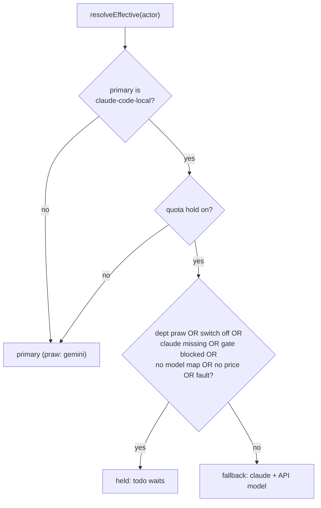
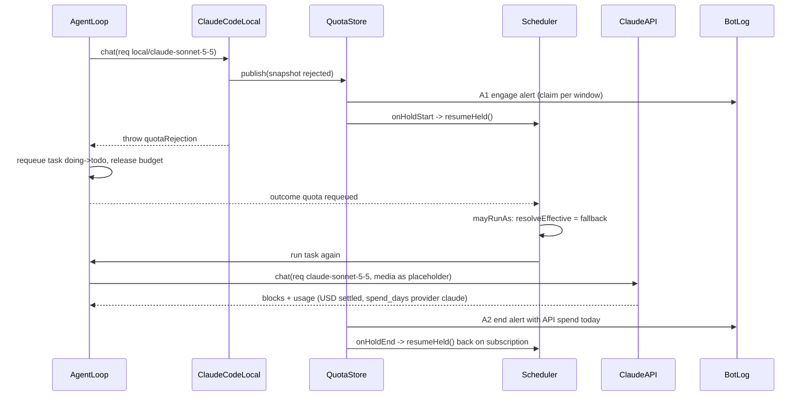

# R8 PROV-FALLBACK: Claude API backup when the CLI quota runs out

Date: 2026-11-16. Status: spec (sa brief), owner decisions of 2026-11-16 binding: mode "Main + backup", budget company $50 / bot $10 / task $5 per day, only praw on Gemini.

======================================================================
SPECIFICATION HANDOFF BRIEF (for document + security)
======================================================================
PLAN REF: /Users/pakawat.tan/Labworkspace/BOT/Assistant/docs/plans/2026-11-12-growth-roadmap.md (R8 row, line 28; the owner's 2026-11-16 decision replaces its text)
TARGET TEMPLATE: freeform, in the house style of the earlier specs (spec, then Amendment SA-1)
OUTPUT DESTINATION: /Users/pakawat.tan/Labworkspace/BOT/Assistant/docs/superpowers/specs/2026-11-16-prov-fallback-design.md
Requires security gate: YES (spend, provider routing, secret handling).

1. MODULE IDENTIFIER: R8 PROV-FALLBACK. Every department except praw uses the subscription CLI (`claude-code-local`) as its main path. When the CLI quota is rejected, it falls back to the Claude API (`claude`).

2. ACTORS & BOUNDARIES
- Actors: every head and persona whose department is not praw; Praw (dept `praw`, Gemini); the helper calls (reflect, review, classify); the judges (`ai_review`, `skill_review`); the owner and Bot Admins.
- Process boundary: one app process holds both providers.
  - The CLI child gets an env allowlist (`providers/claude-code-local/spawn.ts` `childEnv`; test `local.test.ts:77`).
  - The API key stays in the app process only.
- Trust boundary: prompts go to the Anthropic API instead of the Anthropic CLI. The vendor is the same; the product terms differ, which the owner accepted by choosing this mode.
- Dev jobs are a separate trust zone (model proxy container, own key). See §3.8.

3. DETAILED LOGIC & FLOWS

3.1 Pre-conditions (all verified in code)
- Live `provider.default` = `{claude-code-local, local/claude-sonnet-5-5}`. The code default is `{claude, claude-sonnet-5-5}` (`config/defaults.ts:78`).
- `claude` is registered only when `ANTHROPIC_API_KEY` is set (`app.ts:395`).
- The hold is `QuotaStore.heldUntil()` (`governance/quota/quota.ts:26,60`). It starts only through `snapshotRejectsHold` (`providers/claude-code-local/quota.ts:64`).
- The registry `resolve` order is actor, then dept, then default (`providers/registry.ts:26`). It maps API ids to local ids only for local (`toLocalModel`, `protocol.ts:21`).
- Budget days are UTC (`isoDay`, `budget.ts:94`), so the daily caps reset at 07:00 Asia/Bangkok.
- HAZARD (BE2 must fix):
  - `app.ts:431` seeds the local default only when `!providers.has('claude')`.
  - With the key added and the config row missing (for example after a data reset like 2026-11-07), the code default `claude` applies and ALL main work runs on the API without any notice.
  - `tests/integration/local-mode.int.test.ts:67-73` asserts exactly this (row stays null).
  - Fix: seed whenever `local?.ok` and the row is null, whether or not `claude` is registered. The VPS is unaffected because its local guard fails there.

3.2 One route function (BE1, new `providers/route.ts`)
`resolveEffective(registry, profile:{sel,deptId}, actor, cfg, fb?: FallbackState, opts?:{allowFallback?:boolean}) -> {provider, model, route:'primary'|'fallback'|'held'}`
1. `primary = registry.resolve(sel,cfg)`. A throw propagates, as today (the loop shows "Unavailable").
2. primary is not `claude-code-local` → `primary`. Praw on Gemini always ends here.
3. `fb?.heldUntil()` is null → `primary`.
4. Any of the following → `held`:
   - `deptId ∈ FALLBACK_EXCLUDED_DEPTS = ['praw']` (code constant)
   - `opts.allowFallback === false`
   - switch `provider.fallback.enabled !== true` (a read error counts as off)
   - `!registry.has('claude')`
   - the gate is blocked for this actor or department (§3.5)
   - `fromLocalModel(primary.model) === null`
   - the mapped model has no `pricing` entry
5. Otherwise → `{provider: registry.get(FALLBACK_PROVIDER='claude'), model: fromLocalModel(...), route:'fallback'}`.
- The target is hard-coded. It is never read from config or a selection.
- A fault inside steps 3-5 returns `held`. This is fail-closed and reverses today's "fault = not held" rule only for the eligibility part.

Model map (new pure function `fromLocalModel` in `protocol.ts`, the inverse of `LOCAL_MODEL_IDS`):

| Local id | API id |
|---|---|
| `local/claude-sonnet-5-5` | `claude-sonnet-5-5` |
| `local/claude-haiku-5-5` | `claude-haiku-5-5` |
| anything else | null (held) |

Persona default `claude-sonnet-5-5` (`agents/context.ts:17`) maps to the local id and back.

Use sites. All of them must call `resolveEffective`; G4 enforces this:
- `agents/loop/loop.ts:275`
- `governance/judge-call.ts:93`
- `knowledge/small.ts:43`
- `agents/scheduler/scheduler.ts:338` (`providerOk`)
- `scheduler.ts:355` (`isHeld` = `route==='held'`)
- `scheduler.ts:768` (warroom lift by the effective provider)

3.3 Decision table (actor whose primary is local, not praw)

| State | Route | Work | Alert |
|---|---|---|---|
| CLI ok (no hold) | local | runs | none |
| Quota rejected, switch on, key ok, gate clear | API | runs, metered USD | A1 engage |
| Quota rejected, switch off | held | todo waits until reset (today's behaviour) | existing text |
| Key missing (`claude` not registered) | held | waits | A1 variant "backup unavailable: no key" |
| API 401/402/403 (by status only) | held for the rest of the episode | requeue; gate `apiOff` until the hold ends or a restart | A3, once per episode |
| API 429/529/5xx after the SDK's 3 retries | held 5 min (`coolUntil`) | requeue | A4, once per episode |
| API refusal `company` | held for all actors until the next UTC day or the hold end | requeue (not blocked) | existing `Budget.announce` |
| API refusal `bot` / `dept` | held for that actor / that department until the next UTC day or the hold end | requeue; the dept raise card fires as today | existing |
| API refusal `task` / `project` / `price` | primary flow unchanged | existing cards / block (`loop.ts:573-576`) | existing |
| API 400 other / ProviderError without status | — | block `error` (today) | existing incident |
| Halt / hq paused | nothing runs | unchanged | — |
| Off day | automated work waits; human-origin runs may use the API while held | unchanged | — |
| CLI not registered (probe-pin failure) | no fallback; idle with the existing alert | ASSUMED per the owner's words (OQ4) | existing |
| Per-model window rejected only | no hold, so no fallback (existing) | OQ5 | — |

- Praw: Gemini always. It never falls back to Claude. I found no strong reason to allow it: Gemini has no quota hold, Praw's attachment and PDF reading depends on Gemini (PF21), and the owner rule applies.
- A praw persona that resolves to local (persona selection skips the dept, `context.ts:61-63`) is `held`, never on the API. ASSUMED: no seeded praw personas (the grep found none).

3.4 Mid-run switch: REQUEUE, not continue
- Reason: `turnsLifted` (`loop.ts:283`) and the tool-context lift (`loop.ts:386`) are fixed at run start. Continuing on the API would carry the local cap lifts into a metered run.
- Flow: a local call fails with `isQuotaRejection` → the existing `requeue` (`loop.ts:439-442`, text unchanged).
- The scheduler then calls `onTaskReady(taskId)` once after the run ends, so the task restarts under `resolveEffective`, on the API if eligible.
- On hold start, the new `QuotaStore.onHoldStart` calls `scheduler.resumeHeld()` to re-offer todo work.
- Task-less run: a fixed alert "The subscription quota just ran out. Send your message again to get a reply on the backup route." (OQ6 asks whether to re-dispatch automatically instead).
- On the API route, before each API call, the loop checks `fb.usable(actor)`. If the switch is off, a gate mark is set, or a halt is on: requeue and stop with the "waits" text.
- If the hold ends mid-run, the run finishes on the API, bounded by `turnsPerTask` 20 and `taskUsd`. The next run goes back to local.
- Media parity: on the `fallback` route the loop replaces every `media` block with `[attachment omitted]` (same as `protocol.ts:190`). No new attachment bytes go out, and no PDF refusal (`providers/claude/request.ts` `media()`).

3.5 FallbackGate (in memory; nothing persisted, so no migration)
- Fields: `apiOff{status}` (until the hold ends), `coolUntil`, `companyOutDay`, `botOut: Map<actorKey, utcDay>`, `deptOut: Map<dept, utcDay>`, `episodeUsed:boolean`.
- Set only by the loop or the judge from fallback-route outcomes (numeric status, `refused.scope`).
- Cleared at hold end. A restart clears it; the first refusal sets it again.

3.6 Helpers and judges

| Call | Fallback? |
|---|---|
| `classify` (a person's proposal) | yes |
| `ai_review` (approval cards) | yes |
| `reflect`, `review` | no (fail fast, as today) |
| `skill_review` | no (fail fast, as today) |

- Mechanism: `allowFallback:false`, so the route is `held` → `ok:false` / `JudgeError('judge_error')` before reserving or spawning.
- `JudgeCaller` gains the hold fail-fast it lacks today.

3.7 Switch
- New key `provider.fallback.enabled`, boolean, default `false`.
- In `admin/keys.ts` `HANDLER_KEYS`, so no model-reachable writer.
- `configRisk`: false→true is risk.
- `/settings` path `planFallbackEnabled` (a clone of `planWsEnabled`, `discord/commands/plans.ts:149`). Turning it on makes a card with the LW Admin confirm; turning it off is direct.
- Owner turns it on at deploy, after checking the key.

3.8 Dev jobs (no R8 code)
- They need `DEVJOB_ANTHROPIC_API_KEY`, exported in the compose shell (`docs/self-code.md` step 2).
- The app REFUSES that variable at boot (`core/env.ts:126`), and the executor refuses both keys (`executor/env.ts:51`).
- Agents get only a per-job proxy credential (`devjob/launcher.ts:68`).
- Recommendation: a SEPARATE key in its own Console workspace with a spend limit. Reusing the same key value is an accepted residual (shared spend limit, one revocation for both).
- `devjob.enabled` stays false until self-code steps 1-8 are done.
- Dev-job spend is metered by the proxy (monthly cap `devjob.budgetUsd` 20). It is not in `budget_days`.

3.9 Budget: config rows at deploy, not code defaults
- Rows: `budget.companyDailyUsd`=50, `budget.botDailyUsd`=10, `budget.taskUsd`=5, set through `/settings set` (raise = card, audited) or a psql one-off by the owner.
- Why rows:
  - they are per install (the VPS is untouched);
  - no churn in existing tests;
  - reversible.
- Cross-impact: these scopes are shared with Praw's Gemini calls and the `metered.ts` media calls, so Praw's bot cap goes from 1 to 10 per day.
- Keep `warroom.dailyUsd` 2.5 and `warroom.botDailyUsd` 0.5. Bot-to-bot talk on the API is the least valuable spend (OQ3).
- Owner backstop: a Console spend limit on the main key.

3.10 Metering, digest, alerts
- `llm.call` audit and `spend_days` already record provider `claude` (`budget.ts:208`).
- Add, all fixed text with numbers only:
  - (a) `/usage range:quota` line: "Backup: on|off · route: subscription|Claude API|held · Claude API today $X / company cap $Y";
  - (b) weekly spend summary (`spend.ts:702`) line: "Claude API (metered) last week: $X, N calls";
  - (c) A2 end alert carries "Claude API spend today: $X (N calls)".
- Alerts go to #bot-log (hq) through the `QuotaStore` alert function. The owner is not DMed (ASSUMED).
  - A1: "The {label} Claude quota is used up. Bots except Praw continue on the Claude API (metered; company cap $Y/day) until {when}."
  - A2: "The Claude quota hold is over. Bots are back on the subscription. …"
  - A3: "The Claude API backup was refused (HTTP {status}). Claude-backed bots now wait until {when}."
  - A4: "The Claude API is busy (HTTP {status}). Backup work pauses 5 minutes."
- Dedupe: A1 reuses the `claimAlert` `rejected` claim per window and reset. A3 and A4 fire once per episode.
- Audit action `provider.fallback`, outcomes `engaged|ended|api_off:<status>|api_busy:<status>|budget_out:<scope>`.
- With the switch off, every existing text is unchanged.

4. MERMAID DIAGRAMS

5. DATA, API & ERROR CONTRACTS
- Config schema: `'provider.fallback.enabled': z.boolean()`, default `false`.
- Types:
  - `FallbackState { heldUntil(): number|null; usable(actor: ActorRef, deptId: DeptId): boolean; mark(e: {kind:'api_off'|'api_busy'; status:number} | {kind:'budget'; scope:'company'|'bot'|'dept'; actor:ActorRef; dept:string}): void }`
  - `QuotaStore` option `onHoldStart?: () => void` (added next to `onHoldEnd`).
- Error mapping, by `ProviderError.status` only:

| Status | Effect |
|---|---|
| 401, 402, 403 | `apiOff` |
| 408, 409, 429, 5xx, 529 | `coolUntil` +5 min |
| any other / no status | today's block |

- Storage: none. No migration; only config rows (the switch and the three budget rows) at deploy.
- `budget.ts:43-48`: replace the comment "There is no local -> metered failover" with the R8 rule. `LIFTED_CAPS` never apply to a `claude` run.

6. SECURITY & PRIVACY NOTES (Gate 1)
- S1: the fallback target `'claude'` and the excluded set `['praw']` are code constants. No config or model path changes them. Prompt overrides cannot change `meta` (Gate 2 PROV-HELPER §2).
- S2: the switch is in `HANDLER_KEYS`; read error = off; turning it on makes a card.
- S3: the first-boot seed fix (§3.1) plus guard G5.
- S4: the key never reaches a child, container or tool. Must stay green:
  - `local.test.ts:77` (CLI allowlist; if the key reached the CLI, the CLI would bill the API outside the meter);
  - `core/child-env.ts:6` FORBIDDEN;
  - `executor/env.ts:51`;
  - no compose file references `ANTHROPIC_API_KEY` (checked);
  - `scripts/local-mode.test.ts:395`.
- S5: masked by `secretsOf` (`app.ts:286`).
- S6: provider error messages are never logged or posted (`providerFault`/`failureInfo`, `agents/call/call.ts:27-48`). Alerts carry only status numbers and enums.
- S7: tool-result wrapping differs. Local wraps `tool_result` with `wrapUntrusted` (`protocol.ts:186`); the API sends native `tool_result` blocks unwrapped (`providers/claude/request.ts:25`, today's VPS path). Gate must rule on parity (OQ9).
- S8: spend is bounded by the company, bot, task, dept and warroom caps, the switch, and a Console limit. There is no separate API concurrency cap beyond `limits.concurrency` 4.
- S9: Sonnet requests carry the server-side fallback beta (`request.ts:63`). Cost is priced on `req.model`; a different served model's price is ASSUMED equal.
- S10: eligibility fault = held (fail closed).

Guard tests (BE1 unit, BE2 integration):
- G1: non-praw never resolves to `gemini`. Extend `knowledge/small.provider.test.ts` to `resolveEffective`: all seed heads and personas × hold on/off × switch on/off.
- G2: praw (head and any praw persona) never resolves to `claude`, in any state.
- G3: hold off with a local default → no actor resolves to `claude`.
- G4: static check: no `providers.resolve(` outside `providers/route.ts` and `providers/registry.ts`. Also add `fromLocalModel` to the `media/graph.test.ts` allowlist if that test flags it.
- G5: boot with both providers and no row → local seeded.
- G6: switch not in `ADMIN_CONFIG_KEYS`; read error → `held`.
- G7: every `LIFTED_CAPS` key reads false on a fallback run; turn cap 20 enforced.
- G8: on the fallback route no `media` block reaches the claude provider.
- G9: alert bodies are fixed strings (a planted provider message never appears).
- G10: a budget refusal on the fallback route requeues and marks the gate, and the next `isHeld` is true.

Invalidated assertion (rule 4):
- `tests/integration/local-mode.int.test.ts:70`: old `toBeNull()`; new: `{provider:'claude-code-local', model:'local/claude-sonnet-5-5'}`, `updatedBy:'system:first-local-boot'`. Retitle the test at line 67.
- Unchanged because the switch-off texts stay as they are:
  - `quota.test.ts:62,191`
  - `usage.quota.test.ts:43`
  - `healer.test.ts:399`
  - `loop.test.ts:388-389`
  - `scheduler.hold.test.ts:43-48`
  - `small.provider.test.ts:98`

Acceptance:
- (1) No hold → zero `llm.call` rows with provider `claude`.
- (2) Hold on with the switch on → non-praw work runs on `claude` with the API model id, and spend shows as provider `claude`.
- (3) Praw stays on Gemini in every state.
- (4) Switch off or no key → today's behaviour, byte for byte.
- (5) 401, 429 and a company refusal each lead to held + requeue + one alert.
- (6) Hold end → back to local, A2 posted with API spend.
- (7) G1-G10 green; full suite green.

Backend dispatches:
- BE1 (additive, nothing wired):
  - `providers/route.ts`
  - `fromLocalModel`
  - `FallbackGate`
  - config key (schema, default, `HANDLER_KEYS`, `configRisk`)
  - `planFallbackEnabled` and the `/settings` case
  - alert text builders
  - unit tests G1-G4, G6, G9
- BE2 (wire):
  - the six use sites
  - loop: requeue handling, gate marks, per-call usable check, media parity
  - scheduler: `onTaskReady` after a quota requeue
  - `QuotaStore`: `onHoldStart` and fallback-aware texts
  - the seed fix and the changed test
  - `budget.ts` comment
  - `/usage` and weekly lines
  - G5, G7, G8, G10

7. OPEN QUESTIONS
- OQ1: Is $50/day the API budget alone or all metered spend (Praw Gemini and media share these scopes)? Should Praw get a `spend.deptMonthlyUsd` cap?
- OQ2: Pricing. Sonnet $2/$10/$0.2 matches third-party sources only. Haiku $0.1/$0.5 looks low, and a low price makes the meter under-count. Check Anthropic's own page before the switch goes on.
- OQ3: Keep the warroom pools at 2.5/0.5?
- OQ4: Fall back when the CLI is not registered (not a quota rejection)? Default: no.
- OQ5: Fall back on a per-model weekly window rejection? Default: no.
- OQ6: Task-less run: ask for a resend (baseline) or re-dispatch automatically?
- OQ7: Switch on through the card path (as for `forge.enabled`) or owner-only through a Founder-role check?
- OQ8: Dev jobs: separate key (recommended) or the same key?
- OQ9 (security): Is the unwrapped `tool_result` on the API path acceptable?
- OQ10: A human admin can still set a department to `claude` through `/bot model`, which puts main work on the API on purpose. Allowed?

8. BOOK CHAPTERS AFFECTED
- /Users/pakawat.tan/.claude/team/knowledge/labworkspace/modules/assistant.md (new section "R8 PROV-FALLBACK"; sections "R1 OPS-HOLD", "PROV-1")
- /Users/pakawat.tan/.claude/team/knowledge/labworkspace/00-INDEX.md (R8 row)

MISSING CONTEXT:
- `~/.claude/team/rules/labworkspace/sa.md` (none)
- `<PROJECT_ROOT>/CLAUDE.md` (none at /Users/pakawat.tan/Labworkspace/BOT/Assistant)
- The live DB was not queried (read-only), so live config rows and personas are assumed.

LEARNINGS:
- fact project: the code default `provider.default` is `claude`, and the first-boot seed skips when `claude` is registered, so adding the API key plus losing the row sends all work to the API | proposed rule: any spec that registers a new provider checks the seed condition at `app.ts:431` and the code default.
- decision project: a provider switch in the middle of a run is unsafe while cap lifts are fixed at run start; requeue instead | proposed rule: none.
- fact project: the claude provider refuses PDFs and sends images, while local omits both; any route change needs media parity | proposed rule: none.

BOOK_UPDATES:
- roadmap R8 line 28: stale (the owner redefined it 2026-11-16).
- modules/assistant.md: record the `provider.default` code-default hazard; the `budget.ts:43-48` "no failover" invariant is being replaced.
======================================================================
Sources: [aicybr Sonnet 5.5 pricing](https://aicybr.com/blog/claude-sonnet-5-5-pricing-benchmarks-api), [eesel Sonnet 5.5 pricing](https://www.eesel.ai/blog/claude-sonnet-5-5-pricing), [pricepertoken](https://pricepertoken.com/pricing-page/model/anthropic-claude-sonnet-5.5)

## Open question resolutions (caller, 2026-11-16, under the owner's standing instruction to take the recommended option)

- OQ1: the $50/$10/$5 caps cover all metered spend (Claude API, Praw Gemini, media), as the scopes are shared today. No extra Praw cap now.
- OQ2: pricing must be checked against Anthropic's own pricing page before `provider.fallback.enabled` is turned on; until then the switch stays off. Under-pricing is a Gate 1 item.
- OQ3: keep `warroom.dailyUsd` 2.5 and `warroom.botDailyUsd` 0.5.
- OQ4: no fallback when the CLI is not registered (probe-pin failure): default no.
- OQ5: no fallback on a per-model window rejection alone: default no.
- OQ6: task-less run: fixed "send again" text (baseline); no automatic re-dispatch.
- OQ7: switch on through the existing card path (LW Admin confirm), like `ws.enabled` and `forge.enabled`.
- OQ8: dev jobs: separate key recommended to the owner; devjob stays off (no R8 code).
- OQ9: for security Gate 1 to rule.
- OQ10: a human admin setting a department to `claude` on purpose stays allowed (admin-only, audited).

## Binding amendment (Gate 1, 2026-11-16)

Source: `docs/security/2026-11-16-gate1-prov-fallback.md` (CONDITIONAL_APPROVE). Every condition PV-C01..PV-C11 in that report is binding as written there; where this spec disagrees, the report wins. Choices made by the caller where the report offers options (owner's standing instruction: take the recommended option):

- PV-C01 (before BE1): replace §3.1's seed fix with the report's outcome guard keyed on the `ALLOW_LOCAL_PROVIDERS` local-mode input: in local mode no main work resolves to `claude` because of a missing or invalid `provider.default` row. Tests G5, G5b (first boot after a data reset), G5c (invalid row skipped by `ConfigStore.apply`).
- PV-C04: omit `betas`/`fallbacks` on R8 fallback-route calls (a refusal ends as "Declined", same as local); a failure after `message_start` settles at the reservation estimate, not $0. The VPS path is unchanged in R8 (PV-F02 stays a residual).
- PV-C05: `fromLocalModel` maps only `local/claude-sonnet-5-5` → `claude-sonnet-5-5`; Haiku maps to null (route `held`).
- PV-C06 (before BE1): on the fallback route an HTTP 400 is a per-task mark (requeue, then held for that task for the episode); never global `apiOff`, never block, never the healer.
- PV-C07: build the SDK client with explicit `baseURL: 'https://api.anthropic.com'` and logging off (or the masked logger), per the report.
- PV-C02, C03, C08, C09, C10 (incl. G11): implement in BE1/BE2; verified at Gate 2.
- PV-C11: owner steps before switch-on (budget rows, Console spend limit, separate dev-job key, key entry, official price re-check).
- PV-F01 (caller decision, folded into R8): `planBotModel` refuses `gemini` for any department other than `praw` (owner rule "only praw on Gemini"), and becomes `risk: true` when the target provider is `claude` (metered), so the LW Admin confirm card applies. Tests for both.
